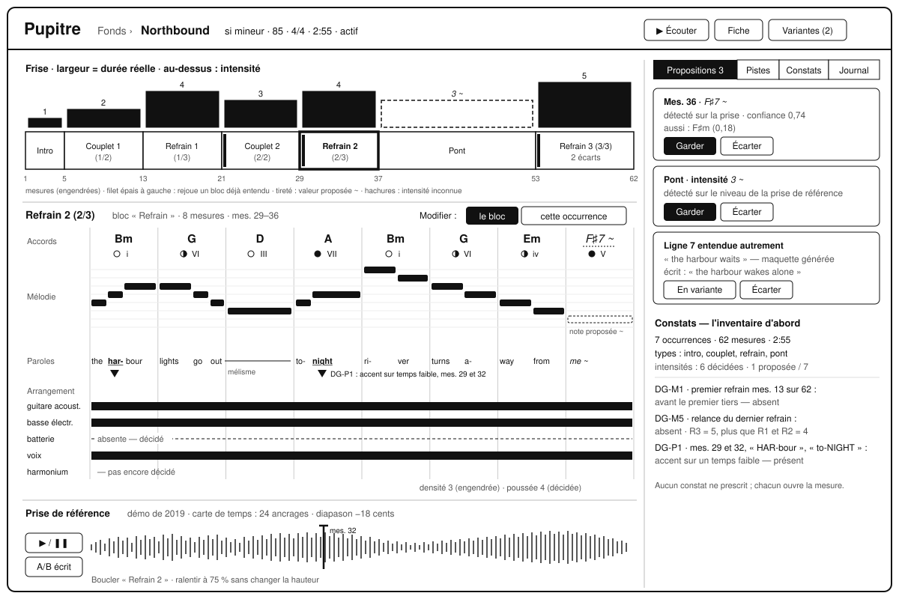

# Pupitre

Un atelier d'écriture musicale, du motif à l'album, pour qui écrit seul ses chansons.



## Pourquoi

Le persona [Sacha](docs/11-persona-et-situations.md) écrit, compose et chante seul : ses idées
arrivent partout, et un album se construit sur des mois. Pupitre tient ensemble le détail d'une
phrase et la forme d'un album, avec un seul matériau, de l'idée captée à l'ordre des morceaux. Il
propose sans décider, et marche hors ligne sur l'ordinateur, le téléphone et la tablette à encre,
qu'un nœud maison relie. Il n'est ni une station audio, ni un graveur de partitions, ni un
générateur de chansons. Le dépôt porte sa conception et son code, sans aucune matière musicale
réelle : les exemples sont inventés, et la conception vise un profil, jamais une personne.

L'état du projet est dans [CLAUDE.md](CLAUDE.md#état), les versions dans [les publications](https://github.com/EdouardZemb/pupitre/releases).

## Démarrer

L'établi, l'application de l'ordinateur, se construit en deux temps : l'interface en WebAssembly,
puis l'application et son installateur.

```sh
cd app/ui && trunk build
cd ../src-tauri && cargo tauri build
```

Les autres commandes, dont le cahier des tables en PDF, sont dans [CLAUDE.md](CLAUDE.md#commandes).

## Où lire quoi

| Document | À lire quand |
|---|---|
| [CLAUDE.md](CLAUDE.md) | avant de travailler ici |
| [La méthode](docs/modele/methode.md) | pour la façon de travailler, commune aux projets nés de `modele-projet` |
| [Les conventions](CONVENTIONS.md) | pour écrire un commit, une branche ou une PR, et pour les portes de CI |
| [Les pistes](docs/pistes.md) | pour ce qui est noté sans être engagé |
| [Le registre](docs/registre.md) | pour ce que les lots ont appris |
| [Les décisions](docs/adr/) | pour ce qui a été décidé, et pourquoi |
| [La vision](docs/10-vision.md) | pour cadrer : le problème, les principes, ce que Pupitre n'est pas |
| [Le persona et ses situations](docs/11-persona-et-situations.md) | avant toute décision de produit |
| [Le continuum de composition](docs/12-continuum-de-composition.md) | pour voir le tout, des échelles aux moments |
| [La SFD](docs/20-sfd/README.md) | pour implémenter une fonction |
| [Le modèle de domaine](docs/30-modele-de-domaine.md) | avant d'écrire une ligne de données |
| [La persistance et la synchronisation](docs/31-persistance-et-synchronisation.md) | avant de toucher au stockage |
| [L'architecture](docs/40-architecture.md) | avant de choisir une dépendance, ou pour l'ordre des incréments |
| [La pile technique](docs/41-pile-technique.md) | avant d'ajouter une bibliothèque |
| [Les interfaces et les appareils](docs/50-interfaces-et-appareils.md) | pour tout écran, et ses maquettes |
| [Le moteur musical](docs/60-moteur-musical.md) | pour un diagnostic, une piste ou la table de la tonalité |
| [La qualité et la vérification](docs/70-qualite-et-verification.md) | pour écrire un test |
| [Le glossaire](docs/80-glossaire.md) | dès qu'un mot hésite |
| [Les questions ouvertes](docs/90-questions-ouvertes.md) | avant de supposer |

## Contribuer

Projet personnel : aucune contribution n'est attendue.
