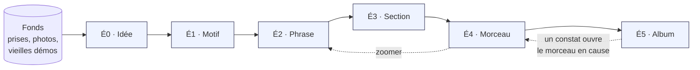
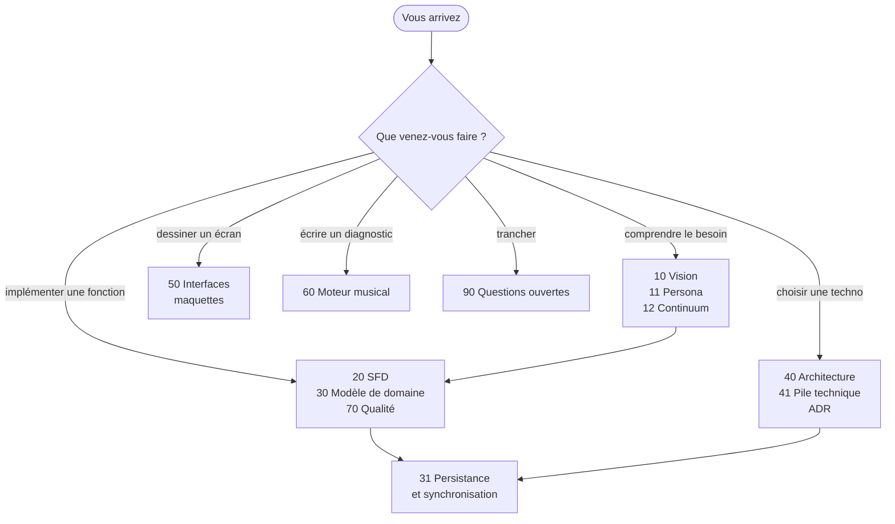

# Pupitre

**Un atelier d'écriture musicale, du motif de quatre notes jusqu'à l'ordre d'un album.**
Pupitre accompagne une composition à toutes ses échelles — l'idée captée dans la rue, le
motif, la phrase, la section, le morceau, l'album — avec un seul matériau du début à la
fin : ce qui est décidé au plus fin se retrouve, sans recopie, au plus large.

> **Ce dépôt porte la conception de Pupitre, et son code à partir d'INC-0.** Il ne contient
> aucune matière musicale réelle : les titres, grilles et paroles des exemples sont inventés
> pour l'illustration. La conception est pensée pour un **profil**, le persona
> [Sacha](docs/11-persona-et-situations.md), pas pour une personne nommée.

---

## Pour qui, pour quoi

Sacha écrit, compose et chante en solo, au piano et à la guitare. Ses idées arrivent
partout, s'accumulent dans des mémos vocaux et des carnets, et un album se construit sur
des mois. Ce qui lui manque n'est pas un studio : c'est un outil qui **tient ensemble** le
détail d'une phrase et la forme d'un album, qui **propose sans décider**, et qui marche
**hors ligne** sur les trois appareils déjà à portée de main.

| Appareil | Rôle | Ce qu'on y fait |
|---|---|---|
| 💻 **Établi** — l'ordinateur | Construire | Écrire, éditer, comparer, ordonner l'album |
| 📱 **Carnet** — le téléphone | Capter, accompagner | Enregistrer en un geste, nommer l'accord joué, garder |
| 📖 **Lutrin** — la tablette à encre | Relire, jouer | Lire la fiche au pupitre ou au calme, annoter au stylet, trancher |
| 🏠 **Nœud maison** — recommandé | Relier et porter le lourd | Synchronisation, miroir et sauvegardes, analyses longues, passerelle IA ; sans lui, un seul appareil ; jamais exposé sur Internet |

## Les maquettes

<table>
<tr>
<td width="33%"> <b>Le fonds</b> — tout ce qui a été capté, sans rien demander</td>
<td width="33%"> <b>Le morceau</b> — la frise, les couloirs, les propositions</td>
<td width="33%"> <b>La loupe</b> — une phrase au plus fin, et ses pistes</td>
</tr>
<tr>
<td> <b>L'album</b> — le plan, les transitions, les constats</td>
<td> <b>Le carnet</b> — capter, puis « Garder » sans viser</td>
<td> <b>Le lutrin</b> — une page de fiche, en noir et blanc pur</td>
</tr>
<tr>
<td> <b>La table</b> — tous les possibles d'une tonalité</td>
</tr>
</table>

## Où lire quoi

| Document | Ce qu'il contient | À lire quand |
|---|---|---|
| [10 — Vision](docs/10-vision.md) | Le problème, la proposition, les principes P1–P8, ce que Pupitre n'est pas, les risques | Pour cadrer |
| [11 — Persona et situations](docs/11-persona-et-situations.md) | Sacha, ses besoins B01–B15, ses douleurs D1–D8, ses anti-besoins N1–N6, cinq situations | Avant toute décision de produit |
| [12 — Continuum de composition](docs/12-continuum-de-composition.md) | Les six échelles, les six moments, la matrice qui les croise, trois parcours de bout en bout | Pour voir le tout |
| [20 — SFD](docs/20-sfd/README.md) | Neuf modules, chaque fonction avec ses règles, ses cas limites et ses critères d'acceptation | Pour implémenter |
| [30 — Modèle de domaine](docs/30-modele-de-domaine.md) | Blocs, occurrences et écarts ; hauteurs relatives ; provenance ; ce que le modèle interdit | Avant d'écrire une ligne de données |
| [31 — Persistance et synchronisation](docs/31-persistance-et-synchronisation.md) | Documents CRDT, captations immuables, miroir texte durable, sauvegarde et restauration | Avant de toucher au stockage |
| [40 — Architecture](docs/40-architecture.md) | Conteneurs, flux, analyse en deux étages, passerelle IA, réseau, trajectoire INC-0 à INC-6 | Avant de choisir une dépendance |
| [41 — Pile technique](docs/41-pile-technique.md) | Chaque choix de pile, ses concurrents écartés, ce qui change par rapport à la pile précédente | Avant d'ajouter une bibliothèque |
| [50 — Interfaces et appareils](docs/50-interfaces-et-appareils.md) | Rôles des appareils, zoom sémantique, l'écran de la table, grammaire des propositions, mode encre | Pour tout écran |
| [60 — Moteur musical](docs/60-moteur-musical.md) | Théorie, doctrine et règles d'outil, dont les familles d'accords ; diagnostics ; pistes ; prosodie ; doigtés et voicing au clavier | Pour un diagnostic, une piste ou la table |
| [70 — Qualité et vérification](docs/70-qualite-et-verification.md) | Invariants I01–I27, bancs d'évaluation, profils d'appareils, portes de CI | Pour écrire un test |
| [80 — Glossaire](docs/80-glossaire.md) | Le vocabulaire, un mot pour une chose | Dès qu'un mot hésite |
| [90 — Questions ouvertes](docs/90-questions-ouvertes.md) | Q01–Q22 triées par ce qu'elles débloquent ; arbitrages A01–A23 et leur coût de renversement | Avant de supposer |
| [ADR](docs/adr/README.md) | Vingt et une décisions d'architecture, une par fichier, avec leurs dépendances | Avant de contredire une décision |

## Statut

| | |
|---|---|
| **Conception** | Refondue le 2026-10-11, à partir du besoin ; la table de la tonalité et la pile Rust y sont entrées le 2026-10-27. Écrite et relue |
| **Code** | Le code d'INC-0, la table, en Rust : les crates `noyau` (la théorie et l'écriture des pages en SVG), `cahier` (le cahier des tables en PDF), `interface` (l'établi, en Leptos) et `etabli` (son enveloppe Tauri, et l'export du cahier) |
| **Décisions** | 21 ADR, dont 10 acceptées, 8 proposées et 3 remplacées ([registre](docs/adr/README.md)) |
| **Bloquant pour démarrer** | Rien : les ADR [001](docs/adr/adr-001-un-seul-materiau.md), [008](docs/adr/adr-008-hauteurs-relatives.md) et [010](docs/adr/adr-010-trois-appareils-mode-encre.md), que met en jeu INC-0, sont acceptées depuis le 2026-10-28 ([§ 40 · 9](docs/40-architecture.md#9-trajectoire-de-construction)). Aucune question ouverte ne bloque le début ; Q01, la capacité du nœud maison, ne bloque que l'analyse lourde et l'IA locale ([§ 90](docs/90-questions-ouvertes.md)) |
| **Prochaine étape** | INC-0 est livré ; l'incrément INC-1 — carnet et fonds ([§ 40 · 9](docs/40-architecture.md#9-trajectoire-de-construction)) |
| **Historique** | Ce dépôt est né le 2026-11-01, d'un seul commit. L'historique de la conception jusque-là, ses PR et l'étiquette `v0.1.0` restent dans le dépôt privé `pupitre-donnees` |

### La série précédente

Une première série de documents — inventaire de l'existant, SFD en un seul fichier,
ADR 1 à 8, plan de remise en état — a été **remplacée** le 2026-10-11 : la conception
repart du besoin au lieu de l'existant. Elle reste entière dans l'historique du dépôt
privé `pupitre-donnees` ; son dernier état y est le commit `0044944`.

## Conventions et portes

Voir [CONVENTIONS.md](CONVENTIONS.md) : le format de commit du modèle de projet
(Conventional Commits), un format de branche, le gabarit de PR du modèle, avec trois
contrôles propres à pupitre, et les portes de CI, dont il tient la liste. La méthode, qui est
celle du modèle, est dans
[`docs/modele/methode.md`](docs/modele/methode.md).

- **`socle / secrets`** cherche les secrets dans les commits et l'historique ;
- **`socle / confidentialite`** refuse une donnée d'identité dans le diff, les messages de
  commit et le texte de la PR ;
- **`contenu`** refuse les fuites détectables mécaniquement dans les fichiers — e-mail,
  secret, export de mémoire, fichier audio ou MIDI, chemin de machine
  ([script](scripts/verif-confidentialite.sh)) ; noms et paroles restent l'affaire de la
  relecture ;
- **`documentation`** vérifie que chaque diagramme se rend et que chaque lien interne mène
  quelque part ([liens](scripts/verif-liens.mjs), [diagrammes](scripts/verif-diagrammes.mjs)) ;
- **`verifier`**, **`windows`** et **`mutants`** gardent le code : son format, son lint et ses
  tests, l'installateur Windows de l'établi, et la mutation du noyau.

## Confidentialité

Dépôt **public**. Rien de personnel n'y entre : ni paroles réelles, ni audio, ni adresse
e-mail, ni prénom de proche, ni export de mémoire, ni chemin de machine. La documentation parle
d'un persona, jamais d'une personne réelle. La porte de confidentialité y refuse, au commit
comme en CI, tout ce qui identifie.
