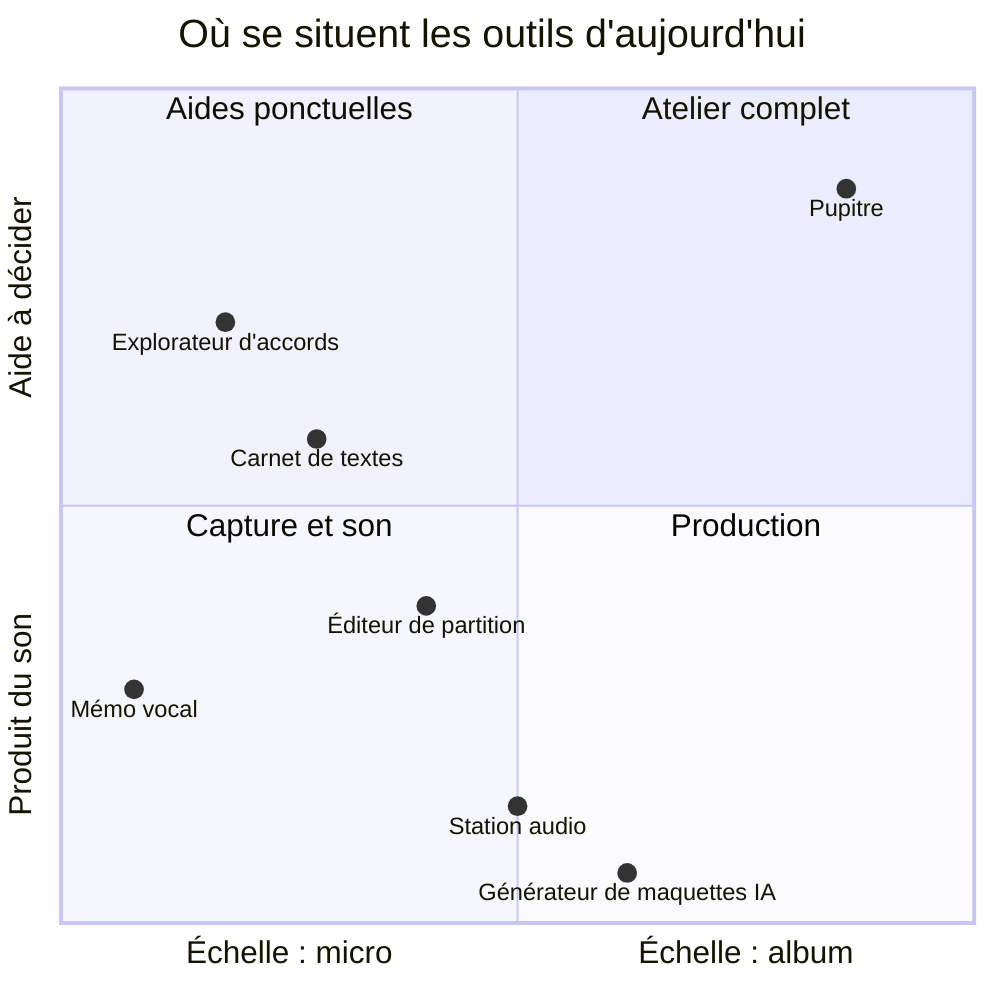
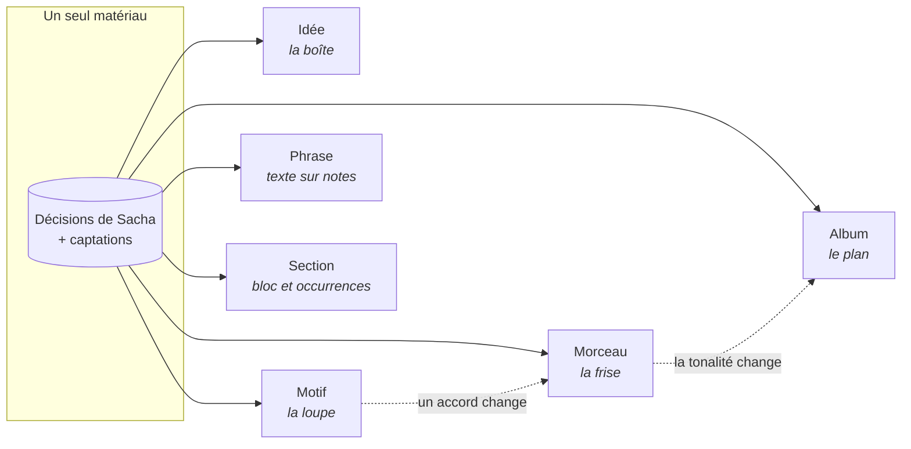
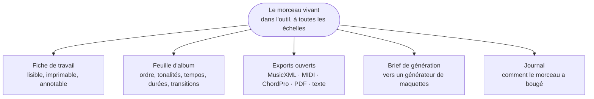
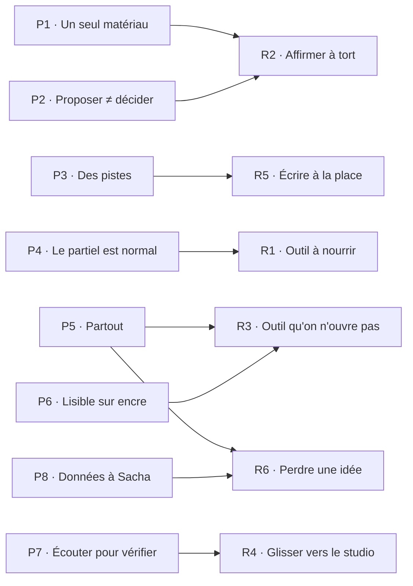
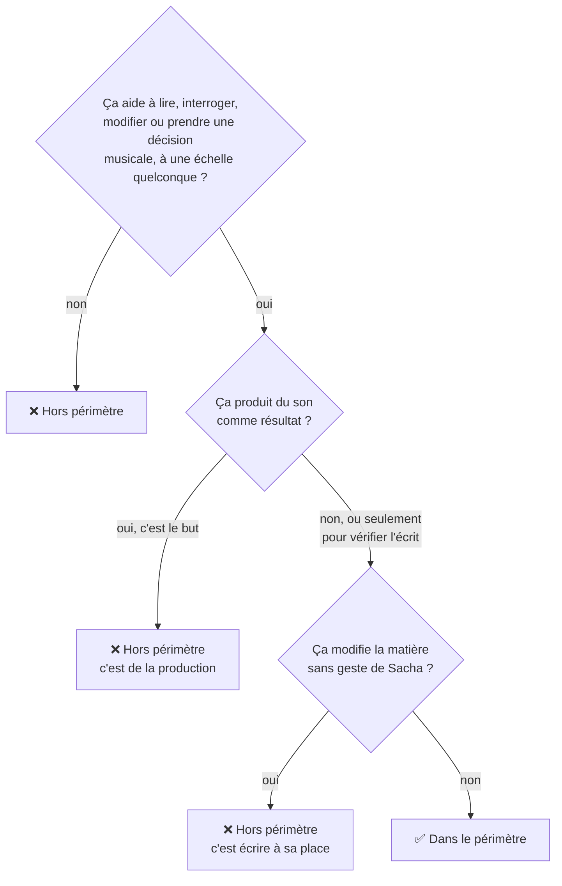

# 10 — Vision

> **Pupitre est l'atelier d'une personne qui écrit seule ses chansons : on y travaille
> deux mesures comme l'ordre d'un album, sur un seul et même matériau, du téléphone au
> papier.**

Pour qui : [Sacha](11-persona-et-situations.md), qui écrit, compose et chante en solo,
avec un fonds de démos, un piano, une guitare, un téléphone, une tablette à encre et
l'envie de faire un album. Comment : [le continuum de composition](12-continuum-de-composition.md).

---

## 1. Le problème

Composer une chanson, puis un album, c'est travailler à six échelles en même temps :
une idée captée au vol, un enchaînement de deux accords, une ligne qui doit tomber sur la
mélodie, un refrain, la forme d'un morceau, l'ordre d'un disque. Une décision prise à une
échelle se répercute sur les autres : changer la tonalité du dernier refrain change la
transition vers le morceau suivant.

Or les outils disponibles se partagent ce travail sans se parler.

Le tableur d'album n'a pas de place sur ces deux axes : il ne produit pas de son, et il
n'aide à décider qu'avec des chiffres recopiés.

| Outil | Ce qu'il fait bien | Ce qui manque à Sacha |
|---|---|---|
| Mémo vocal | Capter en un geste | L'idée devient un fichier sans nom, illisible et introuvable |
| Explorateur d'accords | Montrer les possibles à l'échelle d'une suite | Ne connaît ni la mélodie, ni le texte, ni le morceau |
| Carnet de textes | Écrire | Ignore la musique : ni syllabes sur les notes, ni accents sur les temps |
| Éditeur de partition | Graver | Pensé note à note ; la forme, l'énergie et l'album n'y existent pas |
| Station audio | Produire du son | Pensée multipiste, en secondes ; trop lourde pour réfléchir ; illisible sur papier |
| Générateur de maquettes IA | Produire vite un rendu | Écrit à la place de Sacha ; la paternité devient floue |
| Tableur d'album | Ordonner des lignes | Ne sait rien des morceaux : les chiffres y sont recopiés, donc périssent |

**Trois conséquences**, que le persona vit toutes :

1. **La matière ne se lit pas.** Un enregistrement ne dit ni sa forme, ni sa tonalité,
   ni combien de mesures fait son pont. On ne peut que l'écouter en entier, et se
   souvenir. Or la mémoire invente.
2. **L'album est invisible.** On travaille morceau par morceau. Que trois morceaux
   tombent à des tempos voisins, ou que deux morceaux voisins partagent la même
   tonalité, on ne le voit qu'au moment d'écouter le disque, c'est-à-dire trop tard.
3. **La paternité se brouille.** Entre ce qui a été écrit, transcrit d'une démo,
   proposé par une machine puis retouché, on ne sait plus quelles lignes sont les
   siennes.

---

## 2. La proposition : un seul matériau, toutes les échelles

Pupitre ne juxtapose pas ces outils. Il tient **un seul matériau** et en donne des
**vues** à chaque échelle. Zoomer, c'est changer de vue, pas changer d'outil.

Ce choix a une conséquence qui fait tout l'intérêt de l'outil : **une décision prise à
une échelle est visible à toutes les autres, immédiatement, sans recopie.** Remplacer
un accord dans le bloc du refrain change chaque refrain qui ne s'en écarte pas, la frise,
la fiche de travail et, si la fin du morceau en dépend, la transition d'album.
Décision : [ADR-001](adr/adr-001-un-seul-materiau.md).

---

## 3. Ce que Pupitre produit

| Livrable | Ce qu'il contient | Où il sert |
|---|---|---|
| **Le morceau vivant** | Forme, blocs et occurrences, grille, mélodie, paroles alignées, arrangement, prises, variantes, provenance | Dans Pupitre, sur les trois appareils |
| **La fiche de travail** | En-tête, frise de forme et d'intensité, grille, portée avec paroles, diagrammes de manche, plan d'arrangement, provenance | Au lutrin, sur papier, au piano |
| **La feuille d'album** | Ordre retenu, tonalités, tempos, durées, transitions, arc, livret de paroles | Pour décider, puis pour produire |
| **Les exports ouverts** | Les formats que lisent les autres outils | Vers un éditeur de partition, une station audio, un studio |
| **Le brief de génération** | Ce qu'il faut à un générateur de maquettes, dans ses limites | Pour obtenir une maquette, puis la confronter à l'écrit |
| **Le journal** | Les décisions datées, en phrases lisibles | Pour se souvenir, revenir en arrière, comparer |

**Le produit fini n'est pas une chanson enregistrée.** Pupitre rend ce qu'il faut avoir
sous les yeux et dans l'oreille pour en faire une.

---

## 4. Les principes

Huit principes tranchent les cas douteux. Chacun renvoie à la décision qui l'établit et
au risque qu'il combat (§ 7).

| # | Principe | En une phrase | Décision |
|---|---|---|---|
| P1 | **Un seul matériau** | Toute vue est engendrée d'une source unique ; rien n'est recopié | [ADR-001](adr/adr-001-un-seul-materiau.md), [ADR-007](adr/adr-007-blocs-et-occurrences.md) |
| P2 | **Proposer n'est pas décider** | Ce que la machine mesure ou imagine reste une proposition jusqu'au geste de Sacha | [ADR-004](adr/adr-004-proposer-n-est-pas-decider.md) |
| P3 | **Des pistes, pas des réponses** | Les suggestions arrivent à la demande, au pluriel, avec leurs raisons | [ADR-005](adr/adr-005-des-pistes-pas-des-reponses.md) |
| P4 | **Le partiel est normal** | Une idée de trois notes, un morceau sans texte, un album sans cardinal : tout fonctionne sur ce qu'on a | [ADR-006](adr/adr-006-le-partiel-est-normal.md) |
| P5 | **Partout, même sans réseau** | Chaque appareil porte sa copie ; la maison synchronise | [ADR-002](adr/adr-002-local-first.md), [ADR-003](adr/adr-003-crdt-et-miroir-durable.md) |
| P6 | **Lisible sur papier et sur encre** | Aucune information portée par la seule couleur ; tout s'imprime | [ADR-010](adr/adr-010-trois-appareils-mode-encre.md), [ADR-011](adr/adr-011-encre-ancree-rendu-fige.md) |
| P7 | **Écouter pour vérifier, pas pour produire** | Le son sert à contrôler l'écrit, jamais à fabriquer un rendu | [ADR-009](adr/adr-009-ecoute-de-controle.md) |
| P8 | **Les données appartiennent à Sacha** | Formats ouverts, miroir lisible sans l'outil, rien d'exposé, rien d'envoyé sans consentement | [ADR-003](adr/adr-003-crdt-et-miroir-durable.md), [ADR-015](adr/adr-015-passerelle-ia.md), [ADR-021](adr/adr-021-cle-du-noeud-epinglee.md) |

---

## 5. Ce que Pupitre n'est pas

Chacune de ces tentations est plausible, et chacune coûterait le projet.

| Pupitre n'est pas… | Parce que… |
|---|---|
| **une station audio ni un séquenceur** | Pas d'enregistrement multipiste, de mixage, d'effets, d'automation, de quantification. Le temps s'y compte en mesures et en sections, pas en échantillons |
| **un graveur de partitions** | La portée est un rendu engendré pour être lu. On corrige une note dans le modèle, on ne déplace pas une tête de note au pixel |
| **un générateur de chansons** | Aucun bouton « écrire le morceau ». Une suggestion porte sur un élément, à la demande, et ne s'applique que par un geste |
| **un outil collaboratif** | Une seule personne, un seul fonds. Rien n'interdit de partager un export ; rien n'est conçu pour écrire à plusieurs |
| **une bibliothèque d'écoute** | Pas de pochettes, de lectures comptées, de notes d'écoute |
| **un outil de productivité** | Pas de séries de jours, de rappels, de compteurs de retard, de notifications. Une idée non rattachée n'est pas une tâche en souffrance |
| **un service en ligne** | Rien n'est exposé sur Internet. L'IA distante n'est appelée que sur consentement explicite |

### Le test de périmètre

Quand on ne sait pas si une fonction appartient à Pupitre :

Le test appliqué à des cas réels, pour qu'il ne reste pas abstrait :

| Fonction envisagée | Verdict | Raison |
|---|---|---|
| Jouer la grille au piano échantillonné pour entendre un enchaînement | ✅ | Écoute de contrôle : vérifie l'écrit |
| Exporter un mixage audio de la maquette arrangée | ❌ | Le son est le résultat : c'est de la production |
| Proposer trois accords suivants, chacun avec l'effet qu'il produit | ✅ | Suggestion à la demande, appliquée par un geste |
| Compléter automatiquement le deuxième couplet | ❌ | Écrit sans geste |
| Proposer trois ordres d'album, chacun expliqué | ✅ | Pistes à comparer ; rien n'est réordonné |
| Réordonner l'album tout seul « pour optimiser » | ❌ | Modifie la matière sans geste |
| Aligner une démo sur la grille de mesures | ✅ | Aide à lire la prise |
| Quantifier une démo | ❌ | Transforme le son |

---

## 6. Comment on saura que c'est réussi

Des indicateurs observables, pas des intentions. Chacun est repris dans les critères
d'acceptation de la [SFD](20-sfd/README.md) ou dans les invariants du [§ 70](70-qualite-et-verification.md).

| # | Indicateur | Cible |
|---|---|---|
| IR-1 | Du téléphone verrouillé au début d'un enregistrement | ≤ 3 s, en mode avion |
| IR-2 | Captations perdues sur douze mois d'usage | 0 |
| IR-3 | Retrouver un morceau ou une idée par attribut ou par texte | ≤ 10 s |
| IR-4 | Valeurs non décidées affichées sans marque de proposition | 0, vérifié par test |
| IR-5 | Suggestions appliquées sans geste | 0, vérifié par test |
| IR-6 | Diagnostics d'album affichés sans leur assiette | 0, vérifié par test |
| IR-7 | Fiche de travail lisible au lutrin, à bout de bras, sans couleur | Corps ≥ 11 pt ; test « couleur supprimée » (I17) vert |
| IR-8 | Test de restauration complet | Vert chaque semaine, rapport daté |
| IR-9 | Miroir durable lisible sans Pupitre | Un morceau se relit dans un éditeur de texte et se reconstruit depuis le miroir (I12) |

---

## 7. Ce qui ferait échouer le projet

Sept risques nommés, pour qu'on puisse les surveiller.

| # | Risque | Signal d'alerte | Parade |
|---|---|---|---|
| R1 | **Un outil qu'il faut nourrir avant qu'il serve** | Sacha remplit des champs au lieu de composer | Le partiel est normal (P4) ; la capture d'abord ; aucune saisie obligatoire |
| R2 | **Un outil qui affirme à tort** | Une tonalité fausse circule comme un fait | Toute mesure est une proposition avec sa confiance (P2) ; rien n'est recopié (P1) |
| R3 | **Un outil qu'on n'ouvre pas** | Le papier reste plus rapide que l'écran | Hors ligne, appairage sans saisie longue, mode encre soigné (P5, P6) |
| R4 | **Un outil qui glisse vers le studio** | « Juste un petit effet de réverbération » | Écoute de contrôle bornée (P7) ; le test de périmètre du § 5 |
| R5 | **Un outil qui écrit à la place** | La part d'origine grimpe sans que Sacha l'ait voulu | Suggestions à la demande, plurielles, tracées ; mode sans suggestion (P3) |
| R6 | **Une idée perdue** | Une prise reste sur un téléphone perdu, jamais synchronisée | Indicateur des captations en attente, synchro dès le retour, test de restauration (P5, P8) |
| R7 | **Un projet trop grand pour une personne** | Rien d'utilisable après des mois | Construction par incréments utilisables, bibliothèques éprouvées plutôt que code maison ([§ 40](40-architecture.md#9-trajectoire-de-construction)) |
