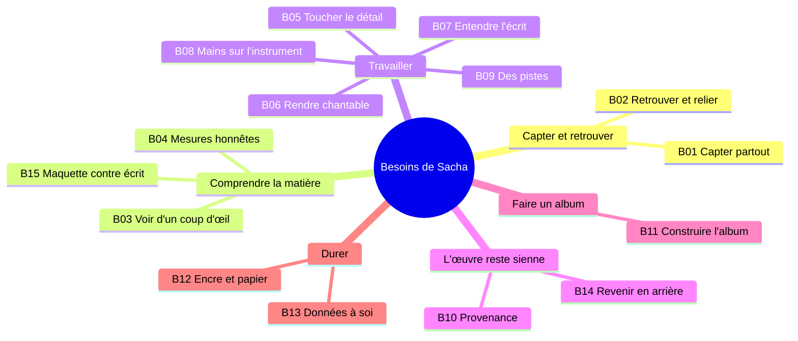
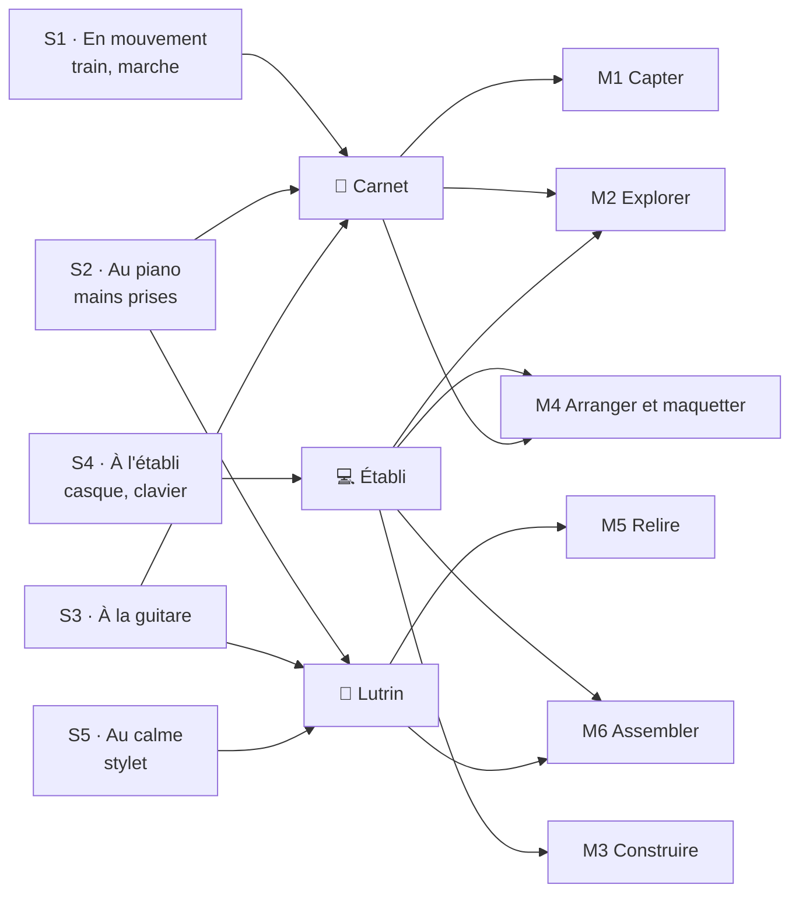
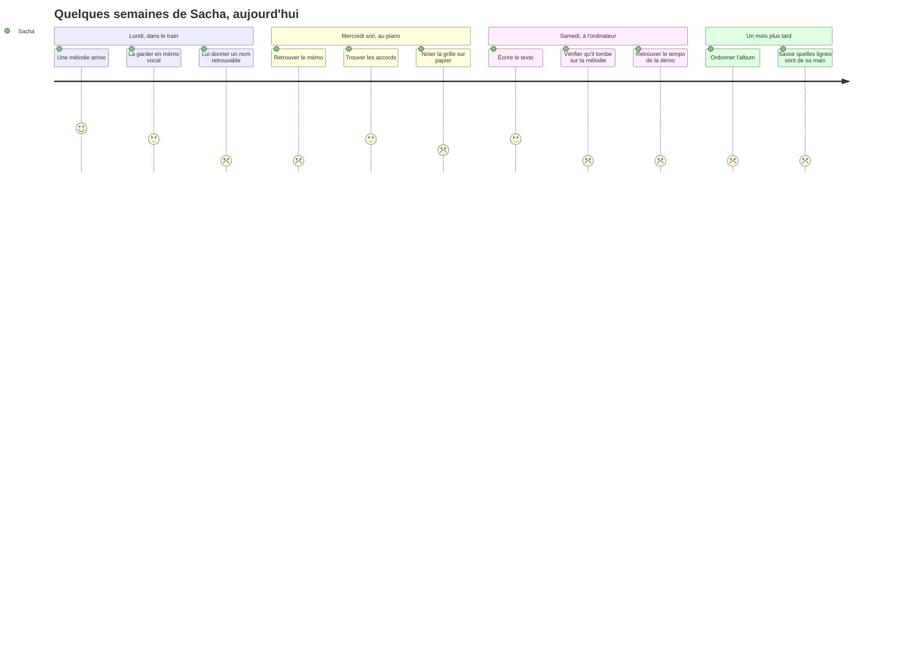
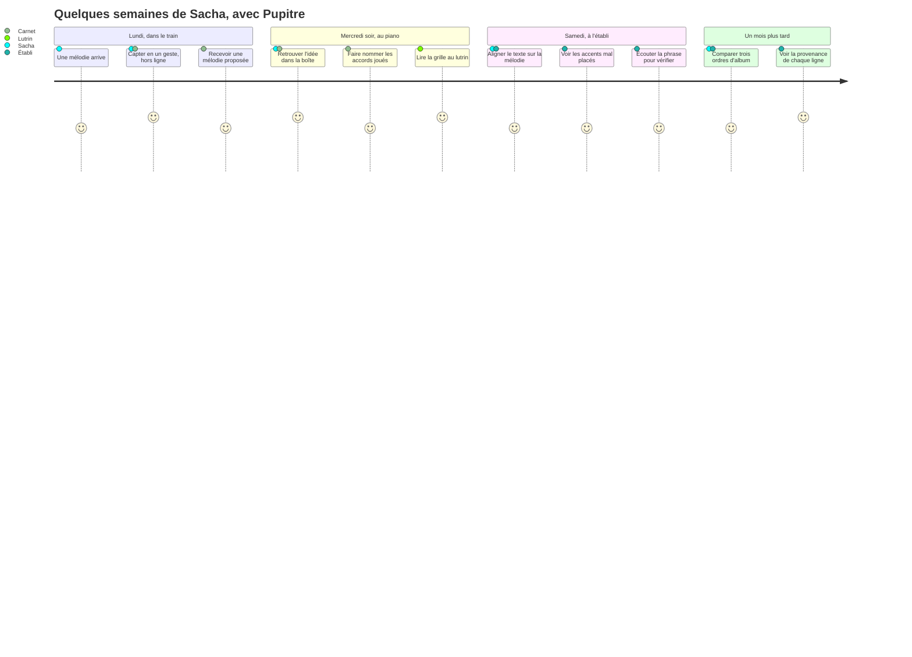

# 11 — Persona et situations d'usage

Pupitre est conçu pour **un profil**, pas pour une personne nommée. Ce profil s'appelle
Sacha. Tout ce que la SFD spécifie se justifie par un besoin de Sacha (§ 3), qui se
manifeste dans une situation physique précise (§ 5).

> Sacha est un persona : un portrait composite qui fixe des besoins, des contraintes et
> des valeurs. Le prénom est épicène et choisi pour cela. Aucun détail biographique de
> ce document ne désigne une personne réelle.

---

## 1. Fiche

| | |
|---|---|
| **Pratique** | Écrit, compose et chante ses chansons en solo, par périodes, depuis une quinzaine d'années |
| **Instruments** | Un piano acoustique à la maison, une guitare acoustique. Lit une partition, connaît les degrés et les cadences courantes, veut progresser en harmonie sans perdre la main |
| **Voix** | Chante ses morceaux. Voix plutôt grave ; tessiture à mesurer plutôt qu'à supposer |
| **Langues** | Écrit surtout en anglais, parfois en français, parfois les deux dans un même morceau |
| **Matière** | Un fonds de plusieurs dizaines de démos (téléphone, vieux enregistrements maison), dont beaucoup de fragments de moins d'une minute et plusieurs versions d'une même idée ; des carnets de textes ; des notes éparses ; des *stems*, ceux de quelques dizaines de morceaux, par jeux de huit à douze, presque chacun avec son fichier MIDI, dont une part peut venir d'un générateur de maquettes externe |
| **Équipement** | Un téléphone, un ordinateur portable, une tablette à encre électronique avec stylet, un petit serveur toujours allumé à la maison. **Pas de home studio** : ni interface audio, ni clavier MIDI |
| **Objectif** | Un album d'une dizaine de titres — le nombre n'est pas arrêté — mené jusqu'à des maquettes abouties, enregistrées soi-même ou obtenues d'un générateur de maquettes à partir de ses morceaux |
| **Rapport à la technique** | À l'aise : sait faire tourner un service à la maison. Mais l'usage quotidien ne doit demander aucune compétence technique |
| **Rythme** | Sessions courtes en semaine (trajets, soirées), sessions longues au piano le week-end |
| **Valeurs** | L'honnêteté sur ce qu'on ne sait pas. La propriété de ses données. Le papier. Que l'œuvre reste la sienne. Comprendre le pourquoi |

### Carte d'empathie

| Sacha dit | Sacha pense |
|---|---|
| « Je l'avais, cette mélodie, dans un mémo de l'an dernier. » | « La moitié de mes idées dorment dans des fichiers dont j'ai oublié le nom. » |
| « Il est à combien, ce morceau ? 120 ? » | « Ma mémoire me raconte des histoires. Les détecteurs aussi, mais avec aplomb. » |
| « Donne-moi des pistes, pas la réponse. » | « Si une machine écrit le refrain, ce n'est plus mon refrain. » |

| Sacha fait | Sacha ressent |
|---|---|
| Joue au piano les mains prises, le téléphone posé à côté | De la frustration quand il faut lâcher le clavier pour taper |
| Relit ses textes sur papier, au crayon | Du plaisir au calme, loin des écrans |
| Ordonne l'album dans sa tête, en écoutant tout | Du vertige : impossible de tout tenir en même temps |

---

## 2. Ce qui fait mal aujourd'hui

| # | Douleur | Ce qui se passe |
|---|---|---|
| D1 | **Les idées se perdent** | Un mémo vocal sans nom, une ligne dans un carnet, une photo de partition : rien ne les relie, rien ne les retrouve |
| D2 | **L'audio ne se lit pas** | Impossible de voir d'un coup d'œil la forme, la tonalité, le tempo d'une démo, ou de comparer deux versions |
| D3 | **La mémoire invente, les détecteurs aussi** | Un tempo « de mémoire » faux d'un tiers ; un détecteur qui affirme une tonalité fausse sans hésiter |
| D4 | **L'album est invisible** | Deux morceaux voisins dans la même tonalité, trois ballades d'affilée : on le découvre en écoutant le disque |
| D5 | **La paternité se brouille** | Après transcriptions, retouches et propositions de machines, on ne sait plus quelles lignes sont de sa main |
| D6 | **Les outils sont mal taillés** | Studios trop lourds et centrés sur le son ; carnets sans musique ; services en ligne qui retiennent les données |
| D7 | **Au piano, les mains sont prises** | Taper casse le geste ; un écran de téléphone ne se lit pas de loin |
| D8 | **Le blocage** | Un refrain qui ne décolle pas ; il faudrait des pistes, pas une solution clés en main |

---

## 3. Les besoins

Formulés comme des tâches à accomplir : *quand* telle situation, *je veux* telle chose,
*pour* tel résultat. Chaque besoin porte un identifiant stable `Bxx`, repris par la
matrice de traçabilité de la [SFD](20-sfd/README.md#matrice-de-traçabilité).

| # | Quand… | Sacha veut… | Pour… | Douleur |
|---|---|---|---|---|
| **B01** | une idée arrive, n'importe où | la capter en quelques secondes, sans réseau | ne pas la perdre | D1 |
| **B02** | Sacha cherche « ce riff d'il y a longtemps » | retrouver et relier n'importe quoi du fonds | réutiliser au lieu de refaire | D1, D2 |
| **B03** | un morceau est ouvert | en voir la forme, les durées, l'intensité, la tonalité et le tempo d'un coup d'œil | décider sur pièce | D2 |
| **B04** | une valeur est mesurée par une machine | qu'elle soit présentée comme une proposition, avec sa confiance | ne jamais construire sur du faux | D3 |
| **B05** | Sacha travaille au plus fin | toucher un accord, une note, une syllabe, une ligne, sans perdre le contexte | que le détail serve le tout | — |
| **B06** | une ligne de texte est posée sur une mélodie | voir les accents, les syllabes, les voyelles et la tessiture | la rendre chantable | — |
| **B07** | Sacha est loin de l'instrument | entendre ce qui est écrit | vérifier un enchaînement ou une ligne | — |
| **B08** | Sacha joue | que l'outil nomme ce qui est joué, accorde, batte la mesure, suive une démo | garder les mains sur l'instrument | D7 |
| **B09** | Sacha bloque | recevoir plusieurs pistes, expliquées, jamais imposées | débloquer sans perdre la main | D8 |
| **B10** | Sacha doute de l'origine d'une ligne | voir la provenance de chaque élément | assumer ce qui est à soi | D5 |
| **B11** | les morceaux s'accumulent | voir et construire l'album : sélection, ordre, transitions, cohérence, arc | faire un disque, pas une compilation | D4 |
| **B12** | Sacha veut relire au calme | lire et annoter sur encre ou sur papier | travailler loin des écrans | — |
| **B13** | des années passent | garder des données durables, lisibles sans l'outil, privées, sauvegardées | ne dépendre de personne | D6 |
| **B14** | une modification déçoit | revenir en arrière, comparer des variantes | oser essayer | — |
| **B15** | une maquette existe, enregistrée ou générée | la confronter à l'écrit : forme, tempo, tonalité, texte entendu | décider ce qu'on garde de la maquette | D3, D5 |

### Ce que Sacha ne veut pas

Ces refus sont aussi contraignants que les besoins.

| # | Sacha ne veut pas… | Conséquence de conception |
|---|---|---|
| N1 | qu'on écrive à sa place | Aucune suggestion ne s'applique sans geste ; aucun bouton « compléter » |
| N2 | être relancé, compté, noté | Pas de notifications, de séries, de compteurs de retard |
| N3 | dépendre d'un service en ligne ou d'un abonnement | Local-first ; IA distante optionnelle et consentie ; formats ouverts |
| N4 | taper au clavier de la tablette à encre | Appairage par code court ; aucune saisie longue sur le lutrin |
| N5 | des affirmations sans leurs raisons | Tout constat chiffré et sourcé ; toute suggestion expliquée |
| N6 | une seule recommandation | Toujours plusieurs pistes, ou l'aveu qu'il n'y en a pas |

### Hors persona

Pour que les arbitrages restent nets, ces profils ne sont **pas** visés : un groupe qui
écrit à plusieurs, un ingénieur du son, un compositeur d'orchestre, un enseignant qui
prépare des supports. Rien ne leur interdit Pupitre ; rien n'est conçu pour eux.

---

## 4. Le doute comme matière première

Une caractéristique du profil commande une bonne partie de la conception : **la matière
de Sacha est incomplète et incertaine, durablement.** Des fragments sans suite, des
démos dont le tempo n'a jamais été mesuré, des titres provisoires, un album dont le
nombre de titres n'est pas arrêté.

Un outil qui ne deviendrait utile qu'une fois tout renseigné ne servirait jamais. D'où
deux décisions structurantes : [le partiel est normal](adr/adr-006-le-partiel-est-normal.md),
et [proposer n'est pas décider](adr/adr-004-proposer-n-est-pas-decider.md).

---

## 5. Les situations d'usage

Il n'y a qu'une personne, mais **cinq situations physiques**, qui imposent des
contraintes incompatibles. Chaque fonction de la SFD dit sur quels appareils elle sert
(rubrique « Appareils ») ; le schéma ci-dessous en déduit les situations.

### S1 · En mouvement — « je capte, j'écoute, je retouche »

| | |
|---|---|
| **Posture** | Debout, ou sur un siège de train, une main libre. Casque ou rien |
| **Appareil** | 📱 Carnet seul. Réseau incertain ou absent |
| **Ce que fait Sacha** | Capte une mélodie fredonnée, une ligne, une photo de page. Réécoute une démo. Retouche une ligne. Demande des accords possibles pour la suite d'un motif |
| **Ce que ça impose** | Tout fonctionne **hors ligne** : capter, écouter, éditer, suggestions de règles. Seules l'analyse lourde et l'IA générative attendent le retour à la maison, et l'interface le dit |
| **Contrainte dure** | Démarrer un enregistrement en moins de 3 s depuis le téléphone verrouillé (IR-1) |

### S2 · Au piano — « je joue, l'outil écoute »

| | |
|---|---|
| **Posture** | Sur le banc du piano, deux mains sur le clavier. Lutrin sur le pupitre, téléphone posé à côté |
| **Appareils** | 📖 Lutrin pour lire, 📱 Carnet en compagnon d'instrument |
| **Ce que fait Sacha** | Cherche un enchaînement. Joue un accord ; veut savoir comment il s'appelle et où il peut aller |
| **Ce que ça impose** | Aucune saisie : le carnet **écoute et nomme**, un accord à la fois, et propose. Garder se fait d'un seul geste large. Le lutrin affiche la grille et la carte des chemins **statiquement** ; ce qui est gardé apparaît à la page suivante, jamais en temps réel |
| **Contrainte dure** | Le piano se désaccorde avec le temps : son diapason se mesure, il ne se suppose pas |

### S3 · À la guitare — « montre-moi un doigté jouable »

| | |
|---|---|
| **Posture** | Guitare en main ; une main se libère brièvement |
| **Appareils** | 📖 Lutrin (grille et diagrammes), 📱 Carnet (accordeur, métronome) |
| **Ce que fait Sacha** | Travaille un morceau dont la grille est connue ; veut le doigté le plus **jouable à cet endroit de la grille**, pas le plus théorique |
| **Ce que ça impose** | Diagrammes de manche en trait noir sur blanc ; doigté calculé selon les accords voisins ; un doigté que Sacha épingle revient partout |

### S4 · À l'établi — « je construis »

| | |
|---|---|
| **Posture** | Au bureau, clavier et souris, casque. Sessions longues |
| **Appareil** | 💻 Établi |
| **Ce que fait Sacha** | Écrit le texte, aligne les syllabes, édite la mélodie, pose la forme, arrange, prépare une maquette, ordonne l'album |
| **Ce que ça impose** | Les éditeurs fins (loupe, frise, plan d'album) sont pensés pour la souris et le clavier, avec raccourcis. L'établi peut tout faire, donc il ne justifie rien : une fonction qui n'existerait que là signale une contrainte contournée |

### S5 · Au calme — « je relis, j'annote, je tranche »

| | |
|---|---|
| **Posture** | Au fauteuil, tablette à encre en main, stylet. Pas d'instrument |
| **Appareil** | 📖 Lutrin |
| **Ce que fait Sacha** | Lit un morceau ou la feuille d'album en entier. Entoure, barre, écrit en marge. Accepte ou écarte une proposition en attente |
| **Ce que ça impose** | Pagination irréprochable ; aucune information portée par la couleur ; annotation ancrée à un rendu figé ; fonctionnement hors ligne sur ce qui a été ouvert. Aucune opération destructrice proposée ici |

---

## 6. Quelques semaines de Sacha

Le même scénario, vécu aujourd'hui puis avec Pupitre. Les notes vont de 1 (pénible) à
5 (fluide).

### Aujourd'hui

### Avec Pupitre

Les points qui restent à 4 et non à 5 sont honnêtes : une mélodie proposée depuis un
fredonnement se relit et se corrige ; le nom d'un accord joué au piano peut être faux ;
aligner un texte et placer ses accents restent un travail d'oreille, que Pupitre éclaire
sans le faire ; l'écoute de contrôle sonne comme un piano échantillonné, pas comme la
chanson ; un ordre d'album reste un choix difficile. Pupitre aide à décider, il ne décide
pas.
