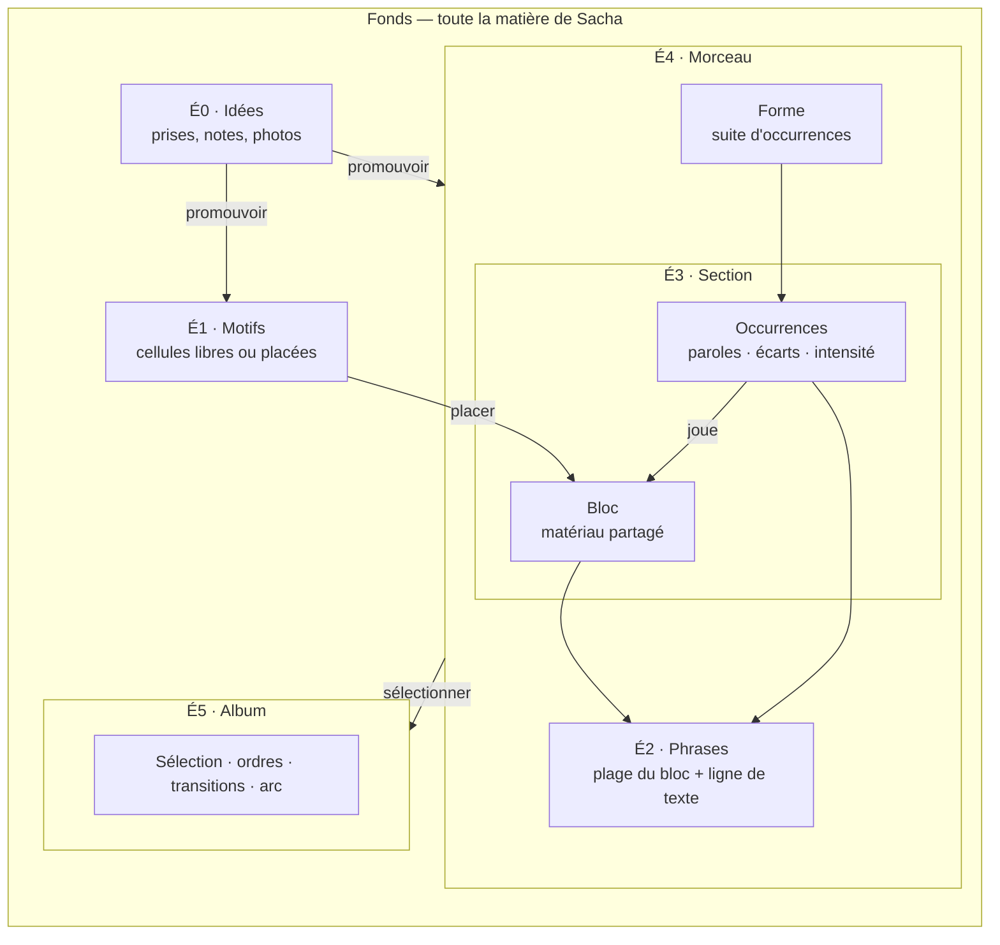
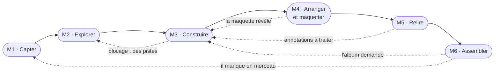
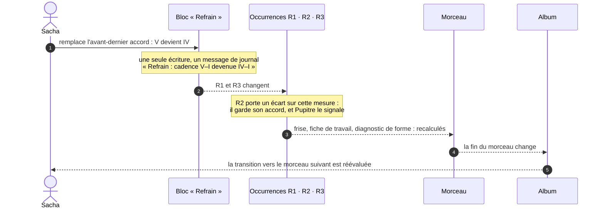
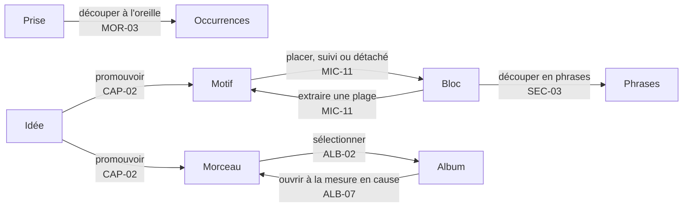
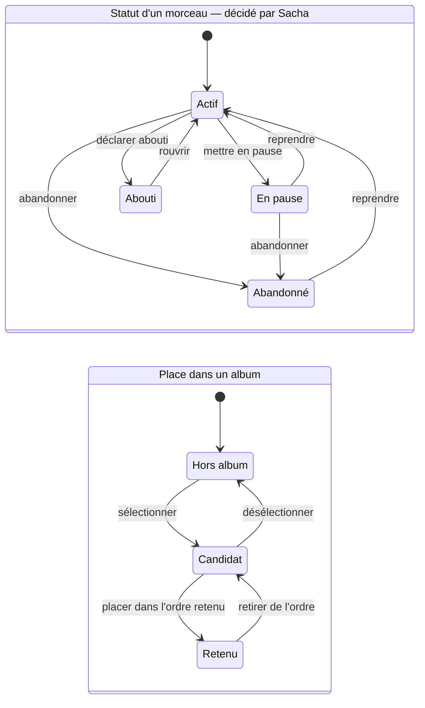
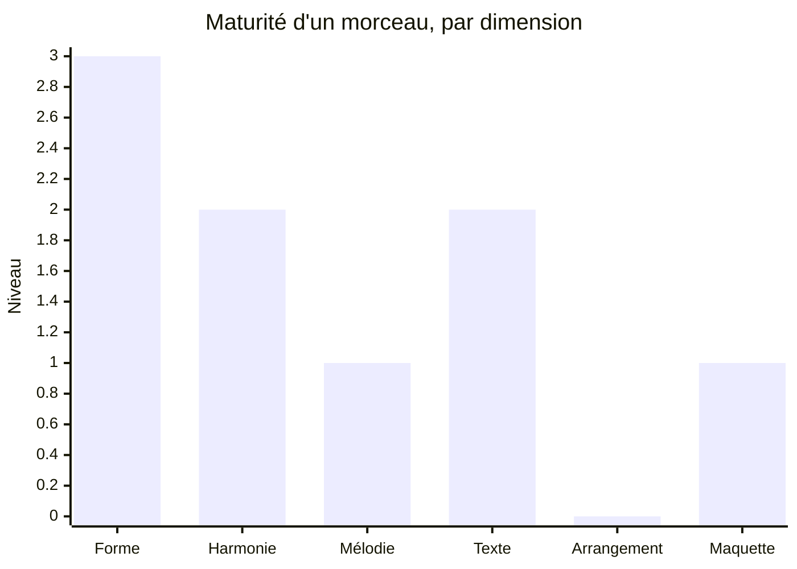
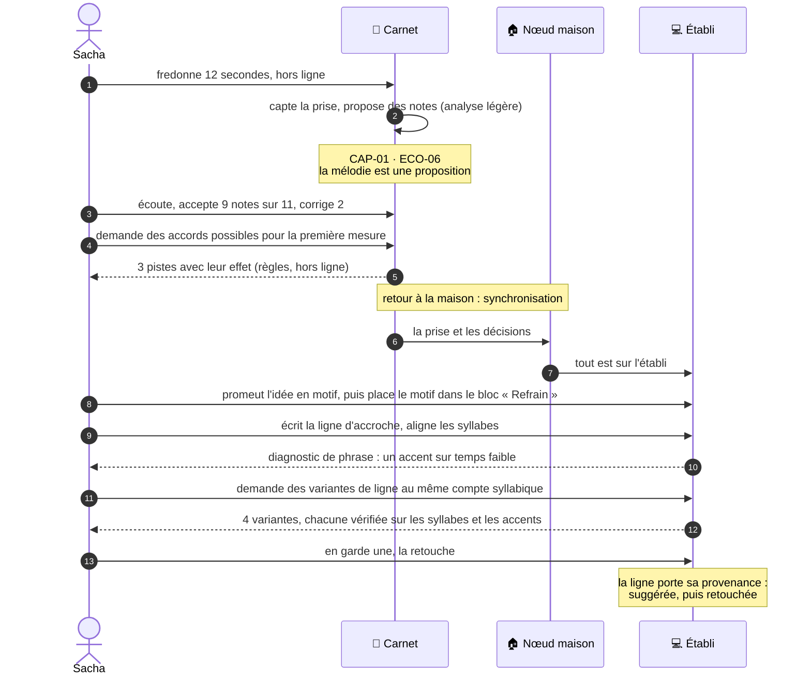
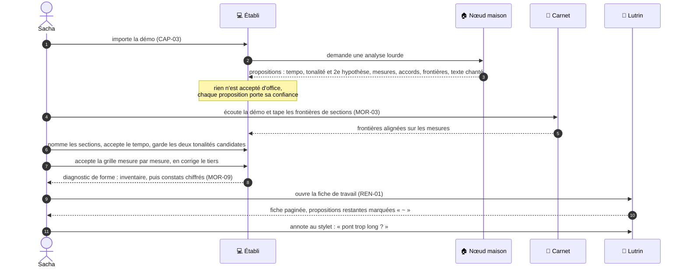
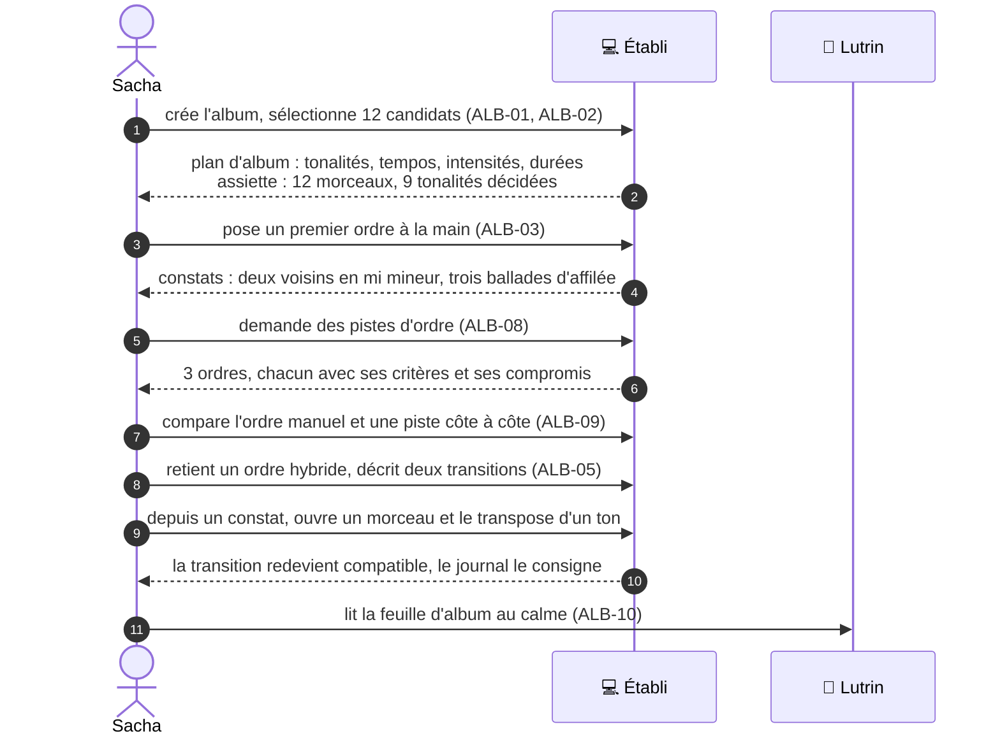
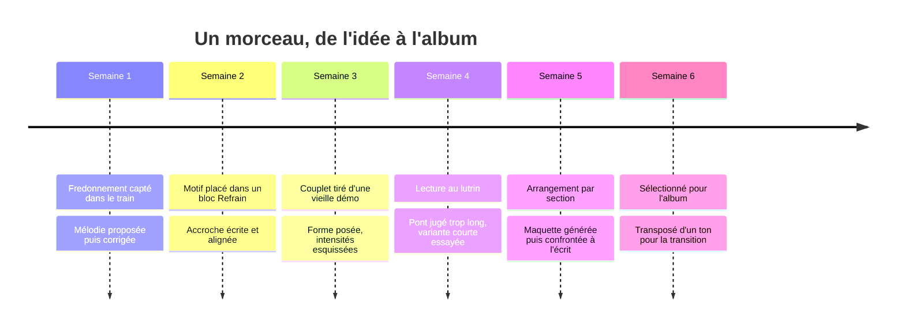

# 12 — Le continuum de composition

Composer, c'est zoomer et dézoomer sans cesse : on écoute l'album, on descend sur un
refrain, on corrige une syllabe, on remonte voir si la transition tient. Ce document
fixe **les échelles** (sur quoi l'on travaille), **les moments** (ce que l'on fait), puis
montre comment Pupitre passe de l'un à l'autre **sans jamais recopier**.

C'est la colonne vertébrale de la conception : la [SFD](20-sfd/README.md) est rangée par
échelle, et chaque fonction dit à quel moment elle sert.

---

## 1. Six échelles dans un fonds

Le **fonds** n'est pas une échelle de travail : c'est le réservoir. On y cherche, on y
rapproche, et c'est là qu'un album puise ses morceaux. Chaque échelle a son propre jeu de
questions, et Pupitre y répond avec une vue, des propositions et des diagnostics.

| Échelle | Taille typique | Les questions de Sacha | Ce que Pupitre montre | Ce que Pupitre propose | Ce que Pupitre diagnostique |
|---|---|---|---|---|---|
| **Fonds** | tout | « Qu'est-ce que j'ai en mi mineur ? Où ai-je déjà fait IV→iv→I ? Quelles idées dorment ? » | Catalogue, recherche, maturité de chaque morceau | Des rapprochements : « ces deux prises semblent la même idée » | Squelettes partagés, incohérences entre sources |
| **É0 · Idée** | quelques secondes à quelques minutes | « Qu'est-ce que c'était ? Est-ce que je l'ai déjà ? » | Les prises et les photos, le texte, les étiquettes, les liens | Mélodie depuis un fredonnement, tempo, tonalité, texte chanté transcrit | — |
| **É1 · Motif** | 1 à 4 mesures | « Comment s'appelle ce que je joue ? Où ça peut aller ? Que donne-t-il renversé, décalé ? » | La loupe : accords, mélodie, rythme, accroche ; la carte des chemins | Accords suivants, substitutions, transformations, rimes pour l'accroche | Notes d'accord, tensions, frottements |
| **É2 · Phrase** | 2 à 8 mesures | « Ma ligne tombe-t-elle sur la mélodie ? Ça se chante ? » | Les syllabes sous les notes, les accents, les voyelles tenues, la tessiture | Découpe syllabique, variantes de ligne au même compte, rimes et quasi-rimes | Accent sur temps faible, voyelle réduite tenue, densité syllabique, sortie de tessiture |
| **É3 · Section** | 4 à 16 mesures, plusieurs occurrences | « Le refrain décolle-t-il ? Le couplet 2 doit-il varier ? Le pont contraste-t-il ? » | Le bloc et ses occurrences côte à côte, leurs écarts, le rythme harmonique, la cadence, le contour, l'intensité | Variantes de cadence, pistes de contraste et de relance | Cadence, rythme harmonique, contour, répétition à l'identique, ambitus |
| **É4 · Morceau** | 1 à 6 minutes | « Quelle forme ? Où est l'énergie ? Ma démo dit-elle la même chose que l'écrit ? » | La frise proportionnelle et sa courbe d'intensité, l'arrangement, les prises alignées, les variantes | Frontières de sections sur une prise, formes alternatives, gestes d'allongement, modulation | Inventaire factuel, puis symptômes de forme |
| **É5 · Album** | 8 à 15 morceaux, 30 à 60 minutes | « Quel ordre ? Les transitions tiennent-elles ? Trop de ballades au milieu ? » | Le plan d'album : tonalités sur le cercle, tempos, intensités, durées, transitions, faces | Ordres candidats expliqués, relations tonales pour les transitions | Adjacences, grappes, redondances, équilibre — toujours avec leur assiette |

---

## 2. Six moments, et des allers-retours

Les moments ne forment pas une chaîne de production : on y revient sans cesse. Le
chemin principal existe, mais **les flèches de retour sont l'usage normal**.

| Moment | Quand | Appareil | Échelles | Ce qu'on y fait |
|---|---|---|---|---|
| **M1 · Capter** | Une idée arrive ; une démo existe | 📱 surtout | Fonds, É0, É1, É4 | Enregistrer, noter, photographier, fredonner ; trier la boîte ; importer, rattacher |
| **M2 · Explorer** | On cherche, on hésite | 📱 💻 | Fonds, É0 à É5 | Essayer des accords, des transformations ; demander des pistes ; écouter pour vérifier |
| **M3 · Construire** | On fixe | 💻 surtout | É0 à É5 | Grille, mélodie, texte, alignement, blocs, occurrences, forme, tonalité, tempo |
| **M4 · Arranger et maquetter** | La chanson tient debout | 💻 📱 | É3, É4 | Qui joue quoi, densité, poussée ; prises de maquette ; brief de génération ; confronter la maquette à l'écrit |
| **M5 · Relire** | On prend du recul | 📖 surtout | Fonds, É1 à É5 | Diagnostics, fiche de travail, annotations, accepter ou écarter, consigner |
| **M6 · Assembler** | Assez de morceaux mûrissent | 💻 📖 | Fonds, É4, É5 | Sélectionner, ordonner, régler les transitions, documenter, exporter |

---

## 3. La matrice échelles × moments

Chaque case porte les fonctions de la SFD qui y servent. C'est la carte de lecture de
la SFD, et la preuve qu'aucune case utile n'est vide.

| | M1 · Capter | M2 · Explorer | M3 · Construire | M4 · Arranger et maquetter | M5 · Relire | M6 · Assembler |
|---|---|---|---|---|---|---|
| **Fonds** | CAP-03 · CAP-07 | CAP-05 · CAP-06 | — | — | PRO-07 | CAP-06 |
| **É0 · Idée** | CAP-01 · CAP-02 · ECO-06 | CAP-05 | CAP-02 | — | — | — |
| **É1 · Motif** | ECO-03 · ECO-06 | MIC-08 · MIC-09 · MIC-10 · MIC-12 · MIC-13 · ECO-01 · ECO-03 | MIC-01 · MIC-02 · MIC-03 · MIC-11 · MIC-12 · MIC-13 | — | MIC-06 | — |
| **É2 · Phrase** | — | MIC-10 · ECO-01 | MIC-01 · MIC-04 · MIC-05 · SEC-03 | — | MIC-06 · MIC-07 | — |
| **É3 · Section** | — | SEC-07 · ECO-01 | SEC-01 · SEC-02 · SEC-03 · SEC-04 | SEC-05 · MOR-06 | SEC-04 · SEC-06 | — |
| **É4 · Morceau** | CAP-04 · MOR-03 | MOR-10 · MOR-11 · MOR-14 | MOR-01 · MOR-02 · MOR-04 | MOR-06 · MOR-07 · MOR-08 | MOR-05 · MOR-09 · MOR-12 · MOR-13 · MOR-14 | SYN-07 |
| **É5 · Album** | — | ALB-08 · ALB-09 | ALB-01 · ALB-02 | — | ALB-04 · ALB-07 | ALB-03 · ALB-05 · ALB-06 · ALB-10 · SYN-07 |

Les modules **transverses** — propositions et provenance (`PRO`), écoute et compagnon
d'instrument (`ECO`), rendus et encre (`REN`), données, appareils et réglages (`SYN`) —
servent toutes les cases. La matrice ne montre que celles de leurs fonctions qui tiennent
à un geste propre à une case : ECO-01, ECO-03, ECO-06, PRO-07 et SYN-07.

---

## 4. Zoomer sans recopier

La promesse du [§ 10](10-vision.md#2-la-proposition--un-seul-matériau-toutes-les-échelles)
se vérifie sur un cas : Sacha change **un** accord dans le bloc du refrain.

Rien n'a été recopié : les trois refrains, la fiche, la frise et le plan d'album sont
des **vues** du même bloc ([ADR-001](adr/adr-001-un-seul-materiau.md)). Et le cas de R2
montre la nuance qui rend le modèle utile : une occurrence peut s'écarter de son bloc,
et l'écart reste visible ([ADR-007](adr/adr-007-blocs-et-occurrences.md)).

---

## 5. Les gestes qui font passer d'une échelle à l'autre

| Geste | De → vers | Ce qui se passe | Ce qui ne se passe jamais |
|---|---|---|---|
| **Promouvoir** | Idée → motif ou morceau | L'idée devient la première matière de l'objet ; sa prise devient la première prise | L'idée n'est pas supprimée : elle reste, reliée |
| **Placer** | Motif → bloc | Le matériau du motif est **copié** dans le bloc, en mode **suivi** (si le motif change, Pupitre **propose** le report) ou **détaché** (aucun suivi) ; la provenance « issu du motif » reste | Un placement ne réécrit pas les autres mesures du bloc ; aucun lien vivant entre documents |
| **Extraire** | Plage d'un bloc → motif | Une plage devient un motif libre, réutilisable ailleurs | Le bloc n'est pas modifié |
| **Découper à l'oreille** | Prise → occurrences | Sacha tape les frontières en écoutant ; Pupitre les aligne sur les mesures | Pupitre ne nomme pas les sections à la place de Sacha |
| **Sélectionner** | Morceau → album | Le morceau devient candidat de l'album | Le morceau n'est pas figé : il continue de vivre |
| **Redescendre** | Constat d'album → morceau | Un constat ouvre le morceau à la mesure en cause | Aucun constat ne modifie un morceau |

---

## 6. Cycle de vie : de l'idée à l'album

Une idée, un motif et un morceau sont des objets distincts, reliés par les gestes du § 5 :
promouvoir une idée ou placer un motif **crée** un objet relié, sans que la source change
d'état ni disparaisse. Deux cycles, eux, sont de vrais états d'un morceau : son statut, et
sa place dans un album.

Deux choses distinctes, à ne pas confondre :

- le **statut** d'un morceau (actif, en pause, abouti, abandonné) est une **décision**
  de Sacha, datée ;
- la **maturité** d'un morceau est **engendrée** depuis ce qu'il contient, dimension par
  dimension, et ne se saisit jamais ([ADR-006](adr/adr-006-le-partiel-est-normal.md)).

Exemple de maturité engendrée, telle que la vue du fonds l'affiche (0 absent · 1 esquissé ·
2 complet · 3 confirmé) :

---

## 7. Trois parcours, de bout en bout

### 7.1 Du fredonnement au refrain — É0 → É3

Une mélodie arrive dans le train ; elle finit en refrain.

### 7.2 De la vieille démo à la fiche de travail — Fonds → É4

Une démo de quatre minutes, jamais transcrite, devient un morceau lisible au lutrin.

### 7.3 De douze morceaux à un album — É4 → É5

---

## 8. La vie d'un morceau, en six semaines

Chaque modification de cette frise est une **opération nommée** d'un journal — du fonds,
du morceau ou de l'album : on peut la relire, la comparer, et revenir avant elle ([MOR-12](20-sfd/24-morceau.md#mor-12--journal-décisions-et-questions-du-morceau)).
