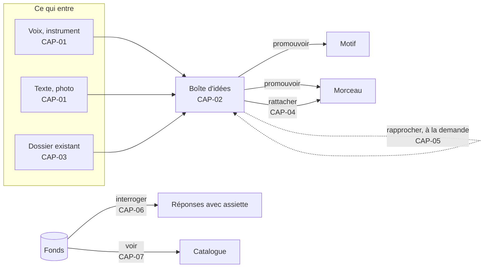

# 21 — CAP · Capter et organiser le fonds

Tout commence par une idée qui arrive, et la peur de la perdre. Ce module couvre ce qui
entre dans le fonds — par la capture ou par l'import — et ce qui permet de s'y retrouver.

---

### CAP-01 · Capter en un geste

| | |
|---|---|
| **Objet** | Enregistrer une idée sonore, écrire une note ou photographier une page, en un geste, n'importe où, sans réseau |
| **Échelle · moment** | É0 · M1 |
| **Appareils** | 📱 conçu pour · 💻 ✅ · 📖 — |
| **Besoins** | B01 |
| **Lit · écrit** | Écrit une **captation** (audio ou photo) dans le stockage local, et une **idée** dans le fonds |

**Règles**
- Un toucher sur « Enregistrer » démarre l'enregistrement. L'idée est créée d'office avec
  sa date, sa durée et l'appareil ; aucun nom n'est demandé.
- L'audio s'écrit **au fil de l'eau**, par tranches de quelques secondes : un appel
  entrant, une batterie vide ou une application fermée ne coûtent que les dernières
  secondes.
- L'audio est gardé dans le format d'enregistrement du système, jamais réencodé.
- Une analyse légère est **proposée** ([ECO-06](27-ecoute-et-compagnon.md#eco-06--fredonner-une-mélodie)),
  jamais imposée.
- Hors ligne, tout fonctionne ; l'idée est marquée « à envoyer » jusqu'à son acheminement
  ([SYN-04](29-socle-donnees-appareils.md#syn-04--acheminer-les-captations)).

**Ne fait pas** — ne demande ni titre, ni étiquette, ni rattachement ; ne notifie pas.

**Cas limites**
- Stockage presque plein : Pupitre prévient avant de commencer et indique la durée
  disponible.
- Micro refusé : Pupitre explique comment l'autoriser et propose le texte ou la photo.
- Une seconde ou trente minutes : acceptées. Aucune durée minimale ni maximale.

**Critères d'acceptation**
1. *Étant donné* le carnet en mode avion, *quand* Sacha touche « Enregistrer » puis
   « Arrêter », *alors* une idée datée existe, avec sa captation, sans aucun appel réseau.
2. *Étant donné* un enregistrement en cours depuis 20 s, *quand* l'application est tuée,
   *alors* à la réouverture l'idée existe avec au moins 18 s d'audio.
3. *Étant donné* une captation enregistrée, *alors* son empreinte recalculée égale son nom
   de stockage.
4. *Quand* une capture se termine, *alors* aucune demande de titre, d'étiquette ou de
   rattachement n'apparaît.
5. `[à l'œil]` Du téléphone verrouillé au début de l'enregistrement : ≤ 3 s (IR-1, 🔶 H01).
   Le délai entre le toucher et le premier échantillon enregistré est mesuré
   automatiquement, ≤ 300 ms.

---

### CAP-02 · Trier la boîte d'idées

| | |
|---|---|
| **Objet** | Écouter, étiqueter, relier, regrouper et promouvoir les idées, quand Sacha le décide |
| **Échelle · moment** | É0 · M1, M3 |
| **Appareils** | 💻 conçu pour · 📱 ✅ · 📖 — |
| **Besoins** | B02 |
| **Lit · écrit** | Idées et liens dans le fonds (décisions) |

**Règles**
- Une idée non reliée est un **objet légitime et durable**, pas une tâche en souffrance
  ([ADR-006](../adr/adr-006-le-partiel-est-normal.md)).
- Gestes : écouter ; compléter le texte ; étiqueter (étiquettes libres) ; relier à un
  morceau, un motif ou une autre idée ; **regrouper** plusieurs prises comme versions d'une
  même idée ; **promouvoir** en motif ou en morceau.
- Promouvoir crée l'objet, y verse la matière de l'idée (sa prise devient la première
  prise), et **garde l'idée**, reliée à ce qu'elle est devenue.
- La boîte se trie par date, étiquette, durée, état (reliée ou non) et provenance.

**Ne fait pas** — ne relance pas, ne compte pas les jours, ne propose pas de « vider la
boîte », ne supprime jamais une prise sans opération destructrice explicite.

**Cas limites**
- Trois cents idées : la liste reste fluide (affichage virtualisé).
- Une idée promue dans deux morceaux : permis, deux liens.

**Critères d'acceptation**
1. *Étant donné* 50 idées non reliées depuis des mois, *alors* aucun compteur d'ancienneté,
   aucune alerte, aucun badge n'est affiché.
2. *Quand* Sacha promeut une idée en morceau, *alors* le morceau existe, sa première prise
   est celle de l'idée, et l'idée existe toujours, reliée au morceau.
3. *Quand* deux prises sont regroupées comme versions, *alors* chacune reste une captation
   distincte, et la boîte les montre ensemble.
4. Chaque geste de tri apparaît au journal du fonds comme une opération nommée.

---

### CAP-03 · Importer un fonds existant

| | |
|---|---|
| **Objet** | Faire entrer en une fois un dossier de démos, de fichiers MIDI, de textes et d'éventuelles analyses déjà produites |
| **Échelle · moment** | Fonds · M1 |
| **Appareils** | 💻 conçu pour · 📱 — · 📖 — |
| **Besoins** | B02, B04 |
| **Lit · écrit** | Écrit des **captations**, des **idées** et des **propositions** importées ; aucune décision musicale |

**Règles**
- Tout format audio que le nœud sait décoder est accepté, et **versé tel quel**.
- Le **nom d'origine est conservé** exactement, espaces et apostrophes compris : c'est
  souvent la seule clé qui relie un fichier à d'autres traces.
- **Dédoublonnage par empreinte** : un même contenu sous deux noms donne un objet et deux
  noms d'origine.
- Un fichier **MIDI** devient une captation, et sa mélodie une **proposition**
  (provenance `importee`). Son tempo n'est jamais cru d'office : un fichier peut porter un
  tempo nominal faux ; la lecture se fait au tempo du morceau.
- Un **texte** (texte brut, Markdown, ChordPro) devient des lignes **proposées**, sans
  provenance d'auteur présumée.
- Des **analyses existantes** (tableaux produits par un outil antérieur) s'importent comme
  **propositions**, avec leurs confiances si elles en portent, selon un mappage de colonnes
  déclaré par Sacha.
- **Aucun rattachement automatique** : l'import crée des idées, jamais de liens vers des
  morceaux, même quand les noms se ressemblent. Les rapprochements se demandent
  ([CAP-05](#cap-05--rapprocher-des-idées-et-des-prises)).
- Un **rapport d'import** compte les fichiers vus, versés, dédoublonnés et illisibles,
  avec leurs octets. On vérifie un import par la comparaison des comptes, jamais par
  l'absence de message d'erreur.

**Ne fait pas** — ne renomme pas, ne convertit pas, ne normalise pas le volume, ne décide
aucune valeur.

**Cas limites**
- Fichier illisible : versé quand même comme captation, marqué « non décodable ». On ne
  jette pas une prise parce qu'un décodeur a échoué.
- Arborescence profonde, noms longs ou en Unicode : acceptés.
- Import interrompu : reprenable ; l'import est idempotent.

**Critères d'acceptation**
1. *Étant donné* un dossier de 80 fichiers dont 3 doublons de contenu, *quand* il est
   importé, *alors* 77 captations existent et le rapport indique 80 vus, 77 versés,
   3 dédoublonnés, avec les octets de chaque catégorie.
2. *Quand* le même dossier est importé deux fois, *alors* aucun objet ni aucune idée de plus
   n'est créé.
3. *Étant donné* un fichier nommé `Démo d'hiver 2 - 01_06_2015 18.42.m4a`, *alors* son nom
   d'origine est relu intact.
4. *Étant donné* des fichiers dont les noms ressemblent aux titres de morceaux existants,
   *quand* ils sont importés, *alors* le nombre de rattachements créés est zéro.
5. *Étant donné* un fichier MIDI au tempo nominal de 120 BPM, rattaché à un morceau décidé
   à 85 BPM, *alors* sa mélodie se lit à 85 BPM.
6. *Quand* un tableau d'analyses est importé, *alors* toutes ses valeurs sont des
   propositions, et le nombre de décisions créées est zéro.

---

### CAP-04 · Rattacher une prise à un morceau

| | |
|---|---|
| **Objet** | Dire qu'une prise est la référence, une version, une prise de travail ou une maquette d'un morceau |
| **Échelle · moment** | É4 · M1 |
| **Appareils** | 💻 ✅ · 📱 ✅ · 📖 — |
| **Besoins** | B02, B15 |
| **Lit · écrit** | Rattachement dans le document du morceau (décision) |

**Règles**
- Rôles : `référence` (au plus une par morceau), `version`, `travail`, `maquette`,
  `maquette générée`.
- Une prise peut être rattachée à plusieurs morceaux, ou à aucun.
- Un rattachement peut porter une **carte de temps**
  ([MOR-03](24-morceau.md#mor-03--découper-une-prise-à-loreille)).

**Ne fait pas** — ne devine jamais un rattachement.

**Cas limites**
- Seconde référence : refusée, en nommant la référence actuelle.
- Morceau abandonné : ses rattachements sont conservés.

**Critères d'acceptation**
1. *Étant donné* un morceau, *alors* il accepte sept prises rattachées et exactement une
   référence.
2. *Quand* Sacha déclare une seconde référence, *alors* l'opération échoue et nomme la
   première.
3. *Étant donné* une prise rattachée à deux morceaux, *alors* elle figure dans les deux.
4. *Quand* le rôle d'une prise change, *alors* le journal du morceau porte l'opération.

---

### CAP-05 · Rapprocher des idées et des prises

| | |
|---|---|
| **Objet** | Proposer, à la demande, des parentés : « ces deux prises semblent la même idée », « ce motif ressemble au refrain de tel morceau » |
| **Échelle · moment** | Fonds, É0 · M2 |
| **Appareils** | 💻 ✅ · 📱 ✅ · 📖 — |
| **Besoins** | B02 |
| **Lit · écrit** | Lit mélodies, grilles et formes, décidées ou proposées ; un rapprochement accepté écrit un lien |

**Règles**
- Trois similarités, **rendues séparément** : mélodique (contour et intervalles, insensible
  à la transposition), harmonique (suite de degrés), de forme (longueurs de sections).
  Jamais un score unique.
- À la demande, depuis une idée, un motif, un morceau ou tout le fonds.
- Chaque rapprochement est une **proposition**. L'accepter crée un lien : « versions d'une
  même idée » ou « apparenté à ».
- Le constat de squelette partagé entre deux morceaux (DG-A8) emploie les mêmes mesures.

**Ne fait pas** — ne fusionne pas, ne conclut pas au doublon, ne qualifie pas une parenté
de problème.

**Cas limites**
- Prise sans mélodie connue : rapprochement harmonique seul, ou aucun, et Pupitre le dit.
- Fonds de 500 prises : calcul sur le nœud, résultat différé.

**Critères d'acceptation**
1. *Étant donné* deux prises d'une même mélodie, à un ton l'une de l'autre (jeu de test),
   *alors* leur similarité mélodique est ≥ 0,9.
2. *Alors* les trois similarités sont affichées séparément, et aucun score global.
3. *Alors* aucun libellé ne contient « doublon » ni « problème ».
4. *Quand* une recherche de rapprochements porte sur tout le fonds, *alors* le nombre de
   liens est inchangé tant que Sacha n'en accepte aucun.

---

### CAP-06 · Interroger le fonds

| | |
|---|---|
| **Objet** | Répondre aux questions qu'on ne peut pas poser à un fichier audio |
| **Échelle · moment** | Fonds · M2, M6 |
| **Appareils** | 💻 ✅ · 📱 ✅ · 📖 ✅ résultats en lecture |
| **Besoins** | B02 |
| **Lit · écrit** | Lit les dérivés de recherche ; n'écrit rien, sauf une requête enregistrée (préférence) |

**Règles**
- Sortes de requêtes :
  - **par attribut** : tonalité, tempo, durée, nombre de mesures, intensité, statut,
    maturité, type de section présent ou absent, langue ;
  - **par motif harmonique** : une suite de degrés (« IV–iv–I »), cherchée dans toutes les
    grilles, pour chaque candidat quand la tonalité est indécise ;
  - **par motif mélodique** : un contour ou une suite d'intervalles ;
  - **par texte** : dans les lignes, filtrable par provenance ;
  - **par provenance** : « tout ce qui vient d'une piste générative ».
- **Toute réponse déclare son assiette** : « 3 morceaux en mi mineur · 6 dont la tonalité
  n'est pas décidée · 41 interrogés ».
- Un résultat ouvre l'objet **à l'endroit trouvé** (la mesure, la ligne).

**Ne fait pas** — ne classe pas par pertinence ; ne cherche pas dans l'audio brut ; ne
cherche pas dans l'encre.

**Cas limites**
- Attribut non renseigné : les objets concernés sont comptés à part, jamais exclus en
  silence.
- Recherche sur des propositions : les résultats sont marqués `~`.

**Critères d'acceptation**
1. *Quand* Sacha cherche les morceaux en mi mineur, *alors* la réponse liste les morceaux
   trouvés **et** donne le nombre de morceaux dont la tonalité est indécise ou absente.
2. *Étant donné* une grille de 150 mesures contenant IV–iv–I aux mesures 37 à 39, *quand*
   Sacha cherche cette suite, *alors* le résultat pointe la mesure 37 et l'ouvre.
3. *Étant donné* un morceau à deux tonalités candidates, *alors* une requête harmonique
   rend un jeu de résultats par candidat.
4. *Quand* Sacha cherche « tout ce qui vient d'une piste », *alors* la liste égale
   exactement l'ensemble des éléments de provenance `suggeree`.
5. *Étant donné* le carnet hors ligne, *alors* toutes les requêtes fonctionnent.
6. *Étant donné* un fonds de 300 morceaux et 2 000 idées, *quand* Sacha cherche par
   attribut ou par texte, *alors* les résultats s'affichent en moins d'une seconde sur le
   téléphone de référence ; retrouver l'élément voulu prend au plus 10 s, `[à l'œil]`
   (IR-3).

---

### CAP-07 · Voir le fonds

| | |
|---|---|
| **Objet** | Le catalogue de toute la matière : idées, morceaux, albums, avec leur statut et leur maturité |
| **Échelle · moment** | Fonds · M1 |
| **Appareils** | 💻 ✅ · 📱 ✅ · 📖 ✅ |
| **Besoins** | B02, B03 |
| **Lit · écrit** | Lit ; n'écrit rien |

**Règles**
- Une ligne par morceau : titre retenu ou « sans titre », statut, tonalité, tempo, durée
  engendrée, **maturité** par dimension (six jauges sans couleur), dernière modification.
- Tri libre ; par défaut, la dernière modification. Jamais un ordre alphabétique imposé.
- La boîte d'idées affiche le nombre d'idées non reliées, sans ancienneté.
- L'état de synchronisation et les captations en attente sont toujours visibles ; la santé
  du nœud est à un geste.
- La maquette de l'écran est au [§ 50 · 3.1](../50-interfaces-et-appareils.md#31-le-fonds).

**Ne fait pas** — ne note pas les morceaux ; ne met rien en avant « à travailler
aujourd'hui ».

**Cas limites**
- Fonds vide : une page explique les trois premiers gestes (capter, importer, créer).
- Morceau à identité seule : une ligne lisible, avec des `—`.

**Critères d'acceptation**
1. *Étant donné* un morceau à identité seule, *alors* sa ligne s'affiche sans erreur, avec
   des `—`.
2. *Alors* les six jauges de maturité restent distinguables en noir et blanc pur (I17).
3. *Quand* un morceau est ajouté, *alors* le nombre affiché change sans qu'aucun compteur
   ne soit écrit.
