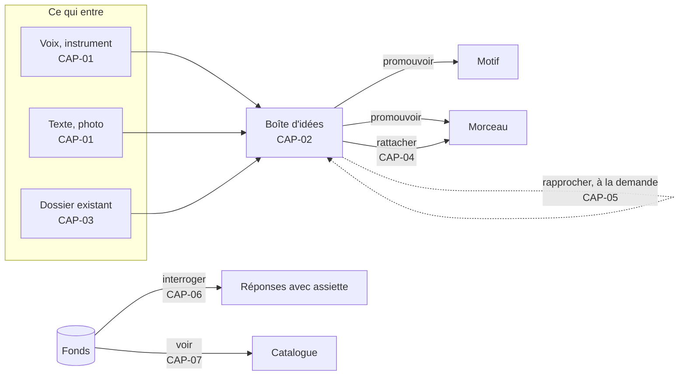

# 21 — CAP · Capter et organiser le fonds

Tout commence par une idée qui arrive, et la peur de la perdre. Ce module couvre ce qui
entre dans le fonds — par la capture ou par l'import — et ce qui permet de s'y retrouver.

---

### CAP-01 · Capter en un geste

| | |
|---|---|
| **Objet** | Enregistrer une idée sonore, écrire une note ou photographier une page, en un geste, n'importe où, sans réseau |
| **Échelle · moment** | É0 · M1 |
| **Appareils** | 📱 conçu pour · 💻 ✅ · 📖 — |
| **Besoins** | B01 |
| **Lit · écrit** | Écrit une **captation** (audio ou photo) dans le stockage local, et une **idée** dans le fonds |

**Règles**
- Un toucher sur « Enregistrer » démarre l'enregistrement. Chaque capture, enregistrer,
  noter ou photographier, crée d'office une idée neuve, de provenance `captee`, avec sa date
  et l'appareil où elle naît ([§ 30 · 8.1](../30-modele-de-domaine.md#81-la-provenance)) ;
  sa prise porte sa durée. Aucun nom n'est demandé, et rien n'est regroupé ni relié
  d'office.
- L'audio s'écrit **au fil de l'eau**, par tranches de quelques secondes : un appel
  entrant, une batterie vide ou une application fermée ne coûtent que les dernières
  secondes.
- L'audio est gardé dans le format d'enregistrement du système, jamais réencodé.
- Une analyse légère est **proposée** ([ECO-06](27-ecoute-et-compagnon.md#eco-06--fredonner-une-mélodie)),
  jamais imposée.
- Hors ligne, tout fonctionne. Tant que le nœud n'a pas accusé réception de sa captation,
  l'idée se montre « à envoyer »
  ([SYN-04](29-socle-donnees-appareils.md#syn-04--acheminer-les-captations)) : cet état est
  celui de l'appareil, et ne s'écrit pas dans le fonds. Tant qu'aucun nœud n'est appairé,
  l'état dit « Sans nœud », et rien ne se montre ainsi
  ([§ 31 · 4.3](../31-persistance-et-synchronisation.md#43-létat-visible-de-la-synchronisation)).

**Ne fait pas** — ne demande ni titre, ni étiquette, ni rattachement ; ne notifie pas, hors
la notice qu'Android impose pendant un enregistrement au premier plan (I29).

**Cas limites**
- Stockage presque plein : Pupitre prévient avant de commencer et indique la durée
  disponible.
- Micro refusé : Pupitre explique comment l'autoriser et propose le texte ou la photo.
- Une seconde ou trente minutes : acceptées. Aucune durée minimale ni maximale.
- Fonds d'une version de schéma plus récente que l'application : une prise ou une photo
  s'écrit, et son idée naît après la mise à jour
  ([§ 31 · 2.4](../31-persistance-et-synchronisation.md#24-la-version-de-schéma)), selon ce
  qu'en dira la PR de conception du lot 2 ; une note en texte est refusée, et Pupitre dit de
  mettre l'application à jour.

**Critères d'acceptation**
1. *Étant donné* le carnet en mode avion, *quand* Sacha touche « Enregistrer » puis
   « Arrêter », *alors* une idée datée existe, avec sa captation, sans aucun appel réseau.
2. *Étant donné* un enregistrement en cours depuis 20 s, *quand* l'application est tuée,
   *alors* à la réouverture l'idée existe avec au moins 18 s d'audio.
3. *Étant donné* une captation enregistrée, *alors* son empreinte recalculée égale son nom
   de stockage.
4. *Quand* une capture se termine, *alors* aucune demande de titre, d'étiquette ou de
   rattachement n'apparaît.
5. `[à l'œil]` Du téléphone verrouillé au début de l'enregistrement : ≤ 3 s (IR-1, 🔶 H01).
   Le délai entre le toucher et le premier échantillon enregistré est mesuré
   automatiquement, ≤ 300 ms.
6. *Quand* Sacha note une idée à l'établi, *alors* elle existe, datée, de provenance
   `captee`, née sur l'établi, sans prise ni durée.

---

### CAP-02 · Trier la boîte d'idées

| | |
|---|---|
| **Objet** | Écouter, étiqueter, relier, regrouper, retirer et promouvoir les idées, quand Sacha le décide |
| **Échelle · moment** | É0 · M1, M3 |
| **Appareils** | 💻 conçu pour · 📱 ✅ · 📖 — |
| **Besoins** | B02 |
| **Lit · écrit** | Idées, liens, et l'idée de chaque prise, de chaque photo, de chaque MIDI versé seul et de chaque texte versé, dans le fonds (décisions) |

**Règles**
- Une idée non reliée est un **objet légitime et durable**, pas une tâche en souffrance
  ([ADR-006](../adr/adr-006-le-partiel-est-normal.md)).
- Gestes : écouter une prise, et les **gestes de tri**, qui écrivent : compléter le texte ;
  étiqueter (poser ou ôter une étiquette libre) ; **relier** à une autre idée, un motif ou
  un morceau, et délier ; **regrouper** des prises comme versions d'une même idée, avec les
  photos, les MIDI versés et les textes versés qui vont avec ; **retirer** une idée, et la
  rétablir. À côté, **promouvoir** en motif ou en morceau.
- Une relation, un mécanisme
  ([§ 30 · 9.3](../30-modele-de-domaine.md#93-regrouper-et-relier)) :
  - **regrouper** verse des prises, des photos, des MIDI versés seuls ou des textes versés
    dans une autre idée, qui les contient désormais : rien n'est copié, et chaque captation
    reste distincte. Une idée que le geste laisse sans rien est retirée avec lui ;
  - **relier** pose un lien « apparenté à ». Une idée est **reliée** quand elle porte au
    moins un lien vers ce qui n'est pas une idée retirée ;
  - « versions d'une même idée » n'est pas un lien, et un lien ne regroupe rien.
- **Retirer** ôte l'idée de la boîte et des requêtes sans rien effacer : la liste des idées
  retirées la rétablit d'un geste, telle qu'elle était
  ([§ 30 · 9.1](../30-modele-de-domaine.md#91-lidée)). La suppression définitive sera une
  opération destructrice explicite, conçue plus tard.
- **Annuler** défait le dernier geste de tri, par l'opération inverse, nommée à son tour
  (« Annulé : Idée du 3 novembre : étiquette #pont posée »,
  [§ 30 · 11](../30-modele-de-domaine.md#11-journal-décisions-questions)). Annuler ne vise
  que le dernier geste de tri fait sur l'appareil depuis l'ouverture ; une note, une requête
  enregistrée, un import ou une déclaration ne le visent ni ne le remplacent ; une
  annulation faite, un second « annuler » est refusé, et le dit. Un geste refusé ne change
  pas ce qu'annuler vise, et une clé en conflit avant le geste revient à sa seule valeur
  présentée. Une capture faite par erreur ne s'annule pas : elle se retire.
- Promouvoir crée l'objet, y verse la matière de l'idée (sa prise devient la première
  prise), et **garde l'idée**, reliée à ce qu'elle est devenue.
- La boîte se trie par date, étiquette, durée, état (reliée ou non) et provenance (captée ou
  importée, [§ 30 · 8.1](../30-modele-de-domaine.md#81-la-provenance)), et se filtre par ce
  que l'idée contient : texte, prise, photo, MIDI versé, texte versé. La durée d'une idée
  est celle de sa prise la plus longue, et `—` dès qu'une de ses prises n'a pas encore la
  sienne ([§ 30 · 9.2](../30-modele-de-domaine.md#92-prises-photos-et-analyses)) ; une idée
  sans durée se range à part, jamais exclue.

**Ne fait pas** — ne relance pas, ne compte pas les jours, ne propose pas de « vider la
boîte », ne regroupe ni ne relie rien d'office, ne supprime jamais une prise sans opération
destructrice explicite.

**Cas limites**
- Deux mille idées, la taille visée du fonds
  ([§ 31 · 2](../31-persistance-et-synchronisation.md#2-les-documents)) : la liste reste
  fluide (affichage virtualisé).
- Une idée promue dans deux morceaux : permis, deux liens.
- Regrouper la seule prise d'une idée qui garde un texte, une étiquette ou un lien : l'idée
  reste, sans prise ; la retirer est un geste de plus.
- Une idée retirée garde ses liens, mais ne relie plus : l'idée qu'elle joignait redevient
  non reliée si elle n'a pas d'autre lien, et reliée au rétablissement.
- Relier une idée à elle-même : refusé, et Pupitre le dit.

**Critères d'acceptation**
1. *Étant donné* 50 idées non reliées depuis des mois, *alors* aucun compteur d'ancienneté,
   aucune alerte, aucun badge n'est affiché.
2. *Quand* Sacha promeut une idée en morceau, *alors* le morceau existe, sa première prise
   est celle de l'idée, et l'idée existe toujours, reliée au morceau.
3. *Quand* deux prises de deux idées sont regroupées, *alors* elles appartiennent à la même
   idée, chacune reste une captation distincte, d'empreinte inchangée, et la boîte les
   montre ensemble.
4. Chaque geste de tri apparaît au journal du fonds comme une opération nommée.
5. *Quand* Sacha retire une idée, *alors* elle quitte la boîte et les requêtes, les
   empreintes de ses captations sont inchangées, et la rétablir la rend telle qu'elle
   était : texte, étiquettes, liens, prises, photos, MIDI et textes versés.
6. *Quand* Sacha annule le dernier geste de tri, *alors* le fonds revient à son état d'avant
   ce geste, et le journal du fonds porte le geste puis son annulation, chacun comme une
   opération nommée.
7. *Étant donné* deux répliques du fonds qui relient hors ligne les deux mêmes idées, l'une
   de A vers B, l'autre de B vers A, *quand* elles fusionnent, *alors* un seul lien les
   joint.
8. *Quand* la seule prise d'une idée qui n'a rien d'autre est regroupée dans une autre idée,
   *alors* l'idée vidée est retirée par le même geste ; annuler ce geste rend la prise à son
   idée, rétablie.

---

### CAP-03 · Importer un fonds existant

| | |
|---|---|
| **Objet** | Faire entrer en une fois un dossier de démos, de fichiers MIDI, de textes et d'éventuelles analyses déjà produites |
| **Échelle · moment** | Fonds · M1 |
| **Appareils** | 💻 conçu pour · 📱 — · 📖 — |
| **Besoins** | B02, B04, B10 |
| **Lit · écrit** | Écrit des **captations**, des **idées** et des **propositions** importées, et ce que Sacha déclare à l'import ; aucune décision musicale |

**Règles**
- Tout format audio que le nœud sait décoder est accepté, et **versé tel quel**. À l'import,
  un fichier se reconnaît audio ou MIDI à sa signature, texte à son extension ; l'établi lit
  seul l'en-tête d'un WAV et celui d'un MIDI, et les autres faits valent `—` jusqu'à ce que
  le nœud sache les décoder ([ADR-024](../adr/adr-024-import-d-un-fonds.md)).
- Le **nom d'origine est conservé** exactement, espaces et apostrophes compris : c'est
  souvent la seule clé qui relie un fichier à d'autres traces. Un fichier versé garde tous
  ses noms d'origine, chacun avec son chemin dans le dossier versé ; le premier vu
  s'affiche. Le nom d'origine d'une prise en stems est celui de son dossier.
- **Dédoublonnage par empreinte** : un même contenu sous deux noms donne un objet et deux
  noms d'origine. Un contenu déjà connu garde ce qu'il était, et prend en plus son rôle
  nouveau : un WAV versé en prise, puis comme stem d'un jeu de stems, reste la prise de son
  idée.
- **Avant de rien verser**, Sacha fait ses déclarations, dossier par dossier, et Pupitre
  compare la taille à verser à la place libre.
- Un dossier que Sacha déclare **jeu de stems** devient une seule prise, la
  **prise en stems** : chaque fichier audio en est un stem, et le MIDI qui porte son nom
  l'accompagne. Pupitre propose de déclarer ainsi un dossier dont au moins deux fichiers WAV
  ont la même durée, sans jamais le faire d'office. Le type d'un stem (voix, batterie,
  basse…) se propose d'après son nom, et se décide d'un geste.
- Sacha peut déclarer l'**origine** d'un dossier versé, à l'import ou plus tard : de sa
  main, ou produite par un générateur externe, qu'il nomme. Elle vaut pour ses
  sous-dossiers, sauf ceux qu'il déclare à part ; plus tard, elle porte aussi sur une prise,
  un MIDI versé seul ou un texte versé. Non déclarée, elle vaut `—`. Elle se range par
  empreinte : un même contenu n'en a qu'une, la plus forte de celles qu'il a reçues, à
  quelque rôle que ce soit (générée, puis de la main de Sacha, puis `—`), et le rapport dit
  chaque origine qu'un import change. Déclarée générée, elle se garde à vie : elle ne se
  retire pas. Pupitre ne la déduit jamais d'un nom ni d'une métadonnée.
- Un fichier **MIDI** devient une captation : il accompagne le stem dont il porte le nom,
  ou, **MIDI versé seul**, appartient à une idée. Sa mélodie devient une **proposition**
  (provenance `importee`) en INC-2, dans un morceau ; d'ici là, l'établi en montre le format
  et la division. Son tempo n'est jamais cru d'office : un fichier peut porter un tempo
  nominal faux ; la lecture se fait au tempo du morceau.
- Un **texte** (texte brut, Markdown, ChordPro) devient une captation d'une idée, le **texte
  versé**, que l'établi montre tel quel. En INC-2, il devient des lignes **proposées** d'un
  morceau, sans provenance d'auteur présumée.
- Des **analyses existantes** (tableaux produits par un outil antérieur) s'importent comme
  **propositions**, avec leurs confiances si elles en portent, selon un mappage de colonnes
  déclaré par Sacha. Elles entrent en INC-2 ; avant, un tableau est ignoré.
- Ce qui n'est ni audio, ni MIDI, ni texte (une archive, un PDF, une image, les métadonnées
  d'un générateur) est **ignoré** : rien n'en est ouvert, aucune archive n'est dépliée.
- **Aucun rattachement automatique** : l'import crée une idée par prise, par MIDI versé seul
  et par texte versé, n'en regroupe aucune d'office, même d'un même dossier, et ne crée
  jamais de liens vers des morceaux, même quand les noms se ressemblent. Les rapprochements
  se demandent ([CAP-05](#cap-05--rapprocher-des-idées-et-des-prises)).
- Un **rapport d'import** compte les fichiers vus, versés, dédoublonnés, illisibles et
  ignorés, avec leurs octets, et se fige en captation à la fin de l'import ; l'opération
  nommée qui clôt l'import le nomme. On vérifie un import par la comparaison des comptes,
  jamais par l'absence de message d'erreur.
- Une prise versée s'écoute par la **lecture simple** de l'appareil, stem par stem pour une
  prise en stems. Une prise qu'elle ne sait pas jouer montre ses faits et « lecture
  impossible sur cet appareil », sans erreur.

**Ne fait pas** — ne renomme pas, ne convertit pas, ne normalise pas le volume, ne décide
aucune valeur ; ne déplie aucune archive, ne lit aucune métadonnée de générateur, ne déduit
aucune origine.

**Cas limites**
- Fichier illisible : versé quand même comme captation, marqué « non décodable ». On ne
  jette pas une prise parce qu'un décodeur a échoué.
- Arborescence profonde, noms longs ou en Unicode : acceptés.
- Import interrompu : reprenable, sous le même identifiant ; l'import est idempotent.
- Stem sans MIDI : un état normal ([ADR-006](../adr/adr-006-le-partiel-est-normal.md)), que
  le rapport ne compte pas comme une erreur.
- Place insuffisante : rien n'est versé, et Pupitre dit la taille à verser et ce qui manque.

**Critères d'acceptation**
1. *Étant donné* un dossier de 80 fichiers dont 3 doublons de contenu, *quand* il est
   importé, *alors* 77 captations sont versées, chaque idée créée porte l'identifiant de
   l'import, et le rapport indique 80 vus, 77 versés, 3 dédoublonnés, avec les octets de
   chaque catégorie.
2. *Quand* le même dossier est importé deux fois, *alors* aucune captation versée ni aucune
   idée de plus n'est créée : seul s'ajoute le rapport du second import.
3. *Étant donné* un fichier nommé `Démo d'hiver 2 - 01_06_2015 18.42.m4a`, *alors* son nom
   d'origine est relu intact.
4. *Étant donné* des fichiers dont les noms ressemblent aux titres de morceaux existants,
   *quand* ils sont importés, *alors* le nombre de rattachements créés est zéro.
5. *Étant donné* un fichier MIDI au tempo nominal de 120 BPM, rattaché à un morceau décidé
   à 85 BPM, *alors* sa mélodie se lit à 85 BPM.
6. *Quand* un tableau d'analyses est importé, *alors* toutes ses valeurs sont des
   propositions, et le nombre de décisions créées est zéro.
7. *Étant donné* un dossier déclaré jeu de stems, de 10 fichiers WAV et de 9 fichiers MIDI
   qui portent leurs noms, *quand* il est importé, *alors* une prise existe, dans une seule
   idée, avec 10 stems dont 9 accompagnés de leur MIDI, et le type de chaque stem est
   proposé, aucun décidé ; l'importer une seconde fois ne verse rien de plus.
8. *Quand* Sacha importe un dossier dont 3 fichiers WAV ont la même durée, *alors* Pupitre
   lui propose, avant de rien verser, de le déclarer jeu de stems ; *s'il* ne le déclare
   pas, 3 prises existent.
9. *Étant donné* un dossier déclaré produit par un générateur externe, *alors* chacune de
   ses prises porte cette origine, la retirer est refusé, et le reverser déclaré de la main
   de Sacha la laisse générée ; *étant donné* un dossier non déclaré, l'origine de ses
   prises vaut `—`.
10. *Étant donné* un même contenu sous deux noms, dans deux sous-dossiers, *alors* un objet
    existe, avec ses deux noms d'origine et leurs chemins.
11. *Étant donné* un dossier qui contient une archive zip et un PDF, *quand* il est importé,
    *alors* aucun des deux n'est ouvert, et le rapport les compte parmi les ignorés, avec
    leurs octets.
12. *Étant donné* une prise que la lecture simple de l'appareil ne sait pas jouer, *quand*
    Sacha l'écoute, *alors* l'établi montre ses faits et « lecture impossible sur cet
    appareil », et aucune erreur.
13. *Étant donné* un dossier plus lourd que la place libre, *quand* Sacha l'importe, *alors*
    rien n'est versé, et Pupitre dit la taille à verser et ce qui manque.

---

### CAP-04 · Rattacher une prise à un morceau

| | |
|---|---|
| **Objet** | Dire qu'une prise est la référence, une version, une prise de travail ou une maquette d'un morceau |
| **Échelle · moment** | É4 · M1 |
| **Appareils** | 💻 ✅ · 📱 ✅ · 📖 — |
| **Besoins** | B02, B15 |
| **Lit · écrit** | Rattachement dans le document du morceau (décision) |

**Règles**
- Rôles : `référence` (au plus une par morceau), `version`, `travail`, `maquette`,
  `maquette générée`.
- Une prise peut être rattachée à plusieurs morceaux, ou à aucun.
- Un rattachement peut porter une **carte de temps**
  ([MOR-03](24-morceau.md#mor-03--découper-une-prise-à-loreille)).

**Ne fait pas** — ne devine jamais un rattachement.

**Cas limites**
- Seconde référence : refusée, en nommant la référence actuelle.
- Morceau abandonné : ses rattachements sont conservés.

**Critères d'acceptation**
1. *Étant donné* un morceau, *alors* il accepte sept prises rattachées et exactement une
   référence.
2. *Quand* Sacha déclare une seconde référence, *alors* l'opération échoue et nomme la
   première.
3. *Étant donné* une prise rattachée à deux morceaux, *alors* elle figure dans les deux.
4. *Quand* le rôle d'une prise change, *alors* le journal du morceau porte l'opération.

---

### CAP-05 · Rapprocher des idées et des prises

| | |
|---|---|
| **Objet** | Proposer, à la demande, des parentés : « ces deux prises semblent la même idée », « ce motif ressemble au refrain de tel morceau » |
| **Échelle · moment** | Fonds, É0 · M2 |
| **Appareils** | 💻 ✅ · 📱 ✅ · 📖 — |
| **Besoins** | B02 |
| **Lit · écrit** | Lit mélodies, grilles et formes, décidées ou proposées ; un rapprochement accepté regroupe des prises ou écrit un lien |

**Règles**
- Trois similarités, **rendues séparément** : mélodique (contour et intervalles, insensible
  à la transposition), harmonique (suite de degrés), de forme (longueurs de sections).
  Jamais un score unique.
- À la demande, depuis une idée, un motif, un morceau ou tout le fonds.
- Chaque rapprochement est une **proposition**. Accepter « ces deux prises semblent la même
  idée » les regroupe dans l'idée de l'une d'elles, au choix de Sacha
  ([CAP-02](#cap-02--trier-la-boîte-didées)) ; accepter une autre parenté crée un lien
  « apparenté à » ([§ 30 · 9.3](../30-modele-de-domaine.md#93-regrouper-et-relier)).
- Le constat de squelette partagé entre deux morceaux (DG-A8) emploie les mêmes mesures.

**Ne fait pas** — ne fusionne pas, ne conclut pas au doublon, ne qualifie pas une parenté
de problème.

**Cas limites**
- Prise sans mélodie connue : rapprochement harmonique seul, ou aucun, et Pupitre le dit.
- Fonds de 500 prises : calcul sur le nœud, résultat différé.

**Critères d'acceptation**
1. *Étant donné* deux prises d'une même mélodie, à un ton l'une de l'autre (jeu de test),
   *alors* leur similarité mélodique est ≥ 0,9.
2. *Alors* les trois similarités sont affichées séparément, et aucun score global.
3. *Alors* aucun libellé ne contient « doublon » ni « problème ».
4. *Quand* une recherche de rapprochements porte sur tout le fonds, *alors* aucun lien
   n'est créé et aucune prise ne change d'idée tant que Sacha n'en accepte aucun.

---

### CAP-06 · Interroger le fonds

| | |
|---|---|
| **Objet** | Répondre aux questions qu'on ne peut pas poser à un fichier audio |
| **Échelle · moment** | Fonds · M2, M6 |
| **Appareils** | 💻 ✅ · 📱 ✅ · 📖 ✅ résultats en lecture |
| **Besoins** | B02 |
| **Lit · écrit** | Lit les dérivés de recherche ; n'écrit rien, sauf une requête enregistrée, dans le document du fonds |

**Règles**
- Sortes de requêtes :
  - **par attribut d'une idée** : date, étiquette, durée, état (reliée ou non), provenance,
    ce qu'elle contient (texte, prise, photo, MIDI versé, texte versé) ;
  - **par attribut d'un morceau** : tonalité, tempo, durée, nombre de mesures, intensité,
    statut, maturité, type de section présent ou absent, langue ;
  - **par motif harmonique** : une suite de degrés (« IV–iv–I »), cherchée dans toutes les
    grilles, pour chaque candidat quand la tonalité est indécise ;
  - **par motif mélodique** : un contour ou une suite d'intervalles ;
  - **par texte** : dans le texte des idées et dans les lignes, filtrable par provenance.
    Chaque mot cherché doit paraître, entier ou en fragment, dans le texte de l'idée ou de la
    ligne, sans égard à la casse ni aux accents : « eglise » trouve « Église », « oe »
    trouve « œ » ;
  - **par provenance** : « tout ce qui vient d'une piste générative ».
- **Toute réponse déclare son assiette** : « 3 morceaux en mi mineur · 6 dont la tonalité
  n'est pas décidée · 41 interrogés ».
- Un résultat ouvre l'objet **à l'endroit trouvé** (la mesure, la ligne).
- Une idée retirée n'est interrogée par aucune requête, et ne compte dans aucune assiette
  ([CAP-02](#cap-02--trier-la-boîte-didées)).
- Une **requête enregistrée** garde un nom et ses critères, jamais ses résultats ni leur
  nombre : ils s'engendrent à chaque ouverture. Elle vit dans le document du fonds, avec ce
  qu'elle interroge
  ([§ 30 · 13](../30-modele-de-domaine.md#13-ce-que-le-modèle-interdit-de-stocker)).
  Enregistrer, renommer et supprimer une requête sont des opérations nommées du journal du
  fonds ([§ 30 · 11](../30-modele-de-domaine.md#11-journal-décisions-questions)) ; ce ne
  sont pas des gestes de tri.

**Ne fait pas** — ne classe pas par pertinence ; ne cherche pas dans l'audio brut ; ne
cherche pas dans l'encre.

**Cas limites**
- Attribut non renseigné : les objets concernés sont comptés à part, jamais exclus en
  silence.
- Recherche sur des propositions : les résultats sont marqués `~`.

**Critères d'acceptation**
1. *Quand* Sacha cherche les morceaux en mi mineur, *alors* la réponse liste les morceaux
   trouvés **et** donne le nombre de morceaux dont la tonalité est indécise ou absente.
2. *Étant donné* une grille de 150 mesures contenant IV–iv–I aux mesures 37 à 39, *quand*
   Sacha cherche cette suite, *alors* le résultat pointe la mesure 37 et l'ouvre.
3. *Étant donné* un morceau à deux tonalités candidates, *alors* une requête harmonique
   rend un jeu de résultats par candidat.
4. *Quand* Sacha cherche « tout ce qui vient d'une piste », *alors* la liste égale
   exactement l'ensemble des éléments de provenance `suggeree`.
5. *Étant donné* le carnet hors ligne, *alors* toutes les requêtes fonctionnent.
6. *Étant donné* un fonds de 300 morceaux et 2 000 idées, *quand* Sacha cherche par
   attribut ou par texte, *alors* les résultats s'affichent en moins d'une seconde sur le
   téléphone de référence ; retrouver l'élément voulu prend au plus 10 s, `[à l'œil]`
   (IR-3).
7. *Étant donné* 12 idées, dont 3 sans prise et 4 dont une prise dure plus d'une minute,
   *quand* Sacha cherche les idées de plus d'une minute, *alors* la réponse liste ces 4
   idées et déclare son assiette : « 4 idées · 3 sans durée · 12 interrogées ».
8. *Étant donné* une idée retirée dont le texte contient le mot cherché, *quand* Sacha le
   cherche, *alors* elle n'est pas dans la réponse, et l'assiette ne la compte pas.
9. *Étant donné* une idée dont une prise dure 30 s et une autre n'a pas de durée lue,
   *quand* Sacha cherche les idées de plus d'une minute, *alors* elle compte parmi les « sans
   durée ».
10. *Étant donné* une idée dont le texte est « Église du port », *quand* Sacha cherche
    « eglise », *alors* elle est dans la réponse.

---

### CAP-07 · Voir le fonds

| | |
|---|---|
| **Objet** | Le catalogue de toute la matière : idées, morceaux, albums, avec leur statut et leur maturité |
| **Échelle · moment** | Fonds · M1 |
| **Appareils** | 💻 ✅ · 📱 ✅ · 📖 ✅ |
| **Besoins** | B02, B03 |
| **Lit · écrit** | Lit ; n'écrit rien |

**Règles**
- Une ligne par morceau : titre retenu ou « sans titre », statut, tonalité, tempo, durée
  engendrée, **maturité** par dimension (six jauges sans couleur), dernière modification.
- Tri libre ; par défaut, la dernière modification. Jamais un ordre alphabétique imposé.
- La boîte d'idées affiche le nombre d'idées non reliées, sans ancienneté. Les idées
  retirées n'y comptent pas ; leur liste est à un geste, et chacune s'y rétablit.
- L'état de synchronisation est toujours visible
  ([§ 31 · 4.3](../31-persistance-et-synchronisation.md#43-létat-visible-de-la-synchronisation)) ;
  dès qu'un nœud est appairé, il donne le nombre de captations à envoyer. La santé du nœud
  est à un geste.
- La maquette de l'écran est au [§ 50 · 3.1](../50-interfaces-et-appareils.md#31-le-fonds).

**Ne fait pas** — ne note pas les morceaux ; ne met rien en avant « à travailler
aujourd'hui ».

**Cas limites**
- Fonds vide : une page explique les premiers gestes (capter, importer, créer). Dans un
  Pupitre neuf, dont la racine des données n'a encore aucun document
  ([§ 31 · 2.3](../31-persistance-et-synchronisation.md#23-la-genèse-et-le-point-de-départ-du-fonds)),
  elle propose aussi de réimporter une archive complète
  ([SYN-07](29-socle-donnees-appareils.md#syn-07--exporter-et-importer) · 4).
- Morceau à identité seule : une ligne lisible, avec des `—`.

**Critères d'acceptation**
1. *Étant donné* un morceau à identité seule, *alors* sa ligne s'affiche sans erreur, avec
   des `—`.
2. *Alors* les six jauges de maturité restent distinguables en noir et blanc pur (I17).
3. *Quand* un morceau est ajouté, *alors* le nombre affiché change sans qu'aucun compteur
   ne soit écrit.
4. *Quand* Sacha ajoute, relie, délie, retire ou rétablit une idée, *alors* le nombre
   d'idées non reliées affiché égale le nombre des idées non retirées qu'aucun lien ne joint
   à ce qui n'est pas une idée retirée, sans qu'aucun compteur ne soit écrit. *Étant donné*
   deux idées non reliées, *quand* Sacha les relie, *alors* ce nombre baisse de deux.
