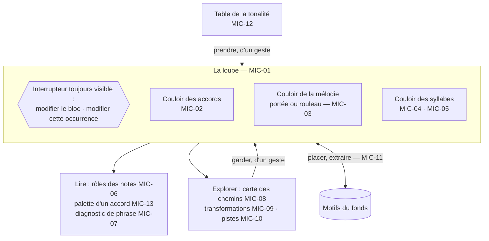

# 22 — MIC · Motif et phrase

L'échelle la plus fine : un accord, une note, une syllabe, une ligne. C'est là que Sacha
passe le plus de temps à hésiter, et là que l'outil doit être le plus discret : montrer,
faire entendre, proposer **sur demande**, et ne rien changer sans geste.

---

### MIC-01 · Ouvrir la loupe

| | |
|---|---|
| **Objet** | Travailler une à huit mesures en grand : un motif libre, ou une plage d'un bloc avec la ligne d'une occurrence |
| **Échelle · moment** | É1, É2 · M3 |
| **Appareils** | 💻 conçu pour · 📱 ✅ un couloir à la fois · 📖 — |
| **Besoins** | B05 |
| **Lit · écrit** | Matériau d'un motif ou d'un bloc ; lignes de l'occurrence choisie |

**Règles**
- Trois couloirs alignés sur les mêmes mesures : accords, mélodie (portée ou rouleau de
  piano, au choix), syllabes sous les notes.
- Le **contexte** reste visible : la mesure d'avant et celle d'après, en lecture seule.
- Ouverte sur une plage d'un bloc, la loupe modifie **le bloc** (donc toutes ses
  occurrences), sauf si Sacha bascule l'interrupteur sur **« cette occurrence »** : la
  modification devient alors un écart ([SEC-02](23-section.md#sec-02--faire-varier-une-occurrence)).
  L'interrupteur est toujours visible : on ne modifie jamais trois refrains par mégarde.
- La plage s'écoute en boucle ([ECO-01](27-ecoute-et-compagnon.md#eco-01--écoute-de-contrôle)).
- Maquette : [§ 50 · 3.3](../50-interfaces-et-appareils.md#33-la-loupe--motif-ou-phrase).

**Ne fait pas** — n'ouvre pas plus de huit mesures : au-delà, c'est la vue de section.

**Cas limites**
- Motif vide : la loupe s'ouvre sur quatre mesures à 4/4, prêtes à recevoir.
- Plage à cheval sur deux blocs : refusée ; Pupitre propose une loupe par bloc.

**Critères d'acceptation**
1. *Quand* la loupe s'ouvre sur les mesures 5 à 8 d'un bloc, *alors* les mesures 4 et 9
   s'affichent en contexte, non modifiables.
2. *Étant donné* l'interrupteur sur « bloc », *quand* Sacha change un accord, *alors*
   toutes les occurrences sans écart sur cet accord changent.
3. *Étant donné* l'interrupteur sur « cette occurrence », *quand* Sacha fait le même geste,
   *alors* un écart est créé dans l'occurrence seule, et le bloc est inchangé.
4. *Alors* l'interrupteur est visible dans tous les états de la loupe.

---

### MIC-02 · Saisir et éditer des accords

| | |
|---|---|
| **Objet** | Entrer et corriger des accords à leur place : au clavier, au toucher, ou depuis l'instrument |
| **Échelle · moment** | É1 · M3 |
| **Appareils** | 💻 conçu pour · 📱 ✅ · 📖 — |
| **Besoins** | B05 |
| **Lit · écrit** | Écrit des **événements d'accord** (objets harmoniques) |

**Règles**
- Sacha saisit dans sa notation : `Em`, `F#m7`, `Bb/D`, `Gsus4`. Le noyau en fait un
  **objet harmonique** ; l'orthographe saisie est conservée
  ([ADR-008](../adr/adr-008-hauteurs-relatives.md)).
- La préférence d'orthographe ([SYN-09](29-socle-donnees-appareils.md#syn-09--régler-ses-préférences))
  ne s'applique qu'aux noms engendrés (transposition, carte des chemins, pistes, imports) ;
  une orthographe saisie prime toujours.
- Plusieurs accords par mesure, à n'importe quel temps ; la grille de saisie se règle au
  temps ou au demi-temps.
- Accord hors tonalité : accepté, marqué emprunt `*`. Accord hors vocabulaire : accepté
  comme ensemble de notes, sans degré.
- Depuis l'instrument, [ECO-03](27-ecoute-et-compagnon.md#eco-03--nommer-un-accord-joué)
  insère l'accord gardé à la position courante.
- Trois états distincts : **absent** `—`, **silence** `N.C.`, **inconnu** `?`.
- Le degré et la fonction s'affichent, engendrés ; pour chaque candidat si la tonalité est
  indécise.

**Ne fait pas** — ne refuse aucun enchaînement ; ne corrige aucune orthographe ; ne stocke
aucun nom d'accord.

**Cas limites**
- Saisie ambiguë (`Cm6` ou `Am7b5/C`) : l'orthographe saisie prime, l'autre lecture est
  montrée.
- Tonalité indécise : un degré par candidat.

**Critères d'acceptation**
1. *Étant donné* un morceau en si mineur décidé, *quand* Sacha saisit `Em`, *alors*
   l'affichage est « Em · iv · sous-dominante » et aucun champ du document ne contient la
   chaîne `Em`.
2. *Quand* la tonalité décidée change, *alors* tous les degrés affichés changent sans
   nouvelle saisie.
3. *Quand* le morceau est transposé d'un demi-ton, *alors* tous les noms affichés changent
   et seule la tonique de référence change dans le document (I02).
4. *Alors* une mesure absente, une mesure `N.C.` et une mesure à accord inconnu sont
   distinguables dans tous les rendus, en noir et blanc pur.
5. *Étant donné* `F#m` saisi mesure 3 et `Gbm` mesure 7, *alors* chacun reste orthographié
   tel que saisi.

---

### MIC-03 · Saisir et éditer une mélodie

| | |
|---|---|
| **Objet** | Écrire et corriger une ligne mélodique : pas à pas, à la souris, ou depuis un fredonnement |
| **Échelle · moment** | É1 · M3 |
| **Appareils** | 💻 conçu pour · 📱 ✅ · 📖 — |
| **Besoins** | B05 |
| **Lit · écrit** | Écrit des **notes** : hauteur relative à la tonique de référence, position, durée, provenance |

**Règles**
- Trois entrées : **pas à pas** au clavier (`D4 croche`, `F#4 noire`) ; **rouleau de
  piano** (placer, glisser, étirer) ; **fredonnement**
  ([ECO-06](27-ecoute-et-compagnon.md#eco-06--fredonner-une-mélodie)), qui donne des
  propositions.
- La **portée est un rendu lié** : toucher une note sur la portée la sélectionne dans le
  modèle. On ne déplace pas une tête de note au pixel.
- La saisie se cale sur une grille réglable (noire, croche, triolet, double croche). Rien
  n'est requantifié après coup sans geste : « aligner sur la grille » est une
  transformation explicite et annulable.
- Une note **proposée** garde son statut jusqu'à son acceptation. Une note probablement
  fausse (hors tessiture, chevauchement) est **marquée**, jamais supprimée.
- L'orthographe des altérations suit la tonalité décidée ; l'enharmonie se force d'un geste.

**Ne fait pas** — ne grave pas ; ne quantifie pas d'office ; ne complète pas une mélodie.

**Cas limites**
- Deux notes simultanées dans une ligne de chant : acceptées, marquées improbables.
- Mélodie sans grille d'accords : valide.

**Critères d'acceptation**
1. *Étant donné* 103 notes proposées, *quand* toutes sont acceptées, *alors* la mélodie
   compte 103 notes : aucune ajoutée, aucune retirée.
2. *Quand* Sacha saisit `D4 croche` puis `F#4 noire`, *alors* deux notes contiguës existent,
   de 480 et 960 ticks.
3. *Quand* Sacha touche une note sur la portée, *alors* la même note est sélectionnée dans
   le rouleau de piano.
4. *Alors* seule l'opération « aligner sur la grille » modifie des positions existantes,
   et elle s'annule.
5. *Étant donné* une mélodie venue d'un MIDI importé, *quand* une hauteur est corrigée,
   *alors* l'empreinte de la captation MIDI est inchangée.

---

### MIC-04 · Écrire une ligne et ses variantes

| | |
|---|---|
| **Objet** | Écrire le vers d'une phrase, garder plusieurs variantes à la même place, et savoir d'où vient chacune |
| **Échelle · moment** | É2 · M3 |
| **Appareils** | 💻 conçu pour · 📱 ✅ · 📖 — |
| **Besoins** | B05, B10 |
| **Lit · écrit** | Écrit des **lignes** : texte, langue, emplacement, provenance, mère ; et, dans l'occurrence, le registre `retenues` (la ligne rendue par emplacement) |

**Règles**
- Une ligne a un identifiant **stable à vie** ; son texte est une valeur atomique.
- **Variantes** : plusieurs lignes au même emplacement ; une seule est **retenue** (rendue
  dans les fiches). Le choix ne se marque pas sur la ligne : il s'écrit dans le registre
  `retenues` de l'occurrence, et le changer est une opération nommée. Deux choix concurrents
  pour un même emplacement sont un conflit, présenté « à trancher »
  ([SYN-03](29-socle-donnees-appareils.md#syn-03--trancher-les-conflits)).
- **Retoucher** crée une ligne fille qui pointe vers sa mère ; la mère reste lisible, et la
  chaîne se remonte entièrement.
- Ce que Sacha tape est `saisie`. Une ligne importée ou transcrite est d'abord une
  **proposition**, sans provenance d'auteur présumée.
- La langue est celle du morceau par défaut, modifiable par ligne.
- Une ligne peut exister sans mélodie.

**Ne fait pas** — ne corrige ni l'orthographe ni la grammaire ; ne fusionne pas deux
lignes ; ne supprime pas une mère.

**Cas limites**
- Dix retouches : une chaîne de dix, consultable.
- Deux lignes identiques de provenances différentes : elles coexistent.
- Ligne orpheline après un raccourcissement : conservée, listée, réaffectable.

**Critères d'acceptation**
1. *Quand* Sacha retouche une ligne, *alors* une seconde ligne existe, liée à la première,
   et la première reste lisible.
2. *Étant donné* cinq retouches successives, *alors* la chaîne se remonte en entier, dans
   l'ordre, avec les dates.
3. *Étant donné* deux variantes au même emplacement, *alors* une seule apparaît dans la
   fiche ; changer la ligne retenue n'écrit que le registre `retenues` de l'occurrence, et
   la fiche change.
4. *Étant donné* une ligne contenant `=`, `|`, `#` et des guillemets, *alors* elle s'écrit,
   se synchronise, passe par le miroir et se relit à l'identique (I12).
5. *Étant donné* deux appareils qui retiennent hors ligne deux lignes différentes au même
   emplacement, *alors* après synchronisation les deux lignes existent, et l'emplacement est
   « à trancher ».

---

### MIC-05 · Aligner syllabes et notes

| | |
|---|---|
| **Objet** | Poser chaque syllabe sous sa note |
| **Échelle · moment** | É2 · M3 |
| **Appareils** | 💻 conçu pour · 📱 ✅ · 📖 — |
| **Besoins** | B06 |
| **Lit · écrit** | Écrit la **découpe syllabique** décidée et l'**alignement** syllabe → notes |

**Règles**
- La découpe est **proposée** selon la langue de la ligne — dictionnaire de prononciation
  pour l'anglais, règles pour le français avec le double compte du `e` muet — et se corrige
  d'un geste (fusionner, scinder).
- L'alignement est proposé (une syllabe par note, dans l'ordre), puis se corrige : glisser
  une syllabe sur une autre note ; **mélisme** (une syllabe, plusieurs notes) ; **élision**
  (plusieurs syllabes, une note).
- L'alignement vise des **identifiants de notes** : déplacer une note dans le temps garde sa
  syllabe.
- Chaque occurrence a son propre alignement : mêmes notes, autres paroles. Une occurrence
  qui reprend les paroles d'une autre ([SEC-02](23-section.md#sec-02--faire-varier-une-occurrence))
  en reprend l'alignement ; ses lignes propres ont le leur.

**Ne fait pas** — n'invente pas de syllabe ; ne déplace pas une note pour loger une
syllabe ; ne refuse pas un alignement « impossible ».

**Cas limites**
- Plus de syllabes que de notes : l'excédent est listé.
- Onomatopée sans voyelle : une syllabe par groupe de lettres.
- Pas de mélodie : l'alignement est impossible, Pupitre le dit, la ligne reste.

**Critères d'acceptation**
1. *Étant donné* une ligne de 8 syllabes et 8 notes, *alors* l'alignement proposé est
   complet, sans reste.
2. *Étant donné* 10 syllabes et 8 notes, *alors* 8 sont alignées et 2 listées en excédent ;
   la mélodie est inchangée.
3. *Alors* un mélisme d'une syllabe sur trois notes est valide et se rend sur la portée.
4. *Quand* une note est déplacée d'un temps, *alors* sa syllabe la suit.
5. *Quand* Sacha corrige une découpe, *alors* la correction persiste et se synchronise.

---

### MIC-06 · Lire la relation mélodie-harmonie

| | |
|---|---|
| **Objet** | Pour chaque note, dire son rôle par rapport à l'accord qui sonne |
| **Échelle · moment** | É1, É2 · M5 |
| **Appareils** | 💻 ✅ · 📱 ✅ · 📖 ✅ |
| **Besoins** | B06 |
| **Lit · écrit** | Lit mélodie, grille et tonalité effectives ; **n'écrit rien** |

**Règles**
- Rôle de chaque note : **note de l'accord** (appui) ; **tension** (neuvième, onzième,
  treizième : une couleur qui se tient) ; **note étrangère** (passage, broderie,
  appoggiature, échappée), avec sa résolution ou son absence de résolution.
- Une 9e, 11e ou 13e diatonique, tenue sans mouvement conjoint vers l'accord suivant, est
  une tension, sauf la 11 juste sur un accord majeur, la ♭9, et la ♭13 sur un accord
  mineur : tenues, elles restent des notes étrangères, comme la
  [palette](#mic-13--lire-la-palette-dun-accord) les classe (I27). Une note qui relie deux
  notes d'accord par degrés conjoints est une note de passage, même si elle forme une 9e.
- **Notes communes** entre deux accords successifs : l'information la plus utile pour
  écrire une ligne qui tient.
- **Attraction** de la dominante : sensibles et résolutions.
- **Note finale** d'une phrase et sa ponctuation : tonique (repos), tierce (ouverture
  douce), quinte (suspens), autre.
- Le rôle se lit par une **forme** sous la note (plein, creux, croix), jamais par la seule
  couleur.

**Ne fait pas** — ne corrige pas une note qui frotte : un frottement est une information,
pas une faute.

**Cas limites**
- Mesure sans accord : ses notes n'ont pas de rôle, et c'est dit.
- Accord hors théorie : rôles par intervalle seulement.
- Mélodie et grille proposées : l'analyse est marquée proposée une fois, pas à chaque note.

**Critères d'acceptation**
1. *Étant donné* un accord de si mineur, *alors* un fa♯ mélodique est « note de l'accord »,
   et un ré♯ (tierce majeure contre l'accord mineur) sur temps fort sans résolution est
   « note étrangère, non résolue ».
2. *Alors* les notes communes entre deux accords sont listées, et une liste vide est dite
   vide.
3. *Quand* l'analyse tourne cent fois, *alors* le document est inchangé.

---

### MIC-07 · Diagnostiquer une phrase

| | |
|---|---|
| **Objet** | Signaler ce qui rend une ligne difficile à chanter ou à comprendre |
| **Échelle · moment** | É2 · M5 |
| **Appareils** | 💻 ✅ · 📱 ✅ · 📖 ✅ |
| **Besoins** | B06 |
| **Lit · écrit** | Lit alignement, mélodie, grille, langue, tessiture ; **n'écrit rien** |

**Règles**
- Constats DG-P1 à DG-P8 du [§ 60 · 3.1](../60-moteur-musical.md#31-phrase-é2), précédés de
  l'inventaire de la phrase (syllabes, notes, ambitus).
- Chaque constat est chiffré, **localisé** (mesure, syllabe), sourcé, sans impératif.

**Ne fait pas** — ne réécrit rien ; ne propose rien de lui-même : les pistes se demandent
([MIC-10](#mic-10--demander-des-pistes-de-détail)).

**Cas limites**
- Sans mélodie : seuls les constats de texte tournent ; les autres sont `indécidable`.
- Ligne sans langue : DG-P1, DG-P2, DG-P7 et DG-P8 refusent en nommant la langue
  manquante ; DG-P3 à DG-P6 tournent.

**Critères d'acceptation**
1. *Étant donné* une syllabe accentuée d'un mot anglais sur le quatrième temps, *alors* le
   constat la signale avec sa mesure et sa syllabe ; la même structure en français donne une
   simple information.
2. *Étant donné* une ligne sans mélodie, *alors* DG-P1 est `indécidable`, jamais `absent`.
3. *Étant donné* une ligne sans langue déclarée, *alors* DG-P1, DG-P2, DG-P7 et DG-P8
   refusent en nommant la langue manquante, et DG-P3 à DG-P6 rendent leur résultat.
4. *Alors* aucun libellé engendré n'est à l'impératif.

---

### MIC-08 · Parcourir la carte des chemins

| | |
|---|---|
| **Objet** | Montrer où un accord peut aller, depuis ce qui précède réellement, et l'effet de chaque chemin |
| **Échelle · moment** | É1 · M2 |
| **Appareils** | 💻 ✅ · 📱 ✅ · 📖 ✅ statique, idéale au piano |
| **Besoins** | B08, B09 |
| **Lit · écrit** | Lit grille, tonalité, règles d'harmonie ; écrit seulement l'accord que Sacha y ajoute, de provenance `suggeree` |

**Règles**
- Enchaînements diatoniques, emprunts courants et dominantes secondaires, **groupés par
  effet** ; raisonnement sur des suites de deux à quatre accords
  ([§ 60 · 4.2](../60-moteur-musical.md#42-les-pistes-de-règles)).
- Dans la tonalité du morceau, avec les noms d'accords et les doigtés de Sacha. Tonalité
  indécise : une carte par candidat. Depuis un emprunt : les **retours** d'abord.
- Chaque chemin s'écoute, et s'ajoute d'un geste à la position courante.
- La carte et la [table de la tonalité](#mic-12--parcourir-la-table-de-la-tonalité)
  puisent dans les mêmes [familles d'accords](../60-moteur-musical.md#les-familles-daccords) :
  la table montre tout, la carte part de ce qui précède réellement. Si la **couche sombre**
  est affichée, ses accords nourrissent aussi les accords suivants.
- Un accord ajouté depuis la carte est une suggestion acceptée, de provenance `suggeree`.
  Un accord **pris** dans la table est une saisie, de provenance `saisie`
  ([ADR-018](../adr/adr-018-la-table-montre-tout.md)).

**Ne fait pas** — ne classe pas les chemins par qualité ; ne modifie pas la grille sans
geste.

**Cas limites**
- Grille vide : la carte part du premier degré (I, ou i en mineur), et sert alors de
  référence.
- Accord hors théorie : la carte part des notes communes.

**Critères d'acceptation**
1. *Étant donné* un morceau en si mineur et une grille vide, *alors* la carte part de `Bm`
   (i), sa dominante s'affiche `F♯7` (V) et sa sous-dominante `Em` (iv) ; aucune carte
   n'est affichée en do.
2. *Alors* l'effet annoncé d'une arrivée sur I diffère entre V–I et IV–iv–I.
3. *Étant donné* un emprunt en position courante, *alors* les chemins de retour viennent en
   premier.
4. *Quand* Sacha ajoute un accord depuis la carte, *alors* l'événement porte la provenance
   `suggeree` (moteur des chemins), jamais `saisie`.
5. *Alors* la carte au lutrin reste interprétable en noir et blanc pur.

---

### MIC-09 · Transformer un motif

| | |
|---|---|
| **Objet** | Produire une variante d'un motif ou d'une phrase par une transformation nommée |
| **Échelle · moment** | É1 · M2 |
| **Appareils** | 💻 ✅ · 📱 ✅ · 📖 — |
| **Besoins** | B05 |
| **Lit · écrit** | Écrit une **variante**, jamais un remplacement silencieux |

**Règles**
- Transformations : **transposer** (chromatiquement, ou diatoniquement dans la tonalité),
  **renverser** (miroir autour d'une note), **rétrograder**, **augmenter** et **diminuer**
  (durées doublées ou divisées), **décaler** (d'un temps, d'une croche), **séquencer**
  (répéter un fragment sur un autre degré), **aligner sur la grille**.
- La variante s'affiche à côté de l'original et s'écoute ; la garder est un geste.
- Sa provenance : `retouchee` depuis l'original, avec le nom de la transformation.

**Ne fait pas** — n'enchaîne pas de transformations au hasard ; ne remplace pas l'original.

**Critères d'acceptation**
1. *Quand* un motif est rétrogradé deux fois, *alors* il est égal à l'original (propriété).
2. *Quand* un motif est transposé diatoniquement d'une tierce, *alors* le nombre de notes et
   les durées sont conservés.
3. *Alors* l'original est inchangé après toute transformation.
4. *Quand* une variante est gardée, *alors* sa provenance nomme la transformation.

---

### MIC-10 · Demander des pistes de détail

| | |
|---|---|
| **Objet** | Obtenir, sur un élément précis, plusieurs pistes : accords suivants, substitutions, variantes de mélodie, rimes, variantes de ligne |
| **Échelle · moment** | É1, É2 · M2 |
| **Appareils** | 💻 ✅ · 📱 ✅ · 📖 — |
| **Besoins** | B09 |
| **Lit · écrit** | Lit le contexte ; une piste gardée écrit l'élément avec la provenance `suggeree` |

**Règles**
- Contrat de [PRO-03](26-propositions-suggestions-provenance.md#pro-03--demander-des-pistes) :
  à la demande, au pluriel, expliquées, vérifiées, écoutables, tracées.
- Pistes **de règles**, hors ligne : accords suivants, substitutions, transformations,
  rimes et quasi-rimes. Pistes **génératives**, à la maison : variantes de ligne
  ([§ 60 · 4.3](../60-moteur-musical.md#43-les-pistes-génératives)).
- Une variante de ligne est vérifiée par le noyau : compte syllabique, accents, voyelles
  tenues, règles de doctrine actives.
- Une ligne **décidée** n'est l'objet de variantes que sur demande explicite (doctrine).

**Ne fait pas** — ne propose rien sans demande ; n'engendre ni mélodie entière, ni texte
entier.

**Cas limites**
- Hors ligne : les pistes génératives sont indisponibles et Pupitre le dit ; les pistes de
  règles fonctionnent.
- Moins de deux pistes valides : « pas de piste valable », avec les motifs de rejet.

**Critères d'acceptation**
1. *Quand* Sacha demande des accords suivants, *alors* la réponse comporte au moins deux
   pistes, chacune avec son effet, ou « pas de piste valable ».
2. *Étant donné* une ligne de 7 syllabes, *quand* Sacha demande des variantes, *alors* seules
   des variantes de 7 syllabes s'affichent.
3. *Étant donné* la règle « pas de rime ajoutée » active et une ligne d'origine sans rime,
   *alors* aucune variante affichée ne rime avec la ligne précédente.
4. *Étant donné* le carnet hors ligne, *quand* Sacha demande des variantes de ligne, *alors*
   la réponse est « disponible à la maison », sans erreur.
5. *Quand* une piste est gardée, *alors* l'élément porte la provenance `suggeree` et la
   référence de la demande.

---

### MIC-11 · Placer et extraire un motif

| | |
|---|---|
| **Objet** | Faire entrer un motif dans un bloc, ou tirer d'un bloc un motif réutilisable |
| **Échelle · moment** | É1 · M3 |
| **Appareils** | 💻 conçu pour · 📱 ✅ · 📖 — |
| **Besoins** | B05 |
| **Lit · écrit** | Écrit dans le bloc (placement) ou dans le fonds (extraction) |

**Règles**
- **Placer** copie le matériau du motif dans le bloc, à une position, avec la provenance
  « issu du motif X ». Deux modes : **suivi** (si le motif change, Pupitre **propose** le
  report) ou **détaché** ([§ 30 · 5.4](../30-modele-de-domaine.md#54-motifs-placés)).
- La hauteur du motif est convertie vers la tonique de référence du morceau ; une
  transposition vers la tonalité du morceau est **proposée**.
- **Extraire** fait d'une plage d'un bloc un motif libre du fonds, avec la provenance
  « extrait de ».

**Ne fait pas** — ne crée pas de lien vivant entre documents ; ne modifie pas le bloc lors
d'une extraction.

**Cas limites**
- Motif en 6/8 placé dans un bloc en 4/4 : refus expliqué, ou changement de métrique local
  proposé.
- Placer insère les mesures du motif à la position choisie ; le bloc s'allonge d'autant, et
  c'est dit.

**Critères d'acceptation**
1. *Quand* un motif de 4 mesures est placé après la mesure 2 d'un bloc de 8, *alors* le bloc
   compte 12 mesures, et les événements d'origine sont inchangés (identifiants et contenu).
2. *Étant donné* un placement suivi, *quand* le motif change, *alors* une proposition de
   report apparaît dans le bloc, qui reste inchangé tant qu'elle n'est pas acceptée.
3. *Étant donné* un placement détaché, *quand* le motif change, *alors* aucune proposition
   n'apparaît.
4. *Quand* les mesures 3 et 4 d'un bloc sont extraites, *alors* un motif de 2 mesures existe,
   et le bloc est inchangé.

---

### MIC-12 · Parcourir la table de la tonalité

| | |
|---|---|
| **Objet** | Montrer d'un coup d'œil tous les accords qu'une tonalité met à portée, rangés par famille, avec l'accord où chacun mène |
| **Échelle · moment** | É1 · M2, M3 |
| **Appareils** | 💻 ✅ interactive · 📱 ✅ · 📖 ✅ page fixe, idéale au piano |
| **Besoins** | B08, B09 |
| **Lit · écrit** | Lit la tonalité choisie (ou celle du morceau) et les réglages ([SYN-09](29-socle-donnees-appareils.md#syn-09--régler-ses-préférences)) : instrument des diagrammes, couche sombre ; écrit seulement l'accord que Sacha y **prend**, avec la provenance `saisie` |

**Les rangées.** Une rangée par famille
([§ 60 · Les familles d'accords](../60-moteur-musical.md#les-familles-daccords)) :
au-dessus, les dominantes secondaires, chacune fléchée vers sa cible ; au centre, les
diatoniques ; au-dessous, les emprunts au mode parallèle ; et la couche sombre, à la
demande. La table se calcule en degrés, puis se nomme dans la tonalité
([ADR-008](../adr/adr-008-hauteurs-relatives.md)). Le § 60 donne les rangées en do majeur
et en la mineur, case par case.

**Règles**
- Chaque case porte le nom de l'accord, son chiffre romain, sa famille et une ligne d'effet.
  - La famille se lit **par la rangée et par une forme de cadre**, jamais par la seule
    couleur ([P6](../10-vision.md#4-les-principes)).
  - La ligne d'effet vient du [§ 60](../60-moteur-musical.md#les-familles-daccords) :
    `tire vers <cible>` pour une dominante secondaire, `assombrit` pour un emprunt au
    mineur, `éclaire` pour un emprunt au majeur, `glisse vers <cible>` pour un diminué,
    `tension sombre avant la dominante` pour la napolitaine, `suspend` pour l'augmenté. Au
    centre, la fonction : `repos`, `éloignement`, `tension`.
- Chaque **flèche de résolution** relie une case à sa cible. Sur l'établi et le carnet,
  toucher une case met sa cible en évidence. Au lutrin, les flèches sont dessinées.
- **Changer de tonalité d'un geste.** Chaque case garde sa place et son chiffre ; seul le
  nom change ([I26](../70-qualite-et-verification.md#3-les-invariants-et-leurs-tests)).
  L'orthographe des tonalités est celle de l'arbitrage A17
  ([§ 90](../90-questions-ouvertes.md#les-arbitrages-pris-dans-cette-conception)).
- Toucher une case l'**écoute**, sur les trois appareils
  ([ECO-01](27-ecoute-et-compagnon.md#eco-01--écoute-de-contrôle)). Au lutrin, rien ne
  bouge à l'écran (arbitrage A19,
  [§ 90](../90-questions-ouvertes.md#les-arbitrages-pris-dans-cette-conception)).
- **Prendre** : depuis un morceau ouvert, l'accord s'insère à la position courante, avec la
  provenance `saisie` ([ADR-018](../adr/adr-018-la-table-montre-tout.md) ; arbitrage A16,
  [§ 90](../90-questions-ouvertes.md#les-arbitrages-pris-dans-cette-conception)). La table
  seule n'écrit rien. On prend à l'établi ou au carnet ; au lutrin, page fixe, on ne prend
  rien ([Q22](../90-questions-ouvertes.md#q22--peut-on-prendre-un-accord-de-la-table-au-lutrin-)).
- Avec l'instrument réglé, chaque case peut porter son diagramme
  ([REN-04](28-rendus-encre-impression.md#ren-04--diagrammes-de-manche) ou
  [REN-08](28-rendus-encre-impression.md#ren-08--diagrammes-de-clavier)). Au lutrin, les
  diagrammes des accords du centre passent au verso
  ([REN-01](28-rendus-encre-impression.md#ren-01--fiche-de-travail)). Dans la table, seuls
  les épinglages de portée fonds s'appliquent : un épinglage de morceau ou d'album ne la
  change pas, puisqu'elle ne lit que la tonalité et les réglages
  ([ADR-018](../adr/adr-018-la-table-montre-tout.md), décision 2).
- La table et la [carte des chemins](#mic-08--parcourir-la-carte-des-chemins) puisent dans
  les mêmes familles d'accords : la table montre tout, la carte part de ce qui précède
  réellement.
- Maquette : [§ 50 · 3.7](../50-interfaces-et-appareils.md#37-la-table-de-la-tonalité).

**Ne fait pas** — ne classe pas, ne recommande pas, ne compose pas de suite, et n'écrit
rien sans geste.

**Cas limites**
- Tonalité indécise : une table par candidat, côte à côte, comme
  [MIC-08](#mic-08--parcourir-la-carte-des-chemins).
- Morceau modal : la table de la tonalité majeure ou mineure la plus proche, et c'est dit.
  Les modes ne sont pas couverts : ils sont notés pour plus tard, dans
  [`docs/pistes.md`](../pistes.md).
- La couche sombre n'ajoute aucune case aux trois rangées : elle forme sa propre rangée.
- Une case dont le nom porterait une double altération s'écrit à l'enharmonique simple,
  sous le même chiffre romain : `A` pour le ♭VI de ré♭ majeur, `G°7` pour `F𝄪°7`. La
  préférence d'orthographe ne s'applique pas à la table, qui est la même pour tout morceau
  ([Q21](../90-questions-ouvertes.md#q21--comment-sécrivent-les-cases-de-la-table-)).

**Critères d'acceptation**
1. *Étant donné* do majeur, *alors* le centre est `C Dm Em F G Am B°` sous
   `I ii iii IV V vi vii°`, et la rangée du dessus `A7 B7 C7 D7 E7`, fléchée vers
   `Dm Em F G Am`.
2. *Étant donné* la mineur, *alors* le centre est `Am B° C Dm Em F G`, et `E7` est fléché
   vers `Am`.
3. *Quand* la tonalité passe de do à mi♭ majeur, *alors* chaque case garde sa position et son
   chiffre, et `C`→`E♭`, `A7`→`C7`, `B°`→`D°`.
4. *Étant donné* fa♯ majeur, *alors* le iii s'écrit `A♯m`. *Étant donné* mi♭ mineur, *alors*
   le V7/i s'écrit `B♭7`.
5. *Alors* la couche sombre est masquée par défaut.
6. *Quand* Sacha prend un accord dans la table, *alors* l'événement porte la provenance
   `saisie`, et la part d'origine (PRO-02) est inchangée.
7. *Alors*, en noir et blanc pur, la famille de chaque case se lit, et chaque flèche relie
   exactement deux cases.
8. *Alors* la page de la table au lutrin ne contient aucune animation (I18).
9. *Étant donné* ré♭ majeur, *alors* le ♭VI s'écrit `A`, et non `B𝄫`.

---

### MIC-13 · Lire la palette d'un accord

| | |
|---|---|
| **Objet** | Avant d'écrire une mélodie sur un accord, montrer ses notes par rôle |
| **Échelle · moment** | É1 · M2, M3 |
| **Appareils** | 💻 ✅ · 📱 ✅ · 📖 ✅ imprimée au verso de la table |
| **Besoins** | B06 |
| **Lit · écrit** | Lit l'accord et la tonalité ; **n'écrit rien** |

**Règles**
- Trois rôles, avec **le vocabulaire et les formes de
  [MIC-06](#mic-06--lire-la-relation-mélodie-harmonie)** :
  - **appui**, une note de l'accord, en forme pleine ;
  - **tension**, une 9, 11 ou 13 diatonique qui se tient sur cet accord, en forme creuse ;
  - **frotte**, une note diatonique qui serait une note étrangère si on la tenait, en croix.
    C'est le cas de la 11 juste sur un accord majeur, de la ♭9, de la ♭13 sur un accord
    mineur, et de la septième d'un accord de trois sons : le si de `C`, le sol de `Am`. Pour
    en faire un appui, on choisit l'accord de septième (`Cmaj7`, `Am7`).
- **Le calcul** passe par une seule fonction, `role(note, accord, tonalité)`, que la palette
  appelle et que MIC-06 appellera (I27). Elle calcule en degrés, sur l'orthographe juste :
  - une note dont la classe de hauteur est dans l'accord est un **appui**, même hors de la
    tonalité ;
  - une note hors de l'accord et hors de la tonalité n'a pas de rôle ;
  - toute autre note de la tonalité se nomme par son intervalle orthographié au-dessus de la
    fondamentale, ramené à l'octave : une seconde est une 9 (♭9, 9, ♯9), une quarte une 11
    (11 juste, ♯11), une sixte une 13 (♭13, 13) ;
  - **frotte** : la ♭9 ; la 11 juste sur un accord majeur ; la ♭13 sur un accord mineur ; toute
    septième ; et toute note qui n'est ni l'une de ces 9, 11 ou 13 ni une septième (unisson,
    tierce ou quinte altérés contre ceux de l'accord, quarte diminuée, sixte augmentée) ;
  - **tension** : toute autre 9, 11 ou 13 ;
  - un accord est majeur si sa tierce est majeure (`maj`, `aug`, `7`), mineur si elle est
    mineure (`m`, `dim`, `dim7`).
- La palette se lit sur une portée d'une octave, sur le manche autour du doigté de l'accord
  (sa zone, à ± 2 frettes) et sur le clavier.
- Les appuis s'affichent tous, même hors de la tonalité : un accord se lit d'abord par ses
  notes. Les tensions et les notes qui frottent sont prises parmi les notes de la tonalité ;
  aucune autre note hors tonalité ne s'affiche.
- Au lutrin, la palette est imprimée au verso de la
  [table](#mic-12--parcourir-la-table-de-la-tonalité)
  ([REN-01](28-rendus-encre-impression.md#ren-01--fiche-de-travail)).

**Ne fait pas** — n'écrit aucune note et ne propose pas de mélodie ; ne corrige pas une note
qui frotte : un frottement est une information, pas une faute, comme dans
[MIC-06](#mic-06--lire-la-relation-mélodie-harmonie).

**Cas limites**
- La septième d'un accord sans septième frotte
  ([Q17](../90-questions-ouvertes.md#q17--quel-rôle-a-la-septième-dun-accord-sans-septième-)).
- Un accord hors du centre de la table montre tous ses appuis, même hors de la tonalité
  ([Q18](../90-questions-ouvertes.md#q18--que-montre-la-palette-dun-accord-hors-du-centre-de-la-table-)).
- Une case dont le nom est réécrit à l'enharmonique simple a toutes ses notes réécrites avec
  lui, du même écart de lettre : `A` pour si𝄫 s'écrit la, do♯, mi. Toute autre note qui
  porterait une double altération s'écrit à l'enharmonique simple : le fa𝄪 de `D♯7` s'écrit
  sol.

**Critères d'acceptation**
1. *Étant donné* `C` en do majeur, *alors* les appuis sont do, mi, sol ; les tensions ré et
   la ; et fa et si frottent.
2. *Étant donné* `G7` en do majeur, *alors* les appuis sont sol, si, ré, fa ; les tensions la
   et mi ; et do frotte.
3. *Étant donné* `Am` en do majeur, *alors* les appuis sont la, do, mi ; les tensions si et
   ré ; et fa et sol frottent.
4. *Étant donné* une mélodie écrite sur un accord, *alors* MIC-06 classe chaque note tenue
   comme la palette de cet accord la classe (invariant I27).
5. *Étant donné* `E♭` en do majeur, *alors* les appuis sont mi♭, sol et si♭, et aucune autre
   note hors de la tonalité ne s'affiche.
