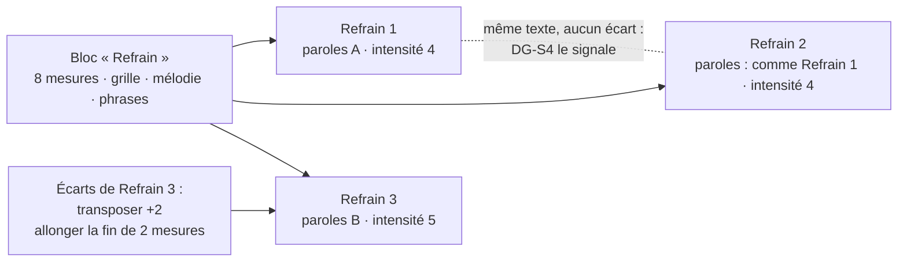

# 23 — SEC · Section

Un refrain revient trois fois ; un couplet garde sa musique et change de paroles ; le
dernier refrain monte d'un ton. L'échelle de la section rend ces faits **visibles et
manipulables**, grâce au couple **bloc / occurrence**
([ADR-007](../adr/adr-007-blocs-et-occurrences.md)).

---

### SEC-01 · Définir un bloc

| | |
|---|---|
| **Objet** | Créer une seule fois le matériau d'un type de section : mesures, grille, mélodie, phrases, arrangement par défaut |
| **Échelle · moment** | É3 · M3 |
| **Appareils** | 💻 conçu pour · 📱 ✅ · 📖 — |
| **Besoins** | B05 |
| **Lit · écrit** | Écrit un **bloc** dans le document du morceau |

**Règles**
- Un bloc porte un **nom libre** (« Refrain », « Pont des mouettes ») et un **type**
  facultatif : intro, couplet, pré-refrain, refrain, post-refrain, pont, instrumental, fin,
  ou `sans type` — la valeur par défaut, et un état parfaitement valide.
- On crée un bloc : vide ; depuis un motif ([MIC-11](22-micro-motif-et-phrase.md#mic-11--placer-et-extraire-un-motif)) ;
  depuis une section découpée sur une prise ([MOR-03](24-morceau.md#mor-03--découper-une-prise-à-loreille)),
  dont le matériau arrive en propositions ; ou en dupliquant un bloc (copie indépendante,
  provenance gardée).
- La métrique par défaut est celle du morceau ; une mesure peut en changer.
- **Le type n'est jamais déduit.** Pupitre peut proposer des **répétitions** (« ces deux
  passages sont le même bloc »), jamais des noms : le refrain est ce que Sacha appelle
  refrain, pas ce qu'un détecteur nomme ainsi.

**Ne fait pas** — ne type pas un bloc de lui-même ; ne refuse pas une forme sans refrain.

**Cas limites**
- Bloc d'une seule mesure : valide.
- Deux blocs au même nom : permis ; l'interface les distingue par leur position.

**Critères d'acceptation**
1. *Étant donné* un bloc `sans type`, *alors* il se rend dans toutes les vues sans erreur.
2. *Quand* un bloc est dupliqué puis la copie modifiée, *alors* l'original est inchangé.
3. *Étant donné* une analyse qui détecte des répétitions sur une prise, *quand* Sacha en
   crée des blocs, *alors* tous sont `sans type` tant que Sacha n'en a pas décidé un.

---

### SEC-02 · Faire varier une occurrence

| | |
|---|---|
| **Objet** | Jouer un bloc à une place de la forme, avec ses paroles et ses écarts |
| **Échelle · moment** | É3 · M3 |
| **Appareils** | 💻 conçu pour · 📱 ✅ · 📖 — |
| **Besoins** | B05 |
| **Lit · écrit** | Écrit des **occurrences** et leurs **écarts** |

**Règles**
- Une occurrence référence un bloc. Son numéro (« Refrain 2 ») est **engendré** par
  position et par type.
- Une occurrence porte ses paroles, ou reprend celles d'une autre occurrence du même bloc
  qui n'en reprend pas elle-même (« paroles : comme Refrain 1 ») ; ses lignes propres sont
  alors des écarts, signalés comme tels (« comme Refrain 1, sauf le dernier vers »).
- Les écarts (types au [§ 30 · 5.1](../30-modele-de-domaine.md#51-les-types-décarts)) naissent
  de la loupe en mode « cette occurrence », ou d'opérations nommées : « transposer cette
  occurrence de +2 », « allonger la fin de deux mesures ».
- La vue **bloc et occurrences côte à côte** montre, pour chacune, ses écarts
  (« Refrain 3 · 2 écarts ») ; dans la grille, un élément en écart porte un filet, pas
  seulement une couleur.
- Deux gestes explicites : **promouvoir** un écart au bloc (il vaut alors pour toutes les
  occurrences), ou le **retirer**.
- Un écart dont la cible a disparu devient **orphelin** : conservé, signalé, proposé à la
  suppression.
- **Détacher** une occurrence en fait un bloc neuf, copie de son matériau effectif, quand
  elle a trop divergé pour rester une variation.

**Ne fait pas** — ne crée aucun écart implicite ; ne propage pas un écart d'une occurrence
à une autre.

**Critères d'acceptation**
1. *Quand* un accord du bloc change, *alors* les occurrences sans écart sur cet accord
   changent, et seulement elles (I03).
2. *Étant donné* une occurrence avec un écart sur cet accord, *alors* elle garde son accord,
   et l'interface le signale.
3. *Quand* l'élément visé par un écart est supprimé du bloc, *alors* l'écart est orphelin,
   conservé et signalé.
4. *Quand* un écart est promu, *alors* il disparaît de l'occurrence et s'applique au bloc, en
   une seule opération nommée.
5. *Quand* un refrain est inséré avant « Refrain 2 », *alors* celui-ci devient « Refrain 3 »
   sans qu'aucun numéro ne soit écrit.
6. *Étant donné* Refrain 2 qui reprend les paroles de Refrain 1, *quand* une ligne de
   Refrain 1 change, *alors* Refrain 2 la chante aussi, sauf là où il porte sa propre ligne.

---

### SEC-03 · Découper en phrases

| | |
|---|---|
| **Objet** | Marquer les phrases d'un bloc, pour y ranger les lignes de texte |
| **Échelle · moment** | É2, É3 · M3 |
| **Appareils** | 💻 conçu pour · 📱 ✅ · 📖 — |
| **Besoins** | B06 |
| **Lit · écrit** | Écrit les **phrases** du bloc |

**Règles**
- Une phrase est une plage du bloc, de (mesure, décalage) à (mesure, décalage) : elle peut
  commencer sur une levée. Des phrases sont **proposées** depuis la mélodie (silences, notes
  longues, cadences) et les lignes existantes ; elles se créent par un geste et se
  corrigent.
- Dans chaque occurrence, chaque ligne se range dans une phrase.
- La vue « phrase » ouvre la loupe sur la plage, avec la ligne de l'occurrence choisie.
- Une mesure peut n'appartenir à aucune phrase (un passage instrumental).

**Critères d'acceptation**
1. *Alors* aucune phrase n'est créée sans geste : les découpes proposées restent des
   propositions tant que Sacha ne les a pas gardées.
2. *Quand* deux phrases se chevaucheraient, *alors* l'opération est refusée.
3. *Quand* une mesure est insérée dans une phrase, *alors* celle-ci s'allonge et aucune
   autre phrase ne change.
4. *Étant donné* une phrase qui commence sur une levée au dernier temps de la mesure 4,
   *alors* elle débute à (mesure 4, 2 880 ticks), et une phrase qui s'arrête à ce point ne
   la chevauche pas.

---

### SEC-04 · Lire l'harmonie d'une section

| | |
|---|---|
| **Objet** | Voir comment la section avance : fonctions, rythme harmonique, cadence finale |
| **Échelle · moment** | É3 · M3, M5 |
| **Appareils** | 💻 ✅ · 📱 ✅ · 📖 ✅ |
| **Besoins** | B05, B03 |
| **Lit · écrit** | Lit grille et tonalité effectives ; **n'écrit rien** |

**Règles**
- La grille en degrés et en fonctions (pastilles du [§ 50 · 6.2](../50-interfaces-et-appareils.md#62-les-encodages)),
  le rythme harmonique (accords par mesure ; changements sur temps fort ou faible), la
  cadence finale typée (DG-S1), les emprunts et les modulations locales.
- Comparaison côte à côte avec une autre section : « le refrain change d'accord deux fois
  plus souvent que le couplet ».

**Critères d'acceptation**
1. *Alors* une section qui finit V–I est typée « parfaite », IV–I « plagale », V–vi
   « rompue ».
2. *Alors* le rythme harmonique s'exprime en accords par mesure, sans qualificatif de
   valeur.
3. *Étant donné* une tonalité indécise, *alors* l'analyse est rendue pour chaque candidat.

---

### SEC-05 · Régler l'intensité d'une occurrence

| | |
|---|---|
| **Objet** | Décider l'intensité et la poussée de chaque occurrence, et voir sa densité |
| **Échelle · moment** | É3 · M4 |
| **Appareils** | 💻 ✅ · 📱 ✅ · 📖 — |
| **Besoins** | B03 |
| **Lit · écrit** | Écrit intensité, poussée et moyen d'espace (décisions) ; lit la densité (engendrée) |

**Règles**
- **Intensité** de 1 (nu) à 5 (plein), décidée. Une valeur est **proposée** depuis l'audio
  d'une prise alignée (niveau, densité d'attaques, présence de la voix).
- **Poussée** de 1 à 5, décidée, distincte de la **densité** — le nombre de couches,
  engendré par l'arrangement ([MOR-06](24-morceau.md#mor-06--arranger)). Un passage peut
  être dense et calme.
- **Moyen d'espace** nommé : répétition, bourdon, pièce.
- Une intensité **inconnue** n'est pas une intensité 1.

**Critères d'acceptation**
1. *Alors* une intensité inconnue s'affiche hachurée pleine hauteur, distincte d'une
   intensité 1, en noir et blanc pur.
2. *Étant donné* deux occurrences de même densité et de poussées différentes, *alors* la
   frise les distingue.
3. *Alors* une intensité proposée depuis une prise ne devient décidée que par un geste.

---

### SEC-06 · Diagnostiquer une section

| | |
|---|---|
| **Objet** | Constater la cadence, le contour, l'ambitus, la densité, les répétitions à l'identique |
| **Échelle · moment** | É3 · M5 |
| **Appareils** | 💻 ✅ · 📱 ✅ · 📖 ✅ |
| **Besoins** | B03 |
| **Lit · écrit** | Lit ; **n'écrit rien** |

**Règles**
- Constats DG-S1 à DG-S5 du [§ 60 · 3.2](../60-moteur-musical.md#32-section-é3), précédés de
  l'inventaire de la section.
- Comparaison entre les occurrences d'un même bloc : écarts, texte, intensité.

**Critères d'acceptation**
1. *Étant donné* deux occurrences sans écart et au même texte, *alors* DG-S4 les signale par
   leurs noms.
2. *Alors* le contour de chaque phrase est nommé parmi les cinq ; une ligne strictement
   montante est un « escalier ».
3. *Quand* le diagnostic tourne, *alors* le document est inchangé.

---

### SEC-07 · Demander des pistes de section

| | |
|---|---|
| **Objet** | Obtenir des pistes de contraste, de relance ou de cadence pour une section précise |
| **Échelle · moment** | É3 · M2 |
| **Appareils** | 💻 ✅ · 📱 ✅ · 📖 — |
| **Besoins** | B09 |
| **Lit · écrit** | Lit ; une piste gardée devient un écart ou une modification du bloc |

**Règles**
- Pistes de règles ([§ 60 · 4.2](../60-moteur-musical.md#42-les-pistes-de-règles)) :
  - **contraste** : changer de centre harmonique, de rythme harmonique, de registre, de
    densité ;
  - **relance** : prolonger la dominante, monter de registre, augmenter la poussée ;
  - **cadences** de fin de section : parfaite, plagale, rompue, demi-cadence (suspensive).
- Chaque piste s'écoute. Gardée, elle devient un **écart** si elle a été demandée pour une
  occurrence, une **modification du bloc** si elle l'a été pour le bloc, avec la provenance
  `suggeree`.

**Ne fait pas** — n'écrit pas de section ; ne change rien sans geste.

**Critères d'acceptation**
1. *Étant donné* une section qui finit V–I, *quand* Sacha demande des cadences, *alors* au
   moins deux cadences différentes sont proposées, chacune écoutable.
2. *Quand* une piste demandée pour une occurrence est gardée, *alors* elle devient un écart
   de cette occurrence, de provenance `suggeree`.
3. *Alors* les pistes de contraste couvrent au moins deux axes différents.
