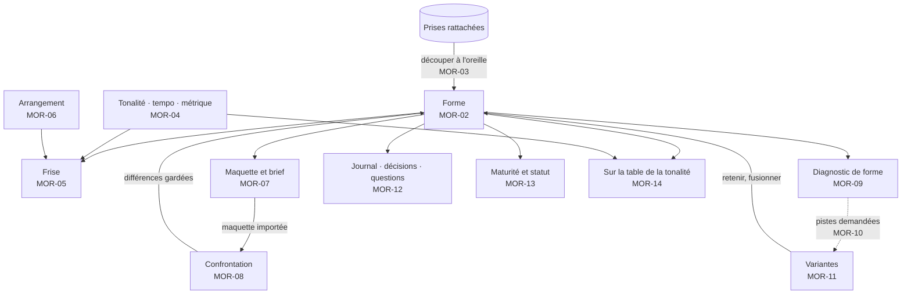
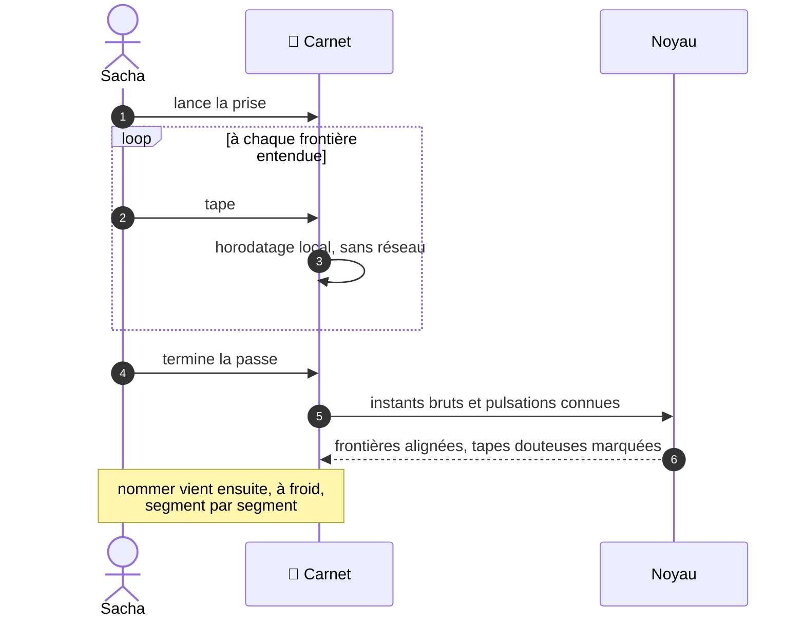
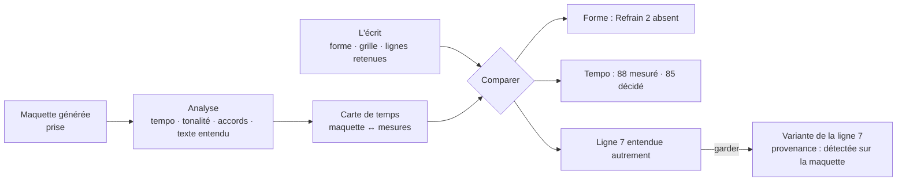
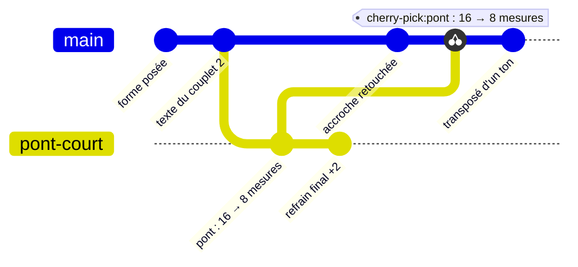

# 24 — MOR · Morceau

L'échelle de la chanson entière : sa forme, son intensité, ses paramètres, son arrangement,
ses maquettes, ses variantes et son histoire. C'est ici qu'une vieille démo devient un
morceau lisible, et qu'un morceau se confronte à sa maquette.

---

### MOR-01 · Créer un morceau

| | |
|---|---|
| **Objet** | Faire exister un morceau, avec rien d'autre qu'une identité |
| **Échelle · moment** | É4 · M3 |
| **Appareils** | 💻 ✅ · 📱 ✅ · 📖 — |
| **Besoins** | B03 |
| **Lit · écrit** | Écrit un **document de morceau**, puis sa référence dans le fonds |

**Règles**
- Créer ne demande **rien** : ni titre, ni tonalité, ni prise
  ([ADR-006](../adr/adr-006-le-partiel-est-normal.md)).
- Les **titres** sont une liste datée : texte, statut (`retenu`, `provisoire`,
  `abandonné`), origine (Sacha, piste, transcription).
- Un morceau se crée vide, depuis une idée ([CAP-02](21-capter-et-organiser.md#cap-02--trier-la-boîte-didées)),
  depuis un motif, ou depuis une prise.
- Statut initial : `actif`. Langue par défaut : celle des réglages, modifiable.

**Critères d'acceptation**
1. *Quand* un morceau est créé sans aucune donnée, *alors* il se rend et se diagnostique
   partout sans erreur (I07).
2. *Quand* le titre change trois fois, *alors* les trois titres sont gardés et datés, et
   l'identité est inchangée.
3. *Alors* le dossier du morceau dans le miroir suit le titre retenu, et l'identifiant en
   reste le préfixe.

---

### MOR-02 · Poser et modifier la forme

| | |
|---|---|
| **Objet** | Ordonner les occurrences, et modifier la forme par des opérations nommées |
| **Échelle · moment** | É4 · M3 |
| **Appareils** | 💻 conçu pour, sur la frise · 📱 ✅ · 📖 — |
| **Besoins** | B03 |
| **Lit · écrit** | Écrit la **forme** (suite d'occurrences) et les blocs touchés |

**Règles**
- Opérations : insérer une occurrence (d'un bloc existant ou nouveau), déplacer,
  dupliquer, retirer, allonger ou raccourcir un bloc, répéter une plage.
- Chaque opération est **nommée**, avec un message engendré : « Northbound : pont
  raccourci de 16 à 8 mesures ».
- Numéros de mesure et durées sont engendrés.
- Raccourcir laisse les paroles des mesures retirées **orphelines**, jamais supprimées.
- Une occurrence retirée reste récupérable (« éléments retirés récemment », historique).

**Ne fait pas** — n'ordonne rien de lui-même ; ne supprime aucune parole.

**Cas limites**
- Forme vide, ou dernière occurrence retirée : le morceau reste valide, sans forme.

**Critères d'acceptation**
1. *Quand* une occurrence de 4 mesures est insérée en deuxième position, *alors* tous les
   numéros de mesure suivants se décalent, sans qu'aucun numéro ne soit écrit.
2. *Quand* un bloc passe de 16 à 8 mesures, *alors* les lignes des mesures retirées restent
   accessibles, marquées orphelines.
3. *Alors* chaque modification de forme produit exactement une opération nommée, dont le
   message nomme le morceau, l'opération et les valeurs.
4. *Quand* une occurrence est retirée puis le geste annulé, *alors* l'état antérieur est
   restitué à l'identique.

---

### MOR-03 · Découper une prise à l'oreille

| | |
|---|---|
| **Objet** | Taper les frontières de sections en écoutant une prise, pour en tirer la forme |
| **Échelle · moment** | É4 · M1 |
| **Appareils** | 📱 conçu pour · 💻 ✅ barre d'espace · 📖 — |
| **Besoins** | B03, B04 |
| **Lit · écrit** | Lit la prise et ses pulsations ; écrit des **frontières**, des **occurrences** et la **carte de temps** de la prise |

**Règles**
- Sacha écoute et **tape** à chaque frontière entendue. Les tapes sont horodatées **sur
  l'appareil**, sans aller-retour réseau : la précision du geste fait la valeur de la
  méthode.
- Si des pulsations sont connues (détectées ou décidées), chaque tape est **attirée** vers
  le premier temps le plus proche, à moins d'une demi-mesure ; au-delà, elle reste brute et
  marquée douteuse. La tape brute est toujours conservée à côté de la valeur alignée.
- Des frontières **proposées** par une analyse s'affichent en pointillé ; une tape gagne
  toujours sur une proposition.
- **Nommer vient après, à froid** : chaque segment devient une occurrence d'un bloc neuf
  (`sans type`) ou existant (« ce segment rejoue le bloc A »). Les répétitions détectées
  sont proposées, jamais imposées.
- Le résultat écrit aussi la **carte de temps** de la prise.
- Reprenable : chaque tape se supprime ; une nouvelle passe ne perd pas la précédente.

**Ne fait pas** — ne nomme aucune section ; n'impose aucune segmentation.

**Cas limites**
- Prise sans pulsations connues : les frontières restent en secondes ; les mesures
  viendront plus tard.
- Prise longue sans répétition (une improvisation) : le tapotage est la seule voie, et c'est
  pour cela qu'il existe.
- Section d'une seule mesure : permise.

**Critères d'acceptation**
1. *Quand* Sacha tape vingt fois sur une prise, *alors* vingt frontières existent, chacune
   avec son instant brut et sa mesure alignée.
2. *Alors* une tape à moins d'une demi-mesure d'un premier temps est alignée dessus ; au-delà,
   elle reste brute et marquée douteuse.
3. *Quand* la troisième tape est supprimée, *alors* les dix-neuf autres sont intactes.
4. *Après* tapotage, *alors* aucun bloc ne porte de type.
5. *Étant donné* une prise sans pulsations, *alors* les frontières s'expriment en secondes,
   sans erreur.
6. *Alors* le délai entre le toucher et l'horodatage de la tape est inférieur à 20 ms
   (mesuré automatiquement).

---

### MOR-04 · Tonalité, tempo, métrique

| | |
|---|---|
| **Objet** | Décider la tonalité, le tempo et la métrique d'un morceau, et leurs changements, depuis des propositions ou sans elles |
| **Échelle · moment** | É4 · M3 |
| **Appareils** | 💻 ✅ · 📱 ✅ · 📖 — |
| **Besoins** | B04 |
| **Lit · écrit** | Lit les propositions des analyses ; écrit des **valeurs décidées**, datées |

**Règles**
- Chaque attribut est **décidé** (avec sa date), **proposé** (candidats, confiances,
  origines), ou **absent**.
- Décider, c'est choisir un candidat **ou** saisir une valeur : Sacha peut savoir ce que les
  machines ignorent. **Revenir** à l'état proposé est toujours possible.
- Des propositions contradictoires — deux analyses à 88 et 140 BPM, ou une erreur d'octave
  de tempo — s'affichent **avec leurs origines**, sans verdict.
- Décider un attribut n'oblige pas à décider les autres.
- Changements en cours de morceau : changement de tempo au début d'une occurrence ou d'une
  mesure ; modulation par écart d'occurrence ; changement de métrique par mesure.
- Tempo et tonalité sont des **paramètres artistiques** : les changer (transposer pour la
  voix, ralentir) est une opération nommée. Transposer change la tonique de référence
  (I02) et vérifie la tessiture ; les doigtés épinglés qui ne correspondent plus à aucun
  accord deviennent inactifs et sont listés (état engendré : rien n'est réécrit,
  l'épinglage garde l'accord absolu sur lequel il a été posé).

**Critères d'acceptation**
1. *Quand* une valeur est décidée, *alors* la proposition qui l'a précédée reste visible,
   inchangée.
2. *Quand* Sacha revient sur une décision, *alors* l'état antérieur est restitué exactement.
3. *Étant donné* un tempo décidé et une tonalité indécise, *alors* tous les rendus sont
   valides.
4. *Étant donné* deux propositions de tempo à 88 et 140 BPM, *alors* les deux s'affichent
   avec leurs origines, et aucune n'est choisie.
5. *Quand* une transposition de +2 fait sortir la mélodie de la tessiture déclarée, *alors*
   un avertissement nomme les notes concernées.

---

### MOR-05 · Voir la frise

| | |
|---|---|
| **Objet** | La forme d'un coup d'œil : occurrences proportionnelles à leur durée, courbe d'intensité, repères |
| **Échelle · moment** | É4 · M5 |
| **Appareils** | 💻 ✅ manipulable · 📱 ✅ manipulable · 📖 ✅ statique |
| **Besoins** | B03 |
| **Lit · écrit** | Lit ; sur l'établi et le carnet, un glisser-déposer déclenche une opération de [MOR-02](#mor-02--poser-et-modifier-la-forme) |

**Règles**
- Chaque occurrence est **large comme sa durée réelle**, pas comme son rang.
- Au-dessus, la courbe d'intensité ; la densité et la poussée à la demande.
- Noms engendrés (« Refrain 2/3 »), filet épais à gauche d'une occurrence qui rejoue un bloc
  déjà entendu, nombre d'écarts.
- Mesures et durées cumulées aux frontières.
- La prise de référence se joue sous la frise ([ECO-05](27-ecoute-et-compagnon.md#eco-05--suivre-une-prise)).
- Maquette : [§ 50 · 3.2](../50-interfaces-et-appareils.md#32-le-morceau--la-frise).

**Critères d'acceptation**
1. *Étant donné* deux occurrences de 8 et 16 mesures au même tempo, *alors* leurs largeurs
   sont dans un rapport de 1 à 2, à 2 % près.
2. *Étant donné* dix occurrences sur onze sans intensité, *alors* la frise se rend et
   distingue « inconnu » de « 1 ».
3. *Alors* la frise du lutrin ne contient ni animation ni horloge (I18).

---

### MOR-06 · Arranger

| | |
|---|---|
| **Objet** | Dire qui joue quoi, avec quel rôle et dans quel registre, par bloc, avec des écarts par occurrence |
| **Échelle · moment** | É3, É4 · M4 |
| **Appareils** | 💻 conçu pour · 📱 ✅ · 📖 — |
| **Besoins** | B03, B15 |
| **Lit · écrit** | Écrit le **plan d'arrangement** (bloc) et ses écarts (occurrence) |

**Règles**
- Une **palette** d'instruments (réglages, complétée par morceau), chacun avec son registre.
- Par bloc : pour chaque instrument, **présent** ou **absent** (explicite), rôle (rythme,
  harmonie, mélodie, contre-chant, bourdon, texture), registre, intensité de jeu.
- Par occurrence : des écarts d'arrangement (« la batterie n'entre qu'au refrain 2 »).
- Vue en **matrice** instruments × occurrences ; densité et courbe d'épaississement
  engendrées.
- Constats DG-M9, DG-M10, DG-M11.

**Ne fait pas** — ne produit aucun son : l'arrangement est un plan, pas un rendu
([ADR-009](../adr/adr-009-ecoute-de-controle.md)).

**Critères d'acceptation**
1. *Alors* « absent » et « pas encore décidé » se distinguent dans la matrice.
2. *Étant donné* une occurrence à six couches, *alors* DG-M9 la signale, et elle reste
   valide.
3. *Quand* une occurrence change, *alors* la courbe d'épaississement se recalcule sans
   champ stocké.
4. *Étant donné* deux instruments du même registre dans une occurrence, *alors* DG-M10 les
   nomme.

---

### MOR-07 · Maquettes et brief de génération

| | |
|---|---|
| **Objet** | Préparer une maquette : l'enregistrer soi-même, ou engendrer un brief pour un générateur externe et en importer le résultat |
| **Échelle · moment** | É4 · M4 |
| **Appareils** | 💻 conçu pour · 📱 ✅ · 📖 — |
| **Besoins** | B15 |
| **Lit · écrit** | Lit tout le morceau ; écrit une **prise** de maquette, ou fige le **brief** en captation |

**Règles**
- **Maquette enregistrée** : une prise rattachée avec le rôle `maquette`. Le clic et le
  décompte ([ECO-02](27-ecoute-et-compagnon.md#eco-02--métronome-et-décompte)) sont
  disponibles, et un **souffleur** affiche les paroles de l'occurrence en cours pendant
  l'enregistrement.
- **Brief de génération** : engendré depuis le morceau — paroles retenues avec les balises
  de section dans la syntaxe de l'outil, style (texte libre de Sacha, enrichi du tempo, de
  la tonalité et de l'instrumentation tirée de l'arrangement), liste d'exclusion, notes.
- Le brief respecte le **profil d'outil** visé (limites en données, [§ 60 · 9](../60-moteur-musical.md#9-les-règles-doutil--le-brief-de-génération)) ;
  Pupitre **refuse** de produire un brief qui le viole, en nommant la limite. Les comptes
  de caractères s'affichent.
- Le brief exporté est **figé en captation** : une maquette générée pourra citer exactement
  ce qui l'a produite.
- **Import du résultat** : une prise au rôle `maquette générée`, liée à son brief.
- **Aucune intégration** avec un service de génération : on exporte, on importe.

**Ne fait pas** — n'appelle aucun générateur ; ne produit aucun son.

**Cas limites**
- Morceau sans forme : brief sans balises, et Pupitre le dit.
- Aucun profil d'outil choisi : brief générique, sans limites vérifiées, avec un
  avertissement.

**Critères d'acceptation**
1. *Étant donné* un morceau complet, *alors* le brief engendré respecte toutes les limites
   du profil, et les comptes affichés sont exacts.
2. *Étant donné* un brief qui dépasserait une limite, *alors* il n'est pas produit, et le
   message nomme la limite et l'excédent.
3. *Étant donné* une entrée d'exclusion qui nomme un objet sans que le style demande l'objet
   concurrent, *alors* la liste est refusée, en citant la règle.
4. *Alors* le brief exporté est une captation, et la maquette importée la référence.
5. *Quand* une section change et que le brief est réengendré, *alors* il change sans saisie.

---

### MOR-08 · Confronter une maquette à l'écrit

| | |
|---|---|
| **Objet** | Écouter une maquette contre l'écrit et voir ce qui diffère : forme, tempo, tonalité, accords, texte entendu |
| **Échelle · moment** | É4 · M4 |
| **Appareils** | 💻 conçu pour · 📱 ✅ · 📖 — |
| **Besoins** | B15 |
| **Lit · écrit** | Lit la maquette, son analyse, sa carte de temps et le morceau ; une différence gardée écrit une **variante** |

**Règles**
- La confrontation s'appuie sur l'analyse de la prise et sur sa carte de temps (tapée ou
  proposée).
- Cinq comparaisons : **forme** (occurrences présentes, absentes, ajoutées), **tempo**
  (mesuré contre décidé), **tonalité** (avec le diapason de la prise), **accords** par
  mesure, **texte entendu** (transcription du chant contre les lignes retenues).
- Chaque différence est une **proposition**. Une ligne entendue autrement que l'écrit peut
  être gardée comme **variante** de la ligne, de provenance `detectee` sur la maquette :
  l'erreur d'écoute d'un générateur devient une piste, jamais une correction silencieuse.

**Ne fait pas** — ne corrige pas l'écrit ; ne juge pas la maquette.

**Cas limites**
- Le générateur a ajouté des sections : elles apparaissent comme segments en plus, pas comme
  des erreurs.
- Transcription incertaine : confiance par mot.

**Critères d'acceptation**
1. *Étant donné* une maquette sans deuxième refrain, *alors* la confrontation indique
   « occurrence absente : Refrain 2 », et la forme est inchangée.
2. *Étant donné* une ligne entendue différente de l'écrit, *alors* les deux s'affichent côte
   à côte ; la garder crée une variante de provenance `detectee`, référencée à la prise.
3. *Alors* le tempo mesuré et le tempo décidé s'affichent ensemble, avec leur différence.
4. *Étant donné* une prise non analysée, *alors* la fonction dit ce qui manque et propose de
   lancer l'analyse.

---

### MOR-09 · Diagnostiquer la forme

| | |
|---|---|
| **Objet** | Énoncer ce que contient le morceau, puis les constats de forme |
| **Échelle · moment** | É4 · M5 |
| **Appareils** | 💻 ✅ · 📱 ✅ · 📖 ✅ |
| **Besoins** | B03 |
| **Lit · écrit** | Lit ; **n'écrit rien**, sauf une désactivation demandée par Sacha |

**Règles**
- L'**inventaire** (DG-M0) d'abord, puis les constats DG-M1 à DG-M11 du
  [§ 60 · 3.3](../60-moteur-musical.md#33-morceau-é4), dans l'ordre du morceau.
- Un constat se **désactive pour ce morceau**, avec un motif obligatoire ; le rapport le
  rappelle à chaque fois, avec sa date.
- Un constat ouvre le morceau à la mesure en cause.

**Critères d'acceptation**
1. *Alors* le rapport commence par l'inventaire : occurrences, mesures, durée, types
   présents et absents, intensités renseignées.
2. *Étant donné* un morceau sans intensités, *alors* DG-M5 est `indécidable`, jamais
   `absent`.
3. *Quand* DG-M3 est désactivé pour un morceau, *alors* il disparaît de ce rapport seul, et
   le rapport mentionne la désactivation, son motif et sa date.
4. *Étant donné* deux occurrences `sans type`, *alors* DG-M1, DG-M2, DG-M4 et DG-M5
   rendent `indécidable`, jamais `absent`.
5. *Quand* le diagnostic tourne cent fois, *alors* le document est inchangé.

---

### MOR-10 · Demander des pistes de forme

| | |
|---|---|
| **Objet** | Obtenir des pistes pour allonger, raccourcir, contraster ou relancer une forme, ou pour moduler |
| **Échelle · moment** | É4 · M2 |
| **Appareils** | 💻 ✅ · 📱 ✅ · 📖 — |
| **Besoins** | B09 |
| **Lit · écrit** | Lit ; une piste gardée crée une **variante** du morceau |

**Règles**
- **Allonger** : répéter, instrumental, augmentation par l'arrangement, demi-tempo,
  modulation, coda, section neuve. Ces pistes sont rangées par **coût en mesures
  ajoutées**, du moins au plus, et cet ordre est dit : il range, il ne juge pas
  ([PRO-03](26-propositions-suggestions-provenance.md#pro-03--demander-des-pistes)).
- **Raccourcir** : retirer une répétition, couper l'introduction, resserrer un passage entre
  deux sections.
- **Réorganiser** : avancer un refrain, ajouter un pré-refrain.
- **Moduler** : avec, pour chaque piste, un chemin de retour ou la mention qu'il n'y en a
  pas.
- Chaque piste indique sa durée résultante et s'écoute. Gardée, elle devient une
  **variante** ([MOR-11](#mor-11--bifurquer-en-variantes)), jamais une modification directe.

**Critères d'acceptation**
1. *Quand* Sacha demande à allonger, *alors* au moins deux gestes sont proposés, rangés par
   mesures ajoutées, du moins au plus, avec l'ordre nommé, et chacun avec sa durée
   résultante.
2. *Quand* une piste de forme est gardée, *alors* une variante est créée, et la version
   retenue est inchangée.
3. *Alors* chaque piste de modulation porte un chemin de retour, ou la mention « pas de
   retour ».

---

### MOR-11 · Bifurquer en variantes

| | |
|---|---|
| **Objet** | Essayer une autre version du morceau sans perdre la première ; comparer, retenir, fusionner |
| **Échelle · moment** | É4 · M2 |
| **Appareils** | 💻 conçu pour · 📱 ✅ · 📖 — |
| **Besoins** | B14 |
| **Lit · écrit** | Bifurque le document du morceau ; rejoue des opérations nommées dans une variante ; écrit dans le fonds la référence de la version retenue |

**Règles**
- Une **variante** est une bifurcation du document du morceau, qui partage son histoire.
  Elle est nommée et datée.
- **Comparer** deux variantes côte à côte : forme, grille, texte, durée, constats.
- **Retenir** une variante : elle devient la version de référence ; l'ancienne reste une
  variante parmi d'autres.
- **Fusionner** les changements choisis d'une variante dans une autre, c'est **rejouer**
  dans la variante cible les opérations nommées choisies, comme des opérations neuves : une
  fusion de documents emporterait toute l'histoire de la variante, pas un choix. Un conflit
  sur une ligne ou un accord devient une variante à trancher
  ([SYN-03](29-socle-donnees-appareils.md#syn-03--trancher-les-conflits)).
- Une opération qui écrit deux documents (retenir une variante, créer un morceau) écrit
  d'abord le document du morceau, puis sa référence dans le fonds ; au démarrage, une
  vérification répare une référence manquante.
- Un album qui contient le morceau suit sa version **retenue**.

*La version principale rejoue une seule opération de la variante « pont-court » ;
« refrain final +2 » reste dans la variante.*

**Critères d'acceptation**
1. *Quand* une variante est créée puis modifiée, *alors* la version retenue est inchangée.
2. *Alors* la comparaison montre les différences de forme, de grille et de texte.
3. *Quand* deux opérations sur trois d'une variante sont fusionnées dans une autre, *alors*
   ces deux-là seules sont rejouées dans la cible, et y figurent au journal comme
   opérations neuves ; un conflit sur une ligne produit deux variantes de cette ligne, à
   trancher.
4. *Étant donné* un album qui contient le morceau, *quand* une autre variante est retenue,
   *alors* l'album la suit.
5. *Étant donné* une interruption entre l'écriture du document du morceau et celle de la
   référence dans le fonds, *quand* Pupitre redémarre, *alors* la référence est réparée.

---

### MOR-12 · Journal, décisions et questions du morceau

| | |
|---|---|
| **Objet** | Relire comment le morceau a bougé, revenir avant une opération, consigner décisions et questions |
| **Échelle · moment** | É4 · M5 |
| **Appareils** | 💻 ✅ · 📱 ✅ · 📖 ✅ lecture |
| **Besoins** | B14 |
| **Lit · écrit** | Lit l'historique ; écrit décisions, questions et retours en arrière |

**Règles**
- Le **journal** liste les opérations nommées : date, appareil, message. Il se filtre (forme,
  texte, harmonie, arrangement, propositions acceptées).
- **Revenir** à un état antérieur est une **nouvelle** opération (« retour à l'état du
  12 octobre ») : l'historique n'est jamais réécrit.
- **Décisions** `D001`… : texte, date, statut, remplaçante éventuelle. **Questions**
  `Q001`… : texte, ce qu'elle débloque, statut.
- Chaque entrée a un identifiant ULID ; son numéro est attribué par le nœud à la première
  synchronisation — d'ici là, hors ligne, elle s'affiche « D— » ou « Q— ». Un numéro
  attribué ne change plus.
- Le compte des questions ouvertes est **engendré** de leur statut.

**Critères d'acceptation**
1. *Alors* chaque opération nommée figure au journal avec sa date et son appareil.
2. *Quand* Sacha revient à un état antérieur, *alors* une nouvelle opération est créée, et
   l'historique postérieur reste consultable.
3. *Quand* une question est close, *alors* le compte des questions ouvertes diminue
   d'exactement un, sans compteur stocké.
4. *Quand* une décision est révisée, *alors* l'ancienne garde son numéro, passe à `révisée`
   et pointe vers sa remplaçante ; aucun numéro n'est jamais réutilisé.
5. *Étant donné* deux décisions consignées hors ligne sur deux appareils, *alors* chacune
   s'affiche « D— » ; après synchronisation, elles portent deux numéros distincts, qui ne
   changent plus.

---

### MOR-13 · Maturité et statut

| | |
|---|---|
| **Objet** | Voir où en est un morceau (engendré), et dire où Sacha le place (décidé) |
| **Échelle · moment** | É4 · M5 |
| **Appareils** | 💻 ✅ · 📱 ✅ · 📖 ✅ |
| **Besoins** | B03 |
| **Lit · écrit** | Lit le contenu ; écrit seulement le **statut** |

**Règles**
- **Maturité** par dimension — forme, harmonie, mélodie, texte, arrangement, maquette — en
  quatre niveaux : 0 absent, 1 esquissé, 2 complet, 3 confirmé (plus aucune proposition en
  attente). Elle est **engendrée** du contenu, jamais saisie.
- **Statut**, décidé et daté : `actif`, `en pause`, `abouti`, `abandonné`.
- Aucune note globale, aucun classement.

**Critères d'acceptation**
1. *Quand* toutes les mesures de tous les blocs ont un accord, *alors* la dimension
   « harmonie » passe à « complet », sans écriture d'un champ d'état.
2. *Étant donné* une dimension « complet », *quand* sa dernière proposition en attente est
   acceptée ou écartée, *alors* elle passe à « confirmé ».
3. *Alors* le statut se change par une opération datée, et la maturité n'est pas saisissable.
4. *Alors* aucune note globale de maturité n'est affichée.

---

### MOR-14 · Poser le morceau sur la table

Livrée avec [INC-2](../40-architecture.md#9-trajectoire-de-construction) : elle attend que
les morceaux existent.

| | |
|---|---|
| **Objet** | Voir les accords d'un morceau dans la table de sa tonalité, et le chemin qu'ils y tracent |
| **Échelle · moment** | É4 · M5, M2 |
| **Appareils** | 💻 ✅ · 📱 ✅ · 📖 ✅ |
| **Besoins** | B08, B09 |
| **Lit · écrit** | Lit la grille effective, la ou les tonalités, les modulations ; **n'écrit rien** |

**Règles**
- La table est celle de
  [MIC-12](22-micro-motif-et-phrase.md#mic-12--parcourir-la-table-de-la-tonalité), dans la
  tonalité du morceau.
- Chaque accord employé est marqué d'un cadre épais, avec son nombre d'emplois.
- Le chemin se dessine **section par section** : un sélecteur de bloc, et les accords de la
  section numérotés dans l'ordre (1, 2, 3…).
- Un accord absent des rangées affichées est listé **hors table**, avec ses notes communes
  avec la tonalité. Il n'est jamais forcé dans une case.
- Un morceau qui module a une table par tonalité, avec la section en cause.
- Un accord proposé et non décidé porte `~`
  ([§ 50 · 4.1](../50-interfaces-et-appareils.md#41-statut-dune-valeur)).
- Maquette et marques sur la table : [§ 50 · 3.7](../50-interfaces-et-appareils.md#37-la-table-de-la-tonalité).

**Ne fait pas** — ne modifie ni la grille ni la table ; ne juge pas le chemin, et ne force
jamais un accord dans une case.

**Cas limites**
- Tonalité indécise : une table par candidat, côte à côte, comme
  [MIC-12](22-micro-motif-et-phrase.md#mic-12--parcourir-la-table-de-la-tonalité).
- Section sans accord : aucune case n'est marquée, et c'est dit.

**Critères d'acceptation**
1. *Étant donné* une section `C G Am F` en do majeur, *alors* quatre cases sont marquées et le
   chemin est numéroté 1 à 4.
2. *Étant donné* un `E♭` dans un morceau en do majeur, *alors* la case ♭III de la rangée du
   dessous est marquée.
3. *Étant donné* un accord absent des rangées affichées, *alors* il figure dans la liste hors
   table, et aucune case n'est marquée pour lui.
