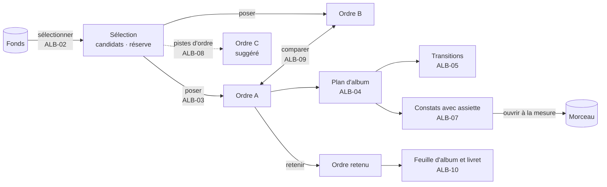
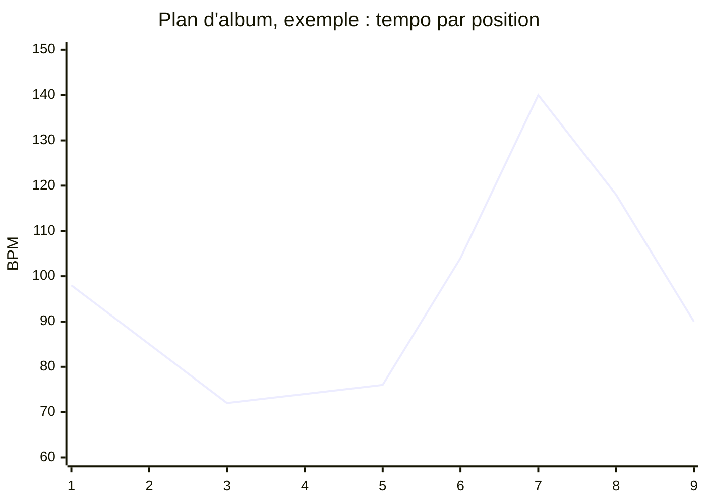

# 25 — ALB · Album

Un album n'est pas une liste de morceaux : c'est un ordre, des transitions, une
trajectoire. C'est aussi l'échelle la plus mal servie par les outils existants — et celle
où les chiffres recopiés périssent le plus vite. Ici, **tout chiffre est lu dans les
morceaux**, jamais recopié, et **tout constat dit son assiette**.

---

### ALB-01 · Créer un album

| | |
|---|---|
| **Objet** | Ouvrir un album, avec ou sans intention |
| **Échelle · moment** | É5 · M3 |
| **Appareils** | 💻 conçu pour · 📱 ✅ · 📖 — |
| **Besoins** | B11 |
| **Lit · écrit** | Écrit un **document d'album** |

**Règles**
- Titre facultatif, en liste datée comme pour un morceau.
- **Intention** facultative : cardinal visé, durée visée, support (numérique ; ou à deux
  faces, avec une durée maximale par face, réglable).
- L'intention n'est lue par **aucun** diagnostic de cardinal : le cardinal est toujours
  compté ([ADR-006](../adr/adr-006-le-partiel-est-normal.md)).
- Un fonds peut porter plusieurs albums ; un morceau peut appartenir à plusieurs.

**Critères d'acceptation**
1. *Étant donné* un album sans titre ni intention, *alors* son plan s'affiche, avec
   l'inventaire « 0 morceau ».
2. *Quand* le cardinal visé change, *alors* aucun constat ne change, et le cardinal affiché
   reste compté.
3. *Alors* deux albums peuvent contenir le même morceau.

---

### ALB-02 · Sélectionner les morceaux

| | |
|---|---|
| **Objet** | Choisir dans le fonds les candidats d'un album, et en mettre en réserve |
| **Échelle · moment** | É5 · M3 |
| **Appareils** | 💻 conçu pour · 📱 ✅ · 📖 — |
| **Besoins** | B11 |
| **Lit · écrit** | Écrit la **sélection** de l'album |

**Règles**
- On sélectionne depuis le fonds — une requête aide : « les morceaux aboutis en mineur »
  ([CAP-06](21-capter-et-organiser.md#cap-06--interroger-le-fonds)) —, depuis la boîte, ou
  depuis un morceau.
- Deux états dans la sélection : `candidat`, `réserve`. « Retenu » n'est pas un état stocké :
  il se **déduit** de la présence dans l'ordre retenu.
- Sélectionner ne fige pas un morceau ; le plan d'album suit ses changements.
- Retirer un morceau de la sélection le retire des ordres qui le contenaient ; chacun est
  marqué modifié, au journal.

**Critères d'acceptation**
1. *Quand* un morceau est retiré de la sélection, *alors* il disparaît des ordres qui le
   contenaient, et chacun est marqué modifié, daté, au journal.
2. *Alors* aucun champ « retenu » n'est stocké.
3. *Quand* un morceau sélectionné change de tempo, *alors* le plan d'album change sans
   écriture dans le document d'album.

---

### ALB-03 · Poser des ordres

| | |
|---|---|
| **Objet** | Ordonner les morceaux, en plusieurs ordres candidats nommés et datés, avec leurs faces |
| **Échelle · moment** | É5 · M6 |
| **Appareils** | 💻 conçu pour, par glisser-déposer · 📱 ✅ · 📖 — |
| **Besoins** | B11 |
| **Lit · écrit** | Écrit des **ordres** et, au besoin, l'**ordre retenu** |

**Règles**
- Un ordre est une suite de positions ; il peut être **partiel**.
- Les coupures de **faces** se posent dans l'ordre.
- Plusieurs ordres coexistent ; on en duplique un pour l'essayer ; un seul peut être
  **retenu**, et c'est une décision datée.
- Un même morceau ne peut pas figurer deux fois dans un ordre.

**Ne fait pas** — n'ordonne rien de lui-même ; ne note pas les ordres.

**Critères d'acceptation**
1. *Alors* deux ordres nommés coexistent ; en retenir un ne modifie pas l'autre.
2. *Étant donné* un ordre partiel de 5 morceaux sur 12, *alors* il est valide, et les
   constats d'adjacence ne portent que sur ses paires.
3. *Quand* Sacha place deux fois le même morceau, *alors* l'opération est refusée, en le
   nommant.
4. *Étant donné* un album de 12 candidats complets, *alors* il a zéro ordre tant que Sacha
   n'en pose pas.

---

### ALB-04 · Voir le plan d'album

| | |
|---|---|
| **Objet** | Voir les morceaux d'un ordre côte à côte, avec ce qui fait une transition |
| **Échelle · moment** | É5 · M5 |
| **Appareils** | 💻 ✅ · 📱 ✅ · 📖 ✅ |
| **Besoins** | B11, B03 |
| **Lit · écrit** | Lit les morceaux et l'ordre ; **n'écrit rien** |

**Règles**
- Des **couloirs** alignés par position : tonalité de début et de fin (avec leur place sur
  le cercle des quintes), tempo et ses changements, intensité, durée et cumul par face,
  nature de la fin (nette, fondue, en suspens).
- Chaque valeur porte son **statut** (décidée, proposée, absente).
- Entre deux morceaux, la **transition** ([ALB-05](#alb-05--décrire-les-transitions)).
- Les **faces**, et leur durée contre la limite du support.
- L'**assiette** en tête : morceaux considérés, morceaux portant chaque donnée, morceaux
  décidés.
- Sans ordre, le plan suit la sélection et le dit ; les constats d'adjacence sont alors
  indécidables.
- Maquette : [§ 50 · 3.4](../50-interfaces-et-appareils.md#34-lalbum--le-plan).

*Exemple fictif. Les positions 3 à 5 forment une grappe de tempo (72 · 74 · 76) : DG-A3 ;
le tempo de la position 3 est proposé (`72 ~`).*

**Critères d'acceptation**
1. *Alors* chaque valeur du plan porte son statut, distinguable en noir et blanc pur.
2. *Alors* le plan affiche son assiette.
3. *Quand* le tempo d'un morceau change, *alors* le plan change sans écriture dans le
   document d'album.
4. *Étant donné* un album sans ordre, *alors* le plan l'indique, et les constats
   d'adjacence sont `indécidable`.

---

### ALB-05 · Décrire les transitions

| | |
|---|---|
| **Objet** | Pour chaque paire de morceaux adjacents, voir la relation et décider la transition |
| **Échelle · moment** | É5 · M6 |
| **Appareils** | 💻 conçu pour · 📱 ✅ · 📖 — |
| **Besoins** | B11 |
| **Lit · écrit** | Lit les fins et les débuts ; écrit la **transition** décidée |

**Règles**
- **Engendré** : la relation tonale entre la fin de l'un et le début de l'autre (même
  tonalité, quinte, relative, demi-ton, triton…), la différence de tempo (en BPM et en
  rapport, 2 pour 1 compris), le changement d'intensité.
- **Décidé** : la nature de la transition (silence et sa durée, fondu, enchaîné,
  interlude), et une note.
- Une transition est attachée à la **paire** A→B : elle réapparaît dans tout ordre qui
  contient A→B.
- **Écouter** la transition : les dernières mesures de A puis les premières de B, en écoute
  de contrôle, ou depuis les prises si elles existent.

**Critères d'acceptation**
1. *Étant donné* un morceau qui finit en mi mineur suivi d'un morceau qui commence en si
   mineur, *alors* la relation est nommée « quinte ».
2. *Étant donné* une transition décrite pour A→B, *alors* elle réapparaît dans un autre
   ordre qui contient A→B.
3. *Quand* Sacha écoute la transition, *alors* les deux dernières mesures de A puis les deux
   premières de B sont jouées.

---

### ALB-06 · Tenir l'arc et la cohérence

| | |
|---|---|
| **Objet** | Écrire l'intention d'ensemble, et voir ce que les morceaux partagent |
| **Échelle · moment** | É5 · M6 |
| **Appareils** | 💻 conçu pour · 📱 ✅ · 📖 ✅ lecture |
| **Besoins** | B11 |
| **Lit · écrit** | Écrit l'**arc** et les **étiquettes** de thèmes, d'images et de procédés |

**Règles**
- L'**arc** : des notes libres et, si Sacha le veut, une **courbe d'intensité visée** par
  position, dessinée à la main.
- Des **étiquettes** par morceau — thèmes, images, procédés —, libres, dans le vocabulaire
  du fonds.
- Vues : matrice étiquettes × morceaux ; répartition.
- Constats liés : DG-A7 (redondance), DG-A8 (squelette partagé), DG-A10 (distance à
  l'arc).

**Critères d'acceptation**
1. *Étant donné* une courbe d'arc visée, *alors* elle se superpose aux intensités de
   l'ordre courant, et DG-A10 chiffre la distance.
2. *Étant donné* une image étiquetée sur plus de la moitié des morceaux, *alors* DG-A7 la
   signale, avec son assiette (« sur 9 morceaux étiquetés »).
3. *Étant donné* aucune étiquette, *alors* DG-A7 est `indécidable`.

---

### ALB-07 · Diagnostiquer l'album

| | |
|---|---|
| **Objet** | Énoncer ce que contient l'album, puis les constats d'adjacence, d'équilibre et de cohérence |
| **Échelle · moment** | É5 · M5 |
| **Appareils** | 💻 ✅ · 📱 ✅ · 📖 ✅ |
| **Besoins** | B11 |
| **Lit · écrit** | Lit ; **n'écrit rien** |

**Règles**
- L'**inventaire** (DG-A0) d'abord, puis DG-A1 à DG-A10 ([§ 60 · 3.4](../60-moteur-musical.md#34-album-é5)).
- Chaque constat porte son **assiette** : sur combien de morceaux il raisonne, combien
  portent la donnée requise, combien sont décidés.
- Sans ordre, les constats d'adjacence sont indécidables ; sur un ordre partiel, ils ne
  portent que sur les paires présentes.
- Un constat **ouvre le morceau en cause** à l'endroit utile (sa fin, son début).
- Les seuils sont des paramètres réglables.

**Critères d'acceptation**
1. *Étant donné* un album sans ordre, *alors* les constats d'adjacence rendent
   `indécidable`, jamais « aucun problème ».
2. *Étant donné* les tempos 98 · 85 · 72 · 74 · 76 · 104 · 140 · 118 · 90 dans cet ordre
   (jeu de test fictif), *alors* DG-A3 signale une grappe aux positions 3 à 5
   (72 · 74 · 76), et DG-A4 mesure une amplitude de 68 BPM (72 → 140) : il rend `absent`.
3. *Alors* chaque constat affiche son assiette.
4. *Alors* un album de 0, 1, 11 et 57 morceaux passe tous les diagnostics sans erreur,
   chaque constat avec un état et une assiette cohérents avec le cardinal (I08).
5. *Quand* le diagnostic tourne, *alors* aucun document n'est modifié.

---

### ALB-08 · Demander des pistes d'ordre

| | |
|---|---|
| **Objet** | Recevoir plusieurs ordres candidats, chacun avec ce qu'il réussit et ce qu'il sacrifie |
| **Échelle · moment** | É5 · M2 |
| **Appareils** | 💻 conçu pour · 📱 ✅ · 📖 — |
| **Besoins** | B09, B11 |
| **Lit · écrit** | Lit ; une piste posée crée un **nouvel ordre** de provenance `suggeree` |

**Règles**
- Une **fonction de coût explicite** sur les transitions et l'arc
  ([§ 60 · 4.4](../60-moteur-musical.md#44-les-pistes-dordre-dalbum)) ; ses **poids** sont
  visibles et réglables.
- Les **contraintes** de Sacha sont respectées : premier ou dernier morceau imposé, paires à
  garder ensemble, faces.
- Au moins **deux ordres**, différents entre eux d'au moins trois positions, chacun avec son
  explication critère par critère et ses transitions remarquables.
- Calculées sur l'appareil, hors ligne.
- Une piste ne réordonne **jamais** un ordre existant : on la **pose** comme nouvel ordre,
  ou on la **compare** ([ALB-09](#alb-09--comparer-deux-ordres)).

**Cas limites**
- Moins de trois morceaux : pas de piste, et Pupitre explique pourquoi.
- Tonalités indécises : le critère tonal s'appuie sur les propositions, marquées, et affiche
  son assiette.

**Critères d'acceptation**
1. *Quand* Sacha demande des pistes, *alors* au moins deux ordres sont rendus, différents
   d'au moins trois positions, chacun expliqué critère par critère.
2. *Étant donné* un premier morceau imposé, *alors* toutes les pistes le respectent.
3. *Quand* un poids change, *alors* les pistes changent sans autre saisie.
4. *Alors* aucune piste ne modifie un ordre existant ; en poser une crée un nouvel ordre, de
   provenance `suggeree`.
5. *Étant donné* la moitié des tonalités indécises, *alors* chaque piste affiche l'assiette
   de son critère tonal.

---

### ALB-09 · Comparer deux ordres

| | |
|---|---|
| **Objet** | Voir deux ordres côte à côte, avec leurs constats et leurs métriques |
| **Échelle · moment** | É5 · M2 |
| **Appareils** | 💻 conçu pour · 📱 ✅ · 📖 ✅ lecture |
| **Besoins** | B11, B14 |
| **Lit · écrit** | Lit ; **n'écrit rien** |

**Règles**
- Deux plans côte à côte ; les positions qui diffèrent sont marquées (filet et numéro, pas
  seulement la couleur).
- Métriques par ordre : constats par règle, somme des sauts de tempo, relations tonales,
  distance à l'arc, durée des faces.
- On écoute les transitions qui diffèrent.

**Critères d'acceptation**
1. *Alors* les positions différentes sont repérables en noir et blanc pur.
2. *Alors* les métriques affichées pour chaque ordre sont identiques à celles de son propre
   plan.

---

### ALB-10 · Feuille d'album et livret

| | |
|---|---|
| **Objet** | Produire les documents d'album : la feuille de route, et le livret de paroles |
| **Échelle · moment** | É5 · M6 |
| **Appareils** | 📖 conçu pour · 💻 ✅ · 📱 ✅ |
| **Besoins** | B11, B12 |
| **Lit · écrit** | Lit ; produit des **rendus**, figés en captation à l'export |

**Règles**
- **Feuille d'album** : l'ordre retenu (ou un ordre choisi), ses faces ; par morceau : titre,
  tonalités de début et de fin, tempo, métrique, durée, intensité, fin, transition prévue ;
  la courbe d'arc ; les constats et leur assiette ; le statut de chaque valeur.
- **Livret** : les lignes retenues de chaque morceau, dans l'ordre.
- Paginés par le moteur de mise en page ([REN-07](28-rendus-encre-impression.md#ren-07--imprimer)),
  lisibles au lutrin, imprimables.

**Critères d'acceptation**
1. *Étant donné* un ordre de 11 morceaux, *alors* la feuille d'album tient sur une page A4
   paysage ou deux A4 portrait, sans couper un morceau entre deux pages.
2. *Alors* toute valeur proposée y porte sa marque `~`.
3. *Alors* le livret contient les lignes retenues de chaque morceau, dans l'ordre, et aucune
   variante non retenue.
