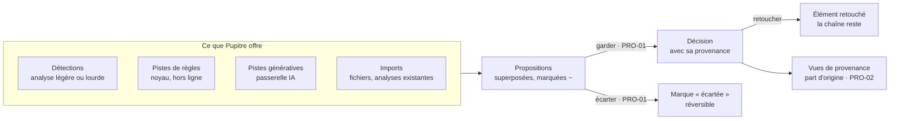

# 26 — PRO · Propositions, pistes et provenance

Ce que la machine mesure (**détections**) et ce qu'elle imagine (**pistes**) passent par
**une même porte** : rien ne devient une décision sans le geste de Sacha, et tout ce qui la
franchit garde sa provenance ([ADR-004](../adr/adr-004-proposer-n-est-pas-decider.md),
[ADR-005](../adr/adr-005-des-pistes-pas-des-reponses.md)).

---

### PRO-01 · Accepter ou écarter une proposition

| | |
|---|---|
| **Objet** | Faire d'une proposition une décision, ou l'écarter, d'un geste, à l'unité ou par plage |
| **Échelle · moment** | Toutes · M3, M5 |
| **Appareils** | 💻 ✅ · 📱 ✅ · 📖 ✅ une à une |
| **Besoins** | B04, B14 |
| **Lit · écrit** | Écrit l'élément accepté avec sa **provenance**, ou une **marque** « écartée » |

**Règles**
- Une proposition s'affiche superposée au contenu, marquée (italique et `~`, pointillé),
  avec sa **confiance** et ses alternatives (détection) ou sa **raison** (piste). Tant
  qu'elle est **en attente**, elle ne porte aucun glyphe de provenance
  ([§ 50 · 4.2](../50-interfaces-et-appareils.md#42-provenance-dun-élément)).
- **Accepter** écrit l'élément et sa provenance. **Écarter** écrit une petite marque, pour
  qu'elle ne revienne pas à chaque ouverture. Les deux se défont.
- Accepter **par plage** est un geste (« garder les mesures 1 à 8 ») ; au lutrin, on accepte
  une à une.
- Une proposition qui contredit une décision s'affiche comme **alternative** ; la décision
  reste affichée.
- Gestes par appareil : [§ 50 · 4.3](../50-interfaces-et-appareils.md#43-accepter-écarter).

**Ne fait pas** — n'accepte rien d'office, même à une confiance de 0,99 ; n'offre **aucune**
acceptation par seuil de confiance : la confiance d'un détecteur n'est pas sa justesse.

**Critères d'acceptation**
1. *Quand* 100 résultats d'analyse sont importés et 100 pistes demandées, *alors* aucun
   élément n'est décidé (I04).
2. *Quand* une proposition est acceptée puis le geste annulé, *alors* l'état proposé est
   restitué exactement.
3. *Quand* une proposition est écartée, *alors* elle ne réapparaît pas à la réouverture ;
   revenir sur ce geste la rétablit.
4. *Étant donné* une proposition contraire à une décision, *alors* elle s'affiche comme
   alternative, et la décision reste affichée.
5. *Alors* aucune fonction n'accepte selon un seuil de confiance.

---

### PRO-02 · Provenance et part d'origine

| | |
|---|---|
| **Objet** | Savoir d'où vient chaque élément, et répondre à « qu'est-ce qui est de ma main ? » |
| **Échelle · moment** | Toutes · M5 |
| **Appareils** | 💻 ✅ · 📱 ✅ · 📖 ✅ |
| **Besoins** | B10 |
| **Lit · écrit** | Lit les provenances ; **n'écrit rien** |

**Règles**
- Chaque élément de contenu porte sa provenance
  ([§ 30 · 8.1](../30-modele-de-domaine.md#81-la-provenance)), affichée par un glyphe discret
  ([§ 50 · 4.2](../50-interfaces-et-appareils.md#42-provenance-dun-élément)).
- La **vue de provenance** regroupe : par morceau (groupes par origine, comptés) ; par
  origine sur tout le fonds (« tout ce qui vient d'une piste générative ») ; par date.
- La **chaîne de retouches** se remonte : ligne, mère, grand-mère…
- La **part d'origine** : la part du matériau (lignes, accords, notes) issue de pistes
  acceptées, retouches comprises (marquées « retouchée depuis une piste »), ou d'un fichier
  versé dont l'origine déclarée est un générateur externe
  ([CAP-03](21-capter-et-organiser.md#cap-03--importer-un-fonds-existant)). Par dimension,
  **à la demande** seulement.
- Le matériau accepté d'un fichier versé sans origine déclarée forme un groupe explicite,
  « versé sans origine déclarée » : il ne compte ni dans la part d'origine, ni comme de la
  main de Sacha ([ADR-024](../adr/adr-024-import-d-un-fonds.md)).
- Un **rapport de provenance** s'exporte (texte ou PDF) : il liste chaque élément issu d'une
  piste ou d'un fichier versé déclaré généré, avec son moteur, son modèle ou le générateur
  déclaré, et sa date. Il sert par exemple quand une démarche de
  dépôt d'œuvre demande quelle part doit quelque chose à une machine.

**Ne fait pas** — ne déduit jamais une provenance ; ne l'efface jamais ; ne porte aucun
jugement.

**Critères d'acceptation**
1. *Alors* une ligne importée a la provenance `importee`, et une ligne transcrite non
   acceptée n'a pas de provenance d'auteur.
2. *Alors* la vue par morceau compte chaque groupe, et les lignes sans provenance d'auteur
   forment un groupe explicite « origine non décidée ».
3. *Étant donné* 3 lignes sur 24 venues de pistes acceptées, *alors* la part d'origine du
   texte vaut 3/24, et elle n'apparaît que sur demande.
4. *Quand* une ligne suggérée est retouchée, *alors* la trace « retouchée depuis une piste »
   demeure.
5. *Alors* le rapport exporté liste chaque élément d'origine `suggeree`, avec son moteur ou
   son modèle et sa date.
6. *Étant donné* 2 lignes acceptées sur 20, venues d'un texte versé déclaré produit par un
   générateur externe, et 3 d'un texte versé sans origine déclarée, *alors* la part
   d'origine du texte vaut 2/20, les 3 autres forment le groupe « versé sans origine
   déclarée », et le rapport exporté liste les 2 premières avec le générateur déclaré.

---

### PRO-03 · Demander des pistes

| | |
|---|---|
| **Objet** | Le contrat commun à toutes les demandes de pistes, à toutes les échelles |
| **Échelle · moment** | É1 à É5 · M2 |
| **Appareils** | 💻 ✅ · 📱 ✅ · 📖 — |
| **Besoins** | B09 |
| **Lit · écrit** | Lit le contexte ; les pistes sont des dérivés éphémères jusqu'à leur acceptation |

**Règles**
- Le contrat du [§ 60 · 4.1](../60-moteur-musical.md#41-deux-sortes-un-même-contrat) :
  à la demande, sur un élément précis ; au moins deux pistes ou l'aveu qu'il n'y en a pas ;
  chacune expliquée, vérifiée, écoutable quand c'est musical ; groupées par effet, jamais
  classées par qualité. Un ordre objectif et nommé (par exemple le coût en mesures
  ajoutées) est admis, et dit.
- Deux sortes : **de règles** (noyau, hors ligne) ; **génératives** (passerelle, à la
  maison).
- Chaque demande a un identifiant, repris dans la provenance des éléments gardés.
- Une demande en cours s'annule.

**Ne fait pas** — ne propose rien sans demande ; n'étiquette aucune piste « meilleure » ou
« recommandée » ; n'applique rien d'office ; n'engendre ni section, ni mélodie, ni texte
entiers.

**Critères d'acceptation**
1. *Alors* une demande rend au moins deux pistes valides, ou « pas de piste valable » avec
   les motifs de rejet (I06).
2. *Étant donné* trente minutes d'édition sans demande, *alors* aucune piste ne s'est
   affichée.
3. *Alors* chaque piste affiche sa raison.
4. *Alors* aucune piste ne porte d'étiquette de qualité ni de rang ; quand des pistes sont
   ordonnées, le critère de l'ordre est affiché (« par mesures ajoutées »).
5. *Quand* une demande est annulée, *alors* rien n'est écrit.

---

### PRO-04 · Passerelle IA et consentement

| | |
|---|---|
| **Objet** | Choisir où partent les demandes génératives, consentir à chaque envoi distant, garder la trace de ce qui est parti |
| **Échelle · moment** | Transverse |
| **Appareils** | 💻 ✅ · 📱 ✅ · 📖 — |
| **Besoins** | B09, B13 |
| **Lit · écrit** | Écrit les réglages de la passerelle et le **journal des envois** (sur le nœud) |

**Règles**
- Fournisseur : **local** (par défaut, si le nœud en porte un), **distant** (sur choix
  explicite), ou **aucun** ([ADR-015](../adr/adr-015-passerelle-ia.md)).
- Consentement distant : **par demande** par défaut, avec l'**aperçu exact** de ce qui
  partira ; ou « toujours pour ce morceau », révocable.
- **Journal des envois** : date, tâche, fournisseur, modèle, taille, empreinte ; consultable
  et exportable.
- **Contexte minimal** : la tâche n'envoie que ce dont elle a besoin.
- Cumul des **coûts** affiché pour le fournisseur distant.
- Indisponibilité (hors du foyer, fournisseur en panne, refus du modèle) : « pas de piste »,
  jamais une erreur bloquante.

**Ne fait pas** — n'envoie rien sans consentement ; n'envoie jamais le fonds entier ;
n'envoie aucune captation audio.

**Critères d'acceptation**
1. *Étant donné* le fournisseur distant et aucun consentement, *quand* Sacha demande des
   variantes, *alors* aucun appel sortant n'a lieu (I23).
2. *Alors* l'aperçu affiché avant consentement est identique, octet pour octet, à ce qui
   part.
3. *Alors* chaque appel distant ajoute exactement une ligne au journal des envois.
4. *Quand* Sacha demande des variantes d'une ligne, *alors* seuls la ligne, sa phrase et ses
   contraintes partent.
5. *Alors* aucune captation audio ne quitte le nœud par la passerelle.

---

### PRO-05 · Travailler sans suggestion

| | |
|---|---|
| **Objet** | Retirer toute piste de l'interface, partout ou pour un morceau |
| **Échelle · moment** | Transverse |
| **Appareils** | 💻 ✅ · 📱 ✅ · 📖 ✅ |
| **Besoins** | B10 |
| **Lit · écrit** | Écrit un réglage, global ou par morceau |

**Règles**
- En mode sans suggestion, toutes les demandes de pistes disparaissent de l'interface
  ([MIC-10](22-micro-motif-et-phrase.md#mic-10--demander-des-pistes-de-détail),
  [SEC-07](23-section.md#sec-07--demander-des-pistes-de-section),
  [MOR-10](24-morceau.md#mor-10--demander-des-pistes-de-forme),
  [ALB-08](25-album.md#alb-08--demander-des-pistes-dordre)). La carte des chemins reste
  consultable comme référence, sans geste d'ajout.
- La [table de la tonalité](22-micro-motif-et-phrase.md#mic-12--parcourir-la-table-de-la-tonalité)
  reste affichée, avec son geste **prendre** : elle ne propose rien, et un accord qu'on y
  prend est une saisie ([ADR-018](../adr/adr-018-la-table-montre-tout.md)).
- Les **détections** restent : ce sont des mesures, pas des pistes.

**Critères d'acceptation**
1. *Étant donné* le mode sans suggestion, *alors* aucune vue ne présente de geste de demande
   de pistes (contrôle statique des vues).
2. *Alors* le mode réglé pour un morceau n'affecte pas les autres.
3. *Alors* les détections restent affichées.
4. *Étant donné* le mode sans suggestion, *alors* la table de la tonalité reste affichée, et
   un accord qu'on y prend porte la provenance `saisie`.

---

### PRO-06 · Régler les règles et la doctrine

| | |
|---|---|
| **Objet** | Voir, écrire, activer et désactiver les règles ; écrire la doctrine de Sacha |
| **Échelle · moment** | Transverse |
| **Appareils** | 💻 conçu pour · 📱 ✅ · 📖 — |
| **Besoins** | B04, B09 |
| **Lit · écrit** | Écrit les **règles**, la **doctrine**, les **profils d'outil** et les désactivations |

**Règles**
- Les règles sont des données ([§ 60 · 1](../60-moteur-musical.md#1-trois-natures-de-règles)) :
  identifiant, nature, échelle, paramètres, source, actif.
- La **doctrine** s'écrit dans les mots de Sacha ; une règle de doctrine peut porter, en
  plus, une forme exécutable.
- Désactiver une règle **pour un morceau** exige un motif.
- Les **seuils** sont réglables ; la valeur par défaut reste visible.
- Avant de changer une règle, son **effet** s'affiche : « s'applique à 14 constats
  actuels ».
- Toute modification est une opération nommée, au journal des réglages.

**Ne fait pas** — ne permet pas de réécrire le contenu d'une règle de théorie (seulement de
l'activer et d'en régler les paramètres) ; n'accepte pas de règle sans source.

**Critères d'acceptation**
1. *Quand* une règle est désactivée, *alors* elle disparaît de tous les constats, sans
   redémarrage.
2. *Quand* une désactivation par morceau est demandée sans motif, *alors* elle est refusée.
3. *Quand* la doctrine est vidée, *alors* tous les constats de théorie sont inchangés.
4. *Quand* un seuil change, *alors* les constats concernés changent sans autre saisie, et
   l'ancien seuil reste au journal.

---

### PRO-07 · Signaler les incohérences

| | |
|---|---|
| **Objet** | Rendre visibles les contradictions entre sources, sans jamais arbitrer |
| **Échelle · moment** | Fonds · M5 |
| **Appareils** | 💻 ✅ · 📱 ✅ · 📖 ✅ |
| **Besoins** | B04 |
| **Lit · écrit** | Lit ; **n'écrit rien** |

**Règles**
- Contradictions détectées : entre propositions de sources différentes pour un même
  attribut (deux analyses, une analyse et un import) ; entre une valeur décidée et une
  proposition plus récente, signalée « à revoir ? » sans toucher la décision.
- Pour chacune : les valeurs, leurs sources, leurs dates. Pupitre **ne choisit pas** la plus
  récente : une source récente n'est pas une source juste.

**Critères d'acceptation**
1. *Étant donné* deux analyses d'une même prise qui proposent 88 et 140 BPM, *alors* une
   incohérence apparaît, avec ses deux sources.
2. *Étant donné* une nouvelle analyse qui contredit une tonalité décidée, *alors* elle est
   signalée « à revoir ? », et la décision est inchangée.
3. *Alors* le rapport n'écrit rien.
4. *Quand* Sacha tranche par une décision, *alors* l'incohérence disparaît du rapport, sans
   qu'aucune règle ne change.
