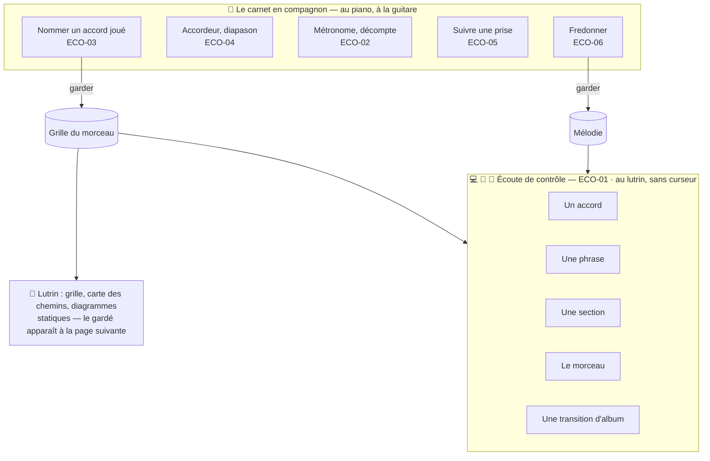

# 27 — ECO · Écoute et compagnon d'instrument

Le son a deux usages dans Pupitre, et deux seulement : **vérifier l'écrit** (l'écoute de
contrôle) et **accompagner l'instrument** (le carnet qui écoute, accorde, bat la mesure,
suit une prise). Il n'en produit jamais comme résultat
([ADR-009](../adr/adr-009-ecoute-de-controle.md)).

---

### ECO-01 · Écoute de contrôle

| | |
|---|---|
| **Objet** | Entendre ce qui est écrit — un accord, une phrase, une section, la forme — pour le vérifier |
| **Échelle · moment** | É1 à É5 · M2 |
| **Appareils** | 💻 ✅ · 📱 ✅ · 📖 ✅ un accord ou une suite, sans curseur animé |
| **Besoins** | B07 |
| **Lit · écrit** | Lit le matériau effectif ; **n'écrit rien** |

**Règles**
- Joue les **accords** (voicing de piano serré, ou le **doigté de guitare** retenu quand la
  guitare est choisie : on entend ce que montre le diagramme) et la **mélodie** (piano, ou un
  timbre doux distinct). Clic facultatif.
- Portée : une sélection, une phrase, une section, le morceau dans l'ordre de la forme
  (écarts appliqués), une transition d'album.
- Au **tempo décidé** ; ralentir pour travailler ne change pas le tempo du morceau ; boucle
  sur une plage.
- Au **diapason de lecture** réglé, pour sonner juste avec le piano de la maison.
- La mesure jouée est repérée sur l'établi et le carnet, jamais au lutrin.
- Au lutrin, on écoute un accord ou une suite, sans curseur animé : rien ne bouge à l'écran
  pendant l'écoute (arbitrage A19,
  [§ 90](../90-questions-ouvertes.md#les-arbitrages-pris-dans-cette-conception)).
- Les échantillons sont servis par le nœud, jamais par un hôte public, puis gardés en
  cache pour l'écoute hors ligne.
- Une prise en stems se joue par un lecteur de prise par stem : tous ensemble, ou en n'en
  gardant que certains. Ce n'est pas un mixage, puisque rien ne s'y règle ni ne s'exporte
  ([ADR-024](../adr/adr-024-import-d-un-fonds.md)).

**Ne fait pas** — pas de mixage, pas d'effet, pas de rendu instrument par instrument de
l'arrangement, pas de batterie, pas d'interprétation « humanisée », **aucune exportation
audio**.

**Cas limites**
- Accord hors théorie : ses notes sont jouées.
- Tempo non décidé : lecture au tempo proposé, signalé ; sans proposition, à 90 BPM, signalé.
- Rien à jouer : Pupitre le dit.

**Critères d'acceptation**
1. *Quand* une phrase est jouée, *alors* sa durée jouée égale sa durée engendrée à 1 % près.
2. *Étant donné* la guitare choisie et un doigté épinglé, *alors* l'accord joué contient
   exactement les notes du diagramme.
3. *Alors* le graphe audio ne contient qu'échantillonneurs, lecteurs de prise (ralentis à
   hauteur constante), volumes et sortie, et aucune fonction d'exportation audio n'existe
   (I21).
4. *Étant donné* le carnet hors ligne, *alors* l'écoute fonctionne.
5. *Quand* la lecture est ralentie, *alors* le tempo décidé du morceau est inchangé.
6. *Alors* aucun échantillon n'est demandé à un autre hôte que le nœud (I24).
7. *Étant donné* une prise en stems, *quand* Sacha la joue, *alors* tous ses stems jouent
   ensemble, depuis le même instant ; *quand* il en coupe un, *alors* les autres continuent,
   et rien ne s'exporte.
7. *Étant donné* le lutrin, *quand* un accord ou une suite est joué, *alors* rien ne bouge à
   l'écran : ni curseur, ni animation (I18).

---

### ECO-02 · Métronome et décompte

| | |
|---|---|
| **Objet** | Battre la mesure, et compter avant une prise |
| **Échelle · moment** | É4 · M3, M4 |
| **Appareils** | 💻 ✅ · 📱 ✅ · 📖 — |
| **Besoins** | B07, B08 |
| **Lit · écrit** | Lit tempo et métrique ; un tempo tapé devient une **proposition** |

**Règles**
- Au tempo du morceau ou à un tempo libre ; premier temps accentué selon la métrique ;
  subdivisions au choix.
- **Décompte** d'une ou deux mesures avant un enregistrement ou une lecture.
- **Tempo tapé** : quelques tapes en rythme donnent une proposition de tempo pour le morceau.
- Une pulsation visuelle large sur le carnet ; rien sur le lutrin.
- Ordonnancement sur l'horloge audio, pas sur les minuteries de l'interface.

**Critères d'acceptation**
1. *Étant donné* 120 BPM, *alors* l'intervalle entre deux clics, mesuré dans le flux audio,
   est de 500 ms à 1 ms près, sur cinq minutes.
2. *Étant donné* une métrique 3/4, *alors* un clic sur trois est accentué.
3. *Quand* Sacha tape un tempo, *alors* il devient une proposition pour le morceau, jamais
   une décision.

---

### ECO-03 · Nommer un accord joué

| | |
|---|---|
| **Objet** | Au piano ou à la guitare, jouer un accord, le voir nommé, et le garder d'un geste |
| **Échelle · moment** | É1 · M1, M2 |
| **Appareils** | 📱 conçu pour · 💻 — · 📖 — |
| **Besoins** | B08 |
| **Lit · écrit** | Lit le micro ; un accord gardé s'écrit à la position courante, provenance `detectee` |

**Règles**
- Un accord à la fois : Pupitre écoute environ une seconde et demie après l'attaque.
- L'accord se reconnaît à son **chromagramme**, pas par une détection de fondamentale : un
  accord fait sonner plusieurs notes à la fois, et une fondamentale n'en dit qu'une. Le
  calcul se fait en Rust, sur l'appareil, hors ligne (analyse légère,
  [ADR-014](../adr/adr-014-analyse-en-deux-etages.md)).
- Les hauteurs sont corrigées du **diapason mesuré** de l'instrument
  ([ECO-04](#eco-04--accordeur-et-diapason)).
- Affichage : le nom en très grand, marqué `~`, avec sa confiance ; l'alternative en petit ;
  la note de basse, pour proposer un accord renversé.
- **« Garder »** occupe toute la largeur : il se touche sans viser, les mains revenant du
  clavier. « Rejouer » recommence.
- L'accord gardé s'insère dans le motif ou la loupe ouverts, à la position courante.
- Au lutrin, rien en temps réel : l'accord gardé apparaît à la page suivante.
- Résonance de la pédale : l'écoute se cale sur l'attaque ; Pupitre suggère de lever la
  pédale si l'accord précédent pollue.

**Ne fait pas** — ne transcrit pas en continu ce qui est joué ; n'insère rien sans
« Garder ».

**Cas limites**
- Pièce bruyante : confiance basse affichée ; sous le seuil, « incertain », avec les notes
  entendues.
- Agrégat sans nom : les notes, sans nom.

**Critères d'acceptation**
1. *Étant donné* le jeu de référence de 50 accords de piano, *alors* la bonne réponse figure
   parmi les deux premiers candidats dans au moins 85 % des cas — seuil de départ, validé
   au banc ([§ 70 · 5](../70-qualite-et-verification.md#5-le-banc-dévaluation-des-analyseurs)).
2. *Alors* aucun accord n'est inséré sans « Garder ».
3. *Alors* l'affichage arrive au plus 2 s après la fin de la fenêtre d'écoute, sur le
   téléphone de référence.
4. *Étant donné* une confiance sous le seuil, *alors* l'affichage dit « incertain » et montre
   les notes entendues.
5. *Étant donné* un instrument accordé 20 cents bas, au diapason mesuré, *alors* aucune
   erreur systématique de nom n'apparaît sur le jeu de référence.

---

### ECO-04 · Accordeur et diapason

| | |
|---|---|
| **Objet** | Accorder la guitare ; mesurer le diapason du piano ou d'une prise |
| **Échelle · moment** | Transverse · M1 |
| **Appareils** | 📱 conçu pour · 💻 ✅ · 📖 — |
| **Besoins** | B04, B08 |
| **Lit · écrit** | Écrit des **propositions** de diapason (instrument, prise) et le diapason de lecture décidé |

**Règles**
- **Accordeur** chromatique : note et décalage en cents, référence réglable.
- **Diapason d'un instrument** : quelques notes jouées donnent une estimation en cents,
  proposée comme diapason de lecture et comme profil de l'instrument.
- **Diapason d'une prise** : estimé par l'analyse, attaché à la prise comme proposition.
- **Aucune analyse de hauteur d'une prise ne suppose 440** : le diapason est estimé d'abord ;
  si l'estimation échoue, l'analyse le dit et s'arrête. En écoute directe, le décalage est
  estimé en continu et affiché.

**Critères d'acceptation**
1. *Étant donné* un la joué à 435 Hz, *alors* l'accordeur affiche « La · −20 cents » pour la
   référence 440.
2. *Alors* le diapason mesuré d'une prise est une proposition attachée à la prise.
3. *Étant donné* une prise dont le diapason ne s'estime pas, *alors* l'analyse de hauteur
   s'arrête en le disant, sans résultat.

---

### ECO-05 · Suivre une prise

| | |
|---|---|
| **Objet** | Écouter une prise en voyant où l'on est dans le morceau, mesure par mesure, et boucler une section |
| **Échelle · moment** | É4 · M1, M4 |
| **Appareils** | 📱 conçu pour · 💻 ✅ · 📖 — |
| **Besoins** | B08, B15 |
| **Lit · écrit** | Lit la prise et sa carte de temps ; **n'écrit rien** |

**Règles**
- S'appuie sur la **carte de temps** de la prise ([MOR-03](24-morceau.md#mor-03--découper-une-prise-à-loreille)).
- Un curseur sur la frise et la grille ; la mesure en cours repérée.
- **Boucler** une occurrence ou une plage.
- **Ralentir** sans changer la hauteur, pour travailler : c'est une aide à la lecture, pas
  une transformation de la prise.
- **Basculer** entre la prise et l'écoute de contrôle de l'écrit, à la même position
  musicale : on entend tout de suite si la grille dit vrai.

**Critères d'acceptation**
1. *Étant donné* une carte de temps, *alors* le curseur montre la bonne mesure, à un temps
   près, tout au long d'une prise de quatre minutes jouée sans clic.
2. *Quand* Sacha boucle « Refrain 2 », *alors* l'intervalle rejoué est exactement celui de
   cette occurrence dans la prise.
3. *Quand* la lecture est ralentie à 75 %, *alors* la hauteur perçue ne bouge pas de plus de
   5 cents.
4. *Quand* Sacha bascule entre prise et écrit, *alors* la lecture reprend à la même mesure et
   au même temps.

---

### ECO-06 · Fredonner une mélodie

| | |
|---|---|
| **Objet** | Chanter ou siffler une idée, et la recevoir en notes proposées |
| **Échelle · moment** | É0, É1 · M1 |
| **Appareils** | 📱 conçu pour · 💻 ✅ · 📖 — |
| **Besoins** | B01 |
| **Lit · écrit** | Lit une prise ; produit des **propositions** de notes et de tempo |

**Règles**
- Transcription **sur l'appareil**, hors ligne, en Rust, par un modèle choisi au banc
  (analyse légère, 🔶 H04).
- Résultat : des notes proposées, orthographiées dans une tonalité proposée, calées sur une
  grille et un tempo proposés, chacune avec sa confiance.
- **A/B** entre la prise et la transcription jouée ; on corrige, puis on garde.
- Sur une longue prise, on transcrit une plage choisie.
- À la maison, l'analyse lourde peut proposer une **seconde** transcription, affichée à côté
  de la première.

**Ne fait pas** — ne remplace jamais la prise ; n'accepte rien d'office.

**Cas limites**
- Environnement bruyant : confiance basse, signalée.
- Glissements et vibrato : les notes de hauteur incertaine sont marquées.

**Critères d'acceptation**
1. *Avant* son activation, la fonction atteint, sur le jeu de référence des fredonnements, la
   F-mesure par note fixée au banc (attaque à ± 50 ms, hauteur à ± 50 cents).
2. *Étant donné* le carnet hors ligne, *alors* 15 s de fredonnement sont transcrites en 5 s
   au plus sur le téléphone de référence (🔶 H04).
3. *Alors* toutes les notes transcrites sont des propositions.
4. *Quand* une transcription lourde arrive, *alors* elle s'affiche à côté de la première,
   sans la remplacer.
