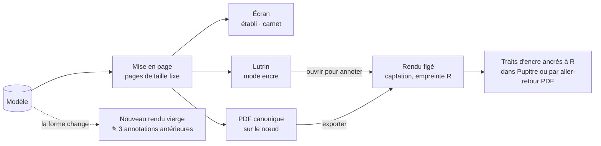

# 28 — REN · Rendus, encre et impression

Tout ce que Sacha lit est un **rendu engendré** du modèle : jamais stocké, toujours à jour,
identique à l'écran du lutrin et sur le papier. Quand on annote, on annote un **rendu
figé**, qui ne bougera plus ([ADR-011](../adr/adr-011-encre-ancree-rendu-fige.md)).

---

### REN-01 · Fiche de travail

| | |
|---|---|
| **Objet** | Le document d'un morceau, ou la table d'une tonalité : lisible, imprimable, annotable |
| **Échelle · moment** | É4 · M5 |
| **Appareils** | 📖 conçu pour · 💻 ✅ · 📱 ✅ consultation |
| **Besoins** | B12, B03 |
| **Lit · écrit** | Lit tout le morceau, ou une tonalité pour le gabarit « table » ; produit des **pages** (dérivé) |

**Règles**
- **Engendrée**, jamais stockée ([ADR-001](../adr/adr-001-un-seul-materiau.md)).
- Composition, dans l'ordre : en-tête (titre, statut, tonalité, tempo, métrique, durée,
  maturité, date du rendu) · frise de forme et d'intensité · forme détaillée · grille ·
  portée avec paroles, ou paroles seules · diagrammes des accords employés · plan
  d'arrangement · résumé de provenance · constats, si demandés.
- **Pagination** par le moteur de mise en page : pages fixes (A4, A5, ou la taille de l'écran
  du lutrin) ; aucune mesure coupée entre deux pages ; pied de page avec `page / total`,
  date du rendu, empreinte courte et nombre de propositions en attente.
- Le statut de chaque valeur est visible ([§ 50 · 4.1](../50-interfaces-et-appareils.md#41-statut-dune-valeur)).
- Trois gabarits de morceau : **fiche complète** ; **fiche de répétition** (grille, paroles,
  diagrammes, en grands caractères) ; **fiche de paroles**.
- Un quatrième gabarit, **« table »**, qui part d'une tonalité et non d'un morceau : une
  tonalité par page ([MIC-12](22-micro-motif-et-phrase.md#mic-12--parcourir-la-table-de-la-tonalité)),
  et au verso, pour les accords du centre et dans leur ordre, leurs diagrammes (guitare,
  clavier, ou les deux selon le réglage) et leurs palettes, la portée sans clé comprise
  ([MIC-13](22-micro-motif-et-phrase.md#mic-13--lire-la-palette-dun-accord)).
- Le **cahier des tables** : les 24 tonalités, un sommaire à liens, au format de l'écran du
  lutrin, imprimable avec la même pagination (I19). Il compte 49 pages en paysage,
  209,5 × 157 mm :
  - **l'ordre** : le sommaire, puis les 24 tonalités dans l'ordre du cahier, le cycle des
    quintes, chaque majeure suivie de sa relative (la relative de fa♯ majeur s'écrit mi♭ mineur,
    A17). Chaque tonalité a sa page de table, dans la couche sombre du réglage, masquée par
    défaut, suivie de son verso. La table de la k-ième tonalité, comptée depuis 0, est la page
    2 + 2k ;
  - **le sommaire** : le titre « Cahier des tables », une ligne qui dit l'instrument et la couche
    sombre du cahier (« instrument : guitare et clavier · couche sombre : masquée »), puis une
    entrée par tonalité, qui dit son nom et sa page. Les entrées se lisent de ligne en ligne et
    de gauche à droite, dans l'ordre du cahier : deux paires par ligne, une majeure et sa
    relative, que sépare un blanc plus étroit que celui qui sépare deux paires. Chaque entrée
    est encadrée, et son cadre est la zone de son lien vers sa table : 16 mm de haut, pour 12 au
    moins
    ([§ 50 · 6.3](../50-interfaces-et-appareils.md#63-les-contraintes-physiques-en-millimètres)) ;
  - **le pied**, sur chaque page, sommaire compris : « page 2 / 49 · rendu le 1er nov. 2026 ·
    empreinte 7c1e4a », et sur une page de table « · verso : diagrammes et palettes des accords
    du centre ». L'empreinte est faite des six premiers caractères hexadécimaux du SHA-256 du
    SVG de la page sans son pied. Le pied se coupe aux « · », à 11 pt, sur les deux lignes
    que chaque page lui réserve au bas de sa hauteur utile, sous un filet : il ne passe jamais
    sur le contenu.
- Déterministe : mêmes données, même gabarit, mêmes pages (I25).
- Maquettes : une page de fiche, [§ 50 · 3.6](../50-interfaces-et-appareils.md#36-le-lutrin--une-page-de-fiche-de-travail) ; une page du gabarit « table », [§ 50 · 3.7](../50-interfaces-et-appareils.md#37-la-table-de-la-tonalité).

**Cas limites**
- Morceau vide : une page, avec le titre ou « sans titre », et « rien de renseigné ».
- Pas de mélodie : la portée est omise ; les paroles s'affichent avec les accords au-dessus
  des syllabes.

**Critères d'acceptation**
1. *Étant donné* un morceau sans aucune donnée, *alors* la fiche fait une page, sans erreur.
2. *Étant donné* un morceau de 150 mesures, *alors* aucune mesure n'est coupée entre deux
   pages (I19).
3. *Alors* deux engendrements des mêmes données donnent des pages d'empreinte identique (I25).
4. *Alors* la fiche convertie en noir et blanc pur reste intégralement interprétable (I17).
5. *Étant donné* un morceau sans mélodie, *alors* la fiche montre les paroles avec les accords
   au-dessus des syllabes.
6. *Alors* aucun texte de la fiche n'est composé sous 11 pt, ni un diagramme de doigté sous
   18 mm ([§ 50 · 6.3](../50-interfaces-et-appareils.md#63-les-contraintes-physiques-en-millimètres))
   (IR-7).
7. *Alors* le cahier des tables compte les 24 tonalités, chacune sur une page et son verso,
   et son sommaire mène à chacune ; au lutrin et à l'impression, ses pages sont les mêmes
   (I19).

---

### REN-02 · Grille d'accords

| | |
|---|---|
| **Objet** | Les accords mesure par mesure, lisibles d'un coup d'œil |
| **Échelle · moment** | É3, É4 · M5 |
| **Appareils** | 💻 ✅ · 📱 ✅ · 📖 ✅ |
| **Besoins** | B12, B08 |
| **Lit · écrit** | Lit ; produit un rendu |

**Règles**
- Des cases par mesure, quatre ou huit par ligne, alignées sur les phrases et les sections.
- Noms dans l'orthographe saisie ; les noms engendrés suivent la préférence d'orthographe
  ([MIC-02](22-micro-motif-et-phrase.md#mic-02--saisir-et-éditer-des-accords)) ; degré en
  dessous, à la demande ; fonction en pastille, à la demande.
- Marques : `*` emprunt · soulignement pointillé pour un accord douteux · `~` proposé ·
  `—` absent · `N.C.` silence · `?` inconnu.
- Une occurrence sans écart peut se rendre « comme Refrain 1 » ; avec des écarts, « comme
  Refrain 1, sauf mesure 7 », la mesure 7 écrite en entier.
- Avec un capodastre : le nom réel et la forme jouée ([REN-04](#ren-04--diagrammes-de-manche)).

**Critères d'acceptation**
1. *Alors* les marques d'emprunt, de doute, de proposition et d'absence sont présentes sans
   couleur (I17).
2. *Étant donné* une occurrence avec un écart en mesure 7, *alors* elle se rend « comme
   Refrain 1, sauf mesure 7 », avec la mesure 7 écrite.
3. *Quand* la préférence d'orthographe passe de `Gb` à `F#`, *alors* tous les noms
   engendrés changent sans nouvelle saisie, et un `Gbm` saisi reste `Gbm`.

---

### REN-03 · Portée

| | |
|---|---|
| **Objet** | La mélodie sur la portée, avec les paroles sous les notes et les chiffrages au-dessus |
| **Échelle · moment** | É2 à É4 · M5 |
| **Appareils** | 💻 ✅ · 📱 ✅ une phrase à la fois · 📖 ✅ |
| **Besoins** | B12 |
| **Lit · écrit** | Lit ; produit un rendu par un format intermédiaire **jamais stocké** |

**Règles**
- Gravée par une bibliothèque de gravure, depuis un format intermédiaire engendré du modèle
  ([§ 41](../41-pile-technique.md)).
- Armure de la tonalité décidée ; tonalité indécise : armure du premier candidat, et
  l'en-tête nomme les candidats.
- Paroles alignées, traits de prolongation des mélismes ; chiffrages d'accords au-dessus ;
  numéros de mesure.
- Une note proposée dans un passage décidé est **entre parenthèses** ; un passage
  entièrement proposé porte un **crochet** marqué `~`.

**Cas limites**
- Pas de mélodie : la portée est omise, sans erreur.

**Critères d'acceptation**
1. *Étant donné* un morceau en si mineur, *alors* l'armure porte deux dièses.
2. *Alors* chaque syllabe alignée est sous sa note, et un mélisme porte un trait de
   prolongation.
3. *Alors* une note proposée dans un passage décidé est entre parenthèses, et un passage
   entièrement proposé porte un crochet `~`.
4. *Alors* aucun fichier du format intermédiaire n'existe dans les documents.

---

### REN-04 · Diagrammes de manche

| | |
|---|---|
| **Objet** | Pour chaque accord employé, un doigté jouable dans son contexte, dessiné en noir sur blanc |
| **Échelle · moment** | É1 à É4 · M3, M5 |
| **Appareils** | 💻 ✅ · 📱 ✅ · 📖 ✅ idéal : trait noir sur blanc |
| **Besoins** | B08, B12 |
| **Lit · écrit** | Lit grille et épinglages ; écrit un **épinglage** depuis l'établi ou le carnet |

**Règles**
- Doigté par défaut **calculé selon le contexte** ([§ 60 · 6](../60-moteur-musical.md#6-les-doigtés-de-guitare)) ;
  doigté **épinglé** encadré. Un épinglage devenu inactif après une transposition n'est pas
  dessiné : il est listé, et rien n'est réécrit.
- **Capodastre** : paramètre de rendu ; le nom réel et la forme jouée s'affichent tous deux.
- Dessin : six cordes, quatre ou cinq frettes, numéro de frette de départ s'il dépasse 1 ;
  **point plein** pour un doigt, **cercle** pour une corde à vide, **croix** pour une corde
  étouffée, **trait épais** pour un barré, numéros de doigts dessous.
- Au moins **18 mm** de large ; lisible en noir et blanc pur.
- Accord injouable : « pas de doigté jouable », et ses notes.

**Critères d'acceptation**
1. *Étant donné* un même accord dans deux grilles, l'une en position ouverte et l'autre en
   haut du manche, *alors* les doigtés diffèrent, et le déplacement total de la seconde grille
   est minimal avec le doigté choisi.
2. *Alors* tous les doigtés proposés respectent : aucune note étrangère à l'accord, la basse
   juste, toutes les notes sauf éventuellement la quinte, une étendue d'au plus trois frettes,
   au plus quatre doigts —
   vérifié sur les douze tonalités et un vocabulaire de référence.
3. *Quand* un doigté est épinglé, *alors* il apparaît dans la grille, la fiche, la carte des
   chemins et l'impression, sans autre saisie.
4. *Étant donné* un épinglage de morceau et un de fonds pour le même accord, *alors* celui du
   morceau gagne.
5. *Étant donné* un accord injouable, *alors* « pas de doigté jouable » s'affiche avec ses
   notes, jamais un diagramme approximatif.
6. *Alors* en noir et blanc pur, doigts, cordes à vide, cordes étouffées, barré et cadre
   d'épinglage restent distinguables.
7. *Étant donné* un capodastre en deuxième frette sur un morceau en si mineur, *alors* la
   grille affiche « Bm (forme Am) ».
8. `[à l'œil]` À l'impression, un diagramme mesure au moins 18 mm de large ; la largeur est
   vérifiée automatiquement sur le PDF.

---

### REN-05 · Mode encre

| | |
|---|---|
| **Objet** | Le profil de présentation pour l'encre électronique, sur tout écran qui le demande |
| **Échelle · moment** | Transverse |
| **Appareils** | 📖 conçu pour · 💻 ✅ · 📱 ✅ |
| **Besoins** | B12 |
| **Lit · écrit** | Écrit un réglage par appareil |

**Règles**
- Les encodages et les interdits du [§ 50 · 6](../50-interfaces-et-appareils.md#6-le-mode-encre--réencoder-sans-la-couleur).
- **Pages**, jamais de défilement : on tourne par zones tactiles à gauche et à droite.
- Aucune animation, transition visuelle ni minuterie d'interface.
- Zones tactiles d'au moins 12 mm.
- Proposé d'office quand l'écran se déclare monochrome ; réglable par appareil.
- Les pages ouvertes restent consultables hors ligne.

**Critères d'acceptation**
1. *Alors* le mode encre ne contient ni animation, ni transition visuelle, ni défilement
   automatique, ni minuterie d'interface (I18).
2. *Étant donné* un écran qui se déclare monochrome, *alors* le mode encre est proposé.
3. *Alors* toutes les zones tactiles mesurent au moins 12 mm.
4. *Étant donné* une fiche ouverte une fois, *alors* elle s'affiche ensuite hors ligne.

---

### REN-06 · Annoter un rendu figé

| | |
|---|---|
| **Objet** | Écrire au stylet sur une page, et que ce soit encore vrai demain |
| **Échelle · moment** | É4, É5 · M5 |
| **Appareils** | 📖 conçu pour · 💻 — · 📱 — |
| **Besoins** | B12 |
| **Lit · écrit** | Fige le rendu (**captation**) ; écrit les **traits** (captation) et l'entrée d'annotation (décision) |

**Règles**
- Ouvrir une page pour l'annoter **fige** son rendu : une captation, nommée par son empreinte.
- Les traits (position, pression, temps) sont captés en vecteurs, et rattachés à
  l'empreinte du rendu.
- **Deux chemins** : annoter dans Pupitre ; ou exporter le PDF du rendu figé, l'annoter dans
  le lecteur natif de la tablette, le réimporter — les traits sont extraits sur le nœud et
  ancrés au même rendu (🔶 H02).
- **Aucune interprétation de l'encre** : ni reconnaissance d'écriture, ni détection de
  symbole, ni décision automatique.
- Sur le rendu courant, chaque section affiche le **nombre d'annotations portées par ses
  rendus antérieurs** (`✎ 3`), un trait étant rattaché à une section par sa boîte
  englobante ; la liste des rendus annotés est à un geste, avec vignettes, par date ; une
  annotation se marque **traitée** (décision).
- Quand la forme change, le rendu annoté reste tel quel ; un nouveau rendu vierge apparaît.

**Ne fait pas** — pas de reconnaissance d'écriture ; pas de déplacement de l'encre avec la
page ; pas de recherche dans l'encre.

**Cas limites**
- Trait à cheval sur deux sections : compté pour les deux (approximation assumée : le compte
  ne sert qu'à attirer l'attention).
- PDF réimporté qui n'est pas le rendu figé attendu (empreinte de base différente) : refusé,
  avec l'explication.

**Critères d'acceptation**
1. *Quand* la forme change après une annotation, *alors* l'empreinte du rendu annoté est
   inchangée, et ses traits s'affichent aux mêmes coordonnées (I20).
2. *Alors* le nouveau rendu est vierge, et le compte d'annotations antérieures de la section
   touchée a augmenté.
3. *Quand* Sacha annote massivement puis que tout est réengendré, *alors* les documents sont
   inchangés, hors des entrées d'annotation.
4. *Étant donné* un PDF annoté dans le lecteur natif puis réimporté, *alors* ses traits sont
   ancrés au même rendu.
5. *Alors* aucune fonction ne lit la géométrie des traits hors de l'affichage, de
   l'extraction d'un PDF annoté et du rattachement d'un trait à une section par sa boîte
   englobante (contrôle statique, I20).
6. *Quand* une annotation est marquée traitée, *alors* elle sort du compte, et la décision est
   datée.

---

### REN-07 · Imprimer

| | |
|---|---|
| **Objet** | Produire le PDF d'une fiche, d'une feuille d'album ou d'un livret, identique à ce qu'affiche le lutrin |
| **Échelle · moment** | É4, É5 · M5, M6 |
| **Appareils** | 💻 conçu pour · 📱 ✅ · 📖 ✅ |
| **Besoins** | B12 |
| **Lit · écrit** | Produit un **PDF** ; le fige en captation à l'export |

**Règles**
- Les mêmes pages que le lutrin, issues du même moteur de mise en page.
- **PDF canonique** produit sur le nœud (les pages SVG converties par svg2pdf,
  [§ 41](../41-pile-technique.md)), polices embarquées, métadonnées fixées à la date du
  rendu : il est déterministe.
- Sans nœud : impression par le système, depuis les mêmes pages, signalée « non canonique,
  non figée ».
- Le cahier des tables, qui ne dépend que de la tonalité, se produit aussi sur l'établi, par
  `svg2pdf`, déterministe (I25) ; il n'est pas figé en captation.
- Formats A4, A5, Letter ; portrait ou paysage selon le document.

**Critères d'acceptation**
1. *Alors* le PDF et l'affichage au lutrin ont le même nombre de pages et les mêmes coupures
   (I19).
2. *Alors* un PDF canonique engendré deux fois des mêmes données a la même empreinte.
3. *Alors* une fiche imprimée en noir et blanc garde toutes ses distinctions (I17).
4. *Étant donné* l'absence de nœud, *alors* l'impression passe par le système et le dit.

---

### REN-08 · Diagrammes de clavier

| | |
|---|---|
| **Objet** | Pour chaque accord, une main sur le clavier, jouable dans son contexte |
| **Échelle · moment** | É1 à É4 · M3, M5 |
| **Appareils** | 💻 ✅ · 📱 ✅ · 📖 ✅ idéal : trait noir sur blanc |
| **Besoins** | B08, B12 |
| **Lit · écrit** | Lit grille et épinglages ; écrit un **épinglage** de renversement depuis l'établi ou le carnet |

**Règles**
- Sur le modèle de [REN-04](#ren-04--diagrammes-de-manche), pour le clavier : le voicing se
  décide par le renversement
  ([§ 60 · 6.3](../60-moteur-musical.md#63-le-voicing-au-clavier)).
- Le clavier dessiné couvre l'accord avec une marge, deux octaves au plus, et **au moins
  3 mm par touche blanche** à l'impression.
- Une note jouée est un point plein sur la touche, blanc sur une touche noire. La basse est
  une lettre sous le clavier.
- Le renversement par défaut **limite le déplacement de la main** depuis l'accord précédent.
  Hors contexte (dans la table de la tonalité), l'accord est en position fondamentale, sauf un
  accord à basse imposée, comme la napolitaine ♭II6, qui garde sa basse
  ([§ 60 · 6.3](../60-moteur-musical.md#63-le-voicing-au-clavier)).
- Un renversement **épinglé** est encadré. La priorité des épinglages est celle de
  [REN-04](#ren-04--diagrammes-de-manche).

**Ne fait pas** — ne stocke pas le renversement calculé : seul l'épinglage est une décision
([§ 60 · 6.3](../60-moteur-musical.md#63-le-voicing-au-clavier)) ; ne dit pas quels doigts
jouent.

**Cas limites**
- Premier accord d'une grille, sans accord précédent : la position fondamentale, comme hors
  contexte, sauf un accord à basse imposée, comme la napolitaine ♭II6, qui garde sa basse
  ([§ 60 · 6.3](../60-moteur-musical.md#63-le-voicing-au-clavier)).
- Un renversement épinglé qui ne correspond plus à aucun accord après une transposition est
  listé comme inactif, comme un doigté épinglé : rien n'est réécrit, et il redevient actif si
  l'accord revient
  ([Q19](../90-questions-ouvertes.md#q19--que-devient-un-renversement-épinglé-après-une-transposition-)).

**Critères d'acceptation**
1. *Étant donné* `C` dans une table, *alors* do, mi, sol sont marqués, en position
   fondamentale.
2. *Étant donné* `G` puis `C` dans une grille, *alors* `C` prend le renversement qui déplace le
   moins la main depuis `G`.
3. *Alors* en noir et blanc pur, les touches marquées et la basse se distinguent.
4. `[à l'œil]` À l'impression, chaque touche blanche mesure au moins 3 mm. La largeur est
   vérifiée automatiquement sur le PDF.
