# 29 — SYN · Données, appareils et réglages

Le socle qui rend tout le reste possible : travailler sans réseau, retrouver tout sur
chaque appareil, ne rien perdre, pouvoir partir avec ses données. Les choix techniques
sont au [§ 31](../31-persistance-et-synchronisation.md) ; ce module dit ce que Sacha en voit
et ce qui se vérifie.

```mermaid
flowchart LR
  subgraph PARTOUT["Partout, même hors ligne"]
    direction TB
    A1["Capter"]
    A2["Éditer à toutes les échelles"]
    A3["Rendus, fiches, mode encre"]
    A4["Pistes de règles, diagnostics"]
    A5["Analyse légère, écoute de contrôle"]
    A6["Recherche"]
  end
  subgraph MAISON["À la maison — nœud joignable"]
    direction TB
    B1["Synchroniser"]
    B2["Analyse lourde"]
    B3["Pistes génératives"]
    B4["PDF canonique, encre des PDF"]
    B5["Miroir, sauvegarde"]
  end
  PARTOUT -->|"file d'attente,<br/>rien ne se perd"| MAISON
```

---

### SYN-01 · Travailler hors ligne

| | |
|---|---|
| **Objet** | Tout ce qui ne demande pas le nœud fonctionne sans réseau, sur chaque appareil |
| **Échelle · moment** | Transverse |
| **Appareils** | 📱 conçu pour · 💻 ✅ · 📖 ✅ |
| **Besoins** | B01 |
| **Lit · écrit** | Copie locale complète des documents ; captations utiles en cache |

**Règles**
- Hors ligne : capter, éditer à toutes les échelles, rendus et mode encre, pistes de règles,
  diagnostics, analyse légère, écoute de contrôle, recherche, impression par le système.
- À la maison seulement : analyse lourde, pistes génératives, PDF canonique, extraction de
  l'encre des PDF, synchronisation. Ces demandes **attendent en file**, ou disent « à la
  maison » ; aucune n'échoue en silence.
- L'application est installée et s'ouvre sans réseau ; ses données vivent dans le
  **dossier de l'application**, jamais dans un dossier temporaire que le système peut vider
  ([§ 31](../31-persistance-et-synchronisation.md)).

**Critères d'acceptation**
1. *Étant donné* le carnet en mode avion, *alors* le parcours S1 entier passe : capter,
   écouter, retoucher une ligne, demander des accords suivants, chercher (I16).
2. *Alors* chaque fonction indisponible hors ligne le dit, et met la demande en file si elle
   peut attendre.
3. *Quand* le téléphone redémarre en mode avion, *alors* l'application s'ouvre et affiche le
   fonds.
4. *Alors* documents et captations sont écrits dans le dossier de l'application, et aucun
   dans un dossier temporaire.

En INC-1, le critère 1 s'éprouve sur la part du parcours que l'incrément livre : capter,
réécouter une prise, chercher. Retoucher une ligne s'y ajoute avec INC-2, demander des
accords suivants avec INC-4 ([§ 40 · 9](../40-architecture.md#9-trajectoire-de-construction)).

---

### SYN-02 · Synchroniser à la maison

| | |
|---|---|
| **Objet** | Échanger d'elles-mêmes les modifications avec le nœud, dès qu'il est joignable |
| **Échelle · moment** | Transverse |
| **Appareils** | 💻 ✅ · 📱 ✅ · 📖 ✅ |
| **Besoins** | B13 |
| **Lit · écrit** | Documents et captations, dans les deux sens |

**Règles**
- Topologie en étoile autour du nœud ; synchronisation **automatique** dès qu'il est
  joignable, par le réseau du foyer ou un réseau privé configuré.
- Les documents d'abord, les captations ensuite.
- Reprise après interruption, sans perte ni doublon.
- L'état est toujours visible, chiffré ([§ 31 · 4.3](../31-persistance-et-synchronisation.md#43-létat-visible-de-la-synchronisation)).

**Critères d'acceptation**
1. *Étant donné* une modification faite hors ligne sur le carnet, *quand* il rejoint le
   réseau du foyer, application ouverte, *alors* elle apparaît sur l'établi en moins de 10 s.
2. *Quand* une synchronisation est interrompue, *alors* elle reprend sans perte ni doublon.
3. *Alors* l'état affiché donne le nombre de captations à envoyer et l'heure de la dernière
   synchronisation complète.
4. *Alors* trois répliques modifiées en même temps convergent (I10).

---

### SYN-03 · Trancher les conflits

| | |
|---|---|
| **Objet** | Rendre visibles les modifications concurrentes qui ont un sens musical, et les trancher |
| **Échelle · moment** | Transverse · M5 |
| **Appareils** | 💻 conçu pour · 📱 ✅ · 📖 — |
| **Besoins** | B14 |
| **Lit · écrit** | Écrit le choix de Sacha ; garde les autres versions comme variantes |

**Règles**
- Même ligne, même accord ou même note modifiés ailleurs : les deux valeurs deviennent des
  **variantes** ; l'une reste rendue, et le conflit est marqué « à trancher »
  ([§ 31 · 5](../31-persistance-et-synchronisation.md#5-les-conflits)).
- Un objet harmonique, une hauteur et une provenance s'écrivent d'un bloc, comme un objet
  neuf, jamais champ par champ : deux modifications concurrentes ne fusionnent jamais en
  une valeur que personne n'a écrite. Les modifications concurrentes d'un même attribut sont
  relevées à la synchronisation et présentées « à trancher ».
- Forme fusionnée improbable : « forme à vérifier », avec les deux versions.
- Suppression contre modification : l'élément modifié rejoint « retirés récemment ».
- Une liste « à trancher » par morceau, et une pour tout le fonds.
- Trancher est une opération nommée ; la variante non choisie reste consultable.

**Critères d'acceptation**
1. *Étant donné* deux répliques qui modifient la même ligne hors ligne, *alors* après
   synchronisation, deux variantes intactes existent au même emplacement ; l'une est rendue,
   et l'emplacement est marqué « à trancher » (I11).
2. *Alors* aucun texte n'est fusionné caractère par caractère.
3. *Étant donné* deux répliques qui changent hors ligne le même accord, l'une sa
   fondamentale et l'autre sa qualité, *alors* après synchronisation, les deux accords
   écrits existent, entiers, l'un « à trancher » ; aucun accord ne mêle les deux (I11).
4. *Quand* Sacha tranche, *alors* la variante non choisie reste consultable.
5. *Étant donné* une forme fusionnée contenant deux fois la même occurrence, *alors* elle est
   signalée « à vérifier ».

---

### SYN-04 · Acheminer les captations

| | |
|---|---|
| **Objet** | Envoyer au nœud les captations faites sur un appareil, sans jamais en perdre une |
| **Échelle · moment** | Transverse · M1 |
| **Appareils** | 📱 conçu pour · 💻 ✅ · 📖 ✅ |
| **Besoins** | B01, B13 |
| **Lit · écrit** | Captations, par empreinte |

**Règles**
- Envoi par empreinte, en file, avec reprise ; accusé de réception par empreinte.
- **Une captation n'est jamais évincée d'un appareil avant l'accusé de réception du nœud.**
- Budget de stockage local et politique d'éviction par appareil
  ([§ 31 · 6.2](../31-persistance-et-synchronisation.md#62-ce-quun-appareil-garde)) ; chargement à la
  demande, puis mise en cache.
- Intégrité vérifiée des deux côtés.

**Critères d'acceptation**
1. *Étant donné* le nœud coupé, *quand* Sacha capte puis que le cache est purgé, *alors* la
   captation survit (I15).
2. *Étant donné* une captation altérée en route, *alors* son empreinte ne correspond pas, et
   l'envoi est rejeté puis relancé.
3. *Étant donné* une captation absente de l'appareil, *alors* elle se charge à la demande si
   le nœud est joignable, et l'interface dit « disponible à la maison » sinon.
4. *Alors* le nombre de captations à envoyer affiché égale le nombre réel dans la file.

---

### SYN-05 · Tenir le miroir durable

| | |
|---|---|
| **Objet** | Projeter en continu les documents en texte brut, versionné dans git, sur le nœud |
| **Échelle · moment** | Transverse |
| **Appareils** | nœud ; état visible sur l'établi |
| **Besoins** | B13 |
| **Lit · écrit** | Lit les documents ; écrit le **miroir** |

**Règles**
- Format, arborescence et cycle d'écriture du [§ 31 · 8](../31-persistance-et-synchronisation.md#8-le-miroir-durable).
- Un commit par cycle d'écriture ; son message reprend les opérations nommées qu'il projette.
- Poussée facultative vers un dépôt privé hors du foyer, qui refuse la réécriture
  d'historique.
- Un `LISEZMOI` engendré explique comment lire le miroir sans Pupitre.

**Critères d'acceptation**
1. *Quand* une modification est faite, *alors* un commit apparaît dans le miroir au plus
   3 minutes plus tard, avec le message de l'opération.
2. *Alors* l'aller-retour documents → miroir → documents est fidèle (I12).
3. *Quand* un accord change dans une grille de 150 mesures, *alors* le diff du miroir fait une
   ligne.
4. *Alors* un fichier du miroir se lit dans un simple éditeur de texte : hauteurs et accords y
   sont en clair.

---

### SYN-06 · Sauvegarder et restaurer

| | |
|---|---|
| **Objet** | Tout sauvegarder chaque jour hors du nœud, et prouver chaque semaine qu'on sait restaurer |
| **Échelle · moment** | Transverse |
| **Appareils** | nœud ; santé visible sur l'établi |
| **Besoins** | B13 |
| **Lit · écrit** | Lit tout ; écrit des instantanés chiffrés et des rapports datés |

**Règles**
- Instantanés **quotidiens** chiffrés sur un disque externe ; copie hors site facultative,
  en ajout seul : restic vers un serveur qui n'accepte que des ajouts, dont la purge exige
  une clé absente du nœud.
- **Test de restauration hebdomadaire** ([§ 31 · 9](../31-persistance-et-synchronisation.md#9-sauvegarde-et-restauration)) :
  restaurer dans un dossier neuf, vérifier un échantillon de captations, reconstruire les
  documents depuis le miroir et comparer leur teneur à celle des documents Automerge du
  même instantané, reconstruire les dérivés et comparer leurs empreintes. La même procédure
  tourne chaque nuit en CI sur un jeu de test.
- Un échec s'affiche sur l'établi tant qu'un test n'a pas réussi : un bandeau dans
  l'application, pas une notification.
- Une **procédure de reconstruction** d'un nœud neuf depuis la sauvegarde est écrite, et
  rejouée. Après la perte du nœud, les documents reviennent d'abord des copies complètes des
  appareils et des documents Automerge sauvegardés ; le miroir est le dernier recours, et un
  document réimporté depuis le miroir remplace les copies des appareils au lieu de fusionner
  avec elles.

**Critères d'acceptation**
1. *Alors* le test de restauration tourne chaque semaine sans intervention, et produit un
   rapport daté et chiffré.
2. *Étant donné* une captation manquante ou corrompue dans la sauvegarde, *alors* le test
   échoue en la nommant.
3. *Alors* un échec reste affiché sur l'établi jusqu'à un test réussi.
4. *Avant* la mise en service, la reconstruction d'un nœud neuf est rejouée une fois, et
   chronométrée.
5. *Étant donné* un document reconstruit depuis le miroir, *quand* il est réimporté,
   *alors* il remplace les copies des appareils au lieu de fusionner avec elles : aucun
   élément n'est doublé ni caché, et chaque copie remplacée est gardée à part, intacte
   ([§ 31 · 2.5](../31-persistance-et-synchronisation.md#25-la-lignée)).
6. *Étant donné* une copie hors site, *alors* le nœud ne peut qu'y ajouter : la clé qui
   permet de purger n'est pas sur le nœud.

---

### SYN-07 · Exporter et importer

| | |
|---|---|
| **Objet** | Faire sortir le travail dans des formats ouverts, et en faire entrer |
| **Échelle · moment** | É4, É5 · M6 |
| **Appareils** | 💻 conçu pour · 📱 ✅ · 📖 — |
| **Besoins** | B13 |
| **Lit · écrit** | Lit ; un import écrit des **propositions** |

**Règles**

| Format | Sens | Ce qui passe | Ce qui se perd |
|---|---|---|---|
| **MusicXML** | Export, import | Mélodie, accords, paroles retenues, métrique, armure | Provenance, variantes, arrangement, intensité |
| **MIDI** | Export, import | Mélodie, accords plaqués, carte de tempo | Orthographe des notes, paroles, provenance |
| **ChordPro** | Export, import | Paroles retenues et accords au-dessus | Mélodie, arrangement |
| **PDF** | Export | Fiche, feuille d'album, livret ([REN-07](28-rendus-encre-impression.md#ren-07--imprimer)) | Tout ce qui n'est pas imprimé |
| **Texte du miroir** | Export | Tout le contenu décidé d'un morceau | L'historique fin |
| **Brief de génération** | Export | Selon le profil d'outil ([MOR-07](24-morceau.md#mor-07--maquettes-et-brief-de-génération)) | — |
| **Rapport de provenance** | Export | Origine de chaque élément ([PRO-02](26-propositions-suggestions-provenance.md#pro-02--provenance-et-part-dorigine)) | — |
| **Archive complète du fonds** | Export, réimportation | Documents, historique compris, captations, et le miroir dès qu'il existe ([§ 31 · 9.1](../31-persistance-et-synchronisation.md#91-sans-nœud-larchive-complète)) | — |

- Un export **avec perte** dit, avant de partir, ce qui sera perdu.
- Les exports emploient les variantes **retenues**.
- Un import écrit des **propositions**, jamais des décisions
  ([CAP-03](21-capter-et-organiser.md#cap-03--importer-un-fonds-existant)).
- L'**archive complète** annonce sa taille avant de commencer, et ne commence pas sans la
  place libre : un fonds de stems pèse des dizaines de gigaoctets
  ([ADR-024](../adr/adr-024-import-d-un-fonds.md)).
- L'**archive complète** fait exception : réimportée dans un Pupitre neuf, elle restitue les
  documents tels qu'ils étaient, décisions et historique compris. C'est une reprise après
  sinistre, pas un import
  ([§ 31 · 9.1](../31-persistance-et-synchronisation.md#91-sans-nœud-larchive-complète)). Un
  Pupitre qui a déjà un fonds la refuse, et dit pourquoi.

**Critères d'acceptation**
1. *Quand* un morceau est exporté en MusicXML puis réimporté, *alors* les mêmes notes, accords
   et paroles retenues reviennent, en propositions.
2. *Alors* l'export MIDI porte la carte de tempo décidée du morceau.
3. *Alors* chaque export avec perte affiche, avant de partir, ce qui sera perdu.
4. *Quand* l'archive complète est réimportée dans un Pupitre neuf, *alors* documents et
   captations sont restitués : teneurs égales, et le journal du fonds est le même.
5. *Étant donné* un Pupitre qui a déjà un fonds, *quand* une archive complète y est
   réimportée, *alors* rien ne s'écrit, et Pupitre dit pourquoi.
6. *Étant donné* un support dont la place libre est inférieure à la taille de l'archive
   complète, *quand* Sacha l'y exporte, *alors* rien ne s'écrit, et Pupitre dit la taille de
   l'archive et ce qui manque.

---

### SYN-08 · Appairer et révoquer des appareils

| | |
|---|---|
| **Objet** | Ajouter un appareil par un code court, et en révoquer un sans gêner les autres |
| **Échelle · moment** | Transverse |
| **Appareils** | 💻 ✅ · 📱 ✅ · 📖 appairage seul |
| **Besoins** | B13 |
| **Lit · écrit** | Écrit les appareils et leurs jetons, **sur le nœud seul** ; chaque appareil écrit chez lui la clé épinglée du nœud |

**Règles**
- Code à six chiffres, valable deux minutes, affiché par un appareil déjà appairé — ou par
  la console du nœud pour le premier ([§ 40 · 7.3](../40-architecture.md#73-appairage-et-sessions)).
  Cinq essais faux l'invalident ; un seul appairage est ouvert à la fois.
- Le code sert à un **échange à mot de passe authentifié (PAKE)** entre le nouvel appareil
  et le nœud : le code ne circule pas, un intermédiaire ne peut pas s'interposer, et un code
  deviné ne sert qu'une fois. L'échange authentifie la **clé du nœud**, que le nouvel
  appareil **épingle** ([ADR-021](../adr/adr-021-cle-du-noeud-epinglee.md)).
- Un appareil appairé refuse toute autre clé que celle qu'il a épinglée. Le certificat du
  nœud se renouvelle sans nouvel appairage. Une rotation de la clé est annoncée et signée
  par l'ancienne clé ; si l'ancienne est perdue, chaque appareil s'appaire de nouveau.
- L'appareil qui a émis le code nomme le nouvel appareil et confirme son arrivée. Son jeton
  est long, propre à lui, révocable seul.
- La liste des appareils montre leur dernier usage.
- **Révoquer tout** est un geste de dernier recours, avec confirmation renforcée.
- Révocations et opérations destructrices sont **absentes du lutrin**.
- Hors la route d'appairage, aucune requête n'aboutit sans jeton, par aucun chemin ; aucun
  en-tête d'identité injecté n'est cru.

**Critères d'acceptation**
1. *Alors* un code expiré, déjà utilisé ou invalidé après cinq essais faux est refusé, et un
   seul code est valide à la fois.
2. *Quand* un nouvel appareil présente un code valide, *alors* il n'est appairé qu'après
   confirmation sur l'appareil qui a émis le code, sous le nom que celui-ci lui donne.
3. *Quand* « lutrin » est révoqué, *alors* ses requêtes suivantes sont refusées et les autres
   appareils continuent.
4. *Quand* Sacha révoque tout, *alors* toutes les sessions sont refusées, et un nouvel
   appairage exige un code de la console du nœud.
5. *Alors* hors la route d'appairage, aucune requête n'aboutit sans jeton, par aucun chemin
   d'arrivée, et aucun en-tête d'identité forgé n'est cru (I22).
6. *Alors* le lutrin ne présente aucune révocation ni suppression.
7. *Quand* un intermédiaire relaie l'appairage sans connaître le code, *alors* l'échange
   échoue : aucun jeton n'est délivré, et aucune clé n'est épinglée.
8. *Quand* le nœud présente une autre clé que celle épinglée, sans rotation signée par
   l'ancienne, *alors* l'appareil refuse la connexion et le dit.
9. *Quand* la clé du nœud tourne, *alors* un appareil appairé se reconnecte sans nouvel
   appairage, et un appareil non appairé est refusé (🔶 H08).

---

### SYN-09 · Régler ses préférences

| | |
|---|---|
| **Objet** | Dire à Pupitre comment Sacha écrit et chante : orthographe des accords, tessiture, instruments, langues, accordage, capodastre, diapason de lecture, gabarits de fiche |
| **Échelle · moment** | Transverse |
| **Appareils** | 💻 conçu pour · 📱 ✅ · 📖 — |
| **Besoins** | B06 |
| **Lit · écrit** | Écrit le **document de réglages** ; les réglages propres à un appareil restent sur l'appareil |

**Règles**
- **Tessiture** : mesurée (Sacha chante sa note la plus grave et la plus aiguë tenables, et
  Pupitre propose) ou déclarée.
- **Palette** d'instruments, avec leurs registres.
- **Diagrammes** : l'instrument des diagrammes, guitare, clavier ou les deux
  ([REN-04](28-rendus-encre-impression.md#ren-04--diagrammes-de-manche),
  [REN-08](28-rendus-encre-impression.md#ren-08--diagrammes-de-clavier)) ; et la **couche
  sombre** de la table, masquée par défaut
  ([MIC-12](22-micro-motif-et-phrase.md#mic-12--parcourir-la-table-de-la-tonalité)).
- **Orthographe** préférée des accords, générale ou accord par accord. Elle ne s'applique
  qu'aux noms engendrés ; une orthographe saisie prime toujours
  ([MIC-02](22-micro-motif-et-phrase.md#mic-02--saisir-et-éditer-des-accords)). La table de
  la tonalité et le cahier des tables gardent l'orthographe de l'arbitrage A17
  ([Q21](../90-questions-ouvertes.md#q21--comment-sécrivent-les-cases-de-la-table-)).
- **Langue** par défaut ; **accordage** de guitare (`EADGBE` par défaut) ; **capodastre** par
  défaut ; **diapason de lecture** en cents ; **gabarits** de fiche.
- Réglages propres à un appareil (mode encre, budget de stockage) : gardés sur l'appareil,
  jamais synchronisés.
- Toute modification est une opération nommée.

**Critères d'acceptation**
1. *Quand* la préférence d'orthographe passe de `Gb` à `F#`, *alors* tous les noms
   engendrés changent sans nouvelle saisie, sauf ceux de la table et du cahier des tables,
   et un `Gbm` saisi reste `Gbm`.
2. *Alors* une tessiture mesurée reste une proposition jusqu'à son acceptation.
3. *Étant donné* aucune tessiture, *alors* les constats de tessiture sont `indécidable`.
4. *Alors* le mode encre réglé sur le lutrin ne se synchronise pas aux autres appareils.
