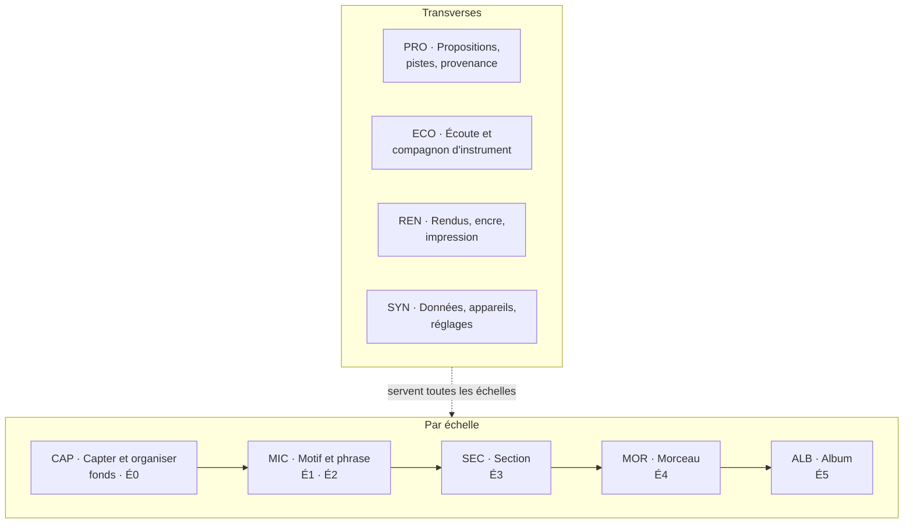

# 20 — Spécification fonctionnelle détaillée

La SFD dit **ce que Pupitre fait**, fonction par fonction, avec des critères
d'acceptation exécutables. Elle est rangée comme le travail de Sacha : **par échelle**,
du plus petit au plus grand, puis les **fonctions transverses** qui servent toutes les
échelles ([§ 12](../12-continuum-de-composition.md)).

---

## Carte des modules

| Module | Fichier | Fonctions |
|---|---|---|
| **CAP** · Capter et organiser | [21-capter-et-organiser.md](21-capter-et-organiser.md) | 7 |
| **MIC** · Motif et phrase | [22-micro-motif-et-phrase.md](22-micro-motif-et-phrase.md) | 13 |
| **SEC** · Section | [23-section.md](23-section.md) | 7 |
| **MOR** · Morceau | [24-morceau.md](24-morceau.md) | 14 |
| **ALB** · Album | [25-album.md](25-album.md) | 10 |
| **PRO** · Propositions, pistes, provenance | [26-propositions-suggestions-provenance.md](26-propositions-suggestions-provenance.md) | 7 |
| **ECO** · Écoute et compagnon d'instrument | [27-ecoute-et-compagnon.md](27-ecoute-et-compagnon.md) | 6 |
| **REN** · Rendus, encre, impression | [28-rendus-encre-impression.md](28-rendus-encre-impression.md) | 8 |
| **SYN** · Données, appareils, réglages | [29-socle-donnees-appareils.md](29-socle-donnees-appareils.md) | 9 |

---

## Conventions de lecture

### Identifiants

Chaque fonction porte un identifiant **stable** `MODULE-nn`, jamais renuméroté. Une
fonction retirée garde son numéro, barré, avec la raison. Ses critères d'acceptation, de
même : un nouveau critère prend le numéro qui suit le dernier, et un critère retiré garde le
sien, son texte barré, avec la raison (`7. ~~texte~~ Retiré : raison.`). Un test nommé
d'après un critère vise son numéro
([§ 70 · 4.1](../70-qualite-et-verification.md#41-les-critères-livrés)).

### Rubriques

Chaque fonction se lit dans le même ordre.

| Rubrique | Ce qu'elle dit |
|---|---|
| **Objet** | Ce que la fonction fait, en une phrase |
| **Échelle · moment** | Où elle se situe dans la [matrice du continuum](../12-continuum-de-composition.md#3-la-matrice-échelles--moments) |
| **Appareils** | 💻 établi · 📱 carnet · 📖 lutrin — `conçu pour`, `✅` possible, `—` absent |
| **Besoins** | Les besoins `Bxx` du [persona](../11-persona-et-situations.md#3-les-besoins) qu'elle sert |
| **Lit · écrit** | Les données touchées, et leur nature : décision, captation, dérivé |
| **Règles** | Ce qu'elle applique |
| **Ne fait pas** | Ses frontières, explicites |
| **Cas limites** | Quand la donnée manque ou se contredit |
| **Critères d'acceptation** | Numérotés, exécutables : *étant donné*, *quand*, *alors* |

### Marques

| Marque | Sens |
|---|---|
| 🔶 | Hypothèse de travail, réfutable vite ; renvoie au [§ 40 · 11](../40-architecture.md#11-hypothèses-à-confronter) |
| 🧪 | Spéculatif : ne s'implémente qu'après arbitrage |
| `[à l'œil]` | Critère qui se vérifie sur l'appareil ; la partie mesurable est automatisée à côté |

---

## Les fonctions

### Par échelle

| Fonction | Échelle · moment | 💻 | 📱 | 📖 |
|---|---|---|---|---|
| [CAP-01](21-capter-et-organiser.md#cap-01--capter-en-un-geste) Capter en un geste | É0 · M1 | ✅ | **conçu pour** | — |
| [CAP-02](21-capter-et-organiser.md#cap-02--trier-la-boîte-didées) Trier la boîte d'idées | É0 · M1 M3 | **conçu pour** | ✅ | — |
| [CAP-03](21-capter-et-organiser.md#cap-03--importer-un-fonds-existant) Importer un fonds existant | Fonds · M1 | **conçu pour** | — | — |
| [CAP-04](21-capter-et-organiser.md#cap-04--rattacher-une-prise-à-un-morceau) Rattacher une prise à un morceau | É4 · M1 | ✅ | ✅ | — |
| [CAP-05](21-capter-et-organiser.md#cap-05--rapprocher-des-idées-et-des-prises) Rapprocher des idées et des prises | Fonds É0 · M2 | ✅ | ✅ | — |
| [CAP-06](21-capter-et-organiser.md#cap-06--interroger-le-fonds) Interroger le fonds | Fonds · M2 M6 | ✅ | ✅ | ✅ |
| [CAP-07](21-capter-et-organiser.md#cap-07--voir-le-fonds) Voir le fonds | Fonds · M1 | ✅ | ✅ | ✅ |
| [MIC-01](22-micro-motif-et-phrase.md#mic-01--ouvrir-la-loupe) Ouvrir la loupe | É1 É2 · M3 | **conçu pour** | ✅ | — |
| [MIC-02](22-micro-motif-et-phrase.md#mic-02--saisir-et-éditer-des-accords) Saisir et éditer des accords | É1 · M3 | **conçu pour** | ✅ | — |
| [MIC-03](22-micro-motif-et-phrase.md#mic-03--saisir-et-éditer-une-mélodie) Saisir et éditer une mélodie | É1 · M3 | **conçu pour** | ✅ | — |
| [MIC-04](22-micro-motif-et-phrase.md#mic-04--écrire-une-ligne-et-ses-variantes) Écrire une ligne et ses variantes | É2 · M3 | **conçu pour** | ✅ | — |
| [MIC-05](22-micro-motif-et-phrase.md#mic-05--aligner-syllabes-et-notes) Aligner syllabes et notes | É2 · M3 | **conçu pour** | ✅ | — |
| [MIC-06](22-micro-motif-et-phrase.md#mic-06--lire-la-relation-mélodie-harmonie) Lire la relation mélodie-harmonie | É1 É2 · M5 | ✅ | ✅ | ✅ |
| [MIC-07](22-micro-motif-et-phrase.md#mic-07--diagnostiquer-une-phrase) Diagnostiquer une phrase | É2 · M5 | ✅ | ✅ | ✅ |
| [MIC-08](22-micro-motif-et-phrase.md#mic-08--parcourir-la-carte-des-chemins) Parcourir la carte des chemins | É1 · M2 | ✅ | ✅ | ✅ |
| [MIC-09](22-micro-motif-et-phrase.md#mic-09--transformer-un-motif) Transformer un motif | É1 · M2 | ✅ | ✅ | — |
| [MIC-10](22-micro-motif-et-phrase.md#mic-10--demander-des-pistes-de-détail) Demander des pistes de détail | É1 É2 · M2 | ✅ | ✅ | — |
| [MIC-11](22-micro-motif-et-phrase.md#mic-11--placer-et-extraire-un-motif) Placer et extraire un motif | É1 · M3 | **conçu pour** | ✅ | — |
| [MIC-12](22-micro-motif-et-phrase.md#mic-12--parcourir-la-table-de-la-tonalité) Parcourir la table de la tonalité | É1 · M2 M3 | ✅ | ✅ | ✅ |
| [MIC-13](22-micro-motif-et-phrase.md#mic-13--lire-la-palette-dun-accord) Lire la palette d'un accord | É1 · M2 M3 | ✅ | ✅ | ✅ |
| [SEC-01](23-section.md#sec-01--définir-un-bloc) Définir un bloc | É3 · M3 | **conçu pour** | ✅ | — |
| [SEC-02](23-section.md#sec-02--faire-varier-une-occurrence) Faire varier une occurrence | É3 · M3 | **conçu pour** | ✅ | — |
| [SEC-03](23-section.md#sec-03--découper-en-phrases) Découper en phrases | É2 É3 · M3 | **conçu pour** | ✅ | — |
| [SEC-04](23-section.md#sec-04--lire-lharmonie-dune-section) Lire l'harmonie d'une section | É3 · M3 M5 | ✅ | ✅ | ✅ |
| [SEC-05](23-section.md#sec-05--régler-lintensité-dune-occurrence) Régler l'intensité d'une occurrence | É3 · M4 | ✅ | ✅ | — |
| [SEC-06](23-section.md#sec-06--diagnostiquer-une-section) Diagnostiquer une section | É3 · M5 | ✅ | ✅ | ✅ |
| [SEC-07](23-section.md#sec-07--demander-des-pistes-de-section) Demander des pistes de section | É3 · M2 | ✅ | ✅ | — |
| [MOR-01](24-morceau.md#mor-01--créer-un-morceau) Créer un morceau | É4 · M3 | ✅ | ✅ | — |
| [MOR-02](24-morceau.md#mor-02--poser-et-modifier-la-forme) Poser et modifier la forme | É4 · M3 | **conçu pour** | ✅ | — |
| [MOR-03](24-morceau.md#mor-03--découper-une-prise-à-loreille) Découper une prise à l'oreille | É4 · M1 | ✅ | **conçu pour** | — |
| [MOR-04](24-morceau.md#mor-04--tonalité-tempo-métrique) Tonalité, tempo, métrique | É4 · M3 | ✅ | ✅ | — |
| [MOR-05](24-morceau.md#mor-05--voir-la-frise) Voir la frise | É4 · M5 | ✅ | ✅ | ✅ |
| [MOR-06](24-morceau.md#mor-06--arranger) Arranger | É3 É4 · M4 | **conçu pour** | ✅ | — |
| [MOR-07](24-morceau.md#mor-07--maquettes-et-brief-de-génération) Maquettes et brief de génération | É4 · M4 | **conçu pour** | ✅ | — |
| [MOR-08](24-morceau.md#mor-08--confronter-une-maquette-à-lécrit) Confronter une maquette à l'écrit | É4 · M4 | **conçu pour** | ✅ | — |
| [MOR-09](24-morceau.md#mor-09--diagnostiquer-la-forme) Diagnostiquer la forme | É4 · M5 | ✅ | ✅ | ✅ |
| [MOR-10](24-morceau.md#mor-10--demander-des-pistes-de-forme) Demander des pistes de forme | É4 · M2 | ✅ | ✅ | — |
| [MOR-11](24-morceau.md#mor-11--bifurquer-en-variantes) Bifurquer en variantes | É4 · M2 | **conçu pour** | ✅ | — |
| [MOR-12](24-morceau.md#mor-12--journal-décisions-et-questions-du-morceau) Journal, décisions et questions du morceau | É4 · M5 | ✅ | ✅ | ✅ |
| [MOR-13](24-morceau.md#mor-13--maturité-et-statut) Maturité et statut | É4 · M5 | ✅ | ✅ | ✅ |
| [MOR-14](24-morceau.md#mor-14--poser-le-morceau-sur-la-table) Poser le morceau sur la table | É4 · M5 M2 | ✅ | ✅ | ✅ |
| [ALB-01](25-album.md#alb-01--créer-un-album) Créer un album | É5 · M3 | **conçu pour** | ✅ | — |
| [ALB-02](25-album.md#alb-02--sélectionner-les-morceaux) Sélectionner les morceaux | É5 · M3 | **conçu pour** | ✅ | — |
| [ALB-03](25-album.md#alb-03--poser-des-ordres) Poser des ordres | É5 · M6 | **conçu pour** | ✅ | — |
| [ALB-04](25-album.md#alb-04--voir-le-plan-dalbum) Voir le plan d'album | É5 · M5 | ✅ | ✅ | ✅ |
| [ALB-05](25-album.md#alb-05--décrire-les-transitions) Décrire les transitions | É5 · M6 | **conçu pour** | ✅ | — |
| [ALB-06](25-album.md#alb-06--tenir-larc-et-la-cohérence) Tenir l'arc et la cohérence | É5 · M6 | **conçu pour** | ✅ | ✅ |
| [ALB-07](25-album.md#alb-07--diagnostiquer-lalbum) Diagnostiquer l'album | É5 · M5 | ✅ | ✅ | ✅ |
| [ALB-08](25-album.md#alb-08--demander-des-pistes-dordre) Demander des pistes d'ordre | É5 · M2 | **conçu pour** | ✅ | — |
| [ALB-09](25-album.md#alb-09--comparer-deux-ordres) Comparer deux ordres | É5 · M2 | **conçu pour** | ✅ | ✅ |
| [ALB-10](25-album.md#alb-10--feuille-dalbum-et-livret) Feuille d'album et livret | É5 · M6 | ✅ | ✅ | **conçu pour** |

### Transverses

| Fonction | 💻 | 📱 | 📖 |
|---|---|---|---|
| [PRO-01](26-propositions-suggestions-provenance.md#pro-01--accepter-ou-écarter-une-proposition) Accepter ou écarter une proposition | ✅ | ✅ | ✅ |
| [PRO-02](26-propositions-suggestions-provenance.md#pro-02--provenance-et-part-dorigine) Provenance et part d'origine | ✅ | ✅ | ✅ |
| [PRO-03](26-propositions-suggestions-provenance.md#pro-03--demander-des-pistes) Demander des pistes | ✅ | ✅ | — |
| [PRO-04](26-propositions-suggestions-provenance.md#pro-04--passerelle-ia-et-consentement) Passerelle IA et consentement | ✅ | ✅ | — |
| [PRO-05](26-propositions-suggestions-provenance.md#pro-05--travailler-sans-suggestion) Travailler sans suggestion | ✅ | ✅ | ✅ |
| [PRO-06](26-propositions-suggestions-provenance.md#pro-06--régler-les-règles-et-la-doctrine) Régler les règles et la doctrine | **conçu pour** | ✅ | — |
| [PRO-07](26-propositions-suggestions-provenance.md#pro-07--signaler-les-incohérences) Signaler les incohérences | ✅ | ✅ | ✅ |
| [ECO-01](27-ecoute-et-compagnon.md#eco-01--écoute-de-contrôle) Écoute de contrôle | ✅ | ✅ | ✅ |
| [ECO-02](27-ecoute-et-compagnon.md#eco-02--métronome-et-décompte) Métronome et décompte | ✅ | ✅ | — |
| [ECO-03](27-ecoute-et-compagnon.md#eco-03--nommer-un-accord-joué) Nommer un accord joué | — | **conçu pour** | — |
| [ECO-04](27-ecoute-et-compagnon.md#eco-04--accordeur-et-diapason) Accordeur et diapason | ✅ | **conçu pour** | — |
| [ECO-05](27-ecoute-et-compagnon.md#eco-05--suivre-une-prise) Suivre une prise | ✅ | **conçu pour** | — |
| [ECO-06](27-ecoute-et-compagnon.md#eco-06--fredonner-une-mélodie) Fredonner une mélodie | ✅ | **conçu pour** | — |
| [REN-01](28-rendus-encre-impression.md#ren-01--fiche-de-travail) Fiche de travail | ✅ | ✅ | **conçu pour** |
| [REN-02](28-rendus-encre-impression.md#ren-02--grille-daccords) Grille d'accords | ✅ | ✅ | ✅ |
| [REN-03](28-rendus-encre-impression.md#ren-03--portée) Portée | ✅ | ✅ | ✅ |
| [REN-04](28-rendus-encre-impression.md#ren-04--diagrammes-de-manche) Diagrammes de manche | ✅ | ✅ | ✅ |
| [REN-05](28-rendus-encre-impression.md#ren-05--mode-encre) Mode encre | ✅ | ✅ | **conçu pour** |
| [REN-06](28-rendus-encre-impression.md#ren-06--annoter-un-rendu-figé) Annoter un rendu figé | — | — | **conçu pour** |
| [REN-07](28-rendus-encre-impression.md#ren-07--imprimer) Imprimer | **conçu pour** | ✅ | ✅ |
| [REN-08](28-rendus-encre-impression.md#ren-08--diagrammes-de-clavier) Diagrammes de clavier | ✅ | ✅ | ✅ |
| [SYN-01](29-socle-donnees-appareils.md#syn-01--travailler-hors-ligne) Travailler hors ligne | ✅ | **conçu pour** | ✅ |
| [SYN-02](29-socle-donnees-appareils.md#syn-02--synchroniser-à-la-maison) Synchroniser à la maison | ✅ | ✅ | ✅ |
| [SYN-03](29-socle-donnees-appareils.md#syn-03--trancher-les-conflits) Trancher les conflits | **conçu pour** | ✅ | — |
| [SYN-04](29-socle-donnees-appareils.md#syn-04--acheminer-les-captations) Acheminer les captations | ✅ | **conçu pour** | ✅ |
| [SYN-05](29-socle-donnees-appareils.md#syn-05--tenir-le-miroir-durable) Tenir le miroir durable | nœud | nœud | nœud |
| [SYN-06](29-socle-donnees-appareils.md#syn-06--sauvegarder-et-restaurer) Sauvegarder et restaurer | nœud | nœud | nœud |
| [SYN-07](29-socle-donnees-appareils.md#syn-07--exporter-et-importer) Exporter et importer | **conçu pour** | ✅ | — |
| [SYN-08](29-socle-donnees-appareils.md#syn-08--appairer-et-révoquer-des-appareils) Appairer et révoquer des appareils | ✅ | ✅ | appairage seul |
| [SYN-09](29-socle-donnees-appareils.md#syn-09--régler-ses-préférences) Régler ses préférences | **conçu pour** | ✅ | — |

---

## Matrice de traçabilité

Chaque besoin du persona est servi par au moins une fonction, et chaque fonction sert au
moins un besoin. Une fonction qui ne servirait aucun besoin n'aurait rien à faire ici.

| Besoin | Fonctions |
|---|---|
| **B01** Capter partout, sans réseau | CAP-01 · ECO-06 · SYN-01 · SYN-04 |
| **B02** Retrouver et relier | CAP-02 · CAP-03 · CAP-04 · CAP-05 · CAP-06 · CAP-07 |
| **B03** Voir un morceau d'un coup d'œil | MOR-01 · MOR-02 · MOR-03 · MOR-05 · MOR-06 · MOR-09 · MOR-13 · SEC-04 · SEC-05 · SEC-06 · ALB-04 · REN-01 · CAP-07 |
| **B04** Des mesures honnêtes | PRO-01 · PRO-06 · PRO-07 · MOR-03 · MOR-04 · ECO-04 · CAP-03 |
| **B05** Toucher le détail | MIC-01 · MIC-02 · MIC-03 · MIC-04 · MIC-09 · MIC-11 · SEC-01 · SEC-02 · SEC-04 |
| **B06** Rendre une ligne chantable | MIC-05 · MIC-06 · MIC-07 · MIC-13 · SEC-03 · SYN-09 |
| **B07** Entendre l'écrit | ECO-01 · ECO-02 |
| **B08** Garder les mains sur l'instrument | ECO-02 · ECO-03 · ECO-04 · ECO-05 · REN-02 · REN-04 · REN-08 · MIC-08 · MIC-12 · MOR-14 |
| **B09** Des pistes, pas des réponses | PRO-03 · PRO-04 · PRO-06 · MIC-08 · MIC-10 · MIC-12 · SEC-07 · MOR-10 · MOR-14 · ALB-08 |
| **B10** Savoir qui a écrit quoi | PRO-02 · PRO-05 · MIC-04 · CAP-03 |
| **B11** Construire l'album | ALB-01 · ALB-02 · ALB-03 · ALB-04 · ALB-05 · ALB-06 · ALB-07 · ALB-08 · ALB-09 · ALB-10 |
| **B12** Lire et annoter sur encre ou papier | REN-01 · REN-02 · REN-03 · REN-04 · REN-05 · REN-06 · REN-07 · REN-08 · ALB-10 |
| **B13** Garder la main sur ses données | SYN-02 · SYN-04 · SYN-05 · SYN-06 · SYN-07 · SYN-08 · PRO-04 |
| **B14** Revenir en arrière, comparer | MOR-11 · MOR-12 · PRO-01 · SYN-03 · ALB-09 |
| **B15** Confronter une maquette à l'écrit | MOR-06 · MOR-07 · MOR-08 · CAP-04 · ECO-05 |

---

## Ce qui est délibérément absent

| Absent | Pourquoi |
|---|---|
| Mixage, effets, export audio d'une maquette | Production sonore ([ADR-009](../adr/adr-009-ecoute-de-controle.md)) |
| Engendrer une section, une mélodie ou un texte entiers | Écrire à la place de Sacha ([ADR-005](../adr/adr-005-des-pistes-pas-des-reponses.md)) |
| Notifications, rappels, séries, compteurs de retard | Anti-besoin N2 |
| Partage, commentaires, rôles | Une seule personne |
| Détection automatique de la langue d'une ligne | Trop peu fiable sur une ligne ; appliquerait les mauvaises règles en silence |

Et ce qui est 🧪 **spéculatif**, à n'ouvrir qu'après arbitrage :

| Piste | Pourquoi elle attend |
|---|---|
| Entrée MIDI depuis un clavier | Sacha n'a pas de clavier MIDI ; le modèle le permettrait sans changement |
| Lecture optique de partitions papier | Domaine difficile ; aucun besoin mesuré |
| Continuation mélodique générative | Frontière délicate avec « écrire à la place » ; à discuter sur un prototype |
| Accordages de guitare autres que `EADGBE` | Le modèle les prévoit ; aucun besoin exprimé |
