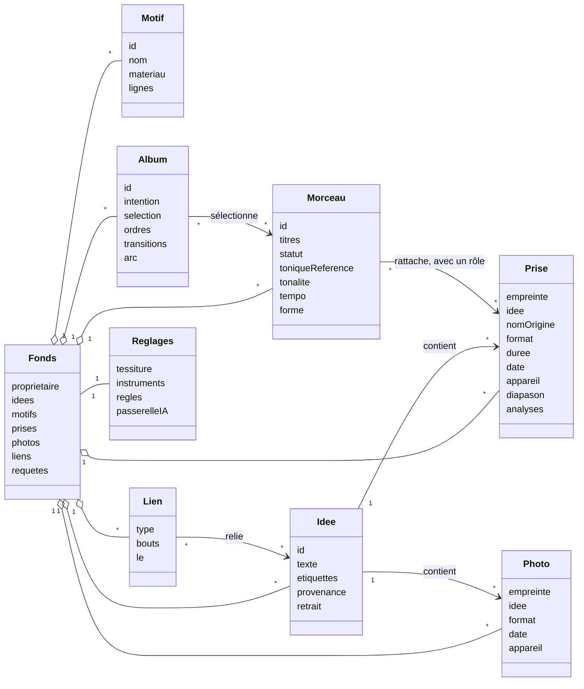
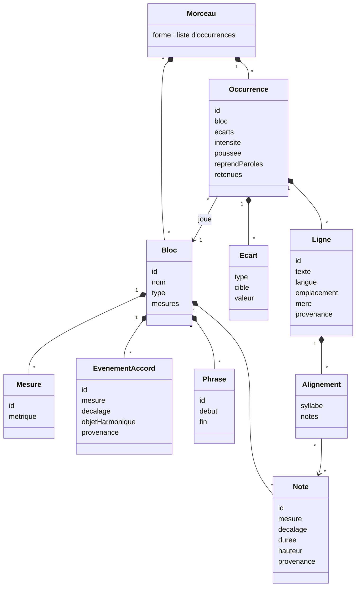
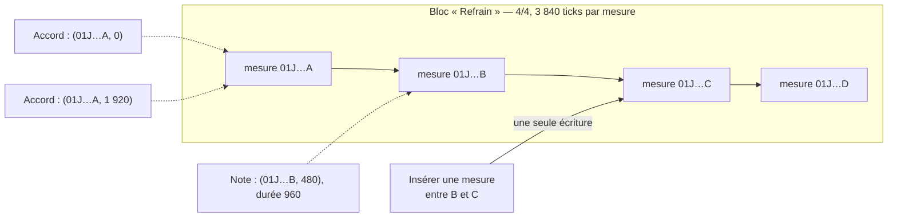
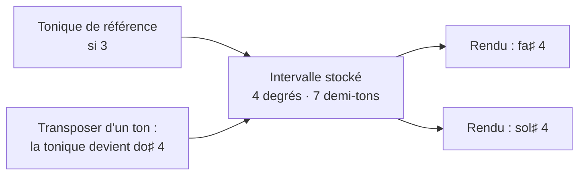
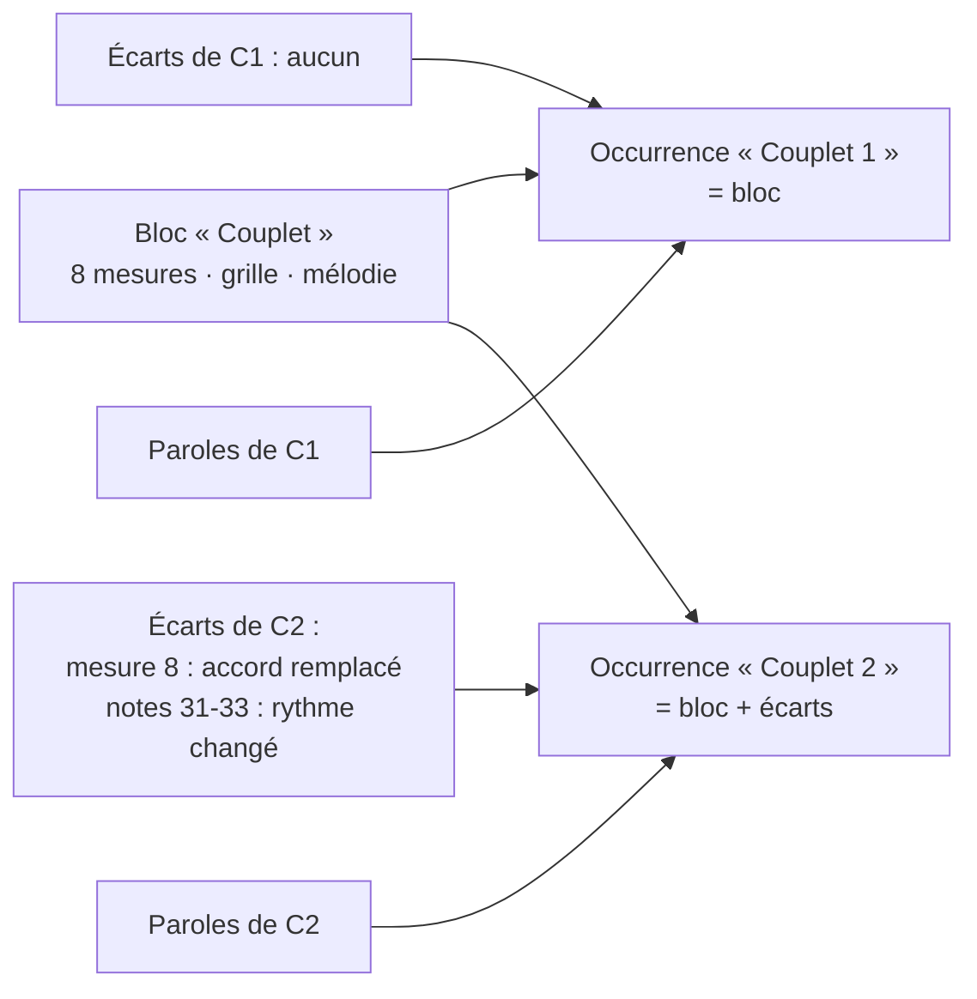
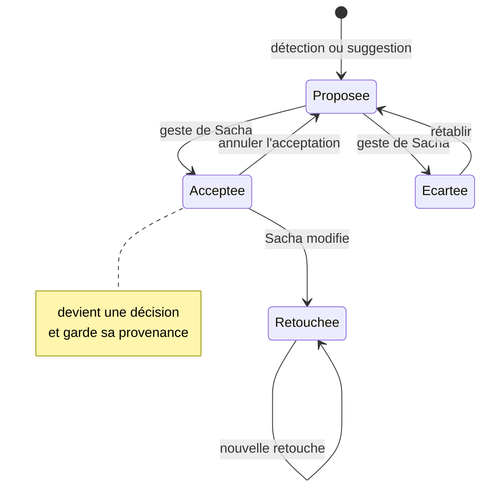
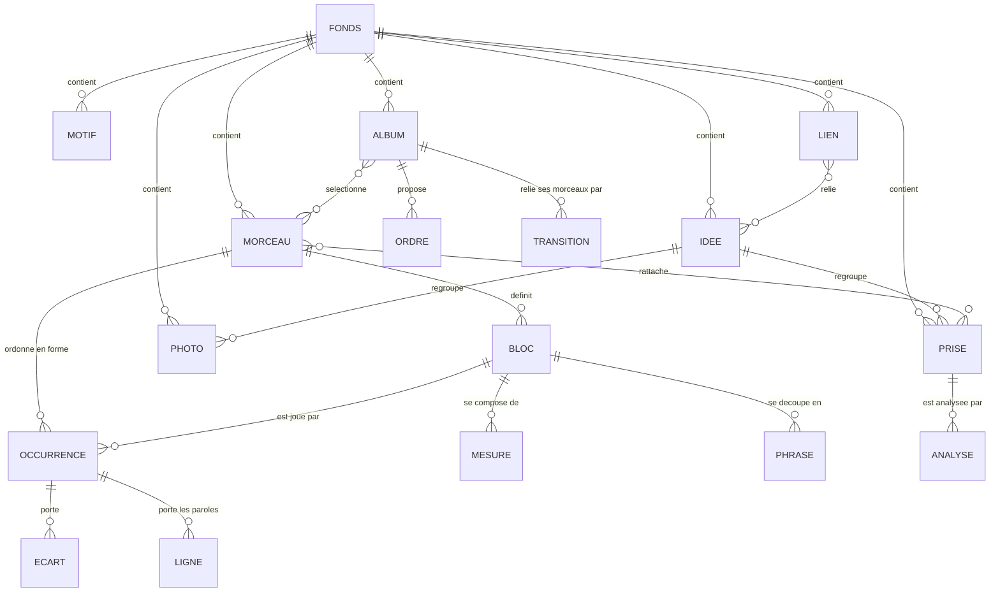

# 30 — Modèle de domaine

> **Ce modèle est la vérité.** Tout le reste — portées, grilles, diagrammes, frises,
> plans d'album, diagnostics, suggestions, index — en est engendré
> ([ADR-001](adr/adr-001-un-seul-materiau.md)). Il est traité ici avec le soin qu'on
> donne à un schéma de base, indépendamment de la façon dont il est stocké et
> synchronisé ([§ 31](31-persistance-et-synchronisation.md)).

Exemple : « Northbound », le morceau employé ici, est fictif ; son titre, sa grille et
ses paroles sont inventés.

---

## 1. Vue d'ensemble



Et l'intérieur d'un morceau, où se joue l'essentiel :



---

## 2. Identités

Une identité est **opaque** et **stable** : elle ne dérive jamais d'un titre, d'un
numéro de mesure ou d'une position. Les numéros que l'interface affiche (« mesure 33 »,
« Refrain 2 ») sont engendrés.

| Objet | Identifiant | Stable ? | Pourquoi |
|---|---|---|---|
| Morceau, album, idée, motif, requête enregistrée | ULID (`01J…`) | **Oui, à vie** | Un titre change ; un morceau peut ne pas en avoir |
| Bloc, occurrence, mesure, phrase | ULID | **Oui** | Insérer une mesure ne doit réécrire aucun autre élément |
| Événement d'accord, note | ULID | **Oui** | Une syllabe s'aligne sur une note précise ; un écart cible un élément précis |
| Ligne de texte | ULID | **Oui, à vie** | La provenance et la chaîne des retouches en dépendent |
| Prise, photo, rendu figé, résultat d'analyse, traits d'encre | Empreinte SHA-256 | **Oui, par construction** | Le contenu est le nom ; une corruption se voit |
| Décision et question du journal | ULID ; numéro `D001`, `Q001` par morceau ou album, attribué par le nœud à la première synchronisation (« D— » provisoire hors ligne) | **Oui** : un numéro attribué ne change plus | Sinon deux appareils hors ligne créeraient chacun leur `D004` ; une décision révisée garde son numéro et pointe vers sa remplaçante |
| Lien | Son type et ses deux bouts, rangés (§ 9.3) | **Oui, par construction** | Deux appareils qui posent hors ligne le même lien n'en font qu'un |
| Propriétaire du fonds | UUID ([M-0001](modele/decisions/M-0001-ecosysteme-des-applications-personnelles.md)), tiré au hasard à la création du fonds | **Oui, à vie** | Toute donnée lui appartient ; il ne dit rien, pas même une date |
| Numéro de mesure, numéro d'occurrence | — | Engendrés | Stockés, ils se désynchroniseraient |

**L'identifiant de propriétaire.** Tout le fonds appartient à un **identifiant de
propriétaire** opaque
([M-0001](modele/decisions/M-0001-ecosysteme-des-applications-personnelles.md)) : un UUID
tiré au hasard à la création du fonds, et non un ULID, dont l'horodatage dirait quand le
fonds est né. Chaque document le porte, à la racine du document : le fonds, les morceaux, les
albums et les réglages ([§ 31 · 2.3](31-persistance-et-synchronisation.md#23-la-genèse-et-le-point-de-départ-du-fonds)).
Il ne nomme personne : Pupitre n'authentifie que des appareils
([SYN-08](20-sfd/29-socle-donnees-appareils.md#syn-08--appairer-et-révoquer-des-appareils)).
Un seul endroit du code le crée et le donne, un service du côté natif
([ADR-022](adr/adr-022-documents-cote-natif.md)), derrière une interface qui ne fait que
cela : le jour où deux applications devront reconnaître Sacha, c'est elle qui change, et
aucun document. La référence est l'identifiant de propriétaire du document du fonds de la
racine des données ([§ 31 · 2.1](31-persistance-et-synchronisation.md#21-sur-le-disque)) :
tout autre document de la racine des données, et toute copie reçue, qui en porte un autre est
refusé, à l'ouverture
comme à la synchronisation, et Pupitre le nomme : deux fonds ne se mêlent jamais, pas même
celui du mode démonstration
([§ 31 · 1](31-persistance-et-synchronisation.md#1-trois-natures-de-données-quatre-lieux)).

---

## 3. Le temps musical

### 3.1 Mesures, temps, ticks

- Une durée se compte en **ticks**, à **960 ticks par noire**. Ce nombre se divise par 2,
  3, 4, 5, 6, 8, 10, 12, 15 et 16 : triolets, quintolets et doubles croches tombent
  juste, sans flottant.
- Un bloc est une **suite de mesures**. Chaque mesure a un identifiant et, au besoin, sa
  métrique (sinon celle du morceau).
- Un événement (accord, note) se positionne par **(mesure, décalage en ticks)**. Il ne
  connaît pas son numéro de mesure : insérer ou retirer une mesure ne touche aucun autre
  événement.



### 3.2 Tempo et durée

- Le **tempo** est une décision du morceau (en BPM), éventuellement avec des
  **changements** attachés au début d'une occurrence ou d'une mesure.
- Une **durée** musicale, celle d'une occurrence, d'un morceau ou d'un album, n'est jamais
  stockée : elle s'engendre depuis la forme, les mesures, la métrique et le tempo. C'est
  ce qui permet à la frise et au plan d'album de rester justes quand un pont perd huit
  mesures. Engendrée d'un tempo seulement proposé, elle est proposée elle aussi : une
  valeur engendrée prend le statut le plus faible de ses entrées
  ([§ 50 · 4.1](50-interfaces-et-appareils.md#41-statut-dune-valeur)). La durée d'une
  prise est autre chose : un fait de sa captation, qui ne change jamais
  ([§ 9.2](#92-prises-photos-et-analyses)).

### 3.3 La carte de temps d'une prise

Une prise vit en **secondes** ; l'écrit vit en **mesures**. La carte de temps les relie :
une liste de **points d'ancrage** `(seconde ↔ occurrence, mesure, temps)`.

- Elle vient du tapotage de Sacha ([MOR-03](20-sfd/24-morceau.md#mor-03--découper-une-prise-à-loreille)),
  d'une détection de pulsations, ou des deux.
- Entre deux ancrages, la correspondance s'interpole. Une démo jouée sans métronome a
  donc beaucoup d'ancrages ; une prise au clic en a peu.
- Elle sert à suivre une prise à la mesure ([ECO-05](20-sfd/27-ecoute-et-compagnon.md#eco-05--suivre-une-prise)),
  à confronter une maquette à l'écrit ([MOR-08](20-sfd/24-morceau.md#mor-08--confronter-une-maquette-à-lécrit)),
  et à placer les propositions d'une analyse sur les bonnes mesures.

---

## 4. Les hauteurs

### 4.1 Une tonique de référence, des intervalles orthographiés

Toute hauteur d'un matériau (bloc ou motif) est stockée comme un **intervalle
orthographié** depuis une **tonique de référence** `T` : un nombre de **degrés
diatoniques** et un nombre de **demi-tons**.

| Note | Tonique de référence | Stocké | Lu |
|---|---|---|---|
| fa♯ 4 | si 3 | (4 degrés, 7 demi-tons) — une quinte juste | `F#4` |
| sol♭ 4 | si 3 | (5 degrés, 7 demi-tons) — une sixte diminuée | `Gb4` |
| ré 5 | si 3 | (9 degrés, 15 demi-tons) — une dixième mineure | `D5` |

Le nombre de degrés porte **l'orthographe** : fa♯ et sol♭ sonnent pareil et ne
s'écrivent pas pareil. Sacha garde l'orthographe saisie.



**Pourquoi ce choix** ([ADR-008](adr/adr-008-hauteurs-relatives.md)) :

- **Transposer** change une seule valeur, la tonique, au lieu de réécrire des milliers
  d'événements ; l'historique reste lisible et léger ;
- un **refrain modulé** est le même bloc joué avec un écart « transposer de +2 » ;
- la tonique de référence est un **repère de stockage, pas une analyse**. Elle ne dit
  pas que le morceau est en si mineur ; la tonalité est un attribut à part (§ 4.3).

### 4.2 L'objet harmonique

Un accord est stocké comme **un objet harmonique**, jamais comme un nom.

| Champ | Contenu | Exemple, avec `T` = si |
|---|---|---|
| `fondamentale` | Classe d'intervalle orthographiée depuis `T` | (3 degrés, 5 demi-tons) → mi |
| `qualite` | Un type du vocabulaire fermé (`maj`, `m`, `dim`, `aug`, `sus2`, `sus4`, `7`, `maj7`, `m7`, `m7b5`, `dim7`, `6`, `m6`, `add9`, `9`, `11`, `13`…), défini comme un ensemble d'intervalles | `m` |
| `extensions` | Altérations et ajouts au-delà de la qualité | `[]` |
| `basse` | Classe d'intervalle de la basse, si elle n'est pas la fondamentale | — |
| `notes` | Pour un accord hors vocabulaire seulement : l'ensemble explicite des classes de hauteur | — |

Le **nom** (`Em`, `Mi m`), le **degré** (`iv`), la **fonction** (sous-dominante), le
**diagramme de manche** et la **position sur la portée** sont des rendus. Un accord
inconnu de la théorie est accepté comme ensemble de notes ; il n'a simplement pas de
degré.

**D'un bloc, jamais champ par champ.** Un objet harmonique, une hauteur et une provenance
s'écrivent d'un bloc (objet neuf), jamais champ par champ. Sinon, deux appareils qui
corrigent la même note hors ligne fusionneraient en une note que personne n'a écrite :
fa♯ 4, stocké (4 degrés, 7 demi-tons), réorthographié sol♭ 4 (5, 7) d'un côté et baissé
en fa 4 (4, 6) de l'autre, deviendrait (5, 6), un sol double bémol. Écrites d'un bloc, les
deux corrections restent deux valeurs en conflit, que Pupitre présente « à trancher »
([§ 31 · 5](31-persistance-et-synchronisation.md#5-les-conflits)).

### 4.3 Tonalité, diapason, tessiture

| Attribut | Ce que c'est | Où il vit | Décidé ou proposé |
|---|---|---|---|
| **Tonalité** | L'analyse tonale : tonique et mode (majeur, mineur, dorien…) | Morceau ; écart d'occurrence en cas de modulation | Décidée, ou proposée avec ses candidats et leurs confiances |
| **Diapason d'une prise** | La hauteur de référence de la prise : son décalage en cents par rapport au la 440 | Métadonnées de la prise | Mesuré (proposition), puis décidé d'un geste |
| **Diapason de lecture** | Le diapason auquel l'écoute de contrôle joue, pour coller à un piano | Réglages | Décidé |
| **Tessiture** | Bornes grave et aiguë de la voix de Sacha | Réglages | Mesurée (proposition) ou déclarée |

Une **tonalité indécise** est un état normal : la grille s'analyse alors en degrés pour
chaque candidat, et les rendus montrent les candidats côte à côte. L'écrit n'a pas de
diapason : il est en hauteur nominale. Comparer une prise à l'écrit applique le
diapason **de la prise**, jamais 440 supposé.

---

## 5. Bloc, occurrence, écart

C'est la structure qui rend le modèle utile à l'échelle de la section
([ADR-007](adr/adr-007-blocs-et-occurrences.md)).

- Un **bloc** porte le matériau musical d'un type de section : ses mesures, ses accords,
  sa mélodie, son découpage en phrases, son arrangement par défaut.
- Une **occurrence** joue un bloc à une place de la forme. Elle porte ce qui lui est
  propre : son intensité, sa poussée, ses **écarts**, et **ses paroles** — ou elle
  reprend celles d'une autre occurrence du même bloc (« paroles : comme Refrain 1 ») ;
  ses lignes propres sont alors des écarts (§ 6.1).
- Un **écart** est une modification locale, exprimée par rapport au bloc et ciblant un
  élément par son identifiant.



### 5.1 Les types d'écarts

| Type | Cible | Exemple |
|---|---|---|
| `remplacer-accord` | un événement d'accord | Dernière mesure : V devient bVII |
| `ajouter-accord` · `retirer-accord` | une position · un événement | Un passage de IV à iv ajouté |
| `remplacer-note` · `ajouter-note` · `retirer-note` | une note · une position | Une broderie sur le dernier temps |
| `ajouter-mesures` · `retirer-mesures` | après une mesure · une plage | Refrain final allongé de deux mesures |
| `transposer` | toute l'occurrence | Dernier refrain un ton plus haut |
| `arrangement` | un instrument | La batterie entre seulement au refrain 2 |

### 5.2 Les règles de calcul

1. Le matériau **effectif** d'une occurrence = le bloc, puis ses écarts appliqués dans
   l'ordre. Il n'est jamais stocké.
2. Modifier le bloc change toutes les occurrences, **sauf** là où un écart vise le même
   élément : l'écart gagne, et Pupitre le signale (« R2 garde son accord en mesure 7 »).
3. Un écart dont la cible a disparu du bloc devient **orphelin** : il est conservé,
   signalé, et proposé à la suppression. Il n'est jamais effacé en silence.
4. « Combien d'accords diffèrent du premier couplet » s'engendre de la liste des écarts.
   Ce chiffre nourrit le diagnostic « bloc joué deux fois à l'identique ».

### 5.3 Phrases

Une **phrase** est une plage nommée d'un bloc, de (mesure, décalage) à (mesure,
décalage) — ses champs `début` et `fin` — : elle peut commencer sur une levée. Dans
chaque occurrence, les lignes de texte se rangent par phrase. C'est l'échelle É2 : la vue
« une phrase » montre une plage de mélodie, ses accords, et la ligne qui s'y aligne dans
l'occurrence choisie.

### 5.4 Motifs placés

Placer un motif dans un bloc **copie** son matériau, avec une provenance
« issu du motif X ». Deux modes :

- **suivi** : si le motif change ensuite, Pupitre **propose** de reporter le changement
  dans le bloc. La proposition s'accepte ou s'écarte comme toute autre ;
- **détaché** : aucun suivi ; la provenance reste.

Un lien vivant entre documents différents (le motif vit dans le fonds, le bloc dans le
morceau) est écarté : il rendrait la synchronisation fragile pour un bénéfice faible, et
la proposition de report donne la même information sans rien imposer.

---

## 6. Le texte

### 6.1 Lignes et variantes

| Champ | Contenu |
|---|---|
| `id` | ULID stable à vie |
| `texte` | Le vers, tel quel. Une valeur atomique : jamais fusionnée caractère par caractère |
| `langue` | `en`, `fr`… **par ligne**, parce qu'un vers français dans une chanson anglaise est légitime |
| `emplacement` | Occurrence, phrase, rang dans la phrase |
| `provenance` | Voir § 8 |
| `mere` | La ligne dont celle-ci est une retouche ; la chaîne se remonte entièrement |
| `syllabes` | La découpe syllabique, proposée puis décidée |

Une **variante** n'écrase rien : c'est une autre ligne au même emplacement. Une
**retouche** crée une ligne neuve qui pointe vers sa mère ; la mère reste lisible.

La ligne rendue ne se marque pas sur la ligne, mais dans l'occurrence :

| Champ de l'occurrence | Contenu |
|---|---|
| `retenues` | Pour chaque emplacement, l'identifiant de la ligne rendue ; deux choix concurrents sont un conflit, présenté « à trancher » ([§ 31 · 5](31-persistance-et-synchronisation.md#5-les-conflits)) |
| `reprendParoles` | Facultatif : l'occurrence du même bloc dont elle reprend les paroles (« paroles : comme Refrain 1 »), jamais une occurrence qui en reprend elle-même |

Un drapeau `retenue` sur chaque ligne laisserait passer deux retouches faites hors ligne :
deux lignes neuves, toutes deux retenues, et aucun conflit pour le dire. Le registre fait
du double choix un conflit visible.

Une occurrence qui reprend des paroles rend, à chaque emplacement, la ligne retenue de
l'occurrence reprise, sauf là où elle a sa propre ligne : ses lignes propres sont des
écarts, signalés comme tels (« comme Refrain 1, sauf le dernier vers »). Ce texte effectif
s'engendre ; il n'est jamais recopié. Modifier une ligne de Refrain 1 change donc
Refrain 2, comme modifier le bloc change ses occurrences.

### 6.2 Alignement syllabes ↔ notes

| Cas | Représentation | Valide ? |
|---|---|---|
| Une syllabe, une note | `syllabe 3 → [note N12]` | Oui |
| Mélisme : une syllabe, plusieurs notes | `syllabe 4 → [N13, N14, N15]` | Oui |
| Élision : plusieurs syllabes, une note | `syllabes 5, 6 → [N16]` | Oui |
| Syllabes en excès | Listées comme non alignées | Oui, signalé |
| Notes sans syllabe | Vocalise ou instrumental | Oui |

L'alignement vise des **identifiants de notes**, pas des positions : déplacer une note
dans le temps ne détache pas sa syllabe.

---

## 7. Arrangement et intensité

| Donnée | Niveau | Nature |
|---|---|---|
| **Palette** d'instruments, avec registre (grave, médium, aigu) | Réglages, puis morceau | Décidée |
| **Plan par bloc** : instrument → présent, rôle, registre, intensité de jeu | Bloc | Décidée, valeur par défaut des occurrences |
| **Écart d'arrangement** : un instrument entre, sort ou change de rôle | Occurrence | Décidée |
| **Intensité** de 1 (nu) à 5 (plein) | Occurrence | Décidée ; proposée depuis l'audio |
| **Poussée** de 1 à 5 | Occurrence | Décidée |
| **Densité** : nombre de couches présentes | Occurrence | **Engendrée**, jamais stockée |
| **Moyen d'espace** : répétition, bourdon, réverbération de pièce | Occurrence | Décidée |

Densité et poussée sont **deux axes distincts** : un passage peut être dense et calme.
Le plan les représente donc sur deux échelles distinctes, pour qu'on ne croie pas qu'elles
varient ensemble. Une ligne `présent = non` explicite (« décidé qu'il ne joue pas »)
diffère d'une absence de ligne (« pas encore décidé »).

---

## 8. Provenance et propositions

### 8.1 La provenance

Tout élément de contenu — accord, note, ligne, frontière, valeur de tempo — porte une
provenance, et la garde à vie.

| Origine | Signifie | Champ `par` | Champ `depuis` |
|---|---|---|---|
| `saisie` | Sacha l'a entré | — | — |
| `detectee` | Mesuré sur une captation, puis accepté | `analyseur@version` | empreinte du résultat d'analyse |
| `suggeree` | Engendré pour aider, puis accepté | `regles:<moteur>@version` ou `modele:<fournisseur>:<modèle>` | identifiant de la demande |
| `importee` | Venu d'un fichier | format | empreinte du fichier |
| `retouchee` | Issu d'un autre élément, retouché par Sacha | — | identifiant de l'élément mère |

S'y ajoutent `le` (date de l'acceptation ou de la saisie) et, pour une détection, la
`confiance` au moment de l'acceptation.

**La provenance d'une idée.** Une idée porte aussi une provenance, posée à sa naissance et
gardée à vie : elle dit comment l'idée est entrée dans le fonds ([§ 9.1](#91-lidée)).

| Origine | Signifie | Champ `par` | Champ `depuis` |
|---|---|---|---|
| `captee` | Née d'une capture : Sacha l'a enregistrée, notée ou photographiée dans Pupitre ([CAP-01](20-sfd/21-capter-et-organiser.md#cap-01--capter-en-un-geste)) | Le rôle de l'appareil : établi ou carnet | — |
| `importee` | Née d'un fichier versé ([CAP-03](20-sfd/21-capter-et-organiser.md#cap-03--importer-un-fonds-existant)) | À fixer avec l'import | À fixer avec l'import |

`le` est la date de sa naissance. Une idée notée et une idée enregistrée ont la même
provenance, puisque capter, c'est enregistrer, noter ou photographier ; ce qu'elles
contiennent, un texte, une prise ou une photo, les distingue. Les autres origines ne
s'appliquent qu'au contenu : une idée ne se détecte pas, ne se suggère pas et ne se retouche
pas. Ce que porte une idée importée, en particulier pour un matériau produit par un
générateur de maquettes externe, se tranche avec l'import
([Q23](90-questions-ouvertes.md#q23--comment-verser-un-fonds-existant-)).

### 8.2 Ce qui est stocké, ce qui ne l'est pas

- Une **proposition non acceptée n'est pas stockée** dans les documents. Une détection
  vit dans son résultat d'analyse (une captation immuable) ; une suggestion est un
  dérivé éphémère. L'interface les superpose au contenu, marquées.
- **Accepter** écrit l'élément dans le document, avec sa provenance.
- **Écarter** écrit seulement une petite marque (« proposition P écartée le … »), pour
  qu'elle ne revienne pas à chaque ouverture. Écarter est réversible.



---

## 9. Idées, prises et analyses

### 9.1 L'idée

| Donnée | Contenu | Nature |
|---|---|---|
| **Idée** | Identifiant, texte libre, étiquettes, provenance ([§ 8.1](#81-la-provenance)), retrait | Décisions, dans le document du fonds |

- Sa **date** et l'**appareil** où elle est née sont ceux de sa provenance : aucun champ ne
  les recopie.
- Le **texte** est une valeur atomique, comme une ligne (§ 6.1) : deux appareils qui le
  changent hors ligne donnent deux valeurs en conflit, jamais un mélange.
- Les **étiquettes** sont libres. Une idée en porte un ensemble : deux appareils qui posent
  hors ligne la même étiquette n'en font qu'une. Les étiquettes du fonds s'engendrent de
  celles de ses idées, et aucune liste n'est stockée à part.
- Les **prises** et les **photos** d'une idée ne sont pas une liste de l'idée : chacune
  porte l'idée à laquelle elle appartient (§ 9.2), et la liste s'en engendre. Deux appareils
  qui versent hors ligne la même prise dans deux idées donnent deux valeurs en conflit,
  jamais une prise dans deux idées.
- Une idée est **reliée** quand elle porte au moins un lien (§ 9.3) dont l'autre bout n'est
  pas une idée retirée. Cet état s'engendre ; il n'est jamais stocké.
- Une idée **retirée** porte la date de son retrait. Elle quitte la boîte, la vue du fonds
  et les requêtes, et ne compte dans aucune assiette. Rien n'en est effacé : ni son texte,
  ni ses étiquettes, ni ses liens, ni ses prises, ni ses photos, ni leurs captations. La
  **rétablir** ôte la marque, et elle revient telle qu'elle était. La suppression définitive
  d'une idée et de ses captations sera une opération destructrice explicite
  ([§ 40 · 7.3](40-architecture.md#73-appairage-et-sessions)), conçue plus tard ; d'ici là,
  rien ne s'efface. Retirée, l'idée reste dans le document, dans sa teneur et dans son
  historique ([ADR-023](adr/adr-023-stockage-des-documents.md)).

### 9.2 Prises, photos et analyses

| Objet | Contenu | Nature |
|---|---|---|
| **Prise** | Empreinte, idée, nom d'origine tel quel, format, durée, date, appareil, diapason mesuré | Captation ; ses métadonnées sont une décision, des faits et une mesure (ci-dessous) |
| **Photo** | Empreinte, idée, format, date, appareil | Captation ; ses métadonnées sont une décision et des faits (ci-dessous) |
| **Rattachement** | Morceau, rôle (`référence`, `version`, `travail`, `maquette`, `maquette générée`), carte de temps | Décision, dans le document du morceau |
| **Résultat d'analyse** | Pour une prise, un analyseur et ses paramètres : candidats de tempo, de tonalité, de diapason ; pulsations et premiers temps ; accords par mesure avec alternatives ; notes ; segments ; texte transcrit avec horodatage par mot | Captation immuable, nommée par l'empreinte de son contenu, indexée par `(prise, analyseur@version, paramètres)` |

Un résultat d'analyse ne se corrige pas : un analyseur meilleur produit un **nouveau**
résultat, à côté, et deux exécutions de même clé qui diffèrent donnent deux résultats,
côte à côte. Les décisions déjà prises gardent la provenance de celui qu'elles ont
accepté.

**Ce que portent une prise et une photo.** Trois natures s'y côtoient :

- l'**idée** qui la contient est une décision, que Sacha change en regroupant (§ 9.3) ;
- son **format**, sa **date**, l'**appareil** qui l'a faite, la **durée** d'une prise et le
  **nom d'origine** d'une prise versée sont des **faits de la captation**. Lus une fois, sur
  la captation ou à sa création, ils ne changent jamais, puisqu'elle est immuable. Ils sont
  écrits dans le document du fonds, à côté de l'empreinte, pour trier et chercher sans la
  captation, qu'un appareil n'a pas toujours
  ([§ 31 · 6.2](31-persistance-et-synchronisation.md#62-ce-quun-appareil-garde)). Tant qu'un
  fait n'est pas lu, il vaut `—` ([ADR-006](adr/adr-006-le-partiel-est-normal.md)) ;
- le **diapason** d'une prise est une mesure : proposé, puis décidé d'un geste (§ 4.3).

**La durée d'une prise n'est pas une durée engendrée.** Le § 13 interdit de stocker une
durée musicale, celle d'une occurrence, d'un morceau ou d'un album : elle s'engendre de la
forme, des mesures, de la métrique et du tempo, et se désynchroniserait si on la stockait.
La durée d'une prise est le temps de son enregistrement : elle ne dépend d'aucune autre
donnée, et sa captation ne change jamais. La durée d'une idée, elle, s'engendre : c'est
celle de sa prise la plus longue. Comme toute valeur engendrée, elle prend le statut le plus
faible de ses entrées ([§ 50 · 4.1](50-interfaces-et-appareils.md#41-statut-dune-valeur)) :
`—` si l'idée n'a pas de prise, ou si l'une de ses prises n'a pas encore sa durée lue.

### 9.3 Regrouper et relier

Trois relations partent d'une idée, et chacune n'a qu'un mécanisme.

| Relation | Mécanisme | Gestes | Ce qui s'écrit |
|---|---|---|---|
| **Versions d'une même idée** | Les prises d'une même idée : chaque prise et chaque photo appartient à une seule idée | Regrouper ([CAP-02](20-sfd/21-capter-et-organiser.md#cap-02--trier-la-boîte-didées)) ; accepter « ces deux prises semblent la même idée » ([CAP-05](20-sfd/21-capter-et-organiser.md#cap-05--rapprocher-des-idées-et-des-prises)) | L'idée de chaque prise ou photo versée |
| **Parenté** | Un lien « apparenté à », non orienté, entre deux idées, motifs ou morceaux | Relier et délier ([CAP-02](20-sfd/21-capter-et-organiser.md#cap-02--trier-la-boîte-didées)) ; accepter un autre rapprochement ([CAP-05](20-sfd/21-capter-et-organiser.md#cap-05--rapprocher-des-idées-et-des-prises)) | Un lien |
| **Ce qu'une idée est devenue** | Un lien « devenue », orienté, de l'idée vers le motif ou le morceau qu'elle a fait naître | Promouvoir ([CAP-02](20-sfd/21-capter-et-organiser.md#cap-02--trier-la-boîte-didées)) | Un lien |

- **Regrouper** ne copie, ne fusionne et ne réécrit aucune captation : une prise ne change
  que d'idée. Il ne mêle ni les textes, ni les étiquettes, ni les liens des deux idées :
  chacune garde les siens. Une idée que le geste laisse sans rien, ni prise, ni photo, ni
  texte, ni étiquette, ni lien, est retirée par le même geste (§ 9.1).
- **Un lien se nomme par son type et ses deux bouts** (§ 2) : pour « apparenté à », non
  orienté, les deux identifiants rangés dans l'ordre de leurs octets ; pour « devenue »,
  l'idée, puis ce qu'elle est devenue. Deux appareils qui posent hors ligne le même lien, dans
  un sens ou dans l'autre, n'en font qu'un, et le même lien ne s'écrit jamais deux fois. Il vit
  dans le document du fonds, même quand un bout est un morceau : c'est une référence par
  identifiant, pas un lien vivant entre documents (§ 5.4).
- **Un lien ne regroupe rien, et regrouper ne lie rien** : « versions d'une même idée »
  n'est pas un type de lien.
- Relier une idée à elle-même est refusé, et Pupitre le dit.

---

## 10. Album

| Donnée | Contenu |
|---|---|
| **Intention** | Facultative : cardinal visé, durée visée, support (numérique, ou vinyle avec deux faces et leur durée maximale) |
| **Sélection** | Morceaux candidats et morceaux en réserve |
| **Ordres** | Plusieurs suites nommées et datées ; chacune peut porter ses coupures de faces |
| **Ordre retenu** | Un identifiant d'ordre, ou rien |
| **Transitions** | Par paire de morceaux adjacents (A puis B), commune à tous les ordres qui les placent ainsi : manière de passer (silence, fondu, enchaîné, interlude), durée, note |
| **Arc** | Notes libres et, facultative, une courbe d'intensité visée par position |

Les attributs comparés au plan d'album — tonalité de début et de fin, tempo, durée,
intensité, fin — sont **lus dans les morceaux**, jamais recopiés. Le **cardinal** est
toujours un résultat de requête ; le champ `cardinal visé` exprime une intention et n'est
lu par aucun diagnostic ([ADR-006](adr/adr-006-le-partiel-est-normal.md)).

---

## 11. Journal, décisions, questions

- Toute modification passe par une **opération nommée**, qui porte un message lisible
  (« Pont raccourci de 16 à 8 mesures »). Le journal d'un morceau est la liste de ces
  messages ; il n'est pas rédigé.
- Le **journal du fonds** se forme de même : c'est la liste des opérations nommées écrites
  dans le document du fonds, chaque capture, chaque import et chaque geste de tri
  ([CAP-02](20-sfd/21-capter-et-organiser.md#cap-02--trier-la-boîte-didées)), avec leur
  message (« Idée du 3 novembre : étiquette #pont posée »). Il se lit dans l'historique du
  document : rien n'est rédigé ni stocké à part, et la compaction n'en retire rien
  ([ADR-023](adr/adr-023-stockage-des-documents.md)). Le fonds n'a ni décisions ni
  questions : elles vivent par morceau et par album.
- **Annuler** le dernier geste de tri écrit l'opération inverse, elle-même nommée
  (« Annulé : étiquette #pont posée ») : l'historique n'est jamais réécrit, et le journal
  porte le geste puis son annulation. Annuler ne vise que le dernier geste de tri fait sur
  l'appareil depuis l'ouverture de l'application, et une annulation ne s'annule pas. Si une
  synchronisation a changé l'élément depuis, l'annulation est refusée, et Pupitre dit ce
  qui a changé.
- Sacha peut consigner des **décisions** (`D001`…) et des **questions** (`Q001`…) par
  morceau et par album. Chacune a un ULID ; son numéro est attribué par le nœud à la
  première synchronisation, et d'ici là elle s'affiche « D— » ou « Q— ». Sans nœud, elle
  le reste : plusieurs appareils peuvent travailler sans lui
  ([§ 31 · 4.1](31-persistance-et-synchronisation.md#41-la-topologie)), et aucun ne
  saurait numéroter seul sans heurter les autres. Un numéro attribué ne change plus : une
  décision révisée garde le sien, passe au statut `révisée` et pointe vers sa remplaçante. Les
  questions se trient **par ce qu'elles débloquent**.
- Le compte des questions ouvertes s'engendre de leur statut, jamais d'un motif de texte.

---

## 12. Règles et réglages

| Donnée | Contenu |
|---|---|
| **Règle** | Identifiant, nature (`théorie`, `doctrine`, `outil`), échelle, paramètres, source citée, active ou non |
| **Désactivation par morceau** | Règle, **motif obligatoire**, date. Une désactivation sans motif est refusée |
| **Doigté épinglé** | Accord absolu (fondamentale nommée, qualité, basse) → frettes, doigts, barré. Trois portées : morceau (document du morceau), album (document d'album), fonds (document de réglages) ; la plus spécifique gagne. Après transposition, un épinglage qui ne correspond plus à aucun accord est listé comme inactif — état engendré, rien n'est réécrit |
| **Renversement épinglé** | Accord absolu (fondamentale nommée, qualité, basse) → renversement au clavier ([§ 60 · 6.3](60-moteur-musical.md#63-le-voicing-au-clavier)). À côté du doigté épinglé, avec les mêmes trois portées et la même priorité : la plus spécifique gagne. Après une transposition, un renversement épinglé qui ne correspond plus à aucun accord est listé comme inactif, comme un doigté épinglé ([Q19](90-questions-ouvertes.md#q19--que-devient-un-renversement-épinglé-après-une-transposition-)) |
| **Réglages** | Tessiture, palette d'instruments, accordage de guitare (`EADGBE` par défaut), capodastre par défaut, instrument des diagrammes (guitare, clavier ou les deux), couche sombre de la table (masquée par défaut), préférences d'orthographe d'accords, langues, diapason de lecture, fournisseur IA et consentement |

---

## 13. Ce que le modèle interdit de stocker

| Interdit | Pourquoi |
|---|---|
| Un nom d'accord, un degré, une fonction | Rendus de l'objet harmonique et de la tonalité |
| Un numéro de mesure ou d'occurrence | Engendrés par position ; stockés, ils se désynchronisent |
| Une durée musicale (d'une occurrence, d'un morceau, d'un album), un horodatage de section, la durée d'une idée | Engendrés depuis forme, mesures, métrique et tempo ; celle d'une idée, depuis ses prises. La durée d'une prise, fait de sa captation, n'en est pas ([§ 9.2](#92-prises-photos-et-analyses)) |
| Une densité, un compte, un total, une statistique | Engendrés ; c'est la source classique des chiffres faux |
| Les prises et les photos d'une idée, les étiquettes du fonds, l'état « reliée » d'une idée, les résultats d'une requête enregistrée | Engendrés depuis l'idée que porte chaque prise et chaque photo, les étiquettes des idées et les liens ; une requête ne garde que son nom et ses critères ([§ 9](#9-idées-prises-et-analyses)) |
| L'état « à envoyer » d'une captation ou d'une idée | Propre à l'appareil qui garde la captation : il se lit dans sa file d'envoi et dans les accusés du nœud ([§ 31 · 4.3](31-persistance-et-synchronisation.md#43-létat-visible-de-la-synchronisation)) |
| Le matériau effectif d'une occurrence, le texte d'une occurrence qui reprend des paroles | Engendrés depuis le bloc et ses écarts, depuis l'occurrence reprise et les lignes propres |
| Un doigté ou un renversement calculé, l'état actif ou inactif d'un épinglage | Engendrés selon le contexte ; seul l'épinglage est une décision |
| Une valeur mesurée dans un champ décidé | Une proposition n'est jamais une décision ([ADR-004](adr/adr-004-proposer-n-est-pas-decider.md)) |
| Un diagnostic ou une suggestion non acceptée | Dérivés, recalculés sur des données à jour |

Un test parcourt les documents et échoue s'il y trouve un champ de cette liste
([§ 70](70-qualite-et-verification.md)).

---

## 14. Résumé des cardinalités



### Un morceau, en notation abrégée

Pour fixer les idées, le cœur de « Northbound » : sa forme, le bloc « Refrain » et ses
trois occurrences.

```text
Morceau 01JA… « Northbound »   statut: actif   tonique de référence: si 3
  tonalité: décidée si mineur        tempo: décidé 85        métrique: 4/4
  forme: [ Oc1 (Intro), Oc2 (Couplet), Oc3 (Refrain), Oc4 (Couplet), Oc5 (Refrain),
           Oc6 (Pont), Oc7 (Refrain) ]

  Bloc Bl3 « Refrain » — mesures [Ma, Mb, Mc, Md, Me, Mf, Mg, Mh]
    accords : A1 (Ma,0) i · A2 (Mb,0) VI · A3 (Mc,0) III · A4 (Md,0) VII
              A5 (Me,0) i · A6 (Mf,0) VI · A7 (Mg,0) iv
    notes   : N1 (Ma,0) 960 (0,0) · N2 (Ma,960) 960 (2,3) · …
    phrases : Ph1 (Ma,0)→(Md,3840) · Ph2 (Me,0)→(Mh,3840)
    (en Mh, l'accord V7 ~ et la dernière note, mi 4 ~, sont des détections en attente :
     elles vivent dans leur résultat d'analyse, pas dans le document)

  Occurrence Oc3 → Bl3   intensité 4   écarts: aucun
    L01 (Ph1, 1)  en  saisie             « the harbour lights go out tonight »
    L02 (Ph2, 1)  en  saisie             « river turns away from me »
    L03 (Ph2, 1)  en  retouchée de L02   « river turns its back on me »
    retenues: (Ph1, 1) → L01 · (Ph2, 1) → L02
  Occurrence Oc5 → Bl3   intensité 4   écarts: aucun   paroles: comme Oc3
  Occurrence Oc7 → Bl3   intensité 5
    écarts: [ transposer +2 · ajouter-mesures après Mh : 2 ]
    paroles: les siennes (L11, L12…)
```

Les accords sont notés ici en degrés pour la lecture ; ce qui est stocké est l'objet
harmonique de chacun (§ 4.2). Oc5 reprend les paroles d'Oc3 : elle rend L01 et L02 sans
les recopier, et L03 reste une variante non retenue. Les écarts d'Oc7 visent leur cible
par identifiant — la mesure Mh, pas « la huitième mesure ».
