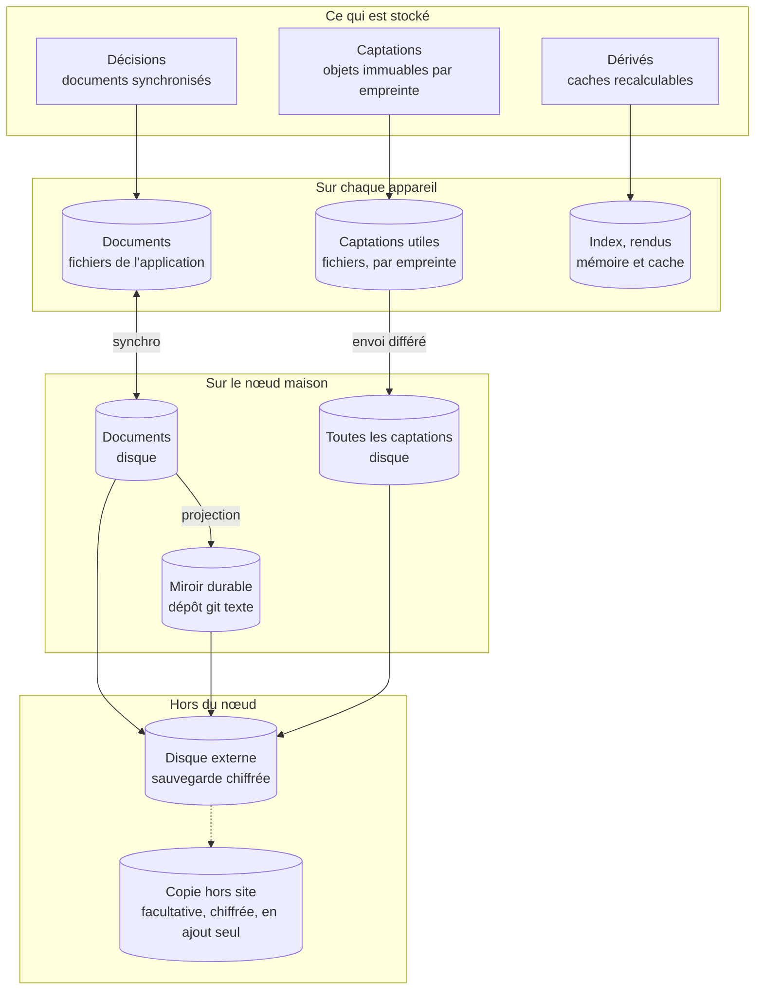
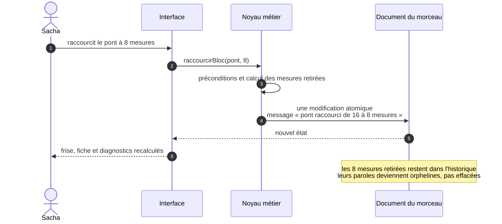
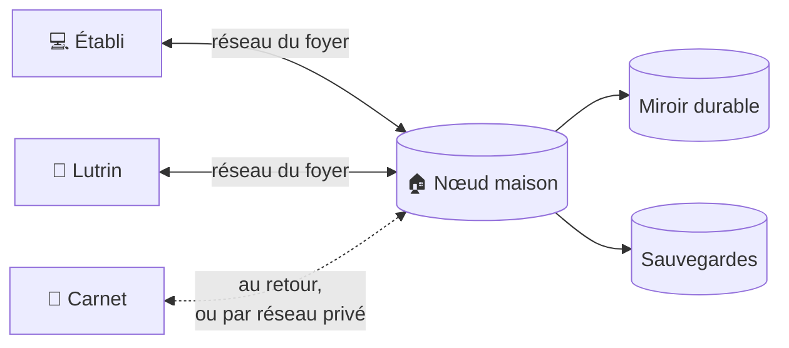
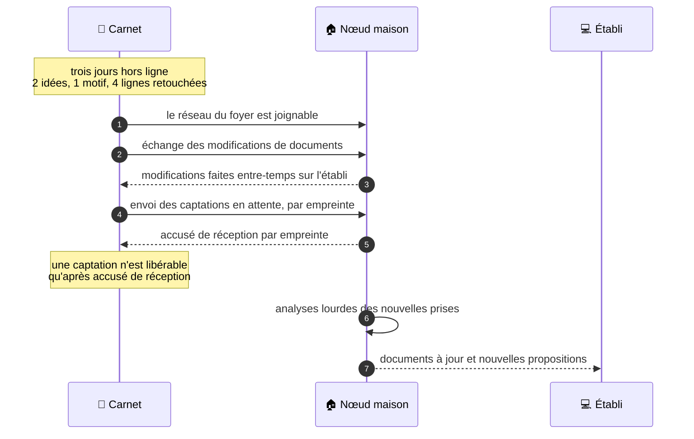
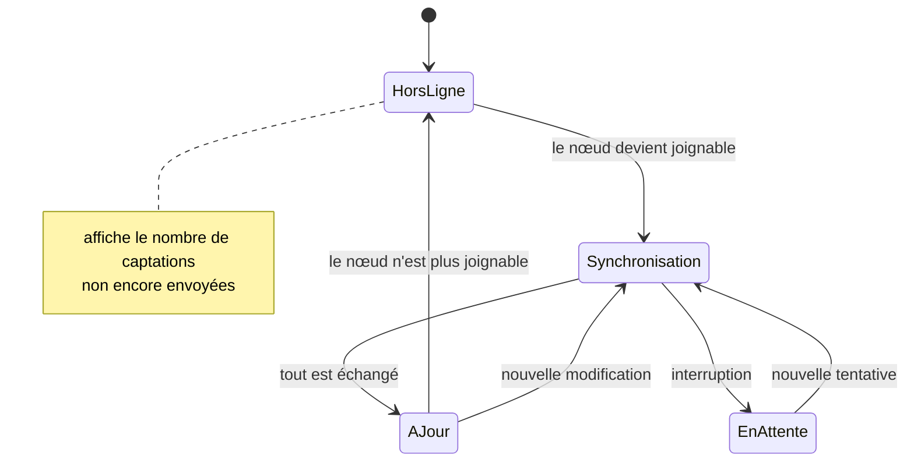

# 31 — Persistance, synchronisation et durabilité

Le [§ 30](30-modele-de-domaine.md) dit **ce que** l'on stocke. Ce document dit **où**,
**comment** cela voyage entre les appareils, et **comment on est sûr de ne rien
perdre**. Les décisions qui le fondent :
[ADR-002](adr/adr-002-local-first.md) (local-first) et
[ADR-003](adr/adr-003-crdt-et-miroir-durable.md) (documents CRDT et miroir durable).

---

## 1. Trois natures de données, quatre lieux



| Nature | Exemples | Se modifie ? | Sur les appareils | Sur le nœud | Sauvegardé ? |
|---|---|---|---|---|---|
| **Décisions** | Forme, grille, mélodie, paroles, provenance, ordres d'album, réglages | Oui, par opérations nommées | **Copie complète** | Copie complète | Oui, par le miroir durable et la sauvegarde |
| **Captations** | Prises, photos, traits d'encre, rendus figés, résultats d'analyse | **Jamais** : on en produit une autre | Ce qui est utile ou pas encore envoyé | Toutes | Oui |
| **Dérivés** | Index de recherche, rendus, diagnostics, suggestions, doigtés et renversements calculés | Recalculés | Cache | Cache | **Non, par conception** |
| **Miroir durable** | Projection texte des décisions, dans git | Écrit par le seul exportateur | — | Oui | Oui : sur le disque externe, et hors site si la copie facultative existe |

**Sur l'appareil, tout est fichier**, dans le dossier de l'application
([§ 41](41-pile-technique.md)) : les documents Automerge, et les captations nommées par
leur empreinte (§ 6.1). Aucun stockage de navigateur : le système ne vide pas ce dossier de
lui-même, à la différence des dossiers temporaires, où rien de ce qui doit durer ne vit.
Le nœud range ses copies de la même façon, sur son disque.

---

## 2. Les documents

La **granularité** de synchronisation est un choix : un document trop gros synchronise
tout pour une virgule ; un document trop fin multiplie les liens fragiles.

| Document | Contient | Taille estimée |
|---|---|---|
| **Fonds** | Idées, motifs, métadonnées des prises, étiquettes, liste des morceaux et albums | 100 Ko à 1 Mo pour quelques centaines d'idées |
| **Morceau** (un par morceau) | Tout le morceau : titres, statut, blocs, occurrences, paroles, alignements, arrangement, rattachements de prises, doigtés épinglés du morceau, annotations, journal | 50 à 300 Ko de contenu ; moins de 2 Mo historique compris |
| **Album** (un par album) | Intention, sélection, ordres, transitions, arc, doigtés épinglés de l'album, journal | Moins de 100 Ko |
| **Réglages** | Tessiture, instruments, règles et doctrine, préférences, doigtés épinglés du fonds, consentements | Moins de 100 Ko |

Avec une soixantaine de morceaux, l'ensemble des documents tient sous **125 Mo** au pire
(60 × 2 Mo, plus le fonds), historique compris : une copie complète par appareil est
raisonnable, y compris sur un téléphone. Ce sont les captations audio qui pèsent (§ 6).

Les **appareils appairés et leurs jetons** ne sont **pas** dans un document synchronisé :
ce sont des données de sécurité, gardées sur le nœud seul. Chaque appareil garde, lui, son
propre jeton et la clé publique épinglée du nœud ([ADR-021](adr/adr-021-cle-du-noeud-epinglee.md)).

---

## 3. Les opérations nommées

Aucune écriture ne se fait « au champ près » depuis l'interface. Chaque modification
passe par une **opération nommée** du noyau métier, qui :

1. vérifie ses préconditions (on ne retire pas la seule mesure d'un bloc sans le dire) ;
2. applique ses changements dans **une seule modification atomique par document** ; une
   opération sur deux documents écrit d'abord le document cible, puis la référence du
   fonds, et un contrôle au démarrage répare une référence manquante ;
3. porte un **message lisible**, engendré : « Northbound : pont raccourci de 16 à 8 mesures ».



C'est ce qui rend le **journal** lisible sans rédaction, et ce qui permet de revenir
avant une opération précise.

---

## 4. La synchronisation

### 4.1 La topologie

Une étoile autour du nœud maison. Chaque appareil travaille sur sa copie et échange
ses modifications avec le nœud **dès qu'il le joint** : sur le réseau du foyer, ou par
un réseau privé virtuel s'il en existe un ([Q07](90-questions-ouvertes.md)).
Aucun appareil n'a besoin d'un autre pour travailler.



Sans nœud maison, Pupitre fonctionne sur un seul appareil, sans synchronisation ; la
sauvegarde passe alors par l'export manuel ([SYN-07](20-sfd/29-socle-donnees-appareils.md#syn-07--exporter-et-importer)).
C'est un mode dégradé assumé, pas un mode nominal.

### 4.2 Le retour à la maison



### 4.3 L'état visible de la synchronisation

Sacha voit toujours où en sont ses données. Pas d'icône ambiguë : un état, un nombre.



| État | Ce que voit Sacha |
|---|---|
| Hors ligne | « Hors ligne · 3 captations à envoyer » |
| Synchronisation | « Synchronisation · 2 captations sur 3 » |
| À jour | « À jour · il y a 2 min » |
| En attente | « Interrompu · nouvel essai dans 30 s » |

### 4.4 La couche de synchronisation

Pupitre emploie la crate `automerge`, à version épinglée, et une **couche maison** en
étoile, sur WebSocket en TLS ; la clé du nœud est épinglée sur chaque appareil
([ADR-021](adr/adr-021-cle-du-noeud-epinglee.md)). Elle est écrite pour Pupitre plutôt
qu'empruntée à samod, le dépôt Automerge en Rust
([A21](90-questions-ouvertes.md#les-arbitrages-pris-dans-cette-conception)), parce
qu'elle fait peu de choses :

- pour chaque document, échanger avec le nœud les modifications qui manquent de part et
  d'autre, par le protocole de synchronisation d'Automerge ;
- relever les conflits à chaque synchronisation, pour les présenter « à trancher » (§ 5).

Elle est isolée derrière l'adaptateur `Documents`
([§ 40 · 3](40-architecture.md#3-composants-de-lapplication)). L'envoi des captations en
attente reste à l'adaptateur `Captations`, en HTTP : par empreinte, et sans libérer une
captation avant l'accusé de réception (§ 4.2). La couche de synchronisation ne transporte
que les documents.

**À définir avant INC-1** : le format de stockage des documents sur disque, la compaction
de leur historique et leur sauvegarde. L'hypothèse H07 le vérifie : deux répliques qui
divergent hors ligne convergent au retour, et les captations restent intègres après une
restauration ([§ 40 · 11](40-architecture.md#11-hypothèses-à-confronter)).

---

## 5. Les conflits

Les documents sont des **CRDT** : deux copies modifiées séparément convergent toujours
vers le même état, sans serveur arbitre. Converger n'est pas tout garder : quand deux
appareils écrivent la même valeur, Automerge en retient une et ne garde l'autre que dans
sa liste de conflits, jusqu'à la prochaine écriture. Pupitre lit donc ces conflits à
chaque synchronisation : rien ne se perd en silence. Avec une seule personne et trois
appareils, les modifications concurrentes sont rares ; elles existent quand même (une
retouche dans le train pendant que l'établi, resté ouvert, édite la même ligne).

La convergence technique ne suffit pas : il faut qu'elle ait un **sens musical**.

| Cas concurrent | Fusion technique | Ce que fait Pupitre |
|---|---|---|
| Deux appareils retouchent **la même ligne de texte** | Chaque retouche crée sa ligne ; le registre `retenues` de l'occurrence reçoit deux valeurs en conflit pour le même emplacement ([§ 30 · 6.1](30-modele-de-domaine.md#61-lignes-et-variantes)) | **Un conflit devient une variante** : les deux lignes sont gardées au même emplacement, l'une est rendue, l'emplacement est marqué « à trancher » |
| Deux appareils changent **le même accord** ou **la même note** | L'objet harmonique, la hauteur s'écrivent d'un bloc : deux valeurs en conflit, jamais un mélange champ par champ | Même règle : une variante d'accord ou de note à trancher, visible dans la grille ou la portée |
| Deux appareils changent **le même attribut** (tempo, tonique, statut) | Une valeur gagne, l'autre reste en conflit jusqu'à la prochaine écriture | Pupitre lit les conflits à la synchronisation et les présente « à trancher » |
| Deux appareils **réordonnent la forme** différemment | Les listes fusionnent, parfois en un ordre étrange | Pupitre détecte une forme improbable (occurrence dupliquée, ordre incohérent) et signale « forme à vérifier » avec les deux versions |
| Un appareil **supprime** une occurrence que l'autre **modifie** | La suppression gagne côté liste ; la modification survit dans l'objet | L'occurrence modifiée réapparaît dans « éléments retirés récemment », récupérable |
| Deux appareils modifient **des éléments différents** | Fusion directe | Rien à signaler |

Aucune fusion ne mélange deux textes caractère par caractère, ni deux accords ou deux
hauteurs champ par champ : un vers fusionné à moitié, ou un sol double bémol né de deux
corrections d'un fa♯ ([§ 30 · 4.2](30-modele-de-domaine.md#42-lobjet-harmonique)), serait
une ligne ou une note que personne n'a écrite. Le test d'I11 couvre les trois cas : texte,
accord, hauteur.

---

## 6. Les captations

### 6.1 Adressage par contenu

Une captation est un fichier nommé par l'**empreinte SHA-256** de son contenu, rangé par
les deux premiers octets de l'empreinte pour qu'aucun répertoire ne déborde.

| Propriété | Conséquence | Testée par |
|---|---|---|
| Le nom est l'empreinte | Une corruption se détecte en relisant | Contrôle périodique des empreintes |
| Rien n'est jamais réécrit | Une sauvegarde incrémentale ne transfère chaque objet qu'une fois | Test d'immuabilité |
| Verser deux fois le même fichier donne un seul objet | L'import est idempotent | Test d'import double |
| Aucune métadonnée dans l'objet | Les métadonnées vivent dans les documents | — |

### 6.2 Ce qu'un appareil garde

| Appareil | Garde localement | Charge à la demande |
|---|---|---|
| 📱 Carnet | Les captations **non envoyées** (toujours), les 30 derniers jours, celles épinglées | Le reste, quand le nœud est joignable |
| 📖 Lutrin | Les rendus figés et les rendus ouverts récemment | Le reste ; aucune prise audio, seulement les échantillons de l'écoute de contrôle ([A19](90-questions-ouvertes.md#les-arbitrages-pris-dans-cette-conception)) |
| 💻 Établi | Ce que Sacha a ouvert, plus un budget configurable | Le reste |

**Règle dure : une captation n'est jamais évincée d'un appareil tant que le nœud n'a
pas accusé réception de son empreinte.** C'est la parade au risque R6
([§ 10](10-vision.md#7-ce-qui-ferait-échouer-le-projet)). Les captations vivent dans le
dossier de l'application, **jamais dans un dossier temporaire** que le système peut vider.

---

## 7. Les dérivés

| Dérivé | Calculé où | Quand |
|---|---|---|
| Index de recherche (texte, attributs, motifs harmoniques) | Chaque appareil, en mémoire | À l'ouverture, puis à chaque modification |
| Matériau effectif des occurrences, numéros de mesure, durées | Chaque appareil | À la demande |
| Rendus (grille, portée, diagrammes, fiche, plan d'album) | Chaque appareil | À l'affichage |
| Diagnostics | Chaque appareil | À la demande, et à la volée pour les plus légers |
| Suggestions de règles | Chaque appareil | À la demande |
| Suggestions génératives | Le nœud, via la passerelle IA | À la demande |
| Analyses lourdes | Le nœud | À l'arrivée d'une prise, ou à la demande — leur résultat devient une **captation** |

Pourquoi un résultat d'analyse lourde est une captation et non un dérivé : il coûte des
minutes de calcul, il dépend d'une version d'analyseur, et il doit rester **la même
preuve** pour la provenance des éléments acceptés. On ne le recalcule pas ; on en produit
un nouveau quand l'analyseur change.

---

## 8. Le miroir durable

### 8.1 Ce que c'est

Une **projection en texte brut** de tous les documents, écrite par le nœud dans un dépôt
git, après chaque lot de modifications. Elle répond à trois besoins :

1. **Durer** : lisible dans vingt ans, sans Pupitre, avec n'importe quel éditeur de texte ;
2. **Sauvegarder** : un dépôt git se copie, se vérifie et se pousse vers un dépôt privé
   hors du foyer ;
3. **Relire** : le journal de git, fait des messages des opérations nommées, raconte
   comment chaque morceau a bougé.

Le miroir est **écrit par le seul exportateur**. On ne l'édite pas à la main ; le
réimporter est une opération de **reprise après sinistre**, pas une synchronisation.

Après la perte du nœud, les documents se rétablissent d'abord depuis les copies complètes
des appareils et les documents Automerge sauvegardés ; le miroir ne sert qu'en dernier
recours, et un document réimporté depuis le miroir remplace les copies des appareils au
lieu de fusionner avec elles. Reconstruit, il a une autre histoire : une fusion
doublerait chacun de ses éléments.

### 8.2 Le format : un enregistrement par ligne

Le format est choisi pour que **le diff de git soit lisible**. Trois formats évidents
sont écartés :

| Format écarté | Pourquoi |
|---|---|
| YAML pour tout | Une liste de 150 mesures produit un diff illisible dès qu'on insère un élément |
| Tableaux Markdown | Ils se réalignent : changer un accord élargit la colonne et réécrit toutes les lignes |
| JSON | Pas de commentaires, des guillemets partout, et une virgule qui touche la ligne précédente |

Retenu : **un fichier par relation, une ligne par enregistrement, des champs nommés.**
Les en-têtes de morceau et d'album sont en **TOML**.

```text
# accords — un événement par ligne
# <id> mesure= decalage= accord= src= par= depuis= le= conf= | note libre
01JB3K mesure=01JB2A decalage=0 accord=Bm src=saisie par= depuis= le=2026-09-14 conf= |
01JB3M mesure=01JB2A decalage=1920 accord=G src=detectee par=<analyseur@version> depuis=<empreinte entière> le=2026-10-10 conf=0.81 |
01JB3P mesure=01JB2C decalage=0 accord=D/F# src=suggeree par=regles:chemins@1 depuis=<id de la demande> le=2026-10-11 conf= |
```

| Règle de forme | Pourquoi |
|---|---|
| Un enregistrement **tient sur une ligne** | Modifier un enregistrement touche une ligne du diff |
| **Aucun alignement** en colonnes | Un alignement se refait, donc réécrit des lignes inchangées |
| L'identifiant en premier | Trier, chercher, repérer à l'œil |
| Champs `clé=valeur`, **ordre stable** | Diff minimal, fichier lisible sans schéma |
| Un champ vide s'écrit `clé=` | Distingue « vide » de « absent » |
| Le texte libre après ` \| `, toujours en dernier | Un vers peut contenir `=`, `#`, `\|` : aucun échappement n'est nécessaire |
| Les hauteurs et accords écrits **en clair** (`F#4`, `D/F#`) | Lisibles sans outil ; la tonique de référence de l'en-tête permet de revenir aux intervalles |
| UTF-8 sans BOM, fins de ligne LF | Fins de ligne LF imposées par `.gitattributes` ; absence de BOM garantie par l'exportateur, vérifiée par l'aller-retour |

### 8.3 L'arborescence

```text
miroir/
  LISEZMOI.md                     comment lire ce miroir (engendré)
  fonds/
    idees.txt                     une ligne par idée
    prises.txt                    une ligne par prise : empreinte, nom d'origine, durée, diapason
    motifs/<id>-<slug>/           mêmes fichiers qu'un bloc, plus paroles.txt (l'accroche)
  morceaux/<id>-<slug>/
    morceau.toml                  titres, statut, tonique de référence, tonalité, tempo, métrique
    forme.txt                     une ligne par occurrence, dans l'ordre
    blocs/<id>-<slug>/
      mesures.txt  accords.txt  notes.txt  phrases.txt  arrangement.txt
    occurrences.txt               une ligne par occurrence : bloc, intensité, poussée, paroles reprises
    ecarts.txt                    une ligne par écart
    paroles.txt                   une ligne par ligne de texte, le vers en dernier
    retenues.txt                  une ligne par emplacement : la ligne rendue
    alignement.txt                une ligne par syllabe alignée
    prises.txt                    rattachements, rôles, ancrages des cartes de temps
    doigtes.txt  annotations.txt
    journal.md                    décisions et questions du morceau
  albums/<id>-<slug>/
    album.toml  selection.txt  transitions.txt  doigtes.txt
    ordres/<date>-<slug>.txt      une ligne par position
    journal.md                    décisions et questions de l'album
  reglages/
    reglages.toml  regles.txt  doigtes.txt
```

Le dossier s'appelle `<id>-<slug>` : le slug suit le titre, l'identité reste le préfixe.
Git n'enregistre aucun renommage : il le déduit après coup, par similarité des contenus.
C'est le préfixe d'identité, qui ne change jamais, qui permet de suivre un morceau dans
l'historique.

### 8.4 Le cycle d'écriture


---

## 9. Sauvegarde et restauration

**Une sauvegarde jamais restaurée est une hypothèse.** La restauration est donc testée
automatiquement : chaque semaine sur le nœud, sur le dernier instantané ; chaque nuit en
CI, sur un jeu de test.

| Copie | Où | Contient | Chiffrée |
|---|---|---|---|
| 1 | Nœud maison | Documents, captations, miroir | Selon le disque du nœud |
| 2 | Disque externe au foyer | Instantanés quotidiens du tout | Oui |
| 3 | Hors site, facultative | Instantanés du tout, en ajout seul (restic vers un serveur `--append-only`), dont la purge exige une clé absente du nœud ; ou le miroir seul, poussé vers un dépôt git privé qui refuse la réécriture d'historique | Instantanés : oui ; dépôt git : privé, en clair |

Le disque externe est branché au nœud : un nœud compromis pourrait l'effacer. La copie
hors site en ajout seul est la seule qu'il ne peut pas détruire
([§ 40 · 7.4](40-architecture.md#74-menaces-retenues)).


En CI, la même procédure tourne chaque nuit sur un jeu de test.

---

## 10. Les tests qui verrouillent ce document

| # | Test | Échoue si… |
|---|---|---|
| 1 | **Dérivés jetables** : supprimer tous les dérivés, les reconstruire, comparer les empreintes canoniques | Un dérivé dépend d'un état non stocké, ou un contenu décidé s'est logé dans un cache |
| 2 | **Aller-retour du miroir** : documents → miroir → documents, comparer la forme canonique | Le miroir perd une information |
| 3 | **Convergence** : trois répliques, opérations concurrentes aléatoires, synchronisation dans un ordre aléatoire | Les répliques divergent ; ou un conflit de texte, d'accord, de hauteur ou d'attribut est fusionné, ou perdu, au lieu d'être présenté « à trancher » |
| 4 | **Captations** : l'empreinte de chaque objet égale son nom ; aucun objet modifié après écriture | Corruption ou réécriture |
| 5 | **Aucune éviction prématurée** : couper le nœud, capter, purger le cache | Une captation non accusée disparaît |
| 6 | **Restauration** : la procédure du § 9, chaque semaine sur le nœud, chaque nuit en CI sur un jeu de test | Un seul de ses contrôles échoue |
| 7 | **Rien d'engendré dans les documents** : chercher les champs interdits du [§ 30 · 13](30-modele-de-domaine.md#13-ce-que-le-modèle-interdit-de-stocker) | Un champ engendré est stocké |
