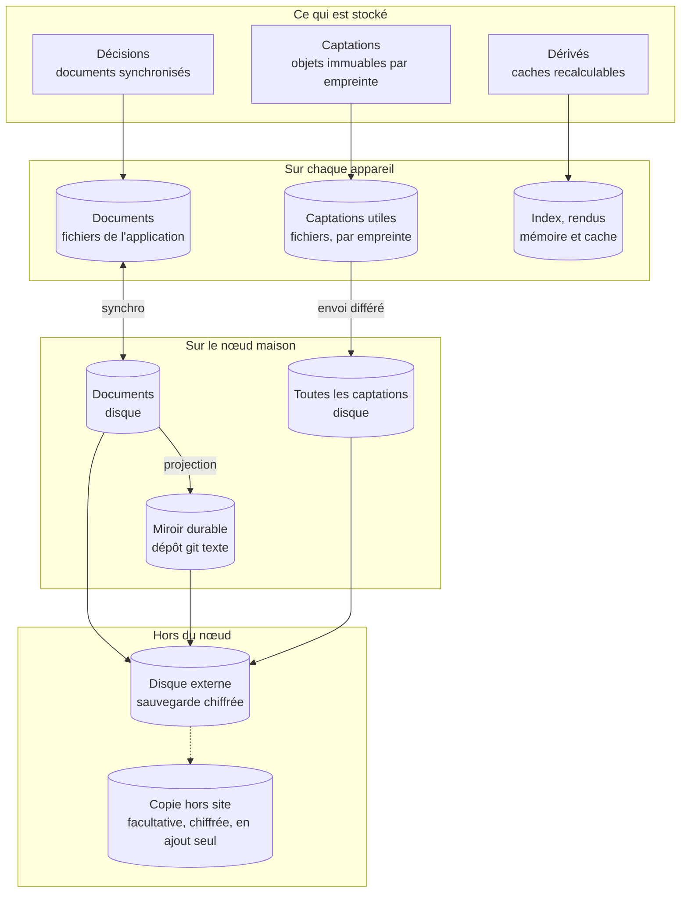
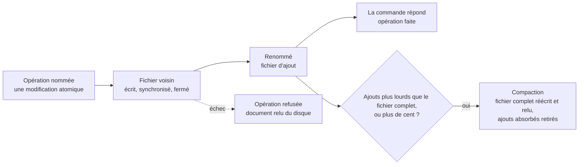
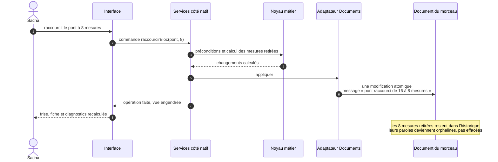
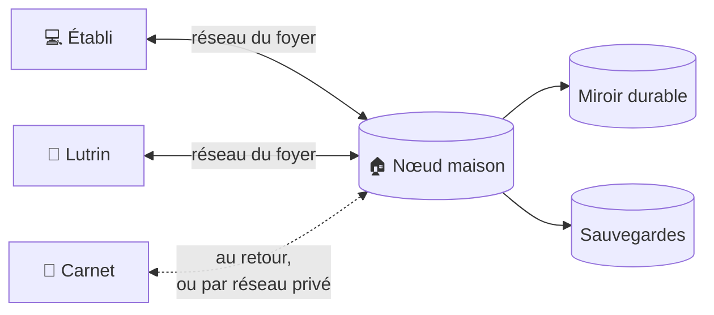
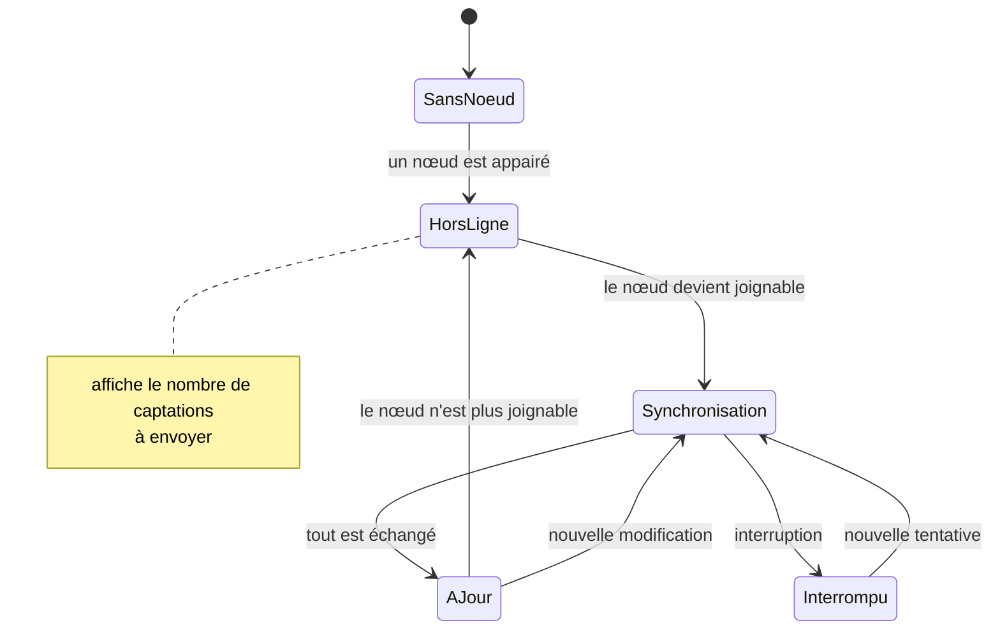
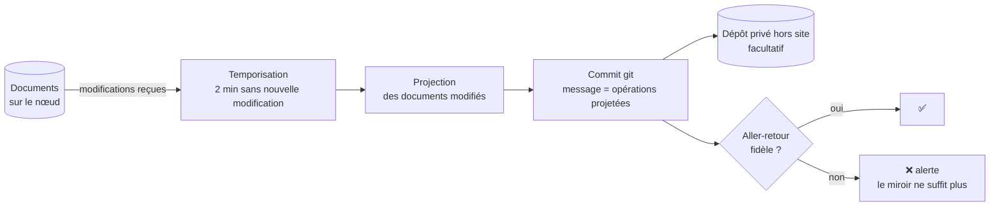
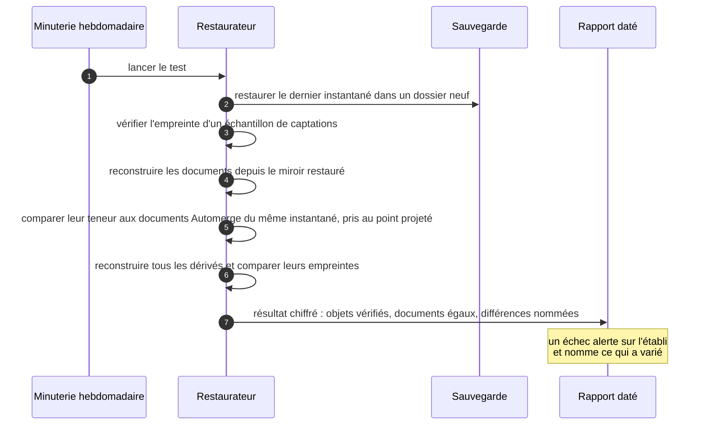

# 31 — Persistance, synchronisation et durabilité

Le [§ 30](30-modele-de-domaine.md) dit **ce que** l'on stocke. Ce document dit **où**,
**comment** cela voyage entre les appareils, et **comment on est sûr de ne rien
perdre**. Les décisions qui le fondent :
[ADR-002](adr/adr-002-local-first.md) (local-first),
[ADR-003](adr/adr-003-crdt-et-miroir-durable.md) (documents CRDT et miroir durable),
[ADR-022](adr/adr-022-documents-cote-natif.md) (les documents côté natif) et
[ADR-023](adr/adr-023-stockage-des-documents.md) (leur stockage).

---

## 1. Trois natures de données, quatre lieux



| Nature | Exemples | Se modifie ? | Sur les appareils | Sur le nœud | Sauvegardé ? |
|---|---|---|---|---|---|
| **Décisions** | Forme, grille, mélodie, paroles, provenance, ordres d'album, réglages | Oui, par opérations nommées | **Copie complète** | Copie complète | Oui, par le miroir durable et la sauvegarde |
| **Captations** | Prises, stems, photos, MIDI et textes versés, manifestes et rapports d'import, traits d'encre, rendus figés, résultats d'analyse | **Jamais** : on en produit une autre | Ce qui est utile ou à envoyer | Toutes | Oui |
| **Dérivés** | Index de recherche, rendus, diagnostics, suggestions, doigtés et renversements calculés | Recalculés | Cache | Cache | **Non, par conception** |
| **Miroir durable** | Projection texte des décisions, dans git | Écrit par le seul exportateur | — | Oui | Oui : sur le disque externe, et hors site si la copie facultative existe |

**Sur l'appareil, tout est fichier**, dans le dossier de l'application
([§ 41](41-pile-technique.md)) : les documents Automerge (§ 2.1), et les captations nommées par
leur empreinte (§ 6.1). Sous Windows, c'est le dossier local de Tauri, `app_local_data_dir`,
jamais le dossier itinérant `app_data_dir` ([§ 40 · 8](40-architecture.md#8-déploiement)).
Aucun stockage de navigateur : le système ne vide pas ce dossier de lui-même, à la différence des dossiers temporaires, où rien de ce qui doit durer ne vit.
Le nœud range ses copies de la même façon, sur son disque.

**Le mode démonstration, dans son dossier.** Pupitre peut s'ouvrir sur le **jeu factice**
que demande [M-0001](modele/decisions/M-0001-ecosysteme-des-applications-personnelles.md),
pour se montrer sans aucune donnée de Sacha.

- C'est la même application, avec les mêmes portes. Seul change le dossier qu'elle ouvre :
  celui de la démonstration, dans le dossier de l'application, à côté de celui du fonds et
  jamais dedans (§ 2.1).
- Elle s'y ouvre par un choix explicite, jamais par défaut, et un bandeau le dit tant
  qu'elle y reste : « Démonstration · fonds inventé ». Le choix relance l'application sur
  `demonstration/` : la racine des données reste reçue au lancement (§ 2.1), et rien du
  fonds de Sacha ne reste ouvert. Le bandeau porte « Quitter la démonstration », qui relance
  sur `donnees/`. Le choix survit à la relance, par un argument passé à la relance ou par un
  fichier du dossier de l'application, que lit au lancement le seul endroit qui reçoit les
  chemins du système (I30) ; le plan du lot 1 fixe lequel. Ce fichier vit à côté de
  `donnees/` et de `demonstration/`, jamais dans l'une ou l'autre ni dans `appareil.txt` :
  c'est lui qui choisit la racine des données, et entrer en démonstration n'écrit rien dans
  `donnees/`.
- Jusqu'au lot 3 d'INC-1, elle n'y synchronise rien et n'y appaire rien : aucun nœud ne voit
  le jeu factice. La PR de conception du lot 3 dit si la démonstration rejoint un nœud qui
  lui est propre, dans son silo
  ([M-0001](modele/decisions/M-0001-ecosysteme-des-applications-personnelles.md) · 2), et
  comment.
- Le jeu factice a son propre identifiant de propriétaire
  ([§ 30 · 2](30-modele-de-domaine.md#2-identités)) : aucun de ses documents ne s'ouvre dans
  le fonds de Sacha, ni l'inverse.

Le jeu factice est **écrit**, jamais dérivé d'un fonds réel. C'est du code, versionné avec
l'application : il crée ses idées par les mêmes opérations nommées que Sacha (§ 3), avec
des textes, des étiquettes et des liens inventés. Il **engendre** ses captations, de façon
déterministe, octet pour octet sur chaque plateforme : des sons de quelques secondes en WAV
PCM, dont l'en-tête s'écrit à la main, tirés d'une onde carrée ou triangulaire, ou de
valeurs de sinus écrites dans le code, jamais d'une fonction comme `f64::sin`, dont la précision
varie selon la plateforme ; et des images dessinées, dans un format qui s'écrit sans crate de
plus, fixé avec la photo par la PR de conception du lot 2. Au lot 1, le jeu factice n'a donc
aucune photo, et regrouper ne s'y éprouve que sur des prises ; les images s'y ajoutent au
lot 2. Le filtre « photo » existe dès le lot 1 : tant qu'aucune photo n'est entrée, il répond
« 0 idée », avec son assiette. Les empreintes des captations du jeu factice sont les mêmes
sur chaque plateforme, et aucune dépendance ne s'ajoute. Aucune captation n'est donc suivie
dans le dépôt, où la porte `contenu` refuse tout fichier audio, MIDI ou partition
([CONVENTIONS](../CONVENTIONS.md#portes-de-ci)). L'application l'écrit dans le dossier de la
démonstration à sa première ouverture, et le réécrit à la demande : ses documents, ses
captations et ses caches sont retirés, puisqu'ils ne portent que du jeu factice, puis
réécrits ; le côté natif refuse cette demande, comme celle du fonds de mesure, hors du mode
démonstration.

**Le fonds de mesure, en démonstration.** À la demande, le mode démonstration engendre à la
place du jeu factice le fonds de mesure (§ 10, test 13), dans `demonstration/`, sous le même
bandeau ; il y remplace le jeu factice jusqu'à ce qu'on réécrive celui-ci. Ses prises peuvent
n'avoir que leurs métadonnées, sans captation : le partiel est normal
([ADR-006](adr/adr-006-le-partiel-est-normal.md)). C'est sur lui que se font les contrôles
chronométrés du
[§ 70 · 7](70-qualite-et-verification.md#7-les-contrôles-à-lœil-sur-lappareil).

**Chaque chemin de données se reçoit, aucun ne se devine.** Les chemins des documents, des
captations et des caches sont donnés aux adaptateurs par qui les lance : le système pour le
fonds de Sacha, le mode démonstration pour son dossier, chaque test pour un dossier jetable.
Le même mécanisme isole la démonstration et les tests, et le test d'isolation des chemins de
données le prouve pour les deux, par l'invariant I30
([§ 70 · 3](70-qualite-et-verification.md#3-les-invariants-et-leurs-tests)).

---

## 2. Les documents

La **granularité** de synchronisation est un choix : un document trop gros synchronise
tout pour une virgule ; un document trop fin multiplie les liens fragiles.

| Document | Contient | Taille estimée |
|---|---|---|
| **Fonds** | L'identifiant de propriétaire ; les idées, leurs étiquettes et leurs liens ; les motifs ; les métadonnées des prises, des stems, des photos, des MIDI et des textes versés ; les requêtes enregistrées ; la liste des morceaux et albums | 100 Ko à 1 Mo de contenu pour quelques centaines d'idées ; moins de 4,5 Mo, historique compris, pour la taille visée : 2 000 idées, et 6 000 prises dont 100 en stems |
| **Morceau** (un par morceau) | Tout le morceau : titres, statut, blocs, occurrences, paroles, alignements, arrangement, rattachements de prises, doigtés épinglés du morceau, annotations, journal | 50 à 300 Ko de contenu ; moins de 2 Mo historique compris |
| **Album** (un par album) | Intention, sélection, ordres, transitions, arc, doigtés épinglés de l'album, journal | Moins de 100 Ko |
| **Réglages** | Tessiture, instruments, règles et doctrine, préférences, doigtés épinglés du fonds, consentements | Moins de 100 Ko |

Avec une soixantaine de morceaux, l'ensemble des documents tient sous **125 Mo** au pire
(60 × 2 Mo, plus moins de 4,5 Mo pour le fonds et moins de 0,5 Mo pour les albums et les
réglages), historique compris : une copie complète par appareil est
raisonnable, y compris sur un téléphone. Ce sont les captations audio qui pèsent (§ 6).

**La taille visée du fonds** est celle de
[CAP-06](20-sfd/21-capter-et-organiser.md#cap-06--interroger-le-fonds) · 6 : 2 000 idées.
Les 300 morceaux de ce critère éprouvent la recherche, pas le budget ci-dessus, compté sur
une soixantaine. Sacha écrit par périodes, depuis une quinzaine d'années, et apporte un fonds
de démos, de *stems*, de fichiers MIDI, de textes et de notes
([§ 11](11-persona-et-situations.md#1-fiche)). À quelques idées par semaine, une semaine sur
deux — une hypothèse, que le persona ne chiffre pas —, il s'en capte une à deux centaines
par an : 2 000 au plus après une dizaine d'années. C'est une borne haute, avec de la marge.
Déclarés, les jeux de stems y ajoutent peu d'idées, une par prise, mais des captations
([CAP-03](20-sfd/21-capter-et-organiser.md#cap-03--importer-un-fonds-existant)). Un stem en
WAV pèse environ 11 Mo par minute, et un jeu de stems en compte huit à douze : les douze stems d'une
version de trois minutes, autour de 400 Mo. La taille visée compte donc, parmi les 6 000 prises
du fonds de mesure, **100 prises en stems** de douze stems, chaque stem avec son MIDI versé, soit 2 400 captations de plus
et environ 40 Go d'audio : les ordres de grandeur d'un relevé, raisonnés pour Sacha
([ADR-024](adr/adr-024-import-d-un-fonds.md)). Le fonds tient sous **4,5 Mo**, historique compris : c'est sa part des 125 Mo
ci-dessus. Le fonds de mesure le vérifie, avec les métadonnées de ces captations, sans leur
audio (§ 10, test 13).

Les **appareils appairés et leurs jetons** ne sont **pas** dans un document synchronisé :
ce sont des données de sécurité, gardées sur le nœud seul. Chaque appareil garde, lui, son
propre jeton et la clé publique épinglée du nœud ([ADR-021](adr/adr-021-cle-du-noeud-epinglee.md)).

### 2.1 Sur le disque

Chaque document a son dossier, sous `documents/`, dans la **racine des données** d'un
fonds : `donnees/`, dans le dossier de l'application, pour le fonds de Sacha ;
`demonstration/`, à côté, pour le mode démonstration (§ 1). Le nœud range ses copies de la
même façon. La racine des données ne se confond pas avec la racine d'un document, son objet
de tête (§ 2.4) : le [glossaire](80-glossaire.md#les-données) les distingue.

```text
<racine des données>/                      donnees/ ou demonstration/ ; un dossier jetable pour un test
  verrou                                   tenu par le processus qui écrit les documents
  appareil.txt                             ce qui est propre à l'appareil (ci-dessous)
  documents/
    fonds/
      complet.automerge                    le fichier complet : tout le document, historique compris
      ajouts/<empreinte>.automerge         un fichier d'ajout par écriture faite depuis
    reglages/                              de même
    morceaux/<id>/  albums/<id>/           de même, un dossier par document
    remplaces/<id>-<lignée>/               une copie d'une lignée remplacée, gardée à part (§ 2.5)
  captations/
    <deux premiers caractères>/<empreinte> une captation (§ 6.1)
  caches/                                  les dérivés, jetables (§ 7)
```

- **Deux sortes de fichiers.** Le **fichier complet** porte tout le document, historique
  compris, tel qu'Automerge l'enregistre d'une traite. Chaque écriture faite depuis ajoute un
  **fichier d'ajout**, qui ne porte que ses modifications, et que nomme l'empreinte de son
  contenu : deux écritures identiques font un seul fichier. Le fichier d'ajout d'une
  opération porte `save_after` des *heads* du document d'avant l'opération, les empreintes de
  ses dernières modifications (§ 9) : il ne dépend ni
  d'une compaction faite à l'ouverture, ni de la relecture du disque après un refus.
- **Ouvrir un document**, c'est lire son fichier complet, puis ses fichiers d'ajout, dans
  n'importe quel ordre : Automerge met de côté une modification dont les dépendances ne
  sont pas encore lues.
- **Chaque fichier s'écrit à côté, puis prend sa place**, comme l'export du cahier des tables
  (`app/src-tauri/src/lib.rs`) : un fichier voisin, `<nom>.<processus>.partiel`, est écrit,
  synchronisé sur le disque, fermé, puis renommé. Hors de Windows, le dossier est synchronisé
  à son tour, pour que le renommage survive à une coupure. Un fichier est donc entier, ou
  absent. Sous Windows, où un dossier ne se synchronise pas, le fichier est renommé par
  `std::fs::rename`, qui remplace au besoin un fichier complet existant, puis rouvert en
  écriture, sans être tronqué, et synchronisé à son tour (`sync_all`, soit
  `FlushFileBuffers`) : Windows garde en cache les métadonnées d'un fichier, et seul un
  fichier synchronisé les écrit. Le renommage peut tout de même se perdre après la réponse.
  Au démarrage, dans `documents/`, le voisin d'un fichier d'ajout dont le contenu donne
  l'empreinte de son nom prend donc sa place. Le voisin d'un fichier complet que `load` relit
  sans erreur se lit avec le document, comme un fichier d'ajout, puisqu'Automerge ignore ce
  qu'il a déjà ; la compaction de l'ouverture le fond, puis le retire. Il se lit de même quand
  le fichier complet manque encore, à la naissance du document (§ 2.3) : le document existe
  alors, et Pupitre n'est plus neuf (§ 9.1). La compaction n'écrit jamais son propre voisin
  par-dessus celui qu'elle fond : le numéro d'un processus se réemploie d'un lancement à
  l'autre, et un nom déjà pris reçoit un suffixe (`<nom>.<processus>-2.partiel`, `-3`…).
  Tout autre `.partiel` de `documents/` est retiré. Le nom provisoire d'une captation suit le § 6.1 : il n'est jamais retiré d'office.
  Une opération refusée retire son voisin avant de dire son refus, comme l'export du cahier.
- **Une opération nommée n'est faite qu'une fois son fichier d'ajout en place**, ou, à la
  naissance d'un document, son premier fichier complet (§ 2.3), et la commande ne répond
  qu'alors ([ADR-022](adr/adr-022-documents-cote-natif.md)). Si
  l'écriture échoue, l'opération est refusée, le refus se dit, et le document se relit du
  disque : la mémoire ne garde jamais une écriture que le disque n'a pas. Une opération sur
  deux documents suit le § 3 : si la seconde écriture échoue, la première reste, Pupitre le
  dit, et le contrôle au démarrage répare la référence manquante. Un document n'est lu par la
  synchronisation qu'entre deux opérations : une modification ne part vers le nœud qu'une
  fois son fichier d'ajout en place, ou, à la naissance d'un document, son premier fichier
  complet. De même, ce que la synchronisation reçoit ne l'est qu'une fois écrit, en un fichier
  d'ajout (`save_after` des *heads* d'avant la réception), avant que l'échange ne continue ; un
  message qui n'apporte rien n'écrit rien.
- **Le message d'une opération nommée** est celui de sa modification Automerge, qui porte
  aussi son heure : le journal se lit dans l'historique (§ 3).
- **Chaque ouverture d'un document tire un acteur neuf.** Un acteur, au sens d'Automerge, est
  l'auteur d'une suite de modifications qui doivent se suivre sans trou ; repris après une
  écriture perdue, il écrirait deux modifications au même rang. L'appareil où naît une idée,
  une prise ou une photo est, lui, une valeur du document
  ([§ 30 · 8.1](30-modele-de-domaine.md#81-la-provenance),
  [§ 30 · 9.2](30-modele-de-domaine.md#92-prises-photos-et-analyses)) ; aucun acteur ne le
  dit.
- **Un fichier illisible n'est ni effacé, ni sauté en silence.** Chaque fichier d'ajout se
  relit d'abord contre l'empreinte qui le nomme. Le fichier complet se lit par `load`, qui
  refuse un tronçon (*chunk*) altéré. `load_incremental` ne sert jamais seul de contrôle : il
  s'arrête sans erreur au premier tronçon altéré. Une fois tout lu, aucune modification
  n'attend ses dépendances (`get_missing_deps(&[])` est vide). Sinon, le document s'ouvre en
  lecture seule, sur ce qui se lit, et un bandeau nomme le fichier. La réparation vient du
  nœud ou, sans lui, de l'archive complète. Le bandeau du document en lecture seule propose
  alors de repartir de l'archive. Pupitre ferme la racine des données : chaque fichier qu'il y
  tient, la prise que sert le protocole des captations comprise, puis le fichier du verrou,
  en dernier. Il renomme alors la racine en `donnees-abimee-AAAA-MM-JJ/` (suffixe `-2`,
  `-3`… si le nom est pris), à côté de `donnees/`, jamais dedans. Il se relance sur une racine des données
  neuve, vide, et y réimporte l'archive (§ 9.1). Le renommage se fait au seul endroit qui
  reçoit les chemins du système (I30). Le bandeau dit ensuite que ce qui s'est écrit depuis
  l'archive reste dans `donnees-abimee-…/`, intact, et n'en revient pas. Si le renommage
  échoue tout de même, sous Windows parce qu'un autre programme tient un fichier de la
  racine, rien n'a changé. Pupitre reprend le verrou et rouvre `donnees/`, le document
  abîmé toujours en lecture seule. Le bandeau dit que la reprise n'a pas eu lieu, et
  pourquoi. Rien ne se réimporte tant que `donnees/` n'est pas renommé (§ 9.1).
- **Tout part d'une seule racine des données**, que l'application reçoit au lancement
  (§ 1) : le mode démonstration ou un test, qui en reçoivent une autre, ne voient rien
  d'autre. Un seul processus écrit les documents d'une racine des données : un verrou
  l'assure. C'est `File::try_lock` sur le fichier `verrou`, ouvert en écriture, sans crate de
  plus (`flock` sous Android, `LockFileEx` sous Windows). Le système le lève quand le fichier
  se ferme, donc aussi à un arrêt brutal ; la seule présence du fichier ne dit rien. Un
  second processus qui ne l'obtient pas s'arrête en le disant. Le démarrage ne retire ni ne
  renomme rien dans `documents/` ni dans `captations/` avant d'avoir pris le verrou.
- **`appareil.txt` porte ce qui est propre à l'appareil**, pour sa racine des données,
  jamais échangé avec le nœud ni archivé :
  une ligne `clé=valeur` par fait, écrit à côté puis renommé, comme tout fichier. Il garde la
  date de la dernière archive complète relue (§ 9.1) ; au lot 3, le budget de stockage ; la
  file d'envoi et les accusés, dont la PR de conception du lot 3 fixe la forme. Rien n'en
  entre dans un document : c'est un état de l'appareil, comme « à envoyer »
  ([glossaire](80-glossaire.md#les-données)).



### 2.2 La compaction

Un fichier d'ajout par geste : ils s'accumulent. La **compaction** les fond dans le fichier
complet.

1. Elle a lieu à l'ouverture d'un document qui a des fichiers d'ajout, ou le voisin entier de
   son fichier complet (§ 2.1), puis dès que ses fichiers d'ajout pèsent ensemble plus que son
   fichier complet, ou passent la centaine.
2. Elle enregistre le document entier, historique compris, relit en mémoire ce qu'elle a
   enregistré, et vérifie qu'il mène au même point de l'histoire que le document en mémoire.
   Sinon elle n'écrit rien, et l'ancien fichier complet reste en place.
3. Elle l'écrit dans un fichier complet neuf, à côté puis renommé (§ 2.1), puis relit ce
   fichier, et vérifie qu'il rend les octets écrits.
4. Elle retire alors les seuls fichiers d'ajout dont chaque modification est dans le fichier
   complet relu, et, aux mêmes conditions, le voisin du fichier complet qu'elle a fondu. Un
   fichier illisible, ou dont une modification attend ses dépendances, n'est
   jamais retiré. Une écriture arrivée entre-temps garde le sien.

Elle ne retire jamais d'histoire : un fichier complet porte toutes les modifications du
document, et le journal et le retour avant une opération (§ 3) restent entiers. Coupée à
n'importe quelle étape, elle ne perd rien : un fichier d'ajout déjà absorbé, relu une seconde
fois, n'ajoute rien, car Automerge ignore une modification déjà appliquée. Un document en
lecture seule (§ 2.1, § 2.4) ne se compacte pas.

### 2.3 La genèse et le point de départ du fonds

Automerge ne fusionne proprement que des copies d'une même histoire. Deux documents créés
chacun de son côté n'ont pas d'ancêtre commun : chacun crée ses propres conteneurs, l'objet à
clés des idées par exemple. À la fusion, les deux objets se disputent la même clé ; Automerge en
présente une et range l'autre parmi les conflits, et les idées de la seconde sortent de la
vue. Son guide le dit : initialiser le document sur chaque appareil « will not work ». D'où
deux règles.

- **Chaque sorte de document part de sa genèse** : sa première modification, écrite une fois
  pour toutes et rangée en octets dans le code de Pupitre, la même dans chaque installation
  et chaque version. Elle crée les conteneurs de la racine du document et pose la version de
  schéma 1 (§ 2.4). Ses octets ne changent plus dès l'étiquette `vX.Y.Z` qui la publie
  ([ADR-023](adr/adr-023-stockage-des-documents.md)).
- **Le fonds de Sacha naît une seule fois**, sur un premier appareil. Il naît au premier
  geste qui écrit, noter une idée ou importer un fonds existant
  ([CAP-03](20-sfd/21-capter-et-organiser.md#cap-03--importer-un-fonds-existant)), jamais à
  la seule ouverture : jusque-là, la racine des données reste sans document, et Pupitre reste
  neuf (§ 9.1). La naissance et ce premier geste s'écrivent ensemble, deux modifications avec
  chacune son message, en un seul fichier : le premier fichier complet du document, qui porte
  aussi la genèse. Si le geste est refusé, la naissance l'est avec lui, et la racine des données
  reste sans document. Sa naissance, faite sur la genèse, écrit son identifiant, sa lignée (§ 2.5)
  et l'identifiant de propriétaire ([§ 30 · 2](30-modele-de-domaine.md#2-identités)). Un
  autre appareil part d'une copie de ce fonds, historique compris, jamais d'un fonds à lui :
  il la reçoit du nœud à l'appairage ;
  sans nœud, d'une copie des documents du premier, que décrit la PR de conception du lot 2
  ([§ 40 · 9](40-architecture.md#9-trajectoire-de-construction)). Ce n'est pas l'archive
  complète : elle sert à repartir après un sinistre (§ 9.1), et emporterait toutes les
  captations du premier, qu'aucun accusé du nœud ne laisserait évincer (§ 6.2). Les deux
  copies ont ainsi une histoire commune : elles fusionnent dès que le nœud les réunit, même
  après des semaines sans lui. Deux fonds nés chacun de son côté ne fusionnent jamais : ce
  sont deux documents, d'identifiants différents.

### 2.4 La version de schéma

Chaque document porte, à la racine du document, sa **version de schéma** : le numéro de sa
structure. La genèse pose la version de schéma 1.

- **Une version de schéma monte par une migration écrite d'avance**, comme la genèse : une
  modification rangée en octets dans le code, qui ne dépend que de la précédente, la genèse
  ou la migration d'avant. Deux appareils qui migrent chacun le même document écrivent la même
  modification, qu'Automerge ne compte qu'une fois. C'est la voie que recommande le guide
  d'Automerge ; une migration calculée sur chaque appareil en écrirait deux, qui se
  heurteraient. Une migration publiée, c'est-à-dire portée par une étiquette, ne change
  plus. La genèse et chaque migration portent l'heure 0, la même partout : le journal les
  montre sans heure (`—`), et nomme la version de Pupitre qui a apporté la migration.
- **Une migration ne touche que la racine du document** : elle y ajoute un conteneur, y pose
  une valeur, monte le numéro. Elle ne touche aucun objet de Sacha. Les conteneurs d'un objet
  naissent avec lui, jamais après. Une valeur simple qu'ajoute une version de schéma se pose
  dans l'objet même, et se lit absente chez un objet plus ancien, comme le veut le partiel
  normal ([ADR-006](adr/adr-006-le-partiel-est-normal.md)). Ce qui demanderait un objet à
  clés neuf n'en crée aucun après la migration : il s'écrit en valeurs simples, dans un
  conteneur de la racine du document que crée la migration, sous une clé qui joint
  l'identifiant de l'objet à celui de l'élément (`<objet>/<élément>`), et cela pour tous les
  objets, y compris ceux nés après la migration. Il n'a ainsi qu'une place, et aucun
  conteneur ne naît deux fois sous la même clé, de deux côtés. Une liste ne se range pas
  ainsi sous des clés sans perdre son ordre : l'ajouter à des objets existants demande une
  décision écrite, comme un changement de structure
  ([ADR-023](adr/adr-023-stockage-des-documents.md)).
- **Une application lit et écrit les versions de schéma qu'elle connaît.** Elle migre un
  document plus ancien à son ouverture ; la migration est une opération nommée comme une
  autre, avec son message : « Fonds passé à la version de schéma 2 ».
- **Devant une version de schéma plus récente, elle lit sans écrire.** Elle montre ce
  qu'elle connaît, laisse le reste intact, et refuse toute opération sur ce document en
  nommant la raison :
  un bandeau dit qu'il vient d'une version plus récente de Pupitre, et qu'il faut mettre à
  jour l'application pour y écrire. C'est l'impossibilité stricte que nomme l'ADR-006. Elle
  en reçoit encore les modifications par la synchronisation, et ne lui transmet aucune
  modification. Une captation n'est jamais refusée pour autant : elle s'écrit, et l'idée qui
  la reçoit naît après la mise à jour.
- **Le nœud se met à jour le premier.** Son exportateur ne projette que les versions de
  schéma qu'il connaît ; devant une autre, il ne projette pas le document, et l'aller-retour
  du miroir échoue en le nommant (§ 8.4).

### 2.5 La lignée

Un document reconstruit hors de son histoire, depuis le miroir (§ 8.1), dit la même chose que
l'ancien avec d'autres modifications : fusionné avec une copie restée sur un appareil,
chacun de ses éléments s'y heurterait à son double : dans un objet à clés, l'un cacherait
l'autre, avec ce qu'on lui a écrit depuis ; dans une liste, les deux paraîtraient. La **lignée**
l'empêche.

- **Chaque document porte sa lignée**, à la racine du document : un ULID, écrit à sa
  naissance. Toutes les copies qui descendent de cette naissance sont de la même lignée.
- **Restitué avec son histoire, un document garde sa lignée** : une copie d'appareil, ou un
  document Automerge d'une sauvegarde ou d'une archive. Il fusionne avec les autres copies,
  sans rien doubler, comme une copie restée hors ligne.
- **Reconstruit hors de son histoire, il ouvre une lignée nouvelle**, qui nomme celles qu'elle
  remplace. Le miroir porte pour cela la lignée de chaque document.
- **La synchronisation compare les lignées avant tout échange** (§ 4.4). Même lignée : elle
  échange. Une copie dont la lignée est remplacée ne fusionne pas : elle est gardée à part,
  intacte, dans `documents/remplaces/`, et la copie de la lignée nouvelle prend sa place.
  Deux lignées dont aucune ne remplace l'autre ne s'échangent rien, et Pupitre le dit.

### 2.6 La teneur

La **teneur** d'un document, c'est ce qu'il dit, sans son histoire. Deux documents de même
teneur disent la même chose, quelle que soit la façon dont ils y sont arrivés. C'est elle que
comparent l'aller-retour du miroir (I12), le test de restauration (§ 9) et la réimportation
de l'archive complète (§ 9.1).

- **Elle se lit sur la valeur que présente le document** : chaque objet à clés, ses clés
  rangées dans l'ordre de leurs octets ; chaque liste, dans son ordre ; chaque valeur simple, avec son
  type exact d'Automerge : `Str`, `Int`, `Uint`, `F64`, `Counter`, `Timestamp`, `Boolean`,
  `Bytes` ou `Null`. Un `F64` s'écrit sous sa forme la plus courte qui se relit à
  l'identique, `-0` distinct de `0`, et un NaN fait échouer l'écriture. Chaque objet s'écrit
  avec sa sorte : objet à clés (`Map` ou `Table` d'Automerge, une seule sorte), liste, texte
  `Text`, distinct
  d'une valeur `Str`. Un type inconnu (`Unknown`) fait échouer l'écriture de la teneur, qui
  le nomme. Pupitre n'écrit ni `Counter`, ni objet `Text` : un test le vérifie sur les
  documents de test. Les identifiants, la version de schéma et l'identifiant de propriétaire
  en font partie.
- **Les textes sont pris octet pour octet**, sans aucune normalisation : une normalisation
  cacherait un miroir qui change un caractère.
- **Pour une clé en conflit**, elle prend la valeur que présente Automerge.
- **Elle laisse l'histoire de côté** : les modifications, leurs acteurs, leurs heures, leurs
  messages, la lignée et les lignées qu'elle remplace (§ 2.5).
- **Elle s'écrit en un texte déterministe**, dont l'empreinte se compare. Cette écriture ne
  change jamais : une archive d'il y a dix ans se compare encore.

Ce qu'elle ne voit pas : l'autre valeur d'un conflit, qu'Automerge ne garde à part que
jusqu'à la prochaine écriture (§ 5). Un conflit relevé à la synchronisation s'écrit donc dans
le document, comme une variante ou un état « à trancher », et non dans la seule liste des
conflits d'Automerge : sinon la teneur, le miroir et l'archive le perdraient.

---

## 3. Les opérations nommées

Aucune écriture ne se fait « au champ près » depuis l'interface : elle n'appelle que des
commandes ([ADR-022](adr/adr-022-documents-cote-natif.md)). Chaque modification passe par une
**opération nommée**, qu'un service d'application conduit, du côté natif. Le noyau métier, en
fonctions pures, en vérifie les préconditions et en calcule les changements ; l'adaptateur
`Documents` les applique. Une opération nommée :

1. vérifie ses préconditions (on ne retire pas la seule mesure d'un bloc sans le dire) ;
2. applique ses changements dans **une seule modification atomique par document** ; une
   opération sur deux documents écrit d'abord le document cible, puis la référence du
   fonds, et un contrôle au démarrage répare une référence manquante ;
3. porte un **message lisible**, engendré : « Northbound : pont raccourci de 16 à 8 mesures ».



C'est ce qui rend le **journal** lisible sans rédaction, et ce qui permet de revenir
avant une opération précise.

---

## 4. La synchronisation

### 4.1 La topologie

Une étoile autour du nœud maison. Chaque appareil travaille sur sa copie et échange
ses modifications avec le nœud **dès qu'il le joint** : sur le réseau du foyer, ou par
un réseau privé virtuel s'il en existe un ([Q07](90-questions-ouvertes.md)).
Une fois sa copie reçue, aucun appareil n'a besoin d'un autre pour travailler
([ADR-023](adr/adr-023-stockage-des-documents.md)).



Sans nœud maison, rien ne se synchronise : chaque appareil travaille sur sa copie, et la
sauvegarde passe par l'archive complète, exportée à la main
([SYN-07](20-sfd/29-socle-donnees-appareils.md#syn-07--exporter-et-importer) ; § 9.1). Un
second appareil part alors d'une copie des documents du premier, historique compris, que
décrit la PR de conception du lot 2 (§ 2.3) : quand le nœud arrive, leurs copies fusionnent.
C'est un mode dégradé assumé, pas un mode nominal.

### 4.2 Le retour à la maison


### 4.3 L'état visible de la synchronisation

Sacha voit toujours où en sont ses données. Pas d'icône ambiguë : un état, un nombre.



| État | Ce que voit Sacha |
|---|---|
| Sans nœud | « Sans nœud · archive du 3 nov. » |
| Hors ligne | « Hors ligne · 3 captations à envoyer » |
| Synchronisation | « Synchronisation · 2 captations sur 3 » |
| À jour | « À jour · il y a 2 min » |
| Interrompu | « Interrompu · nouvel essai dans 30 s » |

Tant qu'aucun nœud n'est appairé, l'état dit « Sans nœud » et la date de la dernière archive
complète relue, que garde `appareil.txt` (§ 2.1, § 9.1) ; avant toute archive, il dit
« Sans nœud · aucune archive ». Aucune idée ne se montre alors « à envoyer », puisqu'aucun
envoi n'est possible.
Ce que le carnet montre de ses captations, qui ne vivent alors que sur lui (R6), se tranche
dans la PR de conception du lot 2
([§ 40 · 9](40-architecture.md#9-trajectoire-de-construction)).

### 4.4 La couche de synchronisation

Pupitre emploie la crate `automerge`, à version épinglée, et une **couche maison** en
étoile, sur WebSocket en TLS ; la clé du nœud est épinglée sur chaque appareil
([ADR-021](adr/adr-021-cle-du-noeud-epinglee.md)). Elle est écrite pour Pupitre plutôt
qu'empruntée à samod, le dépôt Automerge en Rust
([A21](90-questions-ouvertes.md#les-arbitrages-pris-dans-cette-conception)), parce
qu'elle fait peu de choses :

- pour chaque document, échanger avec le nœud les modifications qui manquent de part et
  d'autre, par le protocole de synchronisation d'Automerge, entre copies d'une même lignée
  (§ 2.5) ;
- relever les conflits à chaque synchronisation, pour les présenter « à trancher » (§ 5).

Elle est isolée derrière l'adaptateur `Documents`
([§ 40 · 3](40-architecture.md#3-composants-de-lapplication)), du côté natif de chaque
application ([ADR-022](adr/adr-022-documents-cote-natif.md)). L'envoi des captations
reste à l'adaptateur `Captations`, en HTTP : par empreinte, et sans libérer une
captation avant l'accusé de réception (§ 4.2). La couche de synchronisation ne transporte
que les documents.

Le format de stockage des documents, leur compaction et leur sauvegarde sont au § 2 et au
§ 9 ([ADR-023](adr/adr-023-stockage-des-documents.md)). L'hypothèse H07 en éprouve le
format, à l'ouverture du lot 1 d'INC-1, en CI, avant son plan : deux répliques qui divergent
hors ligne convergent au retour, et une copie de la racine des données, restaurée dans un
dossier neuf, garde ses captations intègres
([§ 40 · 11](40-architecture.md#11-hypothèses-à-confronter)).

---

## 5. Les conflits

Les documents sont des **CRDT** : deux copies modifiées séparément convergent toujours
vers le même état, sans serveur arbitre. Converger n'est pas tout garder : quand deux
appareils écrivent la même valeur, Automerge en retient une et ne garde l'autre que dans
sa liste de conflits, jusqu'à la prochaine écriture. Pupitre lit donc ces conflits à
chaque synchronisation : rien ne se perd en silence. Avec une seule personne et trois
appareils, les modifications concurrentes sont rares ; elles existent quand même (une
retouche dans le train pendant que l'établi, resté ouvert, édite la même ligne).

La convergence technique ne suffit pas : il faut qu'elle ait un **sens musical**.

| Cas concurrent | Fusion technique | Ce que fait Pupitre |
|---|---|---|
| Deux appareils retouchent **la même ligne de texte** | Chaque retouche crée sa ligne ; le registre `retenues` de l'occurrence reçoit deux valeurs en conflit pour le même emplacement ([§ 30 · 6.1](30-modele-de-domaine.md#61-lignes-et-variantes)) | **Un conflit devient une variante** : les deux lignes sont gardées au même emplacement, l'une est rendue, l'emplacement est marqué « à trancher » |
| Deux appareils changent **le même accord** ou **la même note** | L'objet harmonique, la hauteur s'écrivent d'un bloc : deux valeurs en conflit, jamais un mélange champ par champ | Même règle : une variante d'accord ou de note à trancher, visible dans la grille ou la portée |
| Deux appareils changent **le même attribut** (tempo, tonique, statut) | Une valeur gagne, l'autre reste en conflit jusqu'à la prochaine écriture | Pupitre lit les conflits à la synchronisation et les présente « à trancher » |
| Deux appareils **réordonnent la forme** différemment | Les listes fusionnent, parfois en un ordre étrange | Pupitre détecte une forme improbable (occurrence dupliquée, ordre incohérent) et signale « forme à vérifier » avec les deux versions |
| Un appareil **supprime** une occurrence que l'autre **modifie** | La suppression gagne côté liste ; la modification survit dans l'objet | L'occurrence modifiée réapparaît dans « éléments retirés récemment », récupérable |
| Deux appareils modifient **des éléments différents** | Fusion directe | Rien à signaler |

Aucune fusion ne mélange deux textes caractère par caractère, ni deux accords ou deux
hauteurs champ par champ : un vers fusionné à moitié, ou un sol double bémol né de deux
corrections d'un fa♯ ([§ 30 · 4.2](30-modele-de-domaine.md#42-lobjet-harmonique)), serait
une ligne ou une note que personne n'a écrite. Le test d'I11 couvre les trois cas : texte,
accord, hauteur.

---

## 6. Les captations

### 6.1 Adressage par contenu

Une captation est un fichier nommé par l'**empreinte SHA-256** de son contenu : 64
caractères hexadécimaux, en minuscules, sans extension, puisque son format est une
métadonnée du document. Il est rangé dans le sous-dossier de son premier octet, les deux
premiers caractères de l'empreinte : `captations/3f/3fa1…`. Git range ainsi ses objets, en
256 sous-dossiers. Au fonds visé, quelques milliers de captations, chacun en compte quelques
dizaines ; à cent mille, quelques centaines : aucun ne déborde.

Une captation s'écrit sous un nom provisoire, dans `captations/`, jamais dans un dossier
temporaire. Elle est écrite, synchronisée sur le disque, fermée, relue contre son empreinte,
puis renommée à son empreinte, dans son sous-dossier. Hors de Windows, ce sous-dossier est
synchronisé à son tour, et le dossier `captations/` quand le sous-dossier vient d'être créé ;
sous Windows, la captation renommée est rouverte en écriture, sans être tronquée, et
synchronisée, comme au § 2.1. Si l'empreinte existe
déjà, le fichier provisoire est retiré : rien n'est réécrit. Un nom provisoire laissé par un
arrêt brutal n'est jamais retiré d'office : une capture interrompue doit en relire l'audio
([CAP-01](20-sfd/21-capter-et-organiser.md#cap-01--capter-en-un-geste) · 2). Sous Windows,
où un renommage peut se perdre après la réponse (§ 2.1), un nom provisoire de `captations/`
dont le contenu entier donne une empreinte qu'un document nomme, et qu'aucun fichier ne porte
encore, prend ce nom au démarrage. Les autres restent, pour la reprise d'une capture
interrompue.

| Propriété | Conséquence | Testée par |
|---|---|---|
| Le nom est l'empreinte | Une corruption se détecte en relisant | Contrôle périodique des empreintes |
| Rien n'est jamais réécrit | Une sauvegarde incrémentale ne transfère chaque objet qu'une fois | Test d'immuabilité |
| Verser deux fois le même fichier donne un seul objet | L'import est idempotent | Test d'import double |
| Aucune métadonnée dans l'objet | Les métadonnées vivent dans les documents | — |

### 6.2 Ce qu'un appareil garde

| Appareil | Garde localement | Charge à la demande |
|---|---|---|
| 📱 Carnet | Les captations **à envoyer** (toujours), les 30 derniers jours, celles épinglées | Le reste, quand le nœud est joignable |
| 📖 Lutrin | Les rendus figés et les rendus ouverts récemment | Le reste ; aucune prise audio, seulement les échantillons de l'écoute de contrôle ([A19](90-questions-ouvertes.md#les-arbitrages-pris-dans-cette-conception)) |
| 💻 Établi | Ce que Sacha a ouvert, plus un budget configurable | Le reste |

**Règle dure : une captation n'est jamais évincée d'un appareil tant que le nœud n'a
pas accusé réception de son empreinte.** C'est la parade au risque R6
([§ 10](10-vision.md#7-ce-qui-ferait-échouer-le-projet)). Les captations vivent dans le
dossier de l'application, **jamais dans un dossier temporaire** que le système peut vider.

---

## 7. Les dérivés

| Dérivé | Calculé où | Quand |
|---|---|---|
| Index de recherche (texte, attributs, motifs harmoniques) | Chaque appareil, en mémoire | À l'ouverture, puis à chaque modification |
| Matériau effectif des occurrences, numéros de mesure, durées | Chaque appareil | À la demande |
| Rendus (grille, portée, diagrammes, fiche, plan d'album) | Chaque appareil | À l'affichage |
| Diagnostics | Chaque appareil | À la demande, et à la volée pour les plus légers |
| Suggestions de règles | Chaque appareil | À la demande |
| Suggestions génératives | Le nœud, via la passerelle IA | À la demande |
| Analyses lourdes | Le nœud | À l'arrivée d'une prise, ou à la demande — leur résultat devient une **captation** |

Pourquoi un résultat d'analyse lourde est une captation et non un dérivé : il coûte des
minutes de calcul, il dépend d'une version d'analyseur, et il doit rester **la même
preuve** pour la provenance des éléments acceptés. On ne le recalcule pas ; on en produit
un nouveau quand l'analyseur change.

---

## 8. Le miroir durable

### 8.1 Ce que c'est

Une **projection en texte brut** de tous les documents, écrite par le nœud dans un dépôt
git, deux minutes après la dernière modification (§ 8.4). Elle répond à trois besoins :

1. **Durer** : lisible dans vingt ans, sans Pupitre, avec n'importe quel éditeur de texte ;
2. **Sauvegarder** : un dépôt git se copie, se vérifie et se pousse vers un dépôt privé
   hors du foyer ;
3. **Relire** : le journal de git, fait des messages des opérations nommées, raconte
   comment chaque morceau a bougé.

Le miroir est **écrit par le seul exportateur**. On ne l'édite pas à la main ; le
réimporter est une opération de **reprise après sinistre**, pas une synchronisation.

Après la perte du nœud, les documents se rétablissent d'abord depuis les copies complètes
des appareils et les documents Automerge sauvegardés ; le miroir ne sert qu'en dernier
recours, et un document réimporté depuis le miroir remplace les copies des appareils au
lieu de fusionner avec elles. Reconstruit, il a une autre histoire : fusionné, chacun de ses
éléments se heurterait à son double : dans un objet à clés, l'un cacherait l'autre ; dans une
liste, les deux paraîtraient. Il ouvre donc une lignée nouvelle (§ 2.5), et la
synchronisation ne le fusionne jamais avec une copie de l'ancienne.

### 8.2 Le format : un enregistrement par ligne

Le format est choisi pour que **le diff de git soit lisible**. Trois formats évidents
sont écartés :

| Format écarté | Pourquoi |
|---|---|
| YAML pour tout | Une liste de 150 mesures produit un diff illisible dès qu'on insère un élément |
| Tableaux Markdown | Ils se réalignent : changer un accord élargit la colonne et réécrit toutes les lignes |
| JSON | Pas de commentaires, des guillemets partout, et une virgule qui touche la ligne précédente |

Retenu : **un fichier par relation, une ligne par enregistrement, des champs nommés.**
Les en-têtes de morceau et d'album sont en **TOML**.

```text
# accords — un événement par ligne
# <id> mesure= decalage= accord= src= par= depuis= le= conf= | note libre
01JB3K mesure=01JB2A decalage=0 accord=Bm src=saisie par= depuis= le=2026-09-14 conf= |
01JB3M mesure=01JB2A decalage=1920 accord=G src=detectee par=<analyseur@version> depuis=<empreinte entière> le=2026-10-10 conf=0.81 |
01JB3P mesure=01JB2C decalage=0 accord=D/F# src=suggeree par=regles:chemins@1 depuis=<id de la demande> le=2026-10-11 conf= |
```

| Règle de forme | Pourquoi |
|---|---|
| Un enregistrement **tient sur une ligne** | Modifier un enregistrement touche une ligne du diff |
| **Aucun alignement** en colonnes | Un alignement se refait, donc réécrit des lignes inchangées |
| L'identifiant en premier | Trier, chercher, repérer à l'œil |
| Champs `clé=valeur`, **ordre stable** | Diff minimal, fichier lisible sans schéma |
| Un champ vide s'écrit `clé=` | Distingue « vide » de « absent » |
| Le texte libre après ` \| `, toujours en dernier | Un vers peut contenir `=`, `#`, `\|` : aucun échappement n'est nécessaire |
| Les hauteurs et accords écrits **en clair** (`F#4`, `D/F#`) | Lisibles sans outil ; la tonique de référence de l'en-tête permet de revenir aux intervalles |
| UTF-8 sans BOM, fins de ligne LF | Fins de ligne LF imposées par `.gitattributes` ; absence de BOM garantie par l'exportateur, vérifiée par l'aller-retour |

### 8.3 L'arborescence

```text
miroir/
  LISEZMOI.md                     comment lire ce miroir (engendré)
  fonds/
    idees.txt                     une ligne par idée
    prises.txt                    une ligne par prise : empreinte, noms d'origine, durée lue, origine déclarée, diapason
    stems.txt                     une ligne par stem d'une prise en stems : prise, empreinte, type, noms d'origine, durée, MIDI qui l'accompagne
    verses.txt                    une ligne par MIDI versé seul et par texte versé : empreinte, idée, noms d'origine, format, division d'un MIDI, origine déclarée
    motifs/<id>-<slug>/           mêmes fichiers qu'un bloc, plus paroles.txt (l'accroche)
  morceaux/<id>-<slug>/
    morceau.toml                  titres, statut, tonique de référence, tonalité, tempo, métrique
    forme.txt                     une ligne par occurrence, dans l'ordre
    blocs/<id>-<slug>/
      mesures.txt  accords.txt  notes.txt  phrases.txt  arrangement.txt
    occurrences.txt               une ligne par occurrence : bloc, intensité, poussée, paroles reprises
    ecarts.txt                    une ligne par écart
    paroles.txt                   une ligne par ligne de texte, le vers en dernier
    retenues.txt                  une ligne par emplacement : la ligne rendue
    alignement.txt                une ligne par syllabe alignée
    prises.txt                    rattachements, rôles, ancrages des cartes de temps
    doigtes.txt  annotations.txt
    journal.md                    décisions et questions du morceau
  albums/<id>-<slug>/
    album.toml  selection.txt  transitions.txt  doigtes.txt
    ordres/<date>-<slug>.txt      une ligne par position
    journal.md                    décisions et questions de l'album
  reglages/
    reglages.toml  regles.txt  doigtes.txt
```

Le dossier s'appelle `<id>-<slug>` : le slug suit le titre, l'identité reste le préfixe.
Git n'enregistre aucun renommage : il le déduit après coup, par similarité des contenus.
C'est le préfixe d'identité, qui ne change jamais, qui permet de suivre un morceau dans
l'historique.

### 8.4 Le cycle d'écriture



---

## 9. Sauvegarde et restauration

**Une sauvegarde jamais restaurée est une hypothèse.** La restauration est donc testée
automatiquement : chaque semaine sur le nœud, sur le dernier instantané ; chaque nuit en
CI, sur un jeu de test.

| Copie | Où | Contient | Chiffrée |
|---|---|---|---|
| 1 | Nœud maison | Documents, captations, miroir | Selon le disque du nœud |
| 2 | Disque externe au foyer | Instantanés quotidiens du tout | Oui |
| 3 | Hors site, facultative | Instantanés du tout, en ajout seul (restic vers un serveur `--append-only`), dont la purge exige une clé absente du nœud ; ou le miroir seul, poussé vers un dépôt git privé qui refuse la réécriture d'historique | Instantanés : oui ; dépôt git : privé, en clair |

Le disque externe est branché au nœud : un nœud compromis pourrait l'effacer. La copie
hors site en ajout seul est la seule qu'il ne peut pas détruire
([§ 40 · 7.4](40-architecture.md#74-menaces-retenues)).

**L'instantané se prend une fois le miroir à jour.** La minuterie de sauvegarde attend que
la temporisation du miroir soit écoulée et que son dernier commit ait passé son
aller-retour (§ 8.4). Chaque commit du miroir dit, pour chaque document projeté, le point de
son histoire qu'il projette : les empreintes de ses dernières modifications, les *heads*
d'Automerge. Le test de restauration compare la teneur d'un document reconstruit depuis le
miroir à celle du document Automerge restauré, pris à ce point de son histoire : une
modification arrivée entre le commit et l'instantané ne fausse pas la comparaison. Et un
instantané pris pendant une écriture voit, de chaque fichier, l'ancien ou le nouveau, jamais
une moitié (§ 2.1).



En CI, la même procédure tourne chaque nuit sur un jeu de test.

### 9.1 Sans nœud, l'archive complète

Sans nœud, la sauvegarde est l'**archive complète** du fonds
([SYN-07](20-sfd/29-socle-donnees-appareils.md#syn-07--exporter-et-importer) · 4), que Sacha
exporte à la main, hors de l'appareil : sur un disque, une clé, un autre ordinateur.

```text
pupitre-archive-AAAA-MM-JJ/               un dossier, écrit sous un nom provisoire, puis renommé
  LISEZMOI.md                             ce qu'elle contient, sa date, sa version de Pupitre, et comment la relire sans lui
  empreintes.txt                          une ligne par fichier : son empreinte, deux espaces, son chemin relatif à l'archive
  teneurs.txt                             une ligne par document : identifiant, version de schéma, empreinte de la teneur
  documents/fonds.automerge               chaque document en un seul fichier complet, historique compris
  documents/morceaux/<id>.automerge       de même
  documents/reglages.automerge            de même
  documents/albums/<id>.automerge         de même
  captations/<deux caractères>/<empreinte> toutes les captations de l'appareil
  miroir/                                 la projection en texte des documents (§ 8.3)
```

- **Elle garde l'histoire** : avec les documents Automerge, le journal et le retour avant une
  opération survivent à la réimportation, que le miroir seul perdrait.
- **Elle se vérifie sans Pupitre** : `empreintes.txt` suit le format de `sha256sum`.
  `sha256sum -c` le relit sous Linux, `shasum -a 256 -c` sous macOS ; sous Windows,
  `LISEZMOI.md` donne les quelques lignes de PowerShell qui le relisent avec `Get-FileHash`.
  Chaque chemin y est relatif à l'archive et séparé par `/`, chaque ligne terminée par LF,
  même écrite sous Windows. Aucun chemin ne porte de barre oblique inverse, de saut de ligne
  ni de retour chariot : aucun ne demande l'échappement de `sha256sum`.
- **Elle annonce sa taille avant de commencer** : le total des octets à écrire, face à la
  place libre du support. Sans la place, elle ne commence pas, et Pupitre dit ce qui manque
  ([SYN-07](20-sfd/29-socle-donnees-appareils.md#syn-07--exporter-et-importer) · 6). Un
  fonds de stems pèse des dizaines de gigaoctets (§ 2 ; [ADR-024](adr/adr-024-import-d-un-fonds.md)).
- **Elle n'est dite faite qu'une fois sur son support, puis relue** : chaque fichier y est
  écrit, synchronisé (`sync_all`), fermé, puis relu ; chaque document rouvert, sa teneur
  comparée à `teneurs.txt` ; chaque captation relue contre son empreinte. Le dossier n'est
  renommé qu'ensuite, comme au § 2.1, et, hors de Windows, son parent est synchronisé à son
  tour. Il ne remplace jamais une archive existante : si son nom est pris, il devient
  `pupitre-archive-AAAA-MM-JJ-2/`, `-3/`… Sans la synchronisation, l'archive dite faite
  pourrait n'être encore que dans le cache du système, qu'une coupure ou une clé arrachée
  emporterait ; la relecture, qui peut encore venir de ce cache, prouve que chaque fichier dit
  ce qu'il doit dire. Le rapport compte les documents, les captations et leurs octets. Seule
  une archive relue écrit sa date dans `appareil.txt`, que l'archive n'emporte pas (§ 2.1).
- **La réimporter, c'est repartir après un sinistre**, dans un Pupitre neuf : une racine des
  données sans document, comme celle qui remplace une racine des données abîmée (§ 2.1). Un
  Pupitre qui a déjà un fonds la refuse, et dit pourquoi. Elle restitue chaque
  document avec son histoire, donc sa lignée (§ 2.5), et compare sa teneur à `teneurs.txt`,
  avant toute migration ; elle relit chaque captation contre son empreinte. Un document
  illisible se reconstruit depuis le miroir de l'archive, et ouvre une lignée nouvelle.
- **Tant que le miroir du fonds n'est pas livré**, au lot 4 d'INC-1
  ([§ 40 · 9](40-architecture.md#9-trajectoire-de-construction)), l'archive n'a pas de
  `miroir/`, et son `LISEZMOI` le dit. La réimportation n'en souffre pas, puisqu'elle
  restitue par les documents ; seul un document illisible ne peut alors se reconstruire, et
  la réimportation le nomme.
- **Elle n'ajoute aucune dépendance** : un dossier se copie, se relit et se vérifie sans
  outil de plus.

---

## 10. Les tests qui verrouillent ce document

| # | Test | Échoue si… |
|---|---|---|
| 1 | **Dérivés jetables** : supprimer tous les dérivés, les reconstruire, comparer les empreintes canoniques | Un dérivé dépend d'un état non stocké, ou un contenu décidé s'est logé dans un cache |
| 2 | **Aller-retour du miroir** : documents → miroir → documents, comparer leurs teneurs (§ 2.6) | Le miroir perd une information |
| 3 | **Convergence** : trois répliques, opérations concurrentes aléatoires, synchronisation dans un ordre aléatoire | Les répliques divergent ; ou un conflit de texte, d'accord, de hauteur ou d'attribut est fusionné, ou perdu, au lieu d'être présenté « à trancher » |
| 4 | **Captations** : l'empreinte de chaque objet égale son nom ; aucun objet modifié après écriture ; couper l'écriture à chaque étape ; renommage perdu après la réponse : la captation nommée par un document reprend son nom au démarrage | Corruption ou réécriture ; ou une captation nommée a un contenu qui trahit son nom ; ou une captation qu'un document nomme manque ; ou, au démarrage, un nom provisoire de `captations/` est retiré |
| 5 | **Aucune éviction prématurée** : couper le nœud, capter, purger le cache | Une captation non accusée disparaît |
| 6 | **Restauration** : la procédure du § 9, chaque semaine sur le nœud, chaque nuit en CI sur un jeu de test | Un seul de ses contrôles échoue |
| 7 | **Rien d'engendré dans les documents** : chercher les champs interdits du [§ 30 · 13](30-modele-de-domaine.md#13-ce-que-le-modèle-interdit-de-stocker) | Un champ engendré est stocké |
| 8 | **Écriture coupée** : interrompre une écriture à chaque étape (fichier voisin écrit, synchronisé, renommé), puis rouvrir le document ; renommage perdu après la réponse : le voisin entier reste ; renommage refusé : le voisin est retiré ; une synchronisation lancée pendant l'écriture ne voit pas l'opération en cours ; rouvrir un document, ou le relire du disque après une opération refusée, puis faire une opération : son fichier d'ajout ne porte que sa modification ; à la naissance du fonds, renommage du premier fichier complet perdu après la réponse, puis relancer | Une opération dite faite manque, une opération refusée paraît, ou un fichier voisin incomplet, ou celui d'une opération refusée, est lu comme une écriture ; ou un fichier d'ajout porte plus que son opération ; ou Pupitre s'y croit neuf |
| 9 | **Compaction** : compacter en s'interrompant à chaque étape, puis rouvrir, et revenir avant chaque opération ; un fichier d'ajout altéré, puis compacter : il reste en place, et le document s'ouvre en lecture seule ; renommage du fichier complet perdu après la réponse, les fichiers d'ajout absorbés déjà retirés, puis rouvrir ; de même quand le voisin laissé porte le numéro du processus qui rouvre | La teneur ou l'historique change, ou un fichier d'ajout non absorbé est retiré, ou une modification absorbée manque au document rouvert |
| 10 | **Version de schéma** : ouvrir un document de version de schéma N + 1 avec une application qui ne connaît que la version de schéma N ; migrer deux répliques chacune de son côté, puis les fusionner ; après la migration, deux répliques écrivent hors ligne, chacune de son côté, un élément différent de la donnée nouvelle d'un même objet ancien (deux clés `<objet>/<élément>`) | Une opération s'applique au document plus récent, son refus ne se nomme pas, une captation est refusée ; ou la migration paraît deux fois ; ou l'un des deux éléments sort de la vue |
| 11 | **Genèse et teneur figées** : comparer les octets de chaque genèse, et la teneur d'un document témoin, à leurs empreintes de référence, écrites dans le test ; le test ne lit aucune étiquette, que la CI ne récupère pas. Avant l'étiquette qui les publie, une PR qui change la genèse ou l'écriture de la teneur y met les nouvelles. Dès elle, ces empreintes ne changent plus : une PR qui en change une est refusée, et le plan du lot 1 dit par quelle porte. Et deux documents qui ne diffèrent que par leur lignée ont la même teneur | L'une ou l'autre a changé ; ou deux documents qui ne diffèrent que par leur lignée ont des teneurs différentes |
| 12 | **Lignée** : présenter à la synchronisation une copie et le même document reconstruit depuis le miroir | Les deux fusionnent, ou la copie remplacée n'est pas gardée à part, intacte, ou le document reconstruit n'a pas la teneur de la copie qu'il remplace |
| 13 | **Fonds de mesure** : 2 000 idées, 200 octets de texte en moyenne, chaque texte écrit trois fois, trois étiquettes et un lien par idée, cinq opérations par idée ; 6 000 prises avec toutes leurs métadonnées ([§ 30 · 9.2](30-modele-de-domaine.md#92-prises-photos-et-analyses)), dont 100 prises en stems de douze stems, chaque stem avec son MIDI versé, soit 2 400 captations de plus, sans audio, et chaque nom d'origine de 80 octets en moyenne, chemin compris ; un acteur par ouverture, 3 000 en tout ; engendrées à l'exécution | Son fichier complet passe 4,5 Mo |
| 14 | **Archive complète** : l'exporter, la réimporter dans un Pupitre neuf ; lancer un Pupitre neuf et l'ouvrir sans aucun geste, puis y réimporter l'archive ; la réimporter dans un Pupitre qui a déjà un fonds ; abîmer un fichier d'ajout et repartir de l'archive ; repartir de l'archive alors qu'un autre processus tient ouvert un fichier de la racine abîmée ; refuser le premier geste d'un Pupitre neuf, puis y réimporter l'archive ; exporter deux fois le même jour ; exporter vers un support trop petit | Une teneur ou le journal diffère, une captation manque ou trahit son empreinte ; ou le Pupitre seulement ouvert refuse l'archive ; ou la réimportation dans un Pupitre qui a déjà un fonds écrit quoi que ce soit ; ou la racine des données abîmée n'est pas gardée à part, octet pour octet, ou la teneur reprise diffère de celle de l'archive ; ou une reprise dont le renommage échoue écrit quoi que ce soit, ou ne le dit pas ; ou, après un premier geste refusé, l'archive est refusée ; ou deux exports le même jour ne donnent pas deux archives ; ou l'export vers un support trop petit écrit quoi que ce soit, ou ne dit pas ce qui manque |
