# 40 — Architecture

L'architecture découle de quatre exigences, toutes issues du [persona](11-persona-et-situations.md) :

1. **tout fonctionne hors ligne**, sur chacun des trois appareils (B01, situation S1) ;
2. **le travail fin est interactif** : déplacer une note, aligner une syllabe, écouter une
   phrase, sans aller-retour réseau (B05, B07) ;
3. **rien n'est exposé sur Internet**, et rien ne part chez un tiers sans consentement
   (B13) ;
4. **une seule personne doit pouvoir la construire et l'entretenir** (risque R7).

Le choix des briques est justifié au [§ 41](41-pile-technique.md). Ce document décrit
comment elles s'assemblent.

---

## 1. Contexte

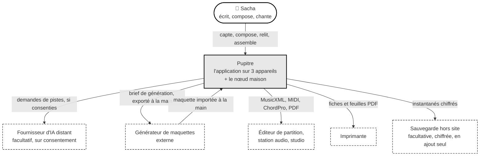

Deux choix de frontière, délibérés :

- le **générateur de maquettes** n'est **pas intégré** : Pupitre exporte un brief et
  importe le résultat comme une prise. Aucune clé de service tiers dans l'application,
  aucune dépendance à son interface, et la maquette reste une captation comme une autre ;
- le **fournisseur d'IA distant** n'est appelé que par la passerelle du nœud, jamais
  directement depuis un appareil (§ 6).

---

## 2. Conteneurs

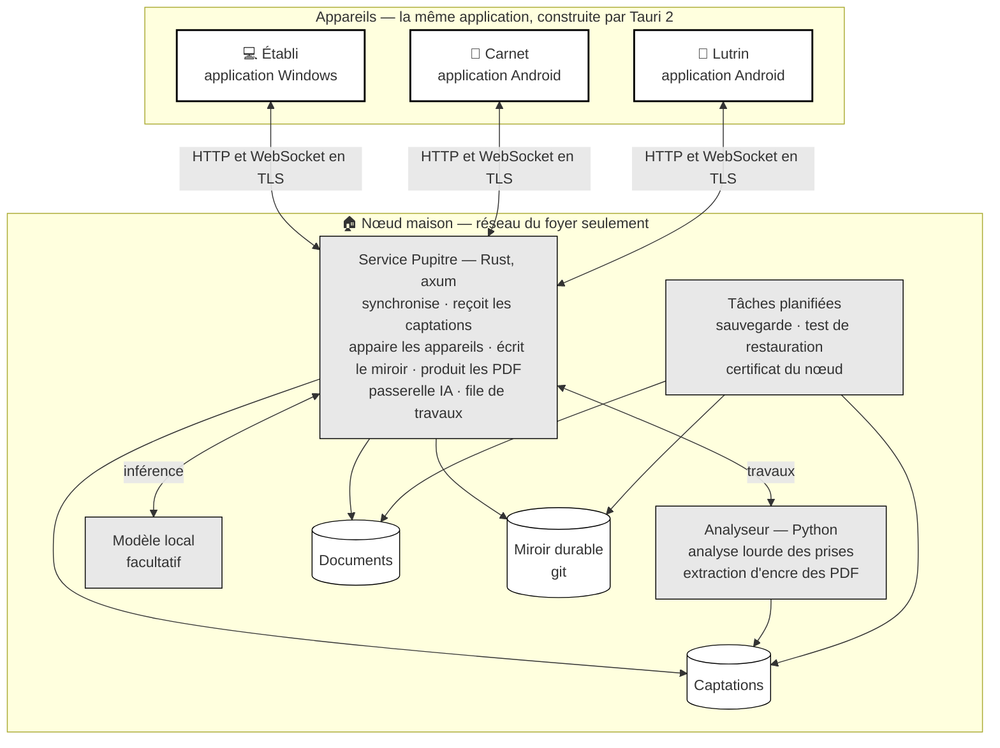

| Conteneur | Langage | Rôle | Fonctionne sans le nœud ? |
|---|---|---|---|
| **Application** (Tauri 2) | Rust : l'interface en Leptos, compilée en WebAssembly, et le côté natif ([ADR-022](adr/adr-022-documents-cote-natif.md)) ; Kotlin pour la seule capture depuis l'écran verrouillé, sur Android | Toute l'interface ; côté natif, les documents, leur stockage et leur synchronisation ; le noyau métier, l'audio, les rendus, l'analyse légère | **Oui**, entièrement, sauf l'analyse lourde et l'IA générative |
| **Service Pupitre** | Rust, axum | Synchronisation, réception des captations, appairage, miroir, PDF canoniques, passerelle IA, file de travaux | — |
| **Analyseur** | Python | Séparation de sources, pulsations, tonalité, accords, mélodie, texte chanté, extraction d'encre | — |
| **Modèle local** | — | Inférence d'un modèle de langage ouvert, si la machine le permet | — |
| **Tâches planifiées** | — | Sauvegarde, test de restauration, renouvellement du certificat du nœud, sur la même clé | — |

Le **même noyau métier** (une crate Rust pure) tourne dans l'application, du côté natif et,
compilé en WebAssembly, sous l'interface ([ADR-022](adr/adr-022-documents-cote-natif.md)),
et dans le service, compilé pour le nœud : le miroir durable, les PDF
canoniques et la validation des pistes génératives emploient exactement le code qui calcule
les vues sur les appareils. Une seule implémentation de la musique
([ADR-019](adr/adr-019-rust-et-python.md)).

Les applications sont construites en CI et installées à la main : l'APK sur le téléphone et
la tablette à encre, l'installeur sur l'ordinateur ([ADR-020](adr/adr-020-leptos-et-tauri.md)).

---

## 3. Composants de l'application

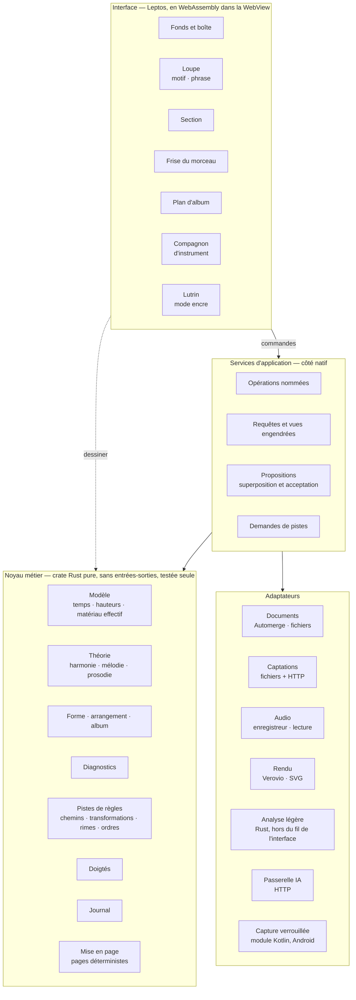

**La règle de dépendance** : le noyau ne dépend de rien d'autre que de lui-même (ni de
l'interface, ni du stockage, ni du réseau). C'est ce qui le rend testable seul, utilisable
sur le nœud, et remplaçable couche par couche.

**La frontière des commandes** : les services d'application, et les adaptateurs `Documents`
et `Captations`, vivent du côté natif. L'interface n'atteint les services que par des
commandes, permises par leur nom ; elle en reçoit des vues, jamais un document. Elle
garde le noyau en WebAssembly pour dessiner ce qu'elle reçoit
([ADR-022](adr/adr-022-documents-cote-natif.md) ;
[§ 7.5](#75-linterface-la-csp-et-les-commandes)).

| Composant | Responsabilité | Exemples |
|---|---|---|
| **Opérations nommées** | Seule porte d'écriture ; une opération = une modification atomique par document + un message ([§ 31 · 3](31-persistance-et-synchronisation.md#3-les-opérations-nommées)) | `placerMotif`, `raccourcirBloc`, `accepterProposition` |
| **Requêtes** | Calculent les vues engendrées, mémorisées tant que les données ne changent pas | matériau effectif, frise, plan d'album |
| **Propositions** | Superposent détections et suggestions au contenu, sans l'écrire | grille proposée en pointillé |
| **Mise en page** | Calcule des pages de taille fixe, identiques à l'écran du lutrin et à l'impression | fiche de travail paginée |
| **Adaptateurs** | Isolent chaque technologie, pour qu'un changement de bibliothèque reste local | remplacer Verovio ne touche que `A4` |

---

## 4. Flux principaux

### 4.1 Une décision, hors ligne

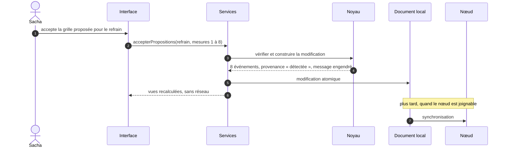

### 4.2 Une prise captée dehors, analysée à la maison

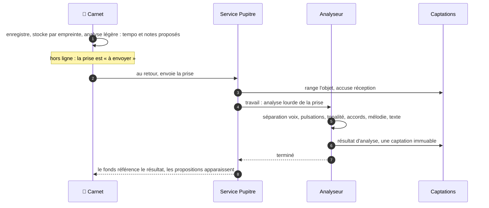

### 4.3 Nommer un accord joué au piano

Tout se passe **sur le carnet**, sans réseau : le geste doit répondre en moins de deux
secondes.

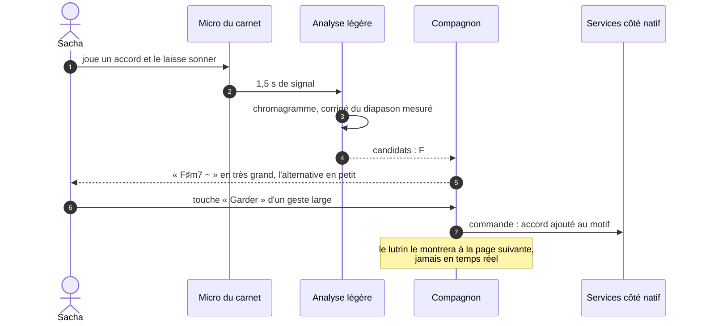

### 4.4 Demander des pistes génératives

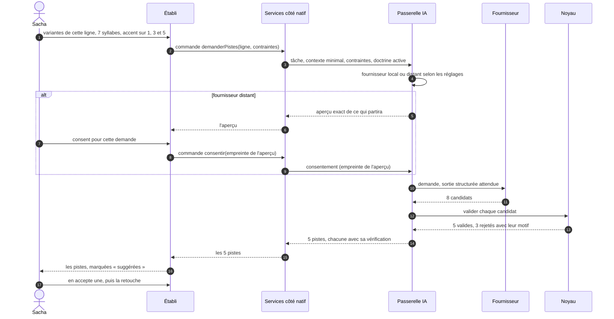

### 4.5 Annoter au lutrin

Deux chemins, parce que la WebView d'une tablette à encre trace plus lentement que
son lecteur PDF natif ([ADR-011](adr/adr-011-encre-ancree-rendu-fige.md),
hypothèse H02 au § 11).

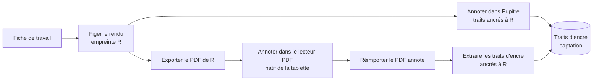

---

## 5. L'analyse en deux étages

| Étage | Où | Ce qu'il fait | Délai visé | Disponible |
|---|---|---|---|---|
| **Léger** | Appareil, en Rust | Accordeur et diapason ; nommer un accord joué ; transcrire un fredonnement ; tempo d'une prise courte | ≤ 2 s pour un accord, ≤ 5 s pour 15 s de fredonnement | **Partout, hors ligne** |
| **Lourd** | Nœud, analyseur Python | Séparer la voix d'un mix ; pulsations et premiers temps ; tonalité avec candidats ; accords par mesure ; mélodie de la voix ; frontières de sections ; texte chanté | Quelques minutes pour une démo de 4 min | À la maison |

**Règle d'entrée : aucun analyseur n'entre sans mesure.** Un **jeu de référence**
(une vingtaine de prises réelles, annotées à la main par la maîtrise d'ouvrage) et un
**banc d'évaluation** chiffrent chaque candidat : précision des pulsations, justesse de la
tonalité, taux d'accords justes, justesse des notes. Les **confiances** affichées sont
calibrées sur ce jeu : « 0,8 » doit vouloir dire « juste huit fois sur dix »
([§ 70](70-qualite-et-verification.md#5-le-banc-dévaluation-des-analyseurs)).

---

## 6. La passerelle IA

Les demandes **génératives** (variantes de ligne, idées de titres, explication d'un
constat) passent toutes par un point unique, sur le nœud
([ADR-015](adr/adr-015-passerelle-ia.md)). Les pistes **de règles** (accords suivants,
transformations, rimes, ordres d'album) ne l'empruntent pas : elles sont calculées par le
noyau, sur l'appareil, hors ligne.

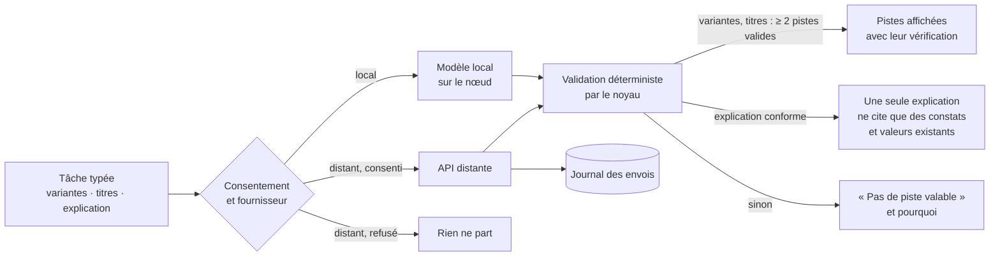

| Exigence | Mise en œuvre |
|---|---|
| **Tâches typées** | Chaque tâche a un gabarit d'invite versionné, une entrée minimale et un **schéma de sortie** structuré. Pas de conversation libre |
| **Contexte minimal** | Seul ce que la tâche exige part : la ligne, sa phrase, ses contraintes. Jamais le morceau entier par défaut |
| **Validation déterministe** | Le noyau vérifie chaque candidat : compte syllabique, accents, rimes, règles de doctrine actives (par exemple « pas de rime ajoutée »). Un candidat non conforme est écarté, avec son motif. Une explication de constat est validée sur sa forme : elle ne cite que des constats et des valeurs qui existent |
| **Au pluriel** | Variantes et titres : au moins deux pistes valides, ou l'aveu qu'il n'y en a pas ([ADR-005](adr/adr-005-des-pistes-pas-des-reponses.md)). Une explication n'est pas une piste : une seule suffit |
| **Consentement** | Fournisseur local par défaut. Pour un fournisseur distant : aperçu exact de l'envoi, consentement par demande (ou par morceau, si Sacha le règle). La passerelle n'envoie que ce dont l'empreinte a reçu le consentement |
| **Journal des envois** | Date, tâche, fournisseur, modèle, taille et empreinte de ce qui est parti. Consultable depuis l'établi |
| **Cache** | Une demande identique (tâche, entrées, gabarit, modèle) réutilise sa réponse, sur le nœud |
| **Refus** | Un refus du fournisseur, un dépassement de délai ou une sortie mal formée donne « pas de piste », jamais une erreur bloquante |

**Fournisseurs.** *Local* : un serveur d'inférence compatible sur le nœud, avec un
modèle ouvert de taille modeste, si la machine le permet (H06). *Distant* : l'API Claude,
avec le modèle `claude-opus-5-5` par défaut, la sortie structurée (`output_config.format`)
pour obtenir un JSON conforme au schéma de la tâche, un effort de réflexion fixé
explicitement par tâche (`output_config.effort`), et la gestion explicite de l'arrêt
`refusal`. Le modèle est un réglage de la passerelle, pas une constante du code.

**Ordre de grandeur de coût, distant** — à mesurer, pas à croire : au tarif public
relevé le 2026-10-06 pour `claude-opus-5-5` (4 $ par million de jetons en entrée, 20 $
en sortie), une demande de variantes d'environ 2 000 jetons en entrée et 1 000 à 3 000
en sortie, réflexion comprise, coûte de l'ordre de **3 à 7 centimes de dollar**. Vingt
demandes par jour restent sous 1,5 $. La passerelle affiche le cumul réel. Les jetons de
réflexion, donc le coût et le délai, dépendent de l'effort demandé : aucun délai n'est
promis ici. Il se mesure au banc des pistes
([§ 70 · 6](70-qualite-et-verification.md#6-le-banc-des-pistes-génératives)), avec un
effort fixé explicitement.

**Confidentialité, distant.** La conservation des données par le fournisseur dépend des
conditions du compte utilisé ; la passerelle affiche la politique en vigueur au moment
du consentement, et Sacha peut rester en local seulement.

---

## 7. Réseau, sécurité, appairage

### 7.1 Exposition

- Le nœud écoute sur le **réseau du foyer**, et sur la plage d'un **réseau privé
  virtuel** s'il en existe un. **Rien n'est exposé sur Internet** : aucune
  redirection de port, aucun tunnel entrant, aucun relais public
  ([ADR-021](adr/adr-021-cle-du-noeud-epinglee.md)).
- Le pare-feu de l'hôte refuse par défaut ce qui ne vient pas de ces plages : une erreur
  de configuration d'écoute ne suffit pas à exposer le service. Cela suppose des
  conteneurs **sans racine** : en mode racine, les ports publiés par Docker contournent
  le pare-feu de l'hôte ([ADR-017](adr/adr-017-noeud-en-conteneurs.md)).
- **Pupitre doit fonctionner avec Internet coupé** : la clé du nœud est épinglée sur
  chaque appareil, sans autorité extérieure, et aucun service extérieur n'est appelé pour
  servir, synchroniser ou appairer. Les échantillons de l'écoute de contrôle sont servis
  par le nœud, puis gardés en cache ; aucun n'est demandé à un hôte public.

### 7.2 TLS par la clé du nœud, épinglée

Les applications sont natives ([ADR-020](adr/adr-020-leptos-et-tauri.md)) : elles ne
dépendent plus du *contexte sécurisé* d'un navigateur, donc plus d'un certificat de
domaine. Le trafic reste chiffré, et chaque appareil doit savoir qu'il parle au bon nœud
([ADR-021](adr/adr-021-cle-du-noeud-epinglee.md)) :

| Voie | Principe | Retenue ? |
|---|---|---|
| **Clé publique du nœud, épinglée à l'appairage** | Le nœud sert TLS avec un certificat émis sur sa propre clé ; chaque appareil épingle la clé publique, authentifiée par l'échange PAKE de l'appairage (§ 7.3) ; le certificat se renouvelle sans nouvel appairage | **Voie retenue** |
| Épingler le certificat | Chaque appareil retient le certificat entier | Écarté : chaque renouvellement exigerait un nouvel appairage |
| Certificat public par défi DNS-01 | Un domaine possédé, un jeton d'API DNS, un certificat générique sur une sous-zone dédiée | Écarté : la voie de l'[ADR-016](adr/adr-016-reseau-domestique.md), dont les applications natives n'ont plus besoin ([Q03](90-questions-ouvertes.md) sans objet) |
| Autorité locale | Une racine installée sur chaque appareil | Écarté : pénible sur la tablette à encre, et inutile quand la clé est épinglée |

**Rotation.** Une nouvelle clé est annoncée par le nœud et signée par l'ancienne ; les
appareils appairés l'épinglent à la place. Si l'ancienne clé est perdue, chaque appareil
s'appaire de nouveau (H08).

### 7.3 Appairage et sessions

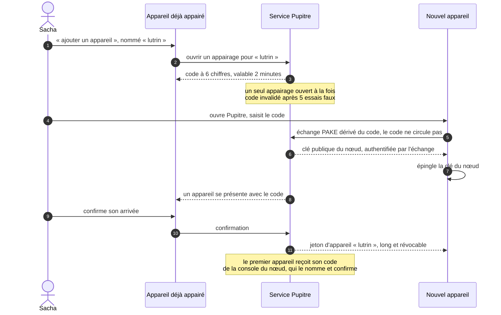

| Mesure | Effet |
|---|---|
| **Clé du nœud épinglée**, authentifiée par un échange PAKE dérivé du code | Un intermédiaire sur le réseau du foyer ne peut pas s'interposer pendant l'appairage ; un code deviné ne sert qu'une fois ; ensuite, l'appareil refuse toute autre clé, sauf une rotation signée par l'ancienne |
| **Un jeton par appareil**, nommé, révocable seul | Tablette perdue : on révoque « lutrin », les autres continuent |
| **Six chiffres une fois**, jamais de secret long à taper ; le nom se donne sur l'appareil émetteur | Rien à saisir au clavier lent de la tablette à encre (N4) |
| **Code borné** : deux minutes, cinq essais faux, un seul appairage ouvert à la fois ; arrivée confirmée sur l'appareil émetteur | Cinq essais sur un million de codes par fenêtre ; un code deviné attend encore la confirmation de l'appareil émetteur |
| **Opérations destructrices** : purge de captations, suppression définitive, révocations | Confirmation renforcée sur l'établi ou le carnet ; **absentes du lutrin** |
| **Identité vérifiée par l'application**, sur chaque requête et chaque chemin | Hors la route d'appairage, aucune requête n'aboutit sans jeton ; aucun en-tête d'identité injecté par un intermédiaire n'est cru (I22) |

### 7.4 Menaces retenues

| Scénario | Parade | Risque résiduel, assumé |
|---|---|---|
| Un appareil d'invité sur le réseau du foyer | Jeton d'appareil sur toute route hors appairage ; code d'appairage borné, arrivée confirmée par l'appareil émetteur ; TLS par la clé épinglée | Essais de code pendant une fenêtre d'appairage, bornés à cinq |
| Un intermédiaire qui s'interpose pendant l'appairage | Échange PAKE dérivé du code : sans le code, il n'obtient ni jeton ni clé épinglée | Un code lu par-dessus l'épaule pendant ses deux minutes de validité |
| Perte de la clé privée du nœud | Clé gardée hors de tout dépôt ; rotation signée tant que l'ancienne clé existe | Sans elle, chaque appareil s'appaire de nouveau |
| Vol de la tablette ou du téléphone | Verrouillage automatique et chiffrement du système de l'appareil ; révocation, qui coupe la synchronisation | La copie locale reste lisible par qui sait déverrouiller l'appareil : la révocation ne l'efface pas |
| Compromission du nœud | Moindre privilège des conteneurs ; une copie hors site en ajout seul (restic vers un serveur `--append-only`), dont la purge exige une clé absente du nœud | Un nœud compromis lit tout le fonds, et peut effacer le disque externe qui lui est branché ; il ne peut effacer les instantanés hors site |
| Fuite vers un fournisseur d'IA | Local par défaut ; consentement par demande ; journal des envois | Ce qui a été envoyé avec consentement l'a été |
| Perte du nœud | Copies complètes des appareils ; sauvegarde externe ; restauration testée chaque semaine sur le nœud, chaque nuit en CI sur un jeu de test | Ce qui a été fait depuis le dernier instantané, et pas encore synchronisé ailleurs |
| Un texte saisi ou importé qui porterait du code | Il reste du texte ; la CSP ; une commande n'est permise que par son nom (§ 7.5) | Un code qui passerait ces trois murs ne ferait que ce que font les commandes permises : des opérations nommées, que le journal garde |

### 7.5 L'interface, la CSP et les commandes

L'interface affiche ce que Sacha écrit : le texte d'une idée dès le lot 1 d'INC-1, puis des
titres et des paroles, et ce qu'un import apporte. Rien de ce texte ne doit devenir du code,
ni ouvrir à l'interface plus qu'elle n'emploie. C'est la protection que demande
[AM-3](registre.md), étendue au carnet et aux commandes. Trois murs, l'un derrière l'autre.

**Un texte reste du texte.** L'interface l'écrit comme texte, jamais comme balisage :
`inner_html` ne reçoit que le SVG du noyau, qui n'écrit aucun texte en clair, puisque ses
lettres sont des tracés ([§ 41 · 4](41-pile-technique.md#4-les-choix-couche-par-couche)).

**La politique de sécurité du contenu (CSP)**, dans `tauri.conf.json`, n'admet que ce que
l'application apporte. Tauri y ajoute de lui-même, à la construction, l'empreinte de chaque
script de l'interface, dont le chargeur en ligne que Trunk écrit dans `index.html` :
`dangerousDisableAssetCspModification` n'est jamais posé.

| Directive | Valeur | Pourquoi |
|---|---|---|
| `default-src` | `'self'` | Rien que les fichiers de l'application |
| `script-src` | `'self' 'wasm-unsafe-eval'` | L'interface est un module WebAssembly, que la WebView compile ; son seul script en ligne, le chargeur de Trunk, n'est admis que par l'empreinte que Tauri ajoute ; ni `'unsafe-inline'`, ni `eval` |
| `style-src` | `'self'` | La feuille de style de l'interface. Un style calculé se pose propriété par propriété (`style:left=…` en Leptos, soit `style.setProperty`), jamais par un attribut `style`, ni par `cssText`, que la CSP refuse. Les trois styles calculés d'INC-0 (`app/ui/src/vue_table.rs`, `style_du_recouvrement` et `style_de_la_palette` ; `app/ui/src/panneau_palette.rs`, la largeur) passent ainsi en propriétés au lot 1, avant que la CSP ne soit posée |
| `img-src`, `media-src` | `'self'`, et le protocole des captations, qui s'écrit `http://<protocole>.localhost` sous Windows et Android, comme `ipc` | Une photo, une prise : le côté natif les sert par leur empreinte, en lecture seule, et rien d'autre. Le protocole de fichiers de Tauri (`asset:`), qui sert tout un dossier, n'est pas employé. Si `useHttpsScheme` est un jour posé, la valeur passe en `https` |
| `connect-src` | `'self'`, et le canal des commandes de Tauri (`ipc:`, `http://ipc.localhost`) | L'interface ne lit que ses propres fichiers, son module WebAssembly compris, et ne parle qu'au côté natif ; la synchronisation se fait de ce côté-là ([ADR-022](adr/adr-022-documents-cote-natif.md)) |
| `object-src`, `frame-src`, `base-uri`, `form-action` | `'none'` | Rien à incorporer, rien à envoyer |

**Les droits de Tauri** ne permettent à l'interface que ce qu'ils nomment.

- Chaque commande est déclarée au manifeste de l'application, dans `build.rs` : sans lui,
  Tauri permet toute commande.
- Un fichier de droits par plateforme, sous `app/src-tauri/capabilities/`, nomme une à une
  les commandes permises, et les seuls droits du noyau de Tauri que l'interface emploie,
  comme l'écoute du signal par lequel le côté natif lui dit qu'un document a changé. Aucun
  droit de greffon n'est donné à l'interface : un greffon, comme la boîte d'enregistrement
  du cahier, s'emploie du côté natif.
- Que l'API de Tauri soit exposée à l'interface (`withGlobalTauri`) ou non, une commande que
  les droits ne nomment pas est refusée : la frontière est celle des droits, et, pour le
  protocole des captations, celle de son gestionnaire.

| Plateforme | Appareil | Ce que l'interface peut appeler |
|---|---|---|
| Windows | 💻 Établi | L'export du cahier des tables, depuis INC-0 ; au lot 1 d'INC-1, les opérations nommées et les requêtes du fonds, l'import, l'archive complète et la reprise depuis l'archive, et la relance sur la démonstration ou sur le fonds |
| Android | 📱 Carnet, puis 📖 lutrin | Rien, tant que la PR de conception du lot 2 n'a pas nommé les commandes du carnet |
| Toute autre | — | Rien : aucune n'est une cible |

Les droits distinguent les plateformes, pas les appareils : le carnet et le lutrin sont tous
deux sous Android. Ce que le lutrin n'a pas, les opérations destructrices et les révocations
(§ 7.3), le côté natif le refuse lui-même, selon le rôle de l'appareil. Une opération
destructrice, quand elle viendra, se confirmera du côté natif, hors de l'interface : un code
injecté ne peut pas confirmer à la place de Sacha.

La liste exacte des commandes vit dans ces fichiers, et nulle part ailleurs : I31 la compare
aux commandes de l'application, et la CSP à ce tableau
([§ 70 · 3](70-qualite-et-verification.md#3-les-invariants-et-leurs-tests)). Si un écran
demande davantage, la PR qui l'ajoute le dit et l'écrit ici.

---

## 8. Déploiement

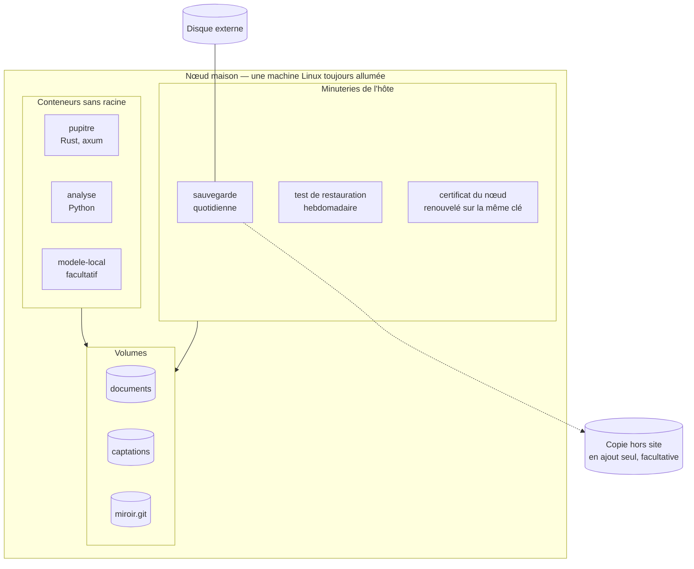

- **Conteneurs** ([ADR-017](adr/adr-017-noeud-en-conteneurs.md)), en mode sans racine :
  la pile d'analyse audio est lourde et fragile ; une image figée la rend reproductible,
  et le nœud déplaçable sur une autre machine.
- **Mises à jour** : images aux versions épinglées. Côté appareils, une nouvelle version
  de l'application est construite en CI et installée à la main : elle ne s'installe
  jamais d'elle-même, donc jamais au milieu d'une saisie.
- **L'application** : la même sur les trois appareils, sous un seul identifiant,
  `app.pupitre`, qui remplace `app.pupitre.etabli` au lot 1 d'INC-1, avant la première
  donnée réelle. L'identifiant fixe le dossier de l'application : changé plus tard, il
  laisserait derrière lui tout ce que ce dossier contient. INC-0 n'y range aucune donnée :
  le changement ne perd rien. Sa version suit les numéros de version des lots, `vX.Y.Z` : la
  PR de clôture d'un lot l'écrit, `0.3.0` pour le lot 1, à un seul endroit, `tauri.conf.json`,
  que lisent les constructions Windows et Android ; les `Cargo.toml` ne la recopient pas.
  Sous Android, le code de version, qui doit croître d'une version à l'autre, se déduit
  d'elle (majeur × 1 000 000 + mineur × 1 000 + correctif). Sans elle dans
  `tauri.conf.json`, Tauri prendrait sous Windows celle du `Cargo.toml`, mais garderait 1.0
  sous Android, avec un code de version figé à 1. Une version nouvelle s'installe par-dessus
  la précédente, jamais après une désinstallation : sous Android, elle emporte le dossier de
  l'application, et les captations à envoyer avec lui ; sous Windows, elle l'emporte dès que
  la case du désinstalleur qui efface les données de l'application est cochée
  ([§ 70 · 7](70-qualite-et-verification.md#7-les-contrôles-à-lœil-sur-lappareil)).
- **Santé** : une page de l'établi montre l'état de synchronisation, la dernière
  sauvegarde, le dernier test de restauration, la file de travaux, l'espace disque et
  l'échéance du certificat.

---

## 9. Trajectoire de construction

Pupitre se construit par **incréments utilisables** : chacun rend un service réel, et
valide une couche de l'architecture avant qu'on empile la suivante. Chaque incrément, ou
chacun de ses lots quand il en compte plusieurs, a son plan, écrit selon la méthode du
modèle : une issue avec sa mini-spec, une PR de plan,
l'implémentation en TDD, une revue finale, une clôture. Le premier est celui d'INC-0.

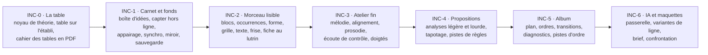

| Incrément | Ce que Sacha peut faire à la fin | Ce que l'incrément prouve |
|---|---|---|
| **INC-0** | Parcourir la table de toute tonalité sur l'établi ; lire au lutrin et imprimer le cahier des tables | Hauteurs relatives, mode encre, même pagination au lutrin et sur papier, doigtés, exactitude de la théorie |
| **INC-1** | Capter partout, retrouver, relier ses idées ; rien ne se perd | Local-first, captations, appairage et clé épinglée, miroir, restauration |
| **INC-2** | Ouvrir un morceau, le lire au lutrin, l'imprimer | Modèle bloc-occurrence, mise en page, mode encre |
| **INC-3** | Travailler une phrase au plus fin et l'entendre | Éditeurs fins, audio, prosodie |
| **INC-4** | Transformer une vieille démo en morceau lisible | Analyse en deux étages, propositions, provenance |
| **INC-5** | Construire l'album | Requêtes inter-morceaux, assiettes, pistes d'ordre |
| **INC-6** | Débloquer une ligne, obtenir et juger une maquette | Passerelle, consentement, validation déterministe |

**INC-0 · La table.** Il vient avant la capture : la table rend un service réel sans serveur
ni stockage ([arbitrage A18](90-questions-ouvertes.md#les-arbitrages-pris-dans-cette-conception)).

- **Il livre :**
  - le noyau de théorie en Rust : degrés, familles, orthographe, transposition, palettes,
    renversements au clavier, doigtés de guitare des accords de la table ;
  - les rendus SVG de la table, des diagrammes et des palettes ;
  - **la table interactive sur l'établi**, une application de bureau Tauri pour Windows ;
  - **le cahier des tables en PDF**, 24 tonalités, lu au lutrin et imprimable.

  [MIC-12](20-sfd/22-micro-motif-et-phrase.md#mic-12--parcourir-la-table-de-la-tonalité) y
  est livrée sans deux de ses règles. L'écoute arrive avec
  [ECO-01](20-sfd/27-ecoute-et-compagnon.md#eco-01--écoute-de-contrôle), en INC-3. Prendre
  un accord dans un morceau arrive quand les morceaux existent, en INC-2.
  [MIC-13](20-sfd/22-micro-motif-et-phrase.md#mic-13--lire-la-palette-dun-accord) et
  [REN-08](20-sfd/28-rendus-encre-impression.md#ren-08--diagrammes-de-clavier) sont
  livrées entières, hors l'épinglage, qui attend le document de réglages ;
  [MOR-14](20-sfd/24-morceau.md#mor-14--poser-le-morceau-sur-la-table) attend INC-2.
- **Il prouve** les hauteurs relatives ([ADR-008](adr/adr-008-hauteurs-relatives.md)), le
  mode encre ([ADR-010](adr/adr-010-trois-appareils-mode-encre.md)), la même pagination au
  lutrin et sur papier (I19 ; le papier est reporté au premier incrément où une imprimante
  est disponible,
  [A23](90-questions-ouvertes.md#les-arbitrages-pris-dans-cette-conception)), les doigtés
  ([REN-04](20-sfd/28-rendus-encre-impression.md#ren-04--diagrammes-de-manche)), et
  l'exactitude de la théorie (I26, I27 :
  [§ 70 · 3](70-qualite-et-verification.md#3-les-invariants-et-leurs-tests)).
- **Il ne contient pas** le stockage, la synchronisation, les morceaux, le serveur, le son.
  Au piano, c'est le piano qui sonne.
- **Il s'ouvre par deux essais courts**, avant toute fonction
  ([§ 11](#11-hypothèses-à-confronter)) :
  - H09 : une fiche témoin, en SVG puis en PDF, comparée sur la Note Air et sur papier ;
  - H10 : un écran Tauri et Leptos construit en CI pour Windows.

  Si l'un échoue, on revient à la conception avant d'aller plus loin.
- **Tranché avant d'écrire son plan** : les ADR qu'il met en jeu sont acceptées,
  [001](adr/adr-001-un-seul-materiau.md), [008](adr/adr-008-hauteurs-relatives.md) et
  [010](adr/adr-010-trois-appareils-mode-encre.md) depuis le 2026-10-28, comme
  [019](adr/adr-019-rust-et-python.md) et [020](adr/adr-020-leptos-et-tauri.md). Q17, Q18,
  Q20 et Q21, qui portent sur ce qu'il calcule, sont tranchées le même jour
  ([§ 90](90-questions-ouvertes.md)).

**INC-1 · Carnet et fonds.** Il fait du fonds un lieu sûr : capter partout, retrouver,
relier ses idées, ne rien perdre. Il ajoute presque tout ce qu'INC-0 ne contenait pas : le
stockage, Android, le nœud, la synchronisation, la sauvegarde. Il se construit donc en
quatre lots, qui rendent chacun un service réel et suivent chacun le cycle de la méthode,
sous une seule milestone, « INC-1 · carnet et fonds », avec une issue par lot, et une pour
H07. Dès la `v0.3.0`, qui clôt le lot 1, le fonds sert pour de vrai : chaque donnée y est
conçue comme réelle dès ce lot, une version nouvelle s'installe par-dessus la précédente
sans jamais désinstaller ([§ 8](#8-déploiement)), et l'archive complète sauvegarde le fonds
tant qu'il n'y a pas de nœud
([§ 31 · 9.1](31-persistance-et-synchronisation.md#91-sans-nœud-larchive-complète)). Avant
elle, aucune construction ne reçoit de donnée réelle : la genèse du fonds se fige à cette
étiquette ([ADR-023](adr/adr-023-stockage-des-documents.md)).

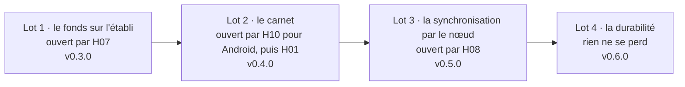

- **Il livre, lot par lot :**
  - **lot 1, le fonds sur l'établi**, en `v0.3.0`. Le stockage des documents et des
    captations, côté natif ([ADR-022](adr/adr-022-documents-cote-natif.md),
    [ADR-023](adr/adr-023-stockage-des-documents.md)). L'adaptateur `Documents` en mémoire
    naît avec celui des fichiers, et la même suite de tests des commandes passe sur les deux,
    en natif ([ADR-022](adr/adr-022-documents-cote-natif.md)) ; la compilation des services
    en WebAssembly, la construction navigateur et ses parcours de bout en bout viennent avec
    la ligne 5 des portes, qui reste à venir
    ([§ 70 · 8](70-qualite-et-verification.md#8-les-portes-de-ci)). La boîte d'idées : noter
    une idée en texte
    ([CAP-01](20-sfd/21-capter-et-organiser.md#cap-01--capter-en-un-geste)), la trier
    — compléter le texte, étiqueter, relier et délier, regrouper des prises (les photos, au
    lot 2), retirer et rétablir —
    ([CAP-02](20-sfd/21-capter-et-organiser.md#cap-02--trier-la-boîte-didées)), annuler le
    dernier geste de tri. Écouter une prise, par la lecture simple que dit « Il ne contient
    pas », servie par le protocole des captations
    ([§ 7.5](#75-linterface-la-csp-et-les-commandes)). L'import d'un fonds existant
    ([CAP-03](20-sfd/21-capter-et-organiser.md#cap-03--importer-un-fonds-existant)), que
    conçoit la PR d'import
    ([Q23](90-questions-ouvertes.md#q23--comment-verser-un-fonds-existant-)). La recherche
    par attribut d'idée et par texte, et ses requêtes enregistrées
    ([CAP-06](20-sfd/21-capter-et-organiser.md#cap-06--interroger-le-fonds)), et la vue du
    fonds, sans ses morceaux
    ([CAP-07](20-sfd/21-capter-et-organiser.md#cap-07--voir-le-fonds)). L'archive complète
    du fonds, critère 4 de
    [SYN-07](20-sfd/29-socle-donnees-appareils.md#syn-07--exporter-et-importer), et la
    reprise depuis elle d'une racine des données abîmée
    ([§ 31 · 2.1](31-persistance-et-synchronisation.md#21-sur-le-disque)). Le mode
    démonstration, sur le jeu factice ou, à la demande, sur le fonds de mesure, dans son
    dossier
    ([§ 31 · 1](31-persistance-et-synchronisation.md#1-trois-natures-de-données-quatre-lieux) ;
    [M-0001](modele/decisions/M-0001-ecosysteme-des-applications-personnelles.md)). La porte
    `contenu` refuse dès ce lot tout fichier `*.automerge` et tout dossier
    `pupitre-archive-*` suivis : un document ou une archive d'un fonds ne se versionne
    jamais. La genèse et chaque migration s'écrivent en octets dans un fichier Rust, jamais
    dans un fichier `.automerge`
    ([§ 31 · 2.3](31-persistance-et-synchronisation.md#23-la-genèse-et-le-point-de-départ-du-fonds)) ;
    un document de test s'engendre à l'exécution, comme le jeu factice. Si un document de
    test doit un jour être suivi, il vit dans un seul dossier, que la porte exempte, et la PR
    qui l'y met le dit. La CSP et les droits de Tauri du
    [§ 7.5](#75-linterface-la-csp-et-les-commandes) sont posés, et, avant eux, les trois
    styles calculés d'INC-0 repris en propriétés. Avant
    toute donnée réelle, l'application prend l'identifiant `app.pupitre`, et sa version
    suit celle du lot ([§ 8](#8-déploiement)) ;
  - **lot 2, le carnet**, en `v0.4.0`. L'application Android du carnet, qui capte l'audio,
    le texte et la photo hors ligne
    ([CAP-01](20-sfd/21-capter-et-organiser.md#cap-01--capter-en-un-geste),
    [SYN-01](20-sfd/29-socle-donnees-appareils.md#syn-01--travailler-hors-ligne)), et l'audio
    depuis l'écran verrouillé, par le module Kotlin
    ([ADR-019](adr/adr-019-rust-et-python.md)). Le module n'écrit aucun document : il dépose
    la captation, et ce qu'il écrit à côté, la PR de conception du lot 2 le nomme ; c'est le
    côté natif, en Rust, qui en fait une idée
    ([ADR-022](adr/adr-022-documents-cote-natif.md)). Le carnet part d'une copie du fonds de
    l'établi, historique compris
    ([§ 31 · 2.3](31-persistance-et-synchronisation.md#23-la-genèse-et-le-point-de-départ-du-fonds)),
    pour que leurs deux copies fusionnent au lot 3. D'ici là, une captation du carnet ne vit
    que sur le téléphone : c'est le risque
    [R6](10-vision.md#7-ce-qui-ferait-échouer-le-projet), que traite la PR de conception du
    lot 2 ;
  - **lot 3, la synchronisation par le nœud**, en `v0.5.0`. Le service Pupitre sur le nœud.
    L'appairage et la clé du nœud épinglée
    ([SYN-08](20-sfd/29-socle-donnees-appareils.md#syn-08--appairer-et-révoquer-des-appareils),
    [ADR-021](adr/adr-021-cle-du-noeud-epinglee.md)), sans lesquels aucune synchronisation
    ne passe. La synchronisation des documents
    ([SYN-02](20-sfd/29-socle-donnees-appareils.md#syn-02--synchroniser-à-la-maison)), et le
    relevé des conflits du fonds
    ([SYN-03](20-sfd/29-socle-donnees-appareils.md#syn-03--trancher-les-conflits)).
    L'acheminement des captations, par empreinte et avec accusé de réception
    ([SYN-04](20-sfd/29-socle-donnees-appareils.md#syn-04--acheminer-les-captations)) ;
  - **lot 4, la durabilité**, en `v0.6.0`. Le miroir durable du fonds
    ([SYN-05](20-sfd/29-socle-donnees-appareils.md#syn-05--tenir-le-miroir-durable)), la
    sauvegarde et la restauration
    ([SYN-06](20-sfd/29-socle-donnees-appareils.md#syn-06--sauvegarder-et-restaurer)), la
    page de santé de l'établi ([§ 8](#8-déploiement)). C'est là seulement que « rien ne se
    perd » est tenu.
- **Il prouve** le local-first ([ADR-002](adr/adr-002-local-first.md) : I10, I15, I16), les
  documents et les captations ([ADR-003](adr/adr-003-crdt-et-miroir-durable.md) : I11, I13,
  I14, I28), que rien d'engendré n'est stocké ([ADR-001](adr/adr-001-un-seul-materiau.md) :
  I01), l'assiette de toute requête ([ADR-006](adr/adr-006-le-partiel-est-normal.md) : I09),
  les commandes permises et la CSP ([ADR-022](adr/adr-022-documents-cote-natif.md) : I31),
  l'isolation des chemins de données
  ([M-0001](modele/decisions/M-0001-ecosysteme-des-applications-personnelles.md) : I30),
  l'absence de notification
  ([A14](90-questions-ouvertes.md#les-arbitrages-pris-dans-cette-conception) : I29),
  l'appairage et la clé épinglée ([ADR-021](adr/adr-021-cle-du-noeud-epinglee.md) : I22,
  I24 et H08), le miroir (I12) et la restauration (la ligne 6 des portes,
  [§ 70 · 8](70-qualite-et-verification.md#8-les-portes-de-ci)). Quatre de ces preuves
  s'éprouvent sur ce qu'INC-1 livre, pas sur tout ce que leur source nomme :
  - au lot 2, I16 et le critère 1 de SYN-01 : capter, réécouter une prise, chercher, en
    mode avion. Retoucher une ligne s'y ajoute avec INC-2, demander des accords suivants
    avec INC-4 : le parcours S1 entier, que vise l'ADR-002, est tenu à INC-4 ;
  - au lot 3, I11 et SYN-03, sur les attributs du fonds : un texte d'idée changé des deux
    côtés, deux regroupements d'une même prise. La ligne, l'accord et la hauteur s'y
    ajoutent avec INC-2, et avec eux les critères 1 et 3 de SYN-03 ;
  - au lot 3, I24 : Internet coupé, le nœud démarre, les applications synchronisent et
    appairent. Charger les échantillons, que nomme l'ADR-021, s'y ajoute avec
    [ECO-01](20-sfd/27-ecoute-et-compagnon.md#eco-01--écoute-de-contrôle), en INC-3 ;
  - au lot 4, I12, sur le document du fonds. IR-9, qui relit un morceau, attend INC-2.
- **Il ne contient pas** les morceaux, l'écoute de contrôle, les analyses, l'application du
  lutrin ni le document de réglages. Ce qui en découle :
  - **le tri** s'y borne à compléter le texte, étiqueter, relier deux idées et les délier,
    regrouper des prises comme versions d'une même idée, retirer et rétablir. Relier une idée
    à un motif ou à un morceau, et la promouvoir en l'un ou l'autre, attendent qu'ils
    existent ; rattacher une prise
    ([CAP-04](20-sfd/21-capter-et-organiser.md#cap-04--rattacher-une-prise-à-un-morceau))
    écrit dans le document du morceau et attend INC-2. Rapprocher
    ([CAP-05](20-sfd/21-capter-et-organiser.md#cap-05--rapprocher-des-idées-et-des-prises))
    lit des mélodies, des grilles et des formes : il attend les morceaux d'INC-2 et, pour les
    prises, les analyses d'INC-4 ;
  - **retirer** une idée ne supprime rien. Sa suppression définitive, avec ses captations,
    sera une opération destructrice explicite, conçue plus tard
    ([§ 30 · 9.1](30-modele-de-domaine.md#91-lidée)) ;
  - **réécouter** une prise se fait par une lecture simple, à sa vitesse. L'écoute de
    contrôle et sa brique
    ([Q16](90-questions-ouvertes.md#q16--quelle-brique-pour-lécoute-de-contrôle-)) attendent
    INC-3 ;
  - **capter** l'audio ou une photo sur l'établi
    ([CAP-01](20-sfd/21-capter-et-organiser.md#cap-01--capter-en-un-geste), 💻 ✅) : INC-1
    n'y note qu'en texte, et l'établi ne capte qu'après INC-1, à l'incrément que la feuille de
    route nommera ;
  - l'analyse légère que CAP-01 propose après une capture attend INC-4 ;
  - le lutrin garde le cahier des tables en PDF, sans application, jusqu'à INC-2. Au lot 3,
    le critère 3 de SYN-08, qui révoque « lutrin », s'éprouve sur un appareil de test ; le
    critère 6 de SYN-08 et le 4 de SYN-09 attendent l'application du lutrin ;
  - le document de réglages
    ([SYN-09](20-sfd/29-socle-donnees-appareils.md#syn-09--régler-ses-préférences)) attend
    au moins INC-2 ; seul un réglage propre à l'appareil, le budget de stockage, entre en
    INC-1, au lot 3 : rien ne s'évince avant un accusé du nœud
    ([§ 31 · 6.2](31-persistance-et-synchronisation.md#62-ce-quun-appareil-garde)), et il
    s'écrit dans `appareil.txt`
    ([§ 31 · 2.1](31-persistance-et-synchronisation.md#21-sur-le-disque)). L'instrument des
    diagrammes et la couche sombre restent réglés jusqu'à la
    fermeture de l'application, comme en INC-0. L'épinglage de MIC-13 et de REN-08 attend
    lui aussi ce document, où s'écrit sa portée fonds
    ([§ 30 · 12](30-modele-de-domaine.md#12-règles-et-réglages)) ;
  - le papier, qu'[A23](90-questions-ouvertes.md#les-arbitrages-pris-dans-cette-conception)
    reporte encore : aucune imprimante n'est prévue pendant INC-1.
- **Les lots 1 à 3 s'ouvrent par des essais courts**, avant toute fonction ; le lot 4 n'en a
  pas, sauf celui que sa PR de conception ajouterait
  ([§ 11](#11-hypothèses-à-confronter)). Un essai qui demande un équipement le nomme, et on
  vérifie qu'il existe avant de l'ouvrir ([EM-1](registre.md)) :
  - lot 1 : H07, en CI seulement, avant même le plan du lot, sur le format de
    l'[ADR-023](adr/adr-023-stockage-des-documents.md). Deux répliques du fonds, modifiées
    hors ligne, se réunissent par le protocole de synchronisation d'Automerge ; une copie de
    la racine des données, restaurée dans un dossier neuf, relit chaque captation contre son
    empreinte. L'archive complète reste une fonction du lot 1, que son plan construit. Le
    cœur de la couche maison
    ([§ 31 · 4.4](31-persistance-et-synchronisation.md#44-la-couche-de-synchronisation))
    naît donc au lot 1, sans réseau ; le lot 3 lui donne son transport, WebSocket en TLS.
    H07 suit lui aussi le cycle de la méthode, en petit : une issue à lui, sous la milestone
    d'INC-1, avec sa mini-spec ; une PR de plan court dans `.claude/plans/`, avec son
    objectif, ses tâches et la vérification de chacune ; puis la PR de l'essai. Le plan du
    lot 1 part de ce qu'il a éprouvé, et la clôture du lot retire les deux plans ;
  - lot 2 : la moitié Android de H10, puis H01. H10 construit pour Android, en CI,
    l'application et les crates natives que le carnet emploiera : `automerge`, la pile TLS
    et l'échange PAKE. H01 chronomètre le prototype du module Kotlin sur le téléphone réel ;
  - lot 3 : H08, un test d'intégration avec un nœud de test ; et la convergence d'H07
    rejouée par le transport, WebSocket en TLS, avec une coupure en cours d'échange
    ([SYN-02](20-sfd/29-socle-donnees-appareils.md#syn-02--synchroniser-à-la-maison) · 2).
    Si elle échoue, on revient à la conception, et le repli sur samod
    ([A21](90-questions-ouvertes.md#les-arbitrages-pris-dans-cette-conception)) s'y rouvre.

  Si l'un échoue, on revient à la conception avant d'aller plus loin.
- **Tranché avant d'écrire le plan du lot 1** : les ADR qu'il met en jeu sont acceptées.
  [001](adr/adr-001-un-seul-materiau.md), [002](adr/adr-002-local-first.md),
  [004](adr/adr-004-proposer-n-est-pas-decider.md),
  [010](adr/adr-010-trois-appareils-mode-encre.md), [019](adr/adr-019-rust-et-python.md),
  [020](adr/adr-020-leptos-et-tauri.md) et [021](adr/adr-021-cle-du-noeud-epinglee.md)
  l'étaient déjà. [003](adr/adr-003-crdt-et-miroir-durable.md) et
  [006](adr/adr-006-le-partiel-est-normal.md) le sont depuis le 2026-11-04, à la relecture
  de la PR de conception d'INC-1, comme les deux qu'elle écrit :
  [022](adr/adr-022-documents-cote-natif.md), les documents et la synchronisation côté
  natif, et [023](adr/adr-023-stockage-des-documents.md), le stockage des documents. Q23,
  l'import d'un fonds existant, se tranche ensuite par une courte PR d'import, après un
  relevé des formats et des volumes
  ([§ 90](90-questions-ouvertes.md#q23--comment-verser-un-fonds-existant-)).
- **Avant chacun des lots suivants**, une courte PR de conception tranche ce qu'il demande :
  - lot 2 : le détail de ses deux essais ; le choix de la pile TLS et de l'échange PAKE que
    compile H10, le même des deux côtés, puisque l'appareil et le nœud parlent le même
    échange, et leurs lignes au budget
    ([§ 41 · 6](41-pile-technique.md#6-le-budget-de-dépendances)) ; le téléphone de
    référence, décrit au
    [§ 70 · 2](70-qualite-et-verification.md#2-les-trois-profils-dappareil-en-test) par ses
    seules caractéristiques (écran, densité, version d'Android, stockage), sans nom de
    modèle ; qui enregistre quand l'application est ouverte, puisque
    l'[ADR-019](adr/adr-019-rust-et-python.md) borne le module Kotlin à l'écran verrouillé ;
    ce qu'écrit ce module à côté de la captation, sous un autre mot que « journal », qui
    nomme celui du fonds ; le premier démarrage du carnet, sur une copie du fonds de
    l'établi, sans faire naître un second fonds ; ce que deviennent le nom provisoire d'une
    capture interrompue
    ([§ 31 · 6.1](31-persistance-et-synchronisation.md#61-adressage-par-contenu)) et une
    capture faite devant un fonds d'une version de schéma plus récente
    ([§ 31 · 2.4](31-persistance-et-synchronisation.md#24-la-version-de-schéma)) ; ce que le
    carnet montre, sans nœud, de ses captations, qui ne vivent que sur lui
    ([§ 31 · 4.3](31-persistance-et-synchronisation.md#43-létat-visible-de-la-synchronisation)) ;
    les commandes du carnet et son fichier de droits ([§ 7.5](#75-linterface-la-csp-et-les-commandes)),
    et la notice d'un enregistrement au premier plan, seule exception d'I29 ; ce que le
    dépôt garde du projet Android engendré, sous `app/src-tauri/gen/`, que le `.gitignore`
    écarte aujourd'hui ; la signature de l'APK, par une clé stable que la maîtrise
    d'ouvrage pose elle-même en secret de la CI : chaque version s'installe par-dessus la
    précédente, et Android refuse une mise à jour signée d'une autre clé ; la sauvegarde
    automatique d'Android, coupée, pour que le dossier de l'application ne quitte pas le
    téléphone ; la porte `contenu`, élargie aux formats audio d'Android et aux images ;
  - lot 3 : le détail d'H08 ; l'[ADR-017](adr/adr-017-noeud-en-conteneurs.md), acceptée
    avant son plan ; le nœud, sa machine et son disque externe, vérifiés avant l'essai et
    décrits hors de ce dépôt public
    ([M-0006](modele/decisions/M-0006-code-et-donnees.md#2-ce-qui-est-une-donnée)) ; la
    chaîne qui livre le service au nœud, une variante « réseau du foyer » de la cible
    `serveur` du modèle de projet, préparée pendant les lots 1 et 2 ; les contrôles du nœud
    au tableau des portes, sans racine et ports fermés ; où vit, dans le document, l'état
    « à trancher » d'un attribut du fonds — un texte d'idée changé des deux côtés, deux
    regroupements d'une même prise, un retrait contre une modification —, qu'Automerge ne
    garde que jusqu'à la prochaine écriture
    ([§ 31 · 5](31-persistance-et-synchronisation.md#5-les-conflits)) ; l'emploi au nœud de
    la pile TLS et de l'échange PAKE choisis au lot 2 ; si la démonstration rejoint un nœud,
    dans son propre silo
    ([M-0001](modele/decisions/M-0001-ecosysteme-des-applications-personnelles.md)) ;
    [Q07](90-questions-ouvertes.md#q07--synchroniser-hors-du-foyer-par-un-réseau-privé-) ;
  - lot 4 : le miroir du fonds, que le
    [§ 31 · 8](31-persistance-et-synchronisation.md#8-le-miroir-durable) ne dit pas encore
    entier : ce que le [§ 30](30-modele-de-domaine.md) y ajoute (photos, liens, l'idée de
    chaque prise, la provenance et le retrait d'une idée, les requêtes enregistrées, le
    journal du fonds, le texte d'une idée sur plusieurs lignes) et ce qu'exige le
    [§ 31 · 2](31-persistance-et-synchronisation.md#2-les-documents) (la lignée, la version
    de schéma et l'identifiant de propriétaire de chaque document, le point d'histoire que
    projette chaque
    commit) ; la restauration chronométrée d'un nœud neuf, critère 4 de SYN-06 ; la page de
    santé ; et si la copie hors site, facultative, y entre.

---

## 10. Ce que l'architecture refuse

| Refusé | Pourquoi |
|---|---|
| Un serveur obligatoire pour travailler | Hors ligne d'abord ([ADR-002](adr/adr-002-local-first.md)) |
| Une exposition sur Internet, même authentifiée | Règle constante ([ADR-021](adr/adr-021-cle-du-noeud-epinglee.md)) |
| Un appel direct d'un appareil vers un fournisseur d'IA | Consentement, journal et validation passent par la passerelle |
| L'intégration d'un générateur de maquettes par son API | Dépendance à un tiers sans bénéfice ; l'export et l'import suffisent |
| Écrire dans un document autrement que par une opération nommée | Le journal et l'historique perdraient leur sens |
| Fusionner deux textes caractère par caractère | Une ligne fusionnée est une ligne que personne n'a écrite |
| Une base de données serveur | Les documents sont la vérité ; les dérivés sont des caches |
| Un rendu qui dépend de l'appareil | Le lutrin et l'imprimante doivent montrer les mêmes pages |

---

## 11. Hypothèses à confronter

Chacune se vérifie vite, et chacune dit ce qui change si elle est fausse.

| # | Hypothèse | Comment la vérifier | Si elle est fausse |
|---|---|---|---|
| H01 | La capture démarre depuis l'écran verrouillé, par le module Kotlin, en 3 s au plus, en mode avion et après une veille, sur le téléphone réel | Essai d'ouverture du lot 2 d'INC-1, après la moitié Android de H10 : prototype du module Kotlin (service au premier plan de type micro, tuile ou raccourci), chronométré sur le téléphone réel de la maîtrise d'ouvrage, en mode avion, après une veille | On revient à la conception avec la maîtrise d'ouvrage : IR-1 est une contrainte dure du persona. L'option la plus proche : la capture par la tuile ou le raccourci, après déverrouillage |
| H02 | La WebView de la tablette à encre affiche les pages et accepte le stylet de façon utilisable ; son lecteur PDF exporte des annotations d'encre lisibles | Une fiche de test, annotée par les deux chemins | Le chemin PDF devient le seul chemin d'annotation |
| H03 | Le nœud analyse une démo de 4 min en moins de 5 min, sans carte graphique | Banc sur trois prises réelles | Analyses plus lentes, mises en file la nuit ; modèles plus légers |
| H04 | La transcription d'un fredonnement de 15 s tourne sur le téléphone en ≤ 5 s | Prototype en Rust, avec le modèle ONNX et la bibliothèque d'inférence candidats, au banc | Transcription renvoyée au nœud, donc au retour à la maison |
| H05 | Les documents d'une soixantaine de morceaux se chargent vite sur la tablette | Jeu de données synthétique | Chargement paresseux par morceau, index du fonds mis en cache |
| H06 | Un modèle ouvert local, après validation déterministe, produit au moins deux variantes valides dans la plupart des cas | Banc de 50 demandes types | Fournisseur distant proposé par défaut pour cette tâche, toujours sur consentement |
| H07 | Deux répliques qui divergent hors ligne convergent au retour, et les captations restent intègres après une restauration | Essai d'ouverture du lot 1 d'INC-1, avant son plan, en CI seulement, sur le cœur de la couche de synchronisation, sans réseau : deux répliques du fonds, au format de l'[ADR-023](adr/adr-023-stockage-des-documents.md), modifiées hors ligne puis réunies par le protocole de synchronisation d'Automerge ; une copie de la racine des données, restaurée dans un dossier neuf, chaque captation relue contre son empreinte ; puis, à l'ouverture du lot 3, la même convergence par le transport | Si les répliques divergent, samod remplace la couche de synchronisation et le rangement des documents sur le disque (A21 ; les décisions 1 à 3 de l'[ADR-023](adr/adr-023-stockage-des-documents.md) sont amendées). Si une captation s'altère après restauration, c'est l'adaptateur `Captations` qu'on reprend |
| H08 | Après une rotation de la clé du nœud, un appareil appairé se reconnecte, et un appareil non appairé est refusé | Essai d'ouverture du lot 3 d'INC-1, test d'intégration avec un nœud de test : rotation signée par l'ancienne clé, reconnexion d'un appareil appairé, tentative d'un appareil inconnu | Toute rotation exige un nouvel appairage de chaque appareil, comme une clé perdue |
| H09 | Une page SVG et son PDF coïncident sur la Note Air 2 Plus du lutrin et à l'impression : mêmes pages, mêmes glyphes, aucun débordement | Essai d'ouverture d'INC-0 : une fiche témoin, en SVG puis en PDF, comparée sur la Note Air et sur papier | On revient à la conception avant d'aller plus loin ; Typst est l'option écartée la plus proche (A20) |
| H10 | La construction Tauri et Leptos est reproductible en CI, pour Windows et pour Android | Essai d'ouverture d'INC-0 : un écran Tauri et Leptos construit en CI pour Windows. Puis essai d'ouverture du lot 2 d'INC-1 : la même construction pour Android, avec les crates natives que le carnet emploiera (`automerge`, la pile TLS, l'échange PAKE), installée à la main sur le téléphone | On revient à la conception avant d'aller plus loin ; Dioxus et Slint sont les options écartées ([ADR-020](adr/adr-020-leptos-et-tauri.md)) |
