# 40 — Architecture

L'architecture découle de quatre exigences, toutes issues du [persona](11-persona-et-situations.md) :

1. **tout fonctionne hors ligne**, sur chacun des trois appareils (B01, situation S1) ;
2. **le travail fin est interactif** : déplacer une note, aligner une syllabe, écouter une
   phrase, sans aller-retour réseau (B05, B07) ;
3. **rien n'est exposé sur Internet**, et rien ne part chez un tiers sans consentement
   (B13) ;
4. **une seule personne doit pouvoir la construire et l'entretenir** (risque R7).

Le choix des briques est justifié au [§ 41](41-pile-technique.md). Ce document décrit
comment elles s'assemblent.

---

## 1. Contexte

Deux choix de frontière, délibérés :

- le **générateur de maquettes** n'est **pas intégré** : Pupitre exporte un brief et
  importe le résultat comme une prise. Aucune clé de service tiers dans l'application,
  aucune dépendance à son interface, et la maquette reste une captation comme une autre ;
- le **fournisseur d'IA distant** n'est appelé que par la passerelle du nœud, jamais
  directement depuis un appareil (§ 6).

---

## 2. Conteneurs

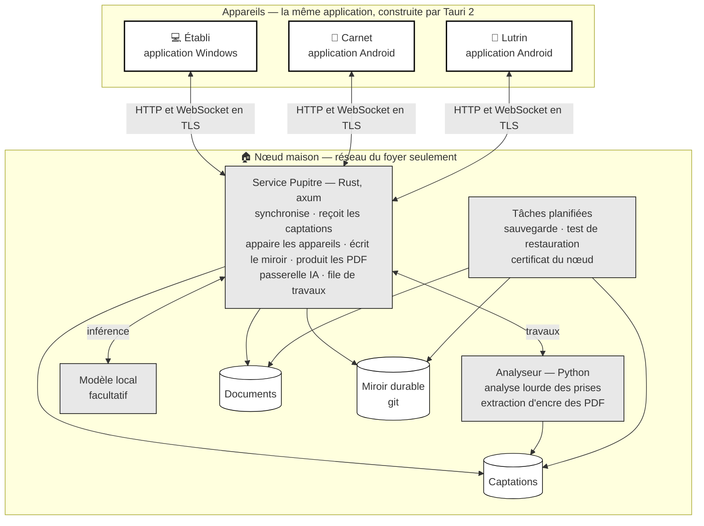

| Conteneur | Langage | Rôle | Fonctionne sans le nœud ? |
|---|---|---|---|
| **Application** (Tauri 2) | Rust : Leptos en WebAssembly ; Kotlin pour la seule capture depuis l'écran verrouillé, sur Android | Toute l'interface, le noyau métier, le stockage local, l'audio, les rendus, l'analyse légère | **Oui**, entièrement, sauf l'analyse lourde et l'IA générative |
| **Service Pupitre** | Rust, axum | Synchronisation, réception des captations, appairage, miroir, PDF canoniques, passerelle IA, file de travaux | — |
| **Analyseur** | Python | Séparation de sources, pulsations, tonalité, accords, mélodie, texte chanté, extraction d'encre | — |
| **Modèle local** | — | Inférence d'un modèle de langage ouvert, si la machine le permet | — |
| **Tâches planifiées** | — | Sauvegarde, test de restauration, renouvellement du certificat du nœud, sur la même clé | — |

Le **même noyau métier** (une crate Rust pure) tourne dans l'application, compilé en
WebAssembly, et dans le service, compilé pour le nœud : le miroir durable, les PDF
canoniques et la validation des pistes génératives emploient exactement le code qui calcule
les vues sur les appareils. Une seule implémentation de la musique
([ADR-019](adr/adr-019-rust-et-python.md)).

Les applications sont construites en CI et installées à la main : l'APK sur le téléphone et
la tablette à encre, l'installeur sur l'ordinateur ([ADR-020](adr/adr-020-leptos-et-tauri.md)).

---

## 3. Composants de l'application

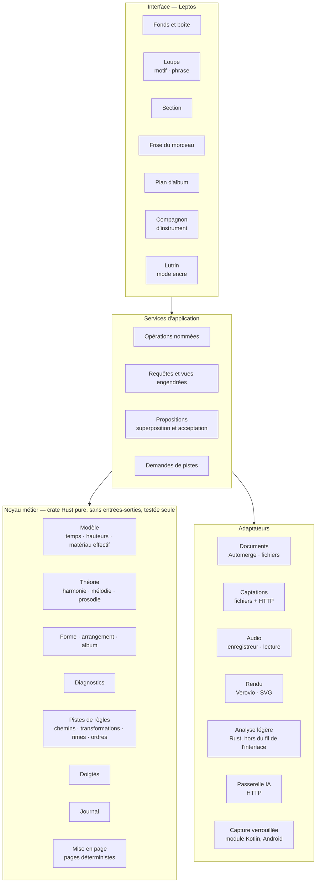

**La règle de dépendance** : le noyau ne dépend de rien d'autre que de lui-même (ni de
l'interface, ni du stockage, ni du réseau). C'est ce qui le rend testable seul, utilisable
sur le nœud, et remplaçable couche par couche.

| Composant | Responsabilité | Exemples |
|---|---|---|
| **Opérations nommées** | Seule porte d'écriture ; une opération = une modification atomique par document + un message ([§ 31 · 3](31-persistance-et-synchronisation.md#3-les-opérations-nommées)) | `placerMotif`, `raccourcirBloc`, `accepterProposition` |
| **Requêtes** | Calculent les vues engendrées, mémorisées tant que les données ne changent pas | matériau effectif, frise, plan d'album |
| **Propositions** | Superposent détections et suggestions au contenu, sans l'écrire | grille proposée en pointillé |
| **Mise en page** | Calcule des pages de taille fixe, identiques à l'écran du lutrin et à l'impression | fiche de travail paginée |
| **Adaptateurs** | Isolent chaque technologie, pour qu'un changement de bibliothèque reste local | remplacer Verovio ne touche que `A4` |

---

## 4. Flux principaux

### 4.1 Une décision, hors ligne

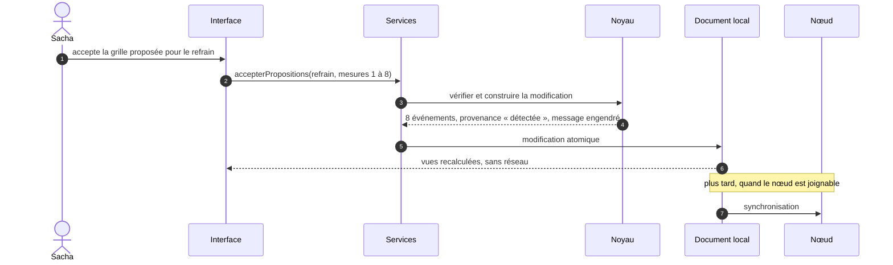

### 4.2 Une prise captée dehors, analysée à la maison

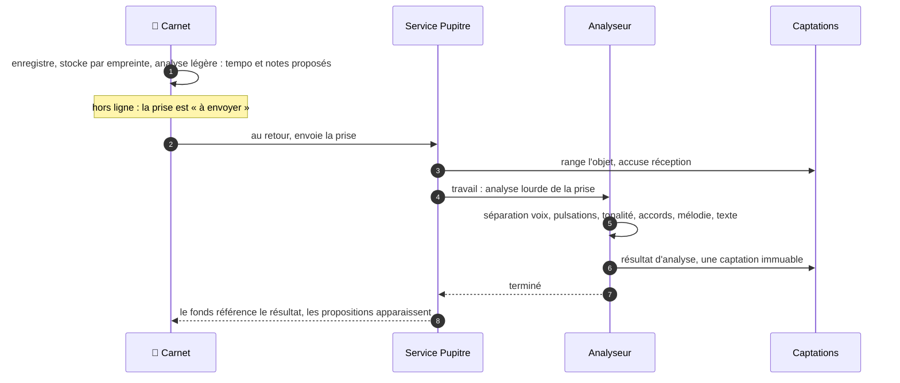

### 4.3 Nommer un accord joué au piano

Tout se passe **sur le carnet**, sans réseau : le geste doit répondre en moins de deux
secondes.

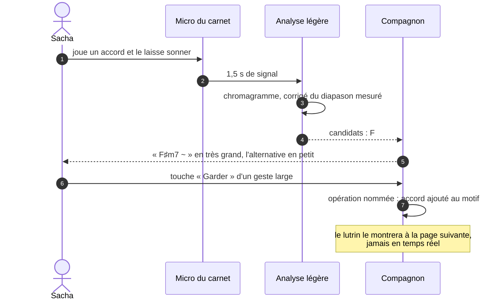

### 4.4 Demander des pistes génératives

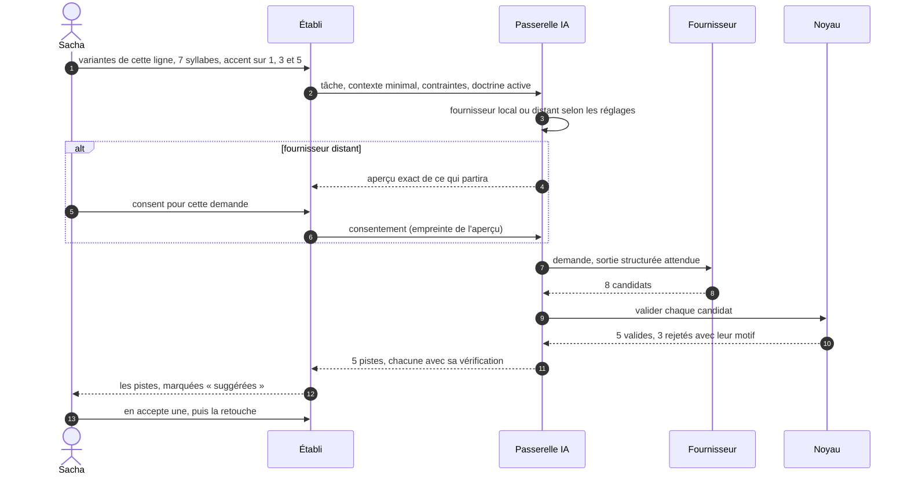

### 4.5 Annoter au lutrin

Deux chemins, parce que la WebView d'une tablette à encre trace plus lentement que
son lecteur PDF natif ([ADR-011](adr/adr-011-encre-ancree-rendu-fige.md),
hypothèse H02 au § 11).

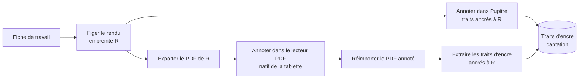

---

## 5. L'analyse en deux étages

| Étage | Où | Ce qu'il fait | Délai visé | Disponible |
|---|---|---|---|---|
| **Léger** | Appareil, en Rust | Accordeur et diapason ; nommer un accord joué ; transcrire un fredonnement ; tempo d'une prise courte | ≤ 2 s pour un accord, ≤ 5 s pour 15 s de fredonnement | **Partout, hors ligne** |
| **Lourd** | Nœud, analyseur Python | Séparer la voix d'un mix ; pulsations et premiers temps ; tonalité avec candidats ; accords par mesure ; mélodie de la voix ; frontières de sections ; texte chanté | Quelques minutes pour une démo de 4 min | À la maison |

**Règle d'entrée : aucun analyseur n'entre sans mesure.** Un **jeu de référence**
(une vingtaine de prises réelles, annotées à la main par la maîtrise d'ouvrage) et un
**banc d'évaluation** chiffrent chaque candidat : précision des pulsations, justesse de la
tonalité, taux d'accords justes, justesse des notes. Les **confiances** affichées sont
calibrées sur ce jeu : « 0,8 » doit vouloir dire « juste huit fois sur dix »
([§ 70](70-qualite-et-verification.md#5-le-banc-dévaluation-des-analyseurs)).

---

## 6. La passerelle IA

Les demandes **génératives** (variantes de ligne, idées de titres, explication d'un
constat) passent toutes par un point unique, sur le nœud
([ADR-015](adr/adr-015-passerelle-ia.md)). Les pistes **de règles** (accords suivants,
transformations, rimes, ordres d'album) ne l'empruntent pas : elles sont calculées par le
noyau, sur l'appareil, hors ligne.

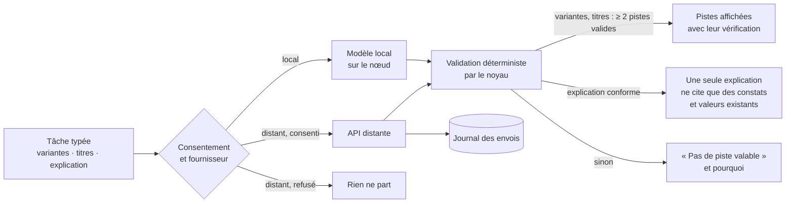

| Exigence | Mise en œuvre |
|---|---|
| **Tâches typées** | Chaque tâche a un gabarit d'invite versionné, une entrée minimale et un **schéma de sortie** structuré. Pas de conversation libre |
| **Contexte minimal** | Seul ce que la tâche exige part : la ligne, sa phrase, ses contraintes. Jamais le morceau entier par défaut |
| **Validation déterministe** | Le noyau vérifie chaque candidat : compte syllabique, accents, rimes, règles de doctrine actives (par exemple « pas de rime ajoutée »). Un candidat non conforme est écarté, avec son motif. Une explication de constat est validée sur sa forme : elle ne cite que des constats et des valeurs qui existent |
| **Au pluriel** | Variantes et titres : au moins deux pistes valides, ou l'aveu qu'il n'y en a pas ([ADR-005](adr/adr-005-des-pistes-pas-des-reponses.md)). Une explication n'est pas une piste : une seule suffit |
| **Consentement** | Fournisseur local par défaut. Pour un fournisseur distant : aperçu exact de l'envoi, consentement par demande (ou par morceau, si Sacha le règle). La passerelle n'envoie que ce dont l'empreinte a reçu le consentement |
| **Journal des envois** | Date, tâche, fournisseur, modèle, taille et empreinte de ce qui est parti. Consultable depuis l'établi |
| **Cache** | Une demande identique (tâche, entrées, gabarit, modèle) réutilise sa réponse, sur le nœud |
| **Refus** | Un refus du fournisseur, un dépassement de délai ou une sortie mal formée donne « pas de piste », jamais une erreur bloquante |

**Fournisseurs.** *Local* : un serveur d'inférence compatible sur le nœud, avec un
modèle ouvert de taille modeste, si la machine le permet (H06). *Distant* : l'API Claude,
avec le modèle `claude-opus-5-5` par défaut, la sortie structurée (`output_config.format`)
pour obtenir un JSON conforme au schéma de la tâche, un effort de réflexion fixé
explicitement par tâche (`output_config.effort`), et la gestion explicite de l'arrêt
`refusal`. Le modèle est un réglage de la passerelle, pas une constante du code.

**Ordre de grandeur de coût, distant** — à mesurer, pas à croire : au tarif public
relevé le 2026-10-06 pour `claude-opus-5-5` (4 $ par million de jetons en entrée, 20 $
en sortie), une demande de variantes d'environ 2 000 jetons en entrée et 1 000 à 3 000
en sortie, réflexion comprise, coûte de l'ordre de **3 à 7 centimes de dollar**. Vingt
demandes par jour restent sous 1,5 $. La passerelle affiche le cumul réel. Les jetons de
réflexion, donc le coût et le délai, dépendent de l'effort demandé : aucun délai n'est
promis ici. Il se mesure au banc des pistes
([§ 70 · 6](70-qualite-et-verification.md#6-le-banc-des-pistes-génératives)), avec un
effort fixé explicitement.

**Confidentialité, distant.** La conservation des données par le fournisseur dépend des
conditions du compte utilisé ; la passerelle affiche la politique en vigueur au moment
du consentement, et Sacha peut rester en local seulement.

---

## 7. Réseau, sécurité, appairage

### 7.1 Exposition

- Le nœud écoute sur le **réseau du foyer**, et sur la plage d'un **réseau privé
  virtuel** s'il en existe un. **Rien n'est exposé sur Internet** : aucune
  redirection de port, aucun tunnel entrant, aucun relais public
  ([ADR-021](adr/adr-021-cle-du-noeud-epinglee.md)).
- Le pare-feu de l'hôte refuse par défaut ce qui ne vient pas de ces plages : une erreur
  de configuration d'écoute ne suffit pas à exposer le service. Cela suppose des
  conteneurs **sans racine** : en mode racine, les ports publiés par Docker contournent
  le pare-feu de l'hôte ([ADR-017](adr/adr-017-noeud-en-conteneurs.md)).
- **Pupitre doit fonctionner avec Internet coupé** : la clé du nœud est épinglée sur
  chaque appareil, sans autorité extérieure, et aucun service extérieur n'est appelé pour
  servir, synchroniser ou appairer. Les échantillons de l'écoute de contrôle sont servis
  par le nœud, puis gardés en cache ; aucun n'est demandé à un hôte public.

### 7.2 TLS par la clé du nœud, épinglée

Les applications sont natives ([ADR-020](adr/adr-020-leptos-et-tauri.md)) : elles ne
dépendent plus du *contexte sécurisé* d'un navigateur, donc plus d'un certificat de
domaine. Le trafic reste chiffré, et chaque appareil doit savoir qu'il parle au bon nœud
([ADR-021](adr/adr-021-cle-du-noeud-epinglee.md)) :

| Voie | Principe | Retenue ? |
|---|---|---|
| **Clé publique du nœud, épinglée à l'appairage** | Le nœud sert TLS avec un certificat émis sur sa propre clé ; chaque appareil épingle la clé publique, authentifiée par l'échange PAKE de l'appairage (§ 7.3) ; le certificat se renouvelle sans nouvel appairage | **Voie retenue** |
| Épingler le certificat | Chaque appareil retient le certificat entier | Écarté : chaque renouvellement exigerait un nouvel appairage |
| Certificat public par défi DNS-01 | Un domaine possédé, un jeton d'API DNS, un certificat générique sur une sous-zone dédiée | Écarté : la voie de l'[ADR-016](adr/adr-016-reseau-domestique.md), dont les applications natives n'ont plus besoin ([Q03](90-questions-ouvertes.md) sans objet) |
| Autorité locale | Une racine installée sur chaque appareil | Écarté : pénible sur la tablette à encre, et inutile quand la clé est épinglée |

**Rotation.** Une nouvelle clé est annoncée par le nœud et signée par l'ancienne ; les
appareils appairés l'épinglent à la place. Si l'ancienne clé est perdue, chaque appareil
s'appaire de nouveau (H08).

### 7.3 Appairage et sessions

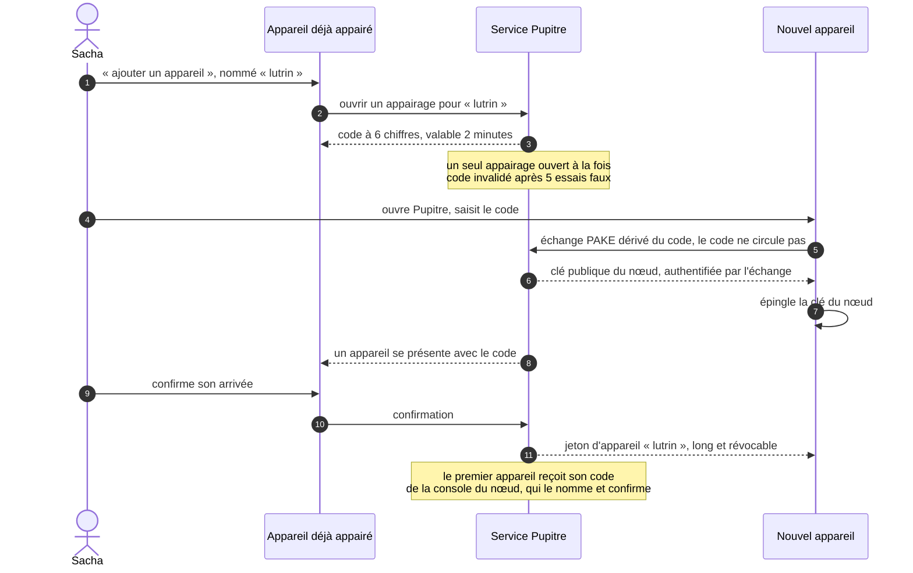

| Mesure | Effet |
|---|---|
| **Clé du nœud épinglée**, authentifiée par un échange PAKE dérivé du code | Un intermédiaire sur le réseau du foyer ne peut pas s'interposer pendant l'appairage ; un code deviné ne sert qu'une fois ; ensuite, l'appareil refuse toute autre clé, sauf une rotation signée par l'ancienne |
| **Un jeton par appareil**, nommé, révocable seul | Tablette perdue : on révoque « lutrin », les autres continuent |
| **Six chiffres une fois**, jamais de secret long à taper ; le nom se donne sur l'appareil émetteur | Rien à saisir au clavier lent de la tablette à encre (N4) |
| **Code borné** : deux minutes, cinq essais faux, un seul appairage ouvert à la fois ; arrivée confirmée sur l'appareil émetteur | Cinq essais sur un million de codes par fenêtre ; un code deviné attend encore la confirmation de l'appareil émetteur |
| **Opérations destructrices** : purge de captations, suppression définitive, révocations | Confirmation renforcée sur l'établi ou le carnet ; **absentes du lutrin** |
| **Identité vérifiée par l'application**, sur chaque requête et chaque chemin | Hors la route d'appairage, aucune requête n'aboutit sans jeton ; aucun en-tête d'identité injecté par un intermédiaire n'est cru (I22) |

### 7.4 Menaces retenues

| Scénario | Parade | Risque résiduel, assumé |
|---|---|---|
| Un appareil d'invité sur le réseau du foyer | Jeton d'appareil sur toute route hors appairage ; code d'appairage borné, arrivée confirmée par l'appareil émetteur ; TLS par la clé épinglée | Essais de code pendant une fenêtre d'appairage, bornés à cinq |
| Un intermédiaire qui s'interpose pendant l'appairage | Échange PAKE dérivé du code : sans le code, il n'obtient ni jeton ni clé épinglée | Un code lu par-dessus l'épaule pendant ses deux minutes de validité |
| Perte de la clé privée du nœud | Clé gardée hors de tout dépôt ; rotation signée tant que l'ancienne clé existe | Sans elle, chaque appareil s'appaire de nouveau |
| Vol de la tablette ou du téléphone | Verrouillage automatique et chiffrement du système de l'appareil ; révocation, qui coupe la synchronisation | La copie locale reste lisible par qui sait déverrouiller l'appareil : la révocation ne l'efface pas |
| Compromission du nœud | Moindre privilège des conteneurs ; une copie hors site en ajout seul (restic vers un serveur `--append-only`), dont la purge exige une clé absente du nœud | Un nœud compromis lit tout le fonds, et peut effacer le disque externe qui lui est branché ; il ne peut effacer les instantanés hors site |
| Fuite vers un fournisseur d'IA | Local par défaut ; consentement par demande ; journal des envois | Ce qui a été envoyé avec consentement l'a été |
| Perte du nœud | Copies complètes des appareils ; sauvegarde externe ; restauration testée chaque semaine sur le nœud, chaque nuit en CI sur un jeu de test | Ce qui a été fait depuis le dernier instantané, et pas encore synchronisé ailleurs |

---

## 8. Déploiement

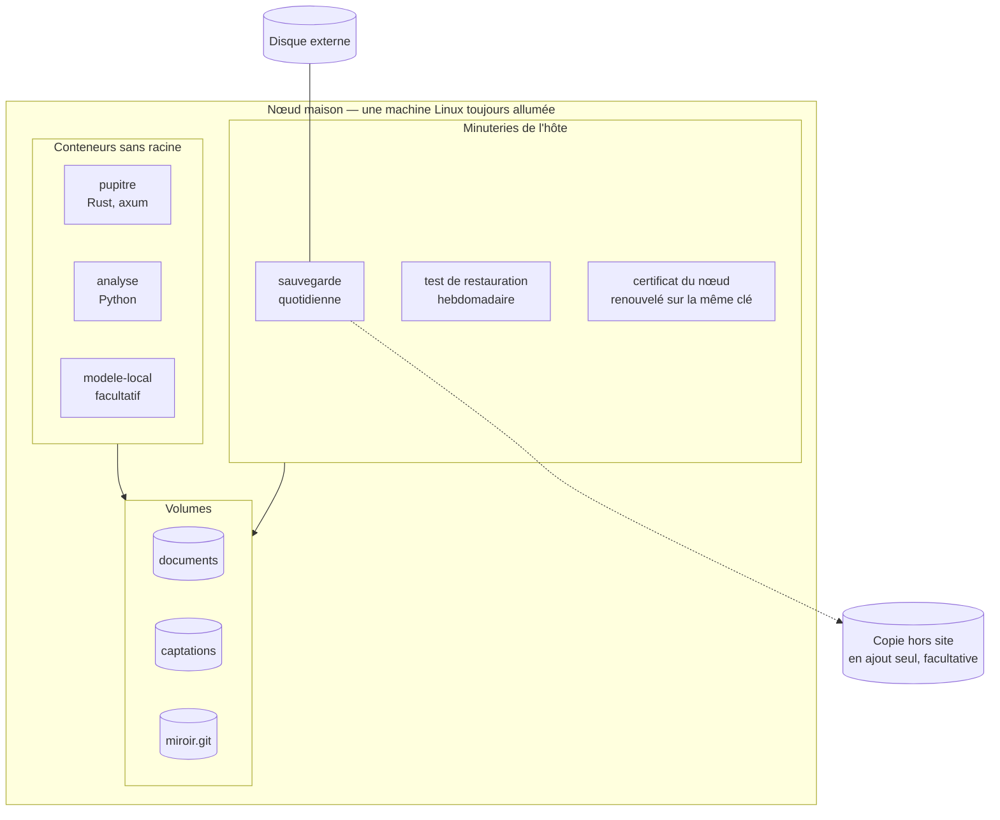

- **Conteneurs** ([ADR-017](adr/adr-017-noeud-en-conteneurs.md)), en mode sans racine :
  la pile d'analyse audio est lourde et fragile ; une image figée la rend reproductible,
  et le nœud déplaçable sur une autre machine.
- **Mises à jour** : images aux versions épinglées. Côté appareils, une nouvelle version
  de l'application est construite en CI et installée à la main : elle ne s'installe
  jamais d'elle-même, donc jamais au milieu d'une saisie.
- **Santé** : une page de l'établi montre l'état de synchronisation, la dernière
  sauvegarde, le dernier test de restauration, la file de travaux, l'espace disque et
  l'échéance du certificat.

---

## 9. Trajectoire de construction

Pupitre se construit par **incréments utilisables** : chacun rend un service réel, et
valide une couche de l'architecture avant qu'on empile la suivante. Chaque incrément a son
plan, écrit selon la méthode du modèle : une issue avec sa mini-spec, une PR de plan,
l'implémentation en TDD, une revue finale, une clôture. Le premier est celui d'INC-0.

```mermaid
flowchart LR
  INC0["INC-0 · La table<br/>noyau de théorie, table sur l'établi,<br/>cahier des tables en PDF"]
  INC1["INC-1 · Carnet et fonds<br/>capter hors ligne, boîte d'idées,<br/>synchro, miroir, sauvegarde"]
  INC2["INC-2 · Morceau lisible<br/>blocs, occurrences, forme,<br/>grille, texte, frise, fiche au lutrin"]
  INC3["INC-3 · Atelier fin<br/>mélodie, alignement, prosodie,<br/>écoute de contrôle, doigtés"]
  INC4["INC-4 · Propositions<br/>analyses légère et lourde,<br/>tapotage, pistes de règles"]
  INC5["INC-5 · Album<br/>plan, ordres, transitions,<br/>diagnostics, pistes d'ordre"]
  INC6["INC-6 · IA et maquettes<br/>passerelle, variantes de ligne,<br/>brief, confrontation"]
  INC0 --> INC1 --> INC2 --> INC3 --> INC4 --> INC5 --> INC6
```

| Incrément | Ce que Sacha peut faire à la fin | Ce que l'incrément prouve |
|---|---|---|
| **INC-0** | Parcourir la table de toute tonalité sur l'établi ; lire au lutrin et imprimer le cahier des tables | Hauteurs relatives, mode encre, même pagination au lutrin et sur papier, doigtés, exactitude de la théorie |
| **INC-1** | Capter partout, retrouver, relier ; rien ne se perd | Local-first, captations, miroir, restauration |
| **INC-2** | Ouvrir un morceau, le lire au lutrin, l'imprimer | Modèle bloc-occurrence, mise en page, mode encre |
| **INC-3** | Travailler une phrase au plus fin et l'entendre | Éditeurs fins, audio, prosodie |
| **INC-4** | Transformer une vieille démo en morceau lisible | Analyse en deux étages, propositions, provenance |
| **INC-5** | Construire l'album | Requêtes inter-morceaux, assiettes, pistes d'ordre |
| **INC-6** | Débloquer une ligne, obtenir et juger une maquette | Passerelle, consentement, validation déterministe |

**INC-0 · La table.** Il vient avant la capture : la table rend un service réel sans serveur
ni stockage ([arbitrage A18](90-questions-ouvertes.md#les-arbitrages-pris-dans-cette-conception)).

- **Il livre :**
  - le noyau de théorie en Rust : degrés, familles, orthographe, transposition, palettes,
    renversements au clavier, doigtés de guitare des accords de la table ;
  - les rendus SVG de la table, des diagrammes et des palettes ;
  - **la table interactive sur l'établi**, une application de bureau Tauri pour Windows ;
  - **le cahier des tables en PDF**, 24 tonalités, lu au lutrin et imprimable.

  [MIC-12](20-sfd/22-micro-motif-et-phrase.md#mic-12--parcourir-la-table-de-la-tonalité) y
  est livrée sans deux de ses règles. L'écoute arrive avec
  [ECO-01](20-sfd/27-ecoute-et-compagnon.md#eco-01--écoute-de-contrôle), en INC-3. Prendre
  un accord dans un morceau arrive quand les morceaux existent, en INC-2.
  [MIC-13](20-sfd/22-micro-motif-et-phrase.md#mic-13--lire-la-palette-dun-accord) et
  [REN-08](20-sfd/28-rendus-encre-impression.md#ren-08--diagrammes-de-clavier) sont
  livrées entières, hors l'épinglage, qui attend le stockage ;
  [MOR-14](20-sfd/24-morceau.md#mor-14--poser-le-morceau-sur-la-table) attend INC-2.
- **Il prouve** les hauteurs relatives ([ADR-008](adr/adr-008-hauteurs-relatives.md)), le
  mode encre ([ADR-010](adr/adr-010-trois-appareils-mode-encre.md)), la même pagination au
  lutrin et sur papier (I19 ; le papier est reporté au premier incrément où une imprimante
  est disponible,
  [A23](90-questions-ouvertes.md#les-arbitrages-pris-dans-cette-conception)), les doigtés
  ([REN-04](20-sfd/28-rendus-encre-impression.md#ren-04--diagrammes-de-manche)), et
  l'exactitude de la théorie (I26, I27 :
  [§ 70 · 3](70-qualite-et-verification.md#3-les-invariants-et-leurs-tests)).
- **Il ne contient pas** le stockage, la synchronisation, les morceaux, le serveur, le son.
  Au piano, c'est le piano qui sonne.
- **Il s'ouvre par deux essais courts**, avant toute fonction
  ([§ 11](#11-hypothèses-à-confronter)) :
  - H09 : une fiche témoin, en SVG puis en PDF, comparée sur la Note Air et sur papier ;
  - H10 : un écran Tauri et Leptos construit en CI pour Windows.

  Si l'un échoue, on revient à la conception avant d'aller plus loin.
- **Tranché avant d'écrire son plan** : les ADR qu'il met en jeu sont acceptées,
  [001](adr/adr-001-un-seul-materiau.md), [008](adr/adr-008-hauteurs-relatives.md) et
  [010](adr/adr-010-trois-appareils-mode-encre.md) depuis le 2026-10-28, comme
  [019](adr/adr-019-rust-et-python.md) et [020](adr/adr-020-leptos-et-tauri.md). Q17, Q18,
  Q20 et Q21, qui portent sur ce qu'il calcule, sont tranchées le même jour
  ([§ 90](90-questions-ouvertes.md)).

---

## 10. Ce que l'architecture refuse

| Refusé | Pourquoi |
|---|---|
| Un serveur obligatoire pour travailler | Hors ligne d'abord ([ADR-002](adr/adr-002-local-first.md)) |
| Une exposition sur Internet, même authentifiée | Règle constante ([ADR-021](adr/adr-021-cle-du-noeud-epinglee.md)) |
| Un appel direct d'un appareil vers un fournisseur d'IA | Consentement, journal et validation passent par la passerelle |
| L'intégration d'un générateur de maquettes par son API | Dépendance à un tiers sans bénéfice ; l'export et l'import suffisent |
| Écrire dans un document autrement que par une opération nommée | Le journal et l'historique perdraient leur sens |
| Fusionner deux textes caractère par caractère | Une ligne fusionnée est une ligne que personne n'a écrite |
| Une base de données serveur | Les documents sont la vérité ; les dérivés sont des caches |
| Un rendu qui dépend de l'appareil | Le lutrin et l'imprimante doivent montrer les mêmes pages |

---

## 11. Hypothèses à confronter

Chacune se vérifie vite, et chacune dit ce qui change si elle est fausse.

| # | Hypothèse | Comment la vérifier | Si elle est fausse |
|---|---|---|---|
| H01 | La capture démarre depuis l'écran verrouillé, par le module Kotlin, en 3 s au plus, en mode avion et après une veille, sur le téléphone réel | Prototype du module Kotlin (service au premier plan de type micro, tuile ou raccourci), chronométré sur le téléphone réel de la maîtrise d'ouvrage, en mode avion, après une veille | On revient à la conception avec la maîtrise d'ouvrage : IR-1 est une contrainte dure du persona. L'option la plus proche : la capture par la tuile ou le raccourci, après déverrouillage |
| H02 | La WebView de la tablette à encre affiche les pages et accepte le stylet de façon utilisable ; son lecteur PDF exporte des annotations d'encre lisibles | Une fiche de test, annotée par les deux chemins | Le chemin PDF devient le seul chemin d'annotation |
| H03 | Le nœud analyse une démo de 4 min en moins de 5 min, sans carte graphique | Banc sur trois prises réelles | Analyses plus lentes, mises en file la nuit ; modèles plus légers |
| H04 | La transcription d'un fredonnement de 15 s tourne sur le téléphone en ≤ 5 s | Prototype en Rust, avec le modèle ONNX et la bibliothèque d'inférence candidats, au banc | Transcription renvoyée au nœud, donc au retour à la maison |
| H05 | Les documents d'une soixantaine de morceaux se chargent vite sur la tablette | Jeu de données synthétique | Chargement paresseux par morceau, index du fonds mis en cache |
| H06 | Un modèle ouvert local, après validation déterministe, produit au moins deux variantes valides dans la plupart des cas | Banc de 50 demandes types | Fournisseur distant proposé par défaut pour cette tâche, toujours sur consentement |
| H07 | Deux répliques qui divergent hors ligne convergent au retour, et les captations restent intègres après une restauration | Avant INC-1, sur la couche de synchronisation : deux répliques modifiées hors ligne puis synchronisées ; une sauvegarde restaurée dans un dossier neuf, chaque captation relue contre son empreinte | La couche maison cède la place à samod, le dépôt Automerge en Rust (A21) |
| H08 | Après une rotation de la clé du nœud, un appareil appairé se reconnecte, et un appareil non appairé est refusé | Test d'intégration : rotation signée par l'ancienne clé, reconnexion d'un appareil appairé, tentative d'un appareil inconnu | Toute rotation exige un nouvel appairage de chaque appareil, comme une clé perdue |
| H09 | Une page SVG et son PDF coïncident sur la Note Air 2 Plus du lutrin et à l'impression : mêmes pages, mêmes glyphes, aucun débordement | Essai d'ouverture d'INC-0 : une fiche témoin, en SVG puis en PDF, comparée sur la Note Air et sur papier | On revient à la conception avant d'aller plus loin ; Typst est l'option écartée la plus proche (A20) |
| H10 | La construction Tauri et Leptos est reproductible en CI, pour Windows et pour Android | Essai d'ouverture d'INC-0 : un écran Tauri et Leptos construit en CI pour Windows ; puis, à partir d'INC-1, la même construction pour Android | On revient à la conception avant d'aller plus loin ; Dioxus et Slint sont les options écartées ([ADR-020](adr/adr-020-leptos-et-tauri.md)) |
