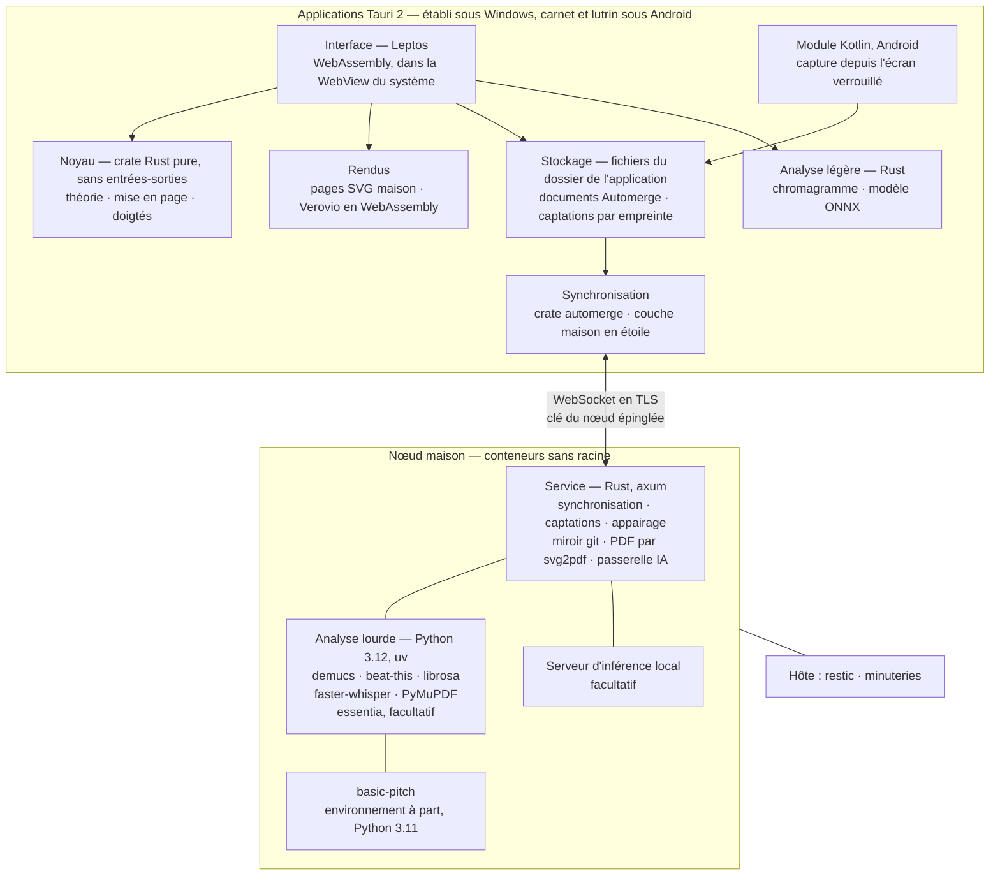

# 41 — Pile technique

Chaque brique est choisie pour une raison qui remonte à un besoin, et comparée à ses
alternatives sérieuses. La pile a été réécrite le 2026-10-27, en Rust
([ADR-019](adr/adr-019-rust-et-python.md), [ADR-020](adr/adr-020-leptos-et-tauri.md),
[ADR-021](adr/adr-021-cle-du-noeud-epinglee.md)). Une revue contradictoire en a cherché les
failles le même jour ; ses constats retenus sont intégrés ici : le module Kotlin,
l'épinglage de la clé plutôt que du certificat, l'échange PAKE, les polices et les essais
H07 à H10 ([§ 40 · 11](40-architecture.md#11-hypothèses-à-confronter)).

Les versions des crates ne sont pas épinglées ici : elles le seront au premier commit de
code, dans [INC-0](40-architecture.md#9-trajectoire-de-construction).

---

## 1. Les critères

| # | Critère | Vient de |
|---|---|---|
| C1 | **Fonctionne hors ligne, sur chaque appareil** : un ordinateur sous Windows, un téléphone et une tablette à encre sous Android | B01, [ADR-002](adr/adr-002-local-first.md) |
| C2 | **Sobre à l'affichage** : peu de rafraîchissements, aucune animation imposée | Le lutrin, [ADR-010](adr/adr-010-trois-appareils-mode-encre.md) |
| C3 | **Entretenable par une personne** : une langue principale, des bibliothèques répandues, une petite surface | Risque R7 |
| C4 | **Durable et ouvert** : formats ouverts, aucun service propriétaire indispensable | B13 |
| C5 | **L'écosystème musical existe** : ne pas réécrire la gravure ni l'analyse lourde ; la théorie, elle, tient dans le noyau | R7 |
| C6 | **Coût d'exploitation nul** hors matériel déjà là | Profil du persona |

---

## 2. La pile en un schéma

---

## 3. Ce qui change le 2026-10-27

La pile du 2026-10-11 ([ADR-012](adr/adr-012-typescript-et-python.md),
[ADR-013](adr/adr-013-svelte-pour-l-interface.md), [ADR-016](adr/adr-016-reseau-domestique.md))
faisait de Pupitre une application web installée, en TypeScript et Svelte, avec un nœud
Node.js et Fastify, ses documents dans IndexedDB et ses captations dans OPFS. **Cette pile
est écartée.**

| Sujet | Pile écartée, du 2026-10-11 | Pile du 2026-10-27 | Pourquoi |
|---|---|---|---|
| Langage | TypeScript partout, Python pour l'analyse lourde | **Rust** pour tout le code écrit par le projet, quatre exceptions nommées | Un seul langage du noyau à l'écran et au nœud ; le noyau testé par mutation |
| Applications | Une application web installée | **Tauri 2** : une application Windows, des APK Android installés à la main | La capture depuis l'écran verrouillé (H01) ; un stockage que le navigateur n'évince pas (R6) |
| Interface | Svelte 5 et SvelteKit | **Leptos**, en WebAssembly | L'interface en Rust, comme le noyau |
| Stockage sur l'appareil | IndexedDB pour les documents, OPFS pour les captations | **Des fichiers** dans le dossier de l'application | Plus de quota ni d'éviction de navigateur |
| Synchronisation | automerge-repo | La crate **automerge** et une couche maison ([A21](90-questions-ouvertes.md#les-arbitrages-pris-dans-cette-conception)) | Le moteur reste Automerge ; la couche de dépôt, mince, est écrite pour l'étoile de Pupitre |
| Nœud | Node.js 24 et Fastify | **axum** | Le noyau partagé est en Rust |
| PDF | Chromium sans tête | **svg2pdf**, depuis les pages SVG ([A20](90-questions-ouvertes.md#les-arbitrages-pris-dans-cette-conception)) | Aucun navigateur au nœud ; l'écran et le PDF viennent des mêmes pages (H09) |
| Analyse légère | pitchy et basic-pitch en TF.js, dans des Workers | **Rust** : chromagramme, modèle ONNX | Un accord se reconnaît à ses notes ; le modèle se charge depuis Rust |
| Réseau | HTTPS par certificat de domaine, défi DNS-01 | **TLS par la clé du nœud**, épinglée à l'appairage, échange PAKE | Plus de contexte sécurisé de navigateur à satisfaire : ni domaine ni jeton d'API DNS ([Q03](90-questions-ouvertes.md) sans objet) |

**Ce qui reste**, parce que les besoins qui le justifiaient n'ont pas changé : Automerge,
le miroir durable en texte dans git, la mise en page maison, Verovio, l'analyse lourde en
Python dans son conteneur, la passerelle IA au nœud, les conteneurs sans racine, restic, et
la règle d'exposition : rien d'exposé sur Internet.

---

## 4. Les choix, couche par couche

| Couche | Choix | Concurrents écartés | Ce qui le justifie dans la SFD |
|---|---|---|---|
| **Noyau** | Une crate Rust pure, sans entrées-sorties, partagée par l'interface (en WebAssembly), le nœud et les tests. Tests de mutation par `cargo-mutants` | Le noyau TypeScript de l'ADR-012 (pile écartée) ; une implémentation par plateforme, qui divergerait ([ADR-001](adr/adr-001-un-seul-materiau.md)) | Les pistes de règles, calculées hors ligne ([MIC-08](20-sfd/22-micro-motif-et-phrase.md#mic-08--parcourir-la-carte-des-chemins)), et la validation des pistes génératives au nœud ([PRO-04](20-sfd/26-propositions-suggestions-provenance.md#pro-04--passerelle-ia-et-consentement)) : le même code des deux côtés |
| **Interface** | Leptos, rendue côté client, compilée en WebAssembly | Svelte 5 (ADR-013, pile écartée) ; Dioxus ; Slint (§ 5.1) | Les éditeurs fins : la loupe ([MIC-01](20-sfd/22-micro-motif-et-phrase.md#mic-01--ouvrir-la-loupe)), la frise ([MOR-05](20-sfd/24-morceau.md#mor-05--voir-la-frise)), le plan d'album ([ALB-04](20-sfd/25-album.md#alb-04--voir-le-plan-dalbum)) ; la sobriété du mode encre ([REN-05](20-sfd/28-rendus-encre-impression.md#ren-05--mode-encre)) |
| **Applications** | Tauri 2. Les APK sont construits en CI et installés à la main sur le téléphone et la tablette à encre | Une application web installée (pile écartée) ; une application native par plateforme, soit trois bases d'interface | Capter depuis le téléphone verrouillé, en 3 s au plus ([CAP-01](20-sfd/21-capter-et-organiser.md#cap-01--capter-en-un-geste), H01) ; tout faire hors ligne ([SYN-01](20-sfd/29-socle-donnees-appareils.md#syn-01--travailler-hors-ligne)) |
| **Stockage sur l'appareil** | Des fichiers dans le dossier de l'application : les documents Automerge et les captations, nommées par leur empreinte. IndexedDB et OPFS disparaissent | IndexedDB et OPFS (pile écartée : un stockage de navigateur, sous quota) ; une base SQLite (des documents qui sont des octets et des captations qui sont des fichiers : une base n'y ajoute rien) | Ne rien perdre d'une captation avant l'accusé de réception ([SYN-04](20-sfd/29-socle-donnees-appareils.md#syn-04--acheminer-les-captations), I15) ; travailler hors ligne ([SYN-01](20-sfd/29-socle-donnees-appareils.md#syn-01--travailler-hors-ligne)) |
| **Synchronisation** | La crate `automerge`, à version épinglée, et une couche maison en étoile, sur WebSocket en TLS. Le format de stockage, la compaction et la sauvegarde sont définis avant INC-1 (H07) | automerge-repo (pile écartée) ; samod, le dépôt Automerge en Rust (A21) ; Yjs (§ 5.2) | Synchroniser à la maison ([SYN-02](20-sfd/29-socle-donnees-appareils.md#syn-02--synchroniser-à-la-maison)), trancher les conflits ([SYN-03](20-sfd/29-socle-donnees-appareils.md#syn-03--trancher-les-conflits)), bifurquer en variantes ([MOR-11](20-sfd/24-morceau.md#mor-11--bifurquer-en-variantes)) |
| **Nœud** | axum, en conteneurs sans racine ([ADR-017](adr/adr-017-noeud-en-conteneurs.md)). git pour le miroir, restic pour les sauvegardes | Node.js et Fastify (pile écartée) ; un service en Python, qui dupliquerait le noyau (§ 5.5) | Le miroir ([SYN-05](20-sfd/29-socle-donnees-appareils.md#syn-05--tenir-le-miroir-durable)), la sauvegarde ([SYN-06](20-sfd/29-socle-donnees-appareils.md#syn-06--sauvegarder-et-restaurer)), l'appairage ([SYN-08](20-sfd/29-socle-donnees-appareils.md#syn-08--appairer-et-révoquer-des-appareils)) |
| **Pages et PDF** | La mise en page maison produit des pages SVG de taille fixe, avec des **polices embarquées et le texte converti en tracés**. Le PDF en est la conversion par `svg2pdf`, sur un sous-ensemble de SVG limité et vérifié (H09) | Chromium sans tête (pile écartée) ; Typst (A20) ; Paged.js (§ 5.7) | La fiche de travail ([REN-01](20-sfd/28-rendus-encre-impression.md#ren-01--fiche-de-travail)), imprimer ([REN-07](20-sfd/28-rendus-encre-impression.md#ren-07--imprimer)) : la même pagination au lutrin et sur papier (I19), des rendus déterministes (I25) |
| **Portée** | Verovio en WebAssembly, à partir d'INC-2 | VexFlow, abcjs, LilyPond (§ 5.3) | La portée ([REN-03](20-sfd/28-rendus-encre-impression.md#ren-03--portée)), la mélodie ([MIC-03](20-sfd/22-micro-motif-et-phrase.md#mic-03--saisir-et-éditer-une-mélodie)) |
| **Diagrammes de manche et de clavier** | SVG écrit à la main, dans le noyau. Les diagrammes de clavier sont maison, comme ceux de guitare | Les bibliothèques de diagrammes d'accords : couleurs, ombres et polices imposées, incompatibles avec le mode encre | Les diagrammes de manche ([REN-04](20-sfd/28-rendus-encre-impression.md#ren-04--diagrammes-de-manche)) et de clavier ([REN-08](20-sfd/28-rendus-encre-impression.md#ren-08--diagrammes-de-clavier)) |
| **Analyse légère** | En Rust, sur l'appareil. Un accord joué se reconnaît à son **chromagramme**, pas par une détection de fondamentale. Un fredonnement se transcrit par un modèle ONNX dans une bibliothèque d'inférence Rust, choisie au banc (H04) | pitchy et basic-pitch en TF.js (pile écartée) ; une détection de fondamentale pour nommer un accord, qui n'entend qu'une note ; tout analyser au nœud, donc rien au piano sans réseau ([ADR-014](adr/adr-014-analyse-en-deux-etages.md)) | Nommer un accord joué ([ECO-03](20-sfd/27-ecoute-et-compagnon.md#eco-03--nommer-un-accord-joué)), accorder ([ECO-04](20-sfd/27-ecoute-et-compagnon.md#eco-04--accordeur-et-diapason)), fredonner ([ECO-06](20-sfd/27-ecoute-et-compagnon.md#eco-06--fredonner-une-mélodie)) |
| **Analyse lourde** | En Python, dans un conteneur du nœud, derrière un contrat d'entrées-sorties. Réexaminée à INC-4 | Tout en Rust dès maintenant : les modèles de séparation, de pulsations et de transcription vivent en Python ; madmom et allin1, plus entretenus | La tonalité et le tempo proposés ([MOR-04](20-sfd/24-morceau.md#mor-04--tonalité-tempo-métrique)), la maquette confrontée à l'écrit ([MOR-08](20-sfd/24-morceau.md#mor-08--confronter-une-maquette-à-lécrit)), la seconde transcription d'un fredonnement ([ECO-06](20-sfd/27-ecoute-et-compagnon.md#eco-06--fredonner-une-mélodie)) |
| **Passerelle IA** | En Rust, au nœud ; l'API distante par HTTP | Le SDK TypeScript du fournisseur (pile écartée) ; un appel direct depuis l'appareil, sans consentement ni journal ([§ 40 · 10](40-architecture.md#10-ce-que-larchitecture-refuse)) | Demander des pistes ([PRO-03](20-sfd/26-propositions-suggestions-provenance.md#pro-03--demander-des-pistes)), la passerelle et le consentement ([PRO-04](20-sfd/26-propositions-suggestions-provenance.md#pro-04--passerelle-ia-et-consentement)) |
| **CI** | Le job `verifier` lance `cargo fmt --check`, `cargo clippy -D warnings` et `cargo test` ; `cargo-mutants` passe sur le noyau ; les constructions Windows et Android tournent (H10) | Construire les applications à la main, sur un poste : une construction qui ne se rejoue pas | Les critères d'acceptation exécutables de toute la SFD ([§ 70 · 4](70-qualite-et-verification.md#4-les-critères-dacceptation-de-la-sfd)), les invariants ([§ 70 · 3](70-qualite-et-verification.md#3-les-invariants-et-leurs-tests)) |

Hors du tableau, sans changement : **git** en ligne de commande pour le miroir (une
bibliothèque liée donne des erreurs moins lisibles), **restic** pour la sauvegarde (borg est
équivalent ; restic est retenu pour ses dépôts distants variés), **Compose** en mode sans
racine (§ 5.6), un **serveur d'inférence ouvert** bâti sur llama.cpp pour l'IA locale,
choisi au banc (H06), et **PyMuPDF**, dans l'analyseur, pour l'encre des PDF.

**La recherche** est un index en mémoire sur chaque appareil, sans base : SQLite et sa
recherche plein texte restent surdimensionnés pour quelques centaines de documents.

---

## 5. Les comparatifs qui ont tranché

Légende : ●●● excellent · ●●○ bon · ●○○ faible · ○○○ inadapté.

### 5.1 L'interface

| Critère | **Leptos dans Tauri 2** | Dioxus | Slint | Application web installée, Svelte 5 |
|---|---|---|---|---|
| Écrite en Rust, comme le noyau ([ADR-019](adr/adr-019-rust-et-python.md)) | ●●● | ●●● | ●●○ | ○○○ |
| Mises à jour fines de l'affichage (C2) | ●●● | ●●○ | ●●● | ●●● |
| Éditeurs riches en SVG, portée de Verovio, pages maison | ●●● | ●●● | ●○○ | ●●● |
| Android, pour le carnet et le lutrin | ●●○ | ●○○ | ●●○ | ●●○ |
| Construction navigateur pour les tests de bout en bout | ●●● | ●●○ | ●○○ | ●●● |
| Point d'entrée natif : capture depuis l'écran verrouillé, fichiers de l'application | ●●○ | ●○○ | ●○○ | ○○○ |

**Leptos dans Tauri 2** l'emporte : une seule base d'interface en Rust, affichée par la
WebView du système, qui garde le SVG, Verovio et une construction navigateur pour les tests.
Sa note Android n'est que ●●○ : Tauri 2 y est récent, et la construction en CI est un essai
d'ouverture d'INC-0 (H10). Ce que Tauri ne donne pas, la capture depuis l'écran verrouillé,
passe par un module Kotlin aussi mince que possible
([ADR-019](adr/adr-019-rust-et-python.md)). **Dioxus** est l'alternative la plus proche,
mais son support d'Android est expérimental. **Slint** dessine une interface native, sans
web : les éditeurs SVG seraient à réécrire dans son langage de vues, et il n'y aurait pas de
construction navigateur. **L'application web installée**, la voie écartée de
l'[ADR-013](adr/adr-013-svelte-pour-l-interface.md), n'a ni point d'entrée depuis l'écran
verrouillé ni stockage à l'abri de l'éviction
([ADR-020](adr/adr-020-leptos-et-tauri.md)).

### 5.2 Les données local-first

| Critère | **Automerge** | Yjs | Journal d'événements maison | Moteurs de synchronisation serveur |
|---|---|---|---|---|
| Hors ligne sur trois appareils (C1) | ●●● | ●●● | ●●○ | ●○○ |
| Historique complet, retour arrière | ●●● | ●○○ | ●●● | ●○○ |
| Bifurquer et fusionner (variantes de morceau) | ●●○ | ○○○ | ●○○ | ○○○ |
| Messages de modification (journal lisible) | ●●● | ●○○ | ●●● | ○○○ |
| Implémentation en Rust (C3) | ●●● | ●●○ | — | ●○○ |
| Effort à fournir seul (C3) | ●●○ | ●●● | ○○○ | ●○○ |

**Automerge** donne l'essentiel de ce que le domaine demande : l'historique (le journal),
la bifurcation (les variantes), les conflits exposés (que Pupitre lit à chaque
synchronisation et présente « à trancher »). Son cœur est écrit en Rust : la crate
`automerge` est employée directement, à version épinglée. Bifurquer et fusionner n'a que
●●○ : Automerge fusionne une variante entière ; fusionner les changements choisis se fait
en rejouant, dans la cible, les opérations nommées choisies
([ADR-003](adr/adr-003-crdt-et-miroir-durable.md)).

L'effort n'a que ●●○ : la couche de synchronisation en étoile est **maison**, plutôt que
samod, le dépôt Automerge en Rust (A21). Elle ne fait que ce que l'étoile demande
([§ 31 · 4.4](31-persistance-et-synchronisation.md#44-la-couche-de-synchronisation)), elle
est isolée derrière l'adaptateur `Documents`, et son format de stockage, sa compaction et
sa sauvegarde sont définis avant INC-1 (H07).

### 5.3 La gravure de portée

| Critère | **Verovio** | VexFlow | abcjs | LilyPond |
|---|---|---|---|---|
| Qualité de gravure | ●●● | ●●○ | ●●○ | ●●● |
| Paroles sous les notes, chiffrages d'accords | ●●● | ●●○ | ●●● | ●●● |
| Mise en page automatique | ●●● | ●○○ | ●●○ | ●●● |
| Tourne sur l'appareil, hors ligne | ●●● | ●●● | ●●● | ○○○ |
| Sortie SVG nette pour l'encre et l'impression | ●●● | ●●● | ●●● | ●●○ |
| Poids | ●○○ | ●●○ | ●●● | — |

**Verovio** : une vraie bibliothèque de gravure, en C++, compilée en WebAssembly — l'une
des quatre exceptions de l'[ADR-019](adr/adr-019-rust-et-python.md). Son poids (plusieurs
mégaoctets) est payé une fois : chargé à la demande, gardé en cache. Il arrive avec INC-2.
VexFlow et abcjs sont des bibliothèques JavaScript, et LilyPond ne tourne pas sur
l'appareil. Le format intermédiaire (MEI) est **engendré** depuis le modèle et jamais stocké
([ADR-001](adr/adr-001-un-seul-materiau.md)).

### 5.4 L'écoute de contrôle

L'écoute de contrôle ([ECO-01](20-sfd/27-ecoute-et-compagnon.md#eco-01--écoute-de-contrôle))
arrive avec INC-3. Sa brique n'est pas tranchée : c'est la question
[Q16](90-questions-ouvertes.md#q16--quelle-brique-pour-lécoute-de-contrôle-), à trancher
avant cet incrément, au même gabarit que les autres couches : un instrument échantillonné
(piano, guitare), un ordonnanceur maison, un graphe borné à des échantillonneurs, un
lecteur de prise, des volumes et une sortie (I21).

Deux exigences ne bougent pas. Les échantillons sont servis par le nœud, jamais par un hôte
public, puis gardés en cache pour l'écoute hors ligne (I24). Et aucun environnement de
production sonore n'entre : Tone.js et ses équivalents sont précisément ce qu'on ne veut
pas avoir sous la main ([ADR-009](adr/adr-009-ecoute-de-controle.md)).

### 5.5 Le service du nœud

| Critère | **Rust, axum** | Node.js, Fastify | Python, FastAPI |
|---|---|---|---|
| Réutilise le noyau métier (miroir, PDF, validation des pistes) | ●●● | ●○○ | ○○○ |
| Un seul langage avec les appareils (C3) | ●●● | ○○○ | ○○○ |
| Synchronisation Automerge | ●●○ | ●●● | ○○○ |
| Stabilité à long terme | ●●● | ●●● | ●●● |

Le noyau est une crate Rust : le nœud l'emploie tel quel. Écrire le service dans un autre
langage obligerait à charger le noyau compilé en WebAssembly, ou à **réimplémenter la
musique une seconde fois** ; deux implémentations divergeraient, ce que
l'[ADR-001](adr/adr-001-un-seul-materiau.md) interdit. La synchronisation n'a que ●●○ : la
couche en étoile est maison (A21).

### 5.6 Conteneurs ou services nus

| Critère | **Conteneurs** | Services système nus |
|---|---|---|
| Pile d'analyse audio reproductible (versions de Python, de PyTorch…) | ●●● | ●○○ |
| Isolement et moindre privilège | ●●● | ●●○ |
| Déplacer le nœud sur une autre machine | ●●● | ●○○ |
| Simplicité | ●●○ | ●●● |

### 5.7 Les pages et le PDF

| Critère | **Pages SVG maison et svg2pdf** | Typst | Chromium sans tête | Paged.js |
|---|---|---|---|---|
| L'écran et le PDF viennent des mêmes pages (I19) | ●●● | ●○○ | ●●○ | ●●○ |
| Aucun navigateur au nœud | ●●● | ●●● | ○○○ | ○○○ |
| En Rust, comme le noyau | ●●● | ●●● | ○○○ | ○○○ |
| Polices embarquées, rendu identique d'un appareil à l'autre | ●●○ | ●●● | ●●○ | ●●○ |

La mise en page maison calcule des pages SVG de taille fixe, identiques à l'écran du lutrin
et à l'impression ; le PDF n'en est que la conversion. **Typst** est un excellent moteur de
composition, mais il mettrait les pages en page une seconde fois : deux paginations à tenir
identiques (A20). `svg2pdf` ne couvre pas tout SVG : la mise en page n'émet qu'un
sous-ensemble limité, avec des polices embarquées et le texte converti en tracés, et H09
vérifie que la page et son PDF coïncident. **Paged.js** pagine dans un navigateur, et sa
dernière version date de 2024.

---

## 6. Le budget de dépendances

**Règle : une dépendance d'exécution entre seulement si une fonction de la SFD l'exige,
et la PR qui l'ajoute le dit.** Les dépendances de construction et de test ne comptent
pas dans ce budget.

| Où | Dépendance | Sert à |
|---|---|---|
| Application | `leptos` | Interface |
| Application | `tauri`, et ses greffons pour les fichiers et le micro | Applications |
| Application | `wasm-bindgen`, `wasm-bindgen-futures`, `js-sys`, `serde`, `serde-wasm-bindgen` | Les crates de liaison que la pile impose : l'appel du navigateur et de l'établi depuis l'interface en WebAssembly |
| Application, nœud | `automerge` | Documents, synchronisation |
| Application | Verovio, en WebAssembly | Portée, à partir d'INC-2 |
| Application | Une bibliothèque d'inférence ONNX en Rust, choisie au banc (H04) | Transcrire un fredonnement |
| Noyau | Une crate d'identifiants ULID | Identifiants stables ([§ 30](30-modele-de-domaine.md)) |
| Noyau | `ttf-parser` | Lire les contours des glyphes de DejaVu Sans, pour écrire le texte des pages en tracés ([§ 50 · 3.7](50-interfaces-et-appareils.md#37-la-table-de-la-tonalité)) |
| Nœud, établi | `svg2pdf`, `pdf-writer` | PDF, depuis les pages SVG : `svg2pdf` convertit chaque page, `pdf-writer` les assemble avec leurs liens (le cahier des tables, crate `cahier`) |
| Nœud | `axum` | HTTP et WebSocket : captations, appairage, synchronisation, passerelle |
| Nœud | Une pile TLS et un échange PAKE, éprouvés | La clé du nœud et l'appairage ([ADR-021](adr/adr-021-cle-du-noeud-epinglee.md)) |
| Analyseur | demucs, beat-this, librosa, faster-whisper, pymupdf ; basic-pitch dans son propre environnement ; essentia, facultatif | Analyse lourde, encre des PDF — isolés dans leur conteneur |

Le noyau n'a aucune dépendance d'entrées-sorties. Ce tableau est un budget, pas une cible :
s'en approcher demande de se justifier.

---

## 7. Les risques de pile

| Risque | Signe | Parade |
|---|---|---|
| **Leptos** change encore d'une version à l'autre | Changements cassants | Version épinglée au premier commit ; une interface mince, sans logique métier |
| **Tauri 2 sur Android** est récent | La construction échoue, un greffon manque | H10, essai d'ouverture d'INC-0 ; le module Kotlin pour ce que Tauri ne donne pas, et rien de plus |
| Les **WebView** de Windows et d'Android rendent différemment | Une page qui varie d'un appareil à l'autre | Des pages SVG de taille fixe, polices embarquées, texte en tracés ; vérifiées sur l'appareil ([§ 70 · 7](70-qualite-et-verification.md#7-les-contrôles-à-lœil-sur-lappareil)) |
| **svg2pdf** ne couvre pas tout SVG | Un PDF qui diffère de sa page | Un sous-ensemble de SVG limité et vérifié ; H09, essai d'ouverture d'INC-0 |
| La **couche de synchronisation maison** perd ou fait diverger | Deux répliques qui ne convergent pas ; une captation altérée après restauration | Format, compaction et sauvegarde définis avant INC-1 ; H07 ; I10, I11, I14 ; repli sur samod (A21) |
| La **rotation de la clé du nœud** échoue | Des appareils qui ne se reconnectent plus | Rotation signée par l'ancienne clé ; H08 ; en dernier recours, un nouvel appairage |
| Le **module Kotlin** grossit | Un langage de plus qui s'étend | Borné à la capture depuis l'écran verrouillé ([ADR-019](adr/adr-019-rust-et-python.md)) |
| **Verovio** pèse lourd sur la tablette | Premier affichage lent | Chargement à la demande, mise en cache |
| **Verovio** doit aussi tourner au nœud, pour les PDF canoniques d'une fiche avec portée | Une portée absente du PDF | La même construction WebAssembly, ou une construction native, tranchée à INC-2 |
| Le **modèle ONNX** du fredonnement est trop lent sur le téléphone | Plus de 5 s pour 15 s de fredonnement | H04, au banc ; repli sur le nœud, au retour à la maison |
| **basic-pitch** (Python) et **librosa 1.0** ne cohabitent pas : l'un exige TensorFlow < 2.15.1, donc Python ≤ 3.11 et numpy < 2 ; l'autre, Python ≥ 3.12 et numpy ≥ 2.1 | Aucun environnement Python ne satisfait les deux | basic-pitch dans un environnement à part, en Python 3.11, appelé par l'analyseur comme un travail distinct |
| **essentia** n'existe qu'en préversions `2.1b6.devNNNN`, sans roue Linux ARM | L'image d'analyse ne se construit pas sur un nœud ARM ([Q01](90-questions-ouvertes.md)) | Facultatif, figé par `uv lock` ; repli : tonalité estimée par profils de chroma avec librosa |
| Un **analyseur** se révèle médiocre sur les mix réels | Taux d'erreur élevé au banc | Il n'entre pas : la règle d'entrée du [§ 40 · 5](40-architecture.md#5-lanalyse-en-deux-étages) s'applique |
| Le **modèle local** est trop faible | Moins de deux pistes valides | Validation déterministe ; fournisseur distant sur consentement (H06) |

---

## 8. Les versions

Aucune version n'est épinglée dans la conception. Les crates le sont au premier commit de
code, dans INC-0, par `Cargo.lock` ; les paquets Python de l'analyseur, par `uv lock`. Le
relevé du 2026-10-11, qui portait sur la pile écartée, reste dans l'historique git.
