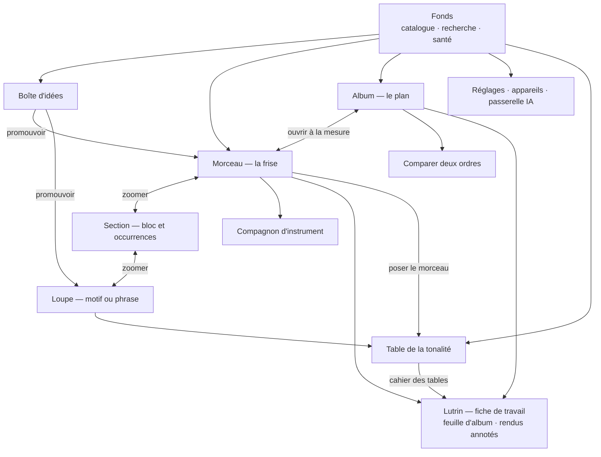
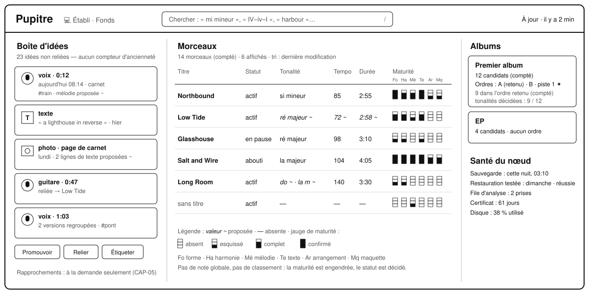
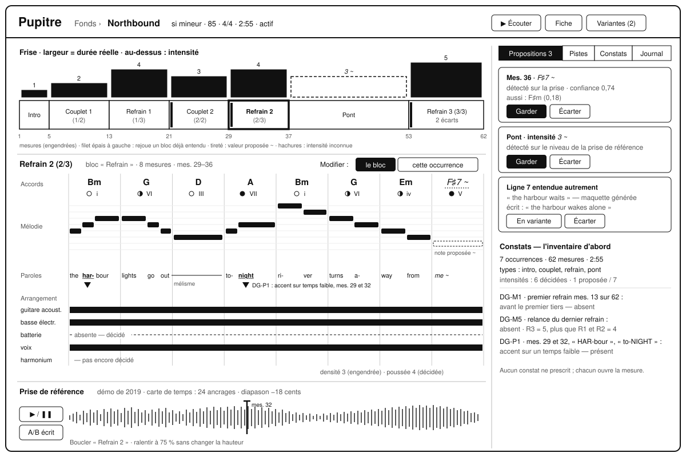
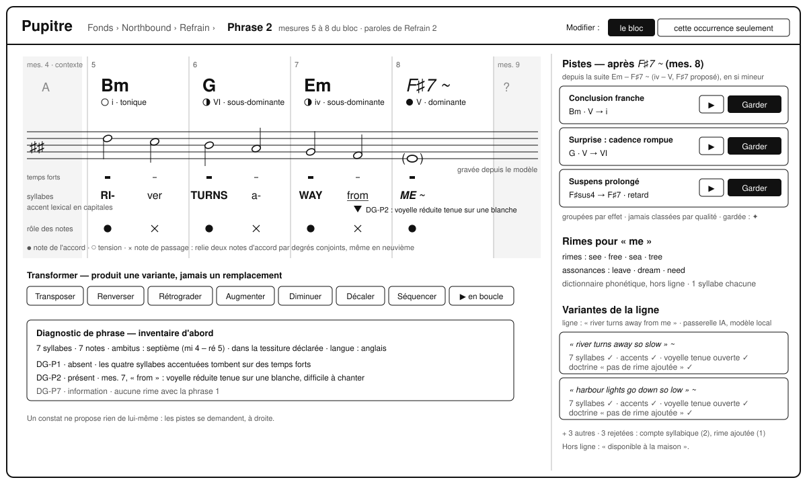
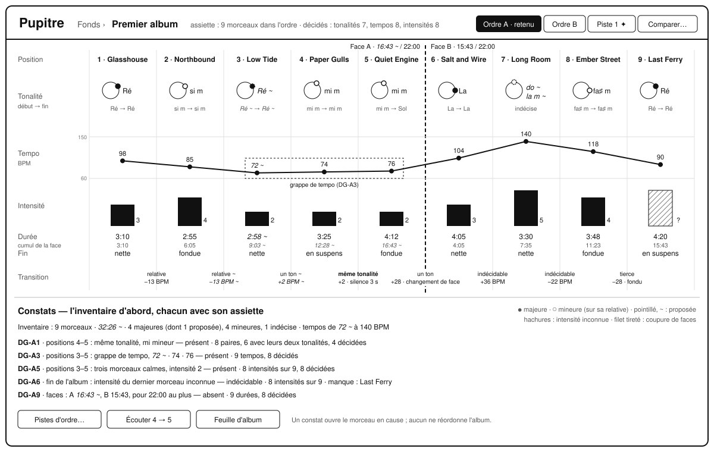
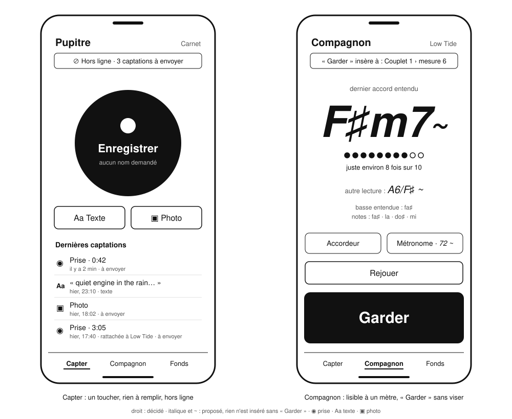
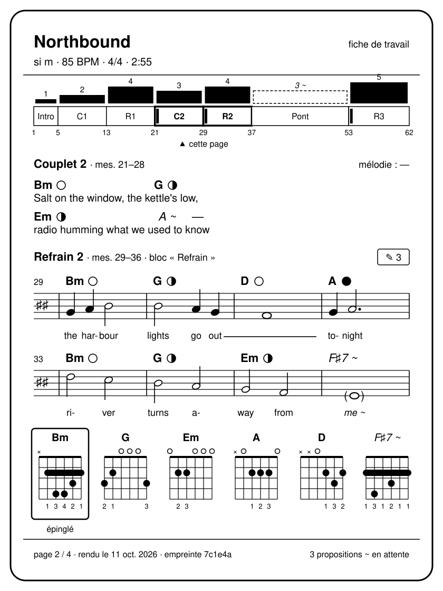
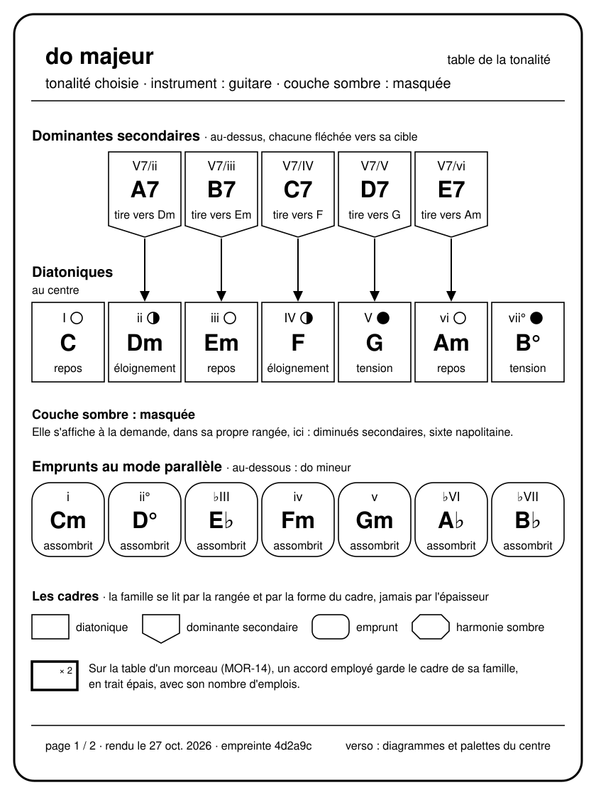

# 50 — Interfaces et appareils

Un seul modèle, une seule application, **trois rôles d'appareil**
([ADR-010](adr/adr-010-trois-appareils-mode-encre.md)). Ce document dit ce que chaque
appareil fait et ne fait pas, montre les écrans principaux, et fixe la grammaire visuelle
— en particulier le **réencodage sans couleur** qu'exige l'encre électronique.

---

## 1. Trois rôles

| | 💻 **Établi** | 📱 **Carnet** | 📖 **Lutrin** |
|---|---|---|---|
| **Appareil** | Ordinateur | Téléphone | Tablette à encre électronique avec stylet |
| **Rôle** | Construire | Capter, écouter, accompagner | Lire, annoter, répéter |
| **Situations** | S4 | S1, S2, S3 | S2, S3, S5 |
| Capter une idée | ✅ | ✅ **en un geste** | — |
| Éditer finement (loupe, frise, plan d'album) | ✅ **conçu pour** | ✅ en version compacte | — |
| Écrire des paroles longues | ✅ **conçu pour** | ✅ une ligne à la fois | — |
| Écouter, écoute de contrôle | ✅ | ✅ | ✅ un accord ou une suite, sans curseur animé |
| Compagnon d'instrument | ✅ métronome, accordeur, suivi de prise, fredonnement | ✅ **conçu pour** ; seul appareil pour nommer un accord joué | affiche la grille, la carte des chemins et la table de la tonalité |
| Taper des frontières en écoutant | ✅ | ✅ | — latence de la dalle |
| Lire une fiche de travail complète | ✅ | acceptable | ✅ **conçu pour** |
| Annoter au stylet | — | — | ✅ **seul appareil** |
| Accepter ou écarter une proposition | ✅ | ✅ | ✅ d'un geste large |
| Opérations destructrices | ✅ confirmation renforcée | ✅ confirmation renforcée | — **absentes** |
| Hors ligne | ✅ | ✅ **exigé** | ✅ **exigé** sur ce qui a été ouvert |

L'**établi** peut tout faire, donc il ne justifie rien : la conception part des deux
appareils contraints, et le confort de l'établi en découle. Une fonction qui
n'existerait que sur l'établi signalerait une contrainte contournée au lieu d'être
traitée.

### Ce qui est impossible, et pourquoi

| Appareil | Impossible | Cause | Conséquence |
|---|---|---|---|
| 📖 Lutrin | Couleur porteuse de sens | Dalle en niveaux de gris, parfois en couleur pâle | Tout le § 6 |
| 📖 Lutrin | Animation, défilement fluide, retour en temps réel | Rafraîchissement de plusieurs centaines de millisecondes, images rémanentes | Pages fixes ; le résultat d'un geste apparaît à la page suivante |
| 📖 Lutrin | Suivre l'écoute ou le jeu à l'écran | La tablette a un haut-parleur et un micro, mais sa dalle ne suit pas le temps réel | L'écoute est possible, sans curseur animé ([arbitrage A19](90-questions-ouvertes.md#les-arbitrages-pris-dans-cette-conception)) ; le micro existe, mais le carnet reste le compagnon d'instrument |
| 📖 Lutrin | Saisie longue | Clavier logiciel lent sur dalle lente | Appairage par code court ; aucune saisie de texte ici |
| 📱 Carnet | Lire une portée de 150 mesures confortablement | Surface | Le carnet montre une phrase ou une section, pas le morceau entier en portée |
| 📱 Carnet | Annoter au stylet | Pas de stylet | — |

---

## 2. Carte de navigation

Le passage d'une échelle à l'autre est un **zoom sémantique**, pas une navigation de
pages : on garde le contexte, le fil d'Ariane le montre (`Fonds › Northbound › Refrain ›
Phrase 2`), et un retour remonte d'un cran sans perdre la sélection.

| Geste de zoom | 💻 Établi | 📱 Carnet |
|---|---|---|
| Descendre d'une échelle sur l'élément sélectionné | Entrée, ou double clic | Toucher l'élément |
| Remonter d'une échelle | Échap | Retour |
| Aller directement au morceau d'un constat d'album | Clic sur le constat | Toucher le constat |
| Chercher partout | `/` | Champ de recherche du fonds |

---

## 3. Les écrans

Les maquettes ci-dessous fixent l'**organisation** de chaque écran, pas son style. Elles
sont dessinées en noir et blanc à dessein : ce qui se lit sans couleur se lira partout.

### 3.1 Le fonds

| Zone | Contenu |
|---|---|
| Bandeau | Recherche ; état de synchronisation (« À jour · il y a 2 min », ou « Hors ligne · 3 captations à envoyer ») |
| Boîte d'idées | Le nombre d'idées non reliées, **sans** compteur d'ancienneté ni alerte (N2) |
| Morceaux | Une ligne par morceau : titre, statut, tonalité, tempo, durée engendrée, **maturité** par dimension, part d'origine à la demande |
| Albums | Leurs ordres, leur ordre retenu, leur cardinal **engendré** |

### 3.2 Le morceau — la frise

| Zone | Contenu |
|---|---|
| **Frise** | Les occurrences dans l'ordre, chacune **large comme sa durée réelle** ; au-dessus, la courbe d'intensité ; une intensité inconnue se dessine en hachures pleine hauteur, jamais à zéro ; un filet épais à gauche d'une occurrence qui rejoue un bloc déjà entendu |
| **Couloirs** de l'occurrence sélectionnée | Accords par mesure · mélodie (portée ou rouleau de piano) · paroles alignées · arrangement |
| **Panneau latéral** | Propositions en attente · pistes demandées · constats · provenance · journal |
| **Prises** | Une prise rattachée, alignée par sa carte de temps, jouable sous la frise |

### 3.3 La loupe — motif ou phrase

| Zone | Contenu |
|---|---|
| **Matériau** | Une à huit mesures, en grand : accords, notes, syllabes sous les notes, accents |
| **Carte des chemins** | Les accords possibles depuis le contexte réel, groupés par effet |
| **Pistes** | Au pluriel, chacune avec sa raison ; « Garder », « Écarter », « Écouter » |
| **Transformations** | Transposer, renverser, rétrograder, augmenter, diminuer, décaler, séquencer — chacune produit une variante, jamais un remplacement silencieux |

### 3.4 L'album — le plan

| Zone | Contenu |
|---|---|
| **Couloirs alignés** sur l'ordre | Tonalité (avec sa place sur le cercle des quintes), tempo, intensité, durée et cumul par face, fin |
| **Transitions** | Entre chaque paire : relation tonale, différence de tempo, et la nature décidée de la transition (silence, fondu, enchaîné, interlude) |
| **Faces** | Si un support à faces est visé : coupure, durée de chaque face contre la limite |
| **Constats** | Chacun avec **son assiette** : « 9 morceaux considérés, 7 tonalités décidées » |
| **Ordres** | Onglets des ordres candidats ; comparer deux ordres côte à côte |

### 3.5 Le carnet — capter et accompagner

| Écran | Contenu |
|---|---|
| **Capter** | Un bouton d'enregistrement qui occupe le tiers de l'écran ; « Texte » et « Photo » à côté ; l'état hors ligne lisible ; les dernières captations |
| **Compagnon** | L'accord entendu en **très grand**, sa confiance, l'alternative en petit ; « Garder » sur toute la largeur ; accordeur et métronome à un geste |

### 3.6 Le lutrin — une page de fiche de travail

| Zone | Contenu |
|---|---|
| En-tête | Titre, tonalité, tempo, métrique, durée, gabarit, chaque valeur avec son statut : « Northbound · si m · 85 BPM · 4/4 · 2:55 · fiche de travail » |
| Frise | La forme proportionnelle à la durée, en noir et blanc : l'intensité chiffrée au-dessus de chaque occurrence ; un filet épais à gauche d'une occurrence qui rejoue un bloc déjà entendu ; une barre en tirets pour une valeur proposée ; des hachures pour l'inconnu |
| Grille | Accords par mesure, glyphes d'incertitude, de proposition et d'emprunt ; une occurrence sans mélodie (ici Couplet 2) porte ses accords au-dessus des syllabes de ses paroles ([REN-01](20-sfd/28-rendus-encre-impression.md#ren-01--fiche-de-travail)) |
| Portée | Une occurrence avec mélodie (ici Refrain 2) : paroles sous les notes, chiffrages d'accords au-dessus, chacun avec la pastille de sa fonction |
| Diagrammes | Les doigtés employés, dans l'ordre d'apparition, avec les numéros de doigts ; l'épinglé encadré |
| Marge | « ✎ 3 » : annotations portées par des rendus antérieurs de cette section |
| Pied | « page 2 / 4 · rendu le 11 oct. 2026 · empreinte 7c1e4a », et le compte des propositions en attente : « 3 propositions ~ en attente » |

### 3.7 La table de la tonalité

La table de
[MIC-12](20-sfd/22-micro-motif-et-phrase.md#mic-12--parcourir-la-table-de-la-tonalité)
montre d'un coup d'œil tous les accords qu'une tonalité met à portée, une rangée par
famille ([§ 60](60-moteur-musical.md#les-familles-daccords)). La maquette en est la page
au lutrin, en do majeur, la couche sombre masquée : c'est aussi une page du cahier des
tables ([REN-01](20-sfd/28-rendus-encre-impression.md#ren-01--fiche-de-travail)).

| Zone | Contenu |
|---|---|
| En-tête | La tonalité, le gabarit, et les réglages que la table lit : « do majeur · table de la tonalité · tonalité choisie · instrument : guitare · couche sombre : masquée » |
| Au-dessus | Les dominantes secondaires, chacune au-dessus de sa cible et fléchée vers elle : `A7` sous `V7/ii`, avec la ligne d'effet `tire vers Dm` |
| Centre | Les sept diatoniques sous leur chiffre romain. Leur ligne d'effet est leur fonction, `repos`, `éloignement` ou `tension`, redoublée par sa pastille (§ 6.2) ; ni filet ni décalage vertical : dans la table, l'épaisseur du trait est à l'accord employé, et la hauteur aux rangées. La fonction de chaque degré est celle du [§ 60](60-moteur-musical.md#les-familles-daccords) ([Q20](90-questions-ouvertes.md#q20--quelle-fonction-porte-chaque-degré-du-centre-de-la-table-)) |
| Couche sombre | Masquée par défaut, et la page le dit à l'endroit où elle s'insère. Affichée, elle forme sa propre rangée, entre le centre et les emprunts |
| Au-dessous | Les emprunts au mode parallèle, chacun sous son degré : en do majeur, les accords de do mineur, avec la ligne d'effet `assombrit` |
| Légende | Les quatre formes de cadre, et le cadre épais d'un accord employé |
| Pied | La pagination, la date du rendu, l'empreinte, et ce que porte le verso : les diagrammes et les palettes des accords du centre |

**La grammaire de la table.** Elle vaut sur les trois appareils, et en noir et blanc pur.

| Élément | Règle |
|---|---|
| **Colonnes** | Une colonne par degré, de I à vii° (de i à VII en mineur). Un emprunt se range sous son degré (♭III sous iii), une dominante secondaire au-dessus de sa cible (V7/ii au-dessus de ii). Quand la tonalité change, chaque case garde sa place et son chiffre : seul le nom change |
| **Rangées** | De haut en bas : les dominantes secondaires, le centre, la couche sombre quand elle est affichée, puis les emprunts. Chaque rangée porte le nom de sa famille ; celle de l'harmonie sombre s'appelle la couche sombre (§ 60) |
| **Cadres** | Un cadre par famille, tous au même trait fin : **droit** pour les diatoniques ; **en pointe**, la pointe vers la cible, pour les dominantes secondaires ; **aux coins arrondis** pour les emprunts ; **aux coins coupés** pour l'harmonie sombre ; l'arrondi et la coupe prennent au moins le quart du côté de la case, pour que le cadre droit s'en distingue (§ 6.5). La famille se lit deux fois, par la rangée et par la forme. L'épaisseur du trait n'en dit jamais rien : elle est réservée à l'accord employé |
| **Flèches de résolution** | Un trait plein, et une pointe pleine posée sur la cible. Une flèche va toujours d'une rangée à la rangée voisine, sans en traverser aucune : des dominantes secondaires vers le centre ; de la couche sombre vers le centre, ou vers les emprunts quand la cible en est un. En la mineur, la napolitaine `B♭/D` mène ainsi au V `E` de la rangée des emprunts. C'est pourquoi la couche sombre s'insère entre le centre et les emprunts. Dans cette rangée, les cases suivent l'ordre des degrés, au plus près de leur cible, et leurs flèches peuvent être obliques. Deux flèches peuvent arriver sur la même case : en do majeur, `F♯°7` et `D♭/F` mènent toutes deux à `G` |
| **Accord employé** ([MOR-14](20-sfd/24-morceau.md#mor-14--poser-le-morceau-sur-la-table)) | Le cadre de sa famille, de même forme, en **trait épais**, et son nombre d'emplois en haut à droite : `× 3`. Dans la section choisie, chaque accord porte en haut à gauche son numéro d'ordre (`1 · 5` pour un accord joué deux fois). Le chemin se lit par ces numéros, sans trait : un trait se confondrait avec une flèche de résolution. Un accord proposé et non décidé porte `~` (§ 4.1). Un accord absent des rangées affichées est listé sous la table, « hors table » |
| **Emprunt** | Dans la table, aucun nom ne porte l'astérisque de la grille (§ 6.2) : la rangée et le cadre disent la famille, y compris pour les accords hors tonalité des dominantes secondaires et de la couche sombre |
| **Toucher une case** | Sur l'établi et le carnet, la case s'écoute, et sa cible passe en inverse, fond noir et texte blanc. Au lutrin, la case s'écoute et rien ne bouge à l'écran ([arbitrage A19](90-questions-ouvertes.md#les-arbitrages-pris-dans-cette-conception)) : les flèches y sont toujours dessinées |
| **Gestes de l'établi et du carnet** | Après un toucher, deux boutons s'affichent à côté de la case : « Palette », qui ouvre la palette de l'accord ([MIC-13](20-sfd/22-micro-motif-et-phrase.md#mic-13--lire-la-palette-dun-accord)), et, depuis un morceau ouvert, « Prendre », qui insère l'accord à la position courante ([MIC-12](20-sfd/22-micro-motif-et-phrase.md#mic-12--parcourir-la-table-de-la-tonalité)). La tonalité se change dans l'en-tête, d'un geste ; la couche sombre s'y affiche ou s'y masque. Les flèches sont dessinées sur les trois appareils. Au lutrin, page fixe, on ne prend rien : on prend à l'établi ou au carnet ([Q22](90-questions-ouvertes.md#q22--peut-on-prendre-un-accord-de-la-table-au-lutrin-)) |
| **Diagrammes** | Avec l'instrument réglé, chaque case peut porter son diagramme ([REN-04](20-sfd/28-rendus-encre-impression.md#ren-04--diagrammes-de-manche) ou [REN-08](20-sfd/28-rendus-encre-impression.md#ren-08--diagrammes-de-clavier)). Au lutrin, ceux des accords du centre passent au verso, avec leurs palettes |

---

## 4. La grammaire des propositions

Partout, sur les trois appareils, une **valeur** se présente dans l'un de trois états, et
tout **élément** porte sa provenance.

### 4.1 Statut d'une valeur

| Statut | Rendu | Exemple |
|---|---|---|
| **Décidée** | Texte droit | `si mineur` |
| **Proposée** | Italique et tilde | *`si mineur ~`* |
| **Absente** | Tiret cadratin, jamais un blanc | `—` |

Le cadratin plutôt que le blanc : un blanc se confond avec un défaut d'affichage ; `—`
dit « on sait qu'on ne sait pas ».

**Une valeur engendrée prend le statut le plus faible de ses entrées.** Une durée
calculée depuis un tempo proposé est proposée (`2:58 ~`) ; elle se lit droite quand le
tempo est décidé, et `—` quand il manque.

Une proposition **en attente** — ni gardée, ni écartée — se lit en italique avec `~`, et
ne porte **aucun glyphe de provenance** : sa provenance naît du geste qui la garde
(§ 4.2). « En attente » est le seul mot pour cet état ; « à trancher » est réservé aux
conflits entre versions concurrentes, nés d'une synchronisation ou d'une fusion de
variantes ([SYN-03](20-sfd/29-socle-donnees-appareils.md#syn-03--trancher-les-conflits)).

### 4.2 Provenance d'un élément

| Provenance | Glyphe | Lu |
|---|---|---|
| Saisie | aucun | l'état par défaut ne se signale pas |
| Détectée, acceptée | `◇` | « mesuré sur une prise » |
| Suggérée, acceptée | `✦` | « venu d'une piste » |
| Importée, acceptée | `⇣` | « venu d'un fichier » |
| Retouchée | `↺` | « issu d'un autre élément » |

Une proposition en attente ne porte aucun de ces glyphes : `◇`, `✦` et `⇣`
n'apparaissent qu'une fois la proposition gardée. `✎` n'est pas un glyphe de provenance :
il compte les annotations à l'encre (§ 6.2).

Le glyphe est discret par défaut. La **vue de provenance** l'agrandit et colore (en plus
du glyphe) pour répondre à « qu'est-ce qui est de ma main ? »
([PRO-02](20-sfd/26-propositions-suggestions-provenance.md#pro-02--provenance-et-part-dorigine)).

### 4.3 Accepter, écarter

| Geste | 💻 Établi | 📱 Carnet | 📖 Lutrin |
|---|---|---|---|
| Accepter une proposition | `Entrée` sur la sélection, ou bouton | Bouton « Garder » pleine largeur | Toucher « Garder », zone d'au moins 12 mm |
| Écarter | `Suppr`, ou bouton | Glisser vers la gauche, ou bouton | Toucher « Écarter » |
| Accepter une plage | Sélection puis `Entrée` | Sélection puis « Garder tout » | — une à une, ou depuis l'établi |
| Annuler le dernier geste | `Ctrl+Z` | Bouton « Annuler » visible 10 s | Bouton « Annuler » sur la page suivante |

---

## 5. Les textes de l'interface

- **Des constats, jamais des ordres.** « Le refrain arrive à la mesure 33 sur 45 » et
  non « avancez le refrain ». Un test vérifie l'absence d'impératif dans les libellés
  engendrés des diagnostics.
- **Toujours l'assiette** d'un chiffre agrégé : « 3 morceaux en mi mineur, 6 dont la
  tonalité n'est pas décidée ».
- **Le vocabulaire du [glossaire](80-glossaire.md)**, et lui seul.
- **Aucune urgence fabriquée** : ni « vous n'avez pas ouvert ce morceau depuis 12 jours »,
  ni série, ni badge rouge.

---

## 6. Le mode encre : réencoder sans la couleur

> Ce n'est pas un réglage de feuille de style. C'est une décision sur la façon dont
> l'information est **encodée**, et elle s'applique à tous les appareils : sur un écran
> couleur, la couleur ne fait que **redoubler** ce que la forme dit déjà.

### 6.1 Le principe

La couleur est un canal **nominal** : elle distingue sans ordonner. Or la plupart des
informations à montrer sont **ordinales** : décidé > proposé > absent ; repos <
éloignement < tension. La couleur était donc le mauvais canal avant même la question de
l'encre.

Le canal retenu pour toute échelle ordinale est **le remplissage d'une pastille**, lisible
à petite taille et intact en **noir et blanc pur**. Deux canaux secondaires le
redoublent : l'épaisseur du trait et le décalage vertical. Si l'un est mal rendu, les
autres portent encore l'information.

### 6.2 Les encodages

| Information | Nature | Encodage |
|---|---|---|
| **Fonction harmonique** : tonique, sous-dominante, dominante | Ordinale, 3 valeurs | Pastille `○` vide · `◐` demi-pleine · `●` pleine ; filet 0,25 · 0,5 · 1 pt ; décalage vertical 0 · +1 · +2 mm. La tension est en haut, le repos au sol. Dans la table, la pastille seule (§ 3.7) |
| **Statut d'une valeur** | Ordinale, 3 valeurs | Droit · italique et `~` · `—` (§ 4.1) |
| **Provenance** | Nominale, 5 valeurs | Aucun glyphe pour la saisie ; `◇ ✦ ⇣ ↺` pour les autres (§ 4.2) |
| **Identité de section** | Nominale | Le **nom** et un compteur `Refrain (2/3)` ; le nombre d'écarts : `Refrain (2/3) · 2 écarts` |
| **Répétition** | Binaire | **Filet épais à gauche** d'une occurrence qui rejoue un bloc déjà entendu |
| **Intensité** | Ordinale, 1 à 5 | Hauteur de barre **et** chiffre écrit ; proposée : barre en tirets et `~` ; inconnue : **contour hachuré pleine hauteur**, jamais une barre nulle |
| **Accord douteux** | Binaire | Soulignement pointillé |
| **Emprunt** | Binaire | Astérisque `*` après le nom ; la table n'en met aucun : la rangée et le cadre disent la famille (§ 3.7) |
| **Famille d'un accord**, dans la table | Nominale, 4 valeurs | La rangée, et la forme du cadre : droit · en pointe vers la cible · aux coins arrondis · aux coins coupés ; toutes au même trait fin (§ 3.7) |
| **Accord employé**, sur la table d'un morceau | Binaire | Le cadre de sa famille en **trait épais**, jamais une autre forme, avec son nombre d'emplois (§ 3.7) |
| **Doigté ou renversement épinglé** | Binaire | Cadre autour du diagramme, de manche ou de clavier (REN-04, REN-08) |
| **Annotations antérieures** | Compte | `✎ 3` dans la marge de la section : le seul emploi de `✎` |
| **Ligne de chant présente** | Ordinale, 3 valeurs | `▮` pleine · `▯` faible · `·` absente |

### 6.3 Les contraintes physiques, en millimètres

La cible est une dalle et une feuille, pas un écran : les tailles se fixent en unités
physiques.

| Élément | Minimum |
|---|---|
| Diagramme de manche | **18 mm** de large pour six cordes |
| Pastille de fonction | **3 mm** de diamètre |
| Trait le plus fin | **0,25 pt** ; en deçà, il disparaît au rafraîchissement |
| Pas d'une trame | **1,5 mm** ; en deçà, le moiré confond deux trames |
| Corps de texte | **11 pt**, lisible à bout de bras sur un pupitre |
| Zone tactile | **12 mm** de côté sur le lutrin |
| Contraste | Noir pur sur blanc pur ; aucun gris pour du texte |

### 6.4 Ce que le mode encre interdit

- tout dégradé ;
- tout gris porteur de sens (un gris décoratif est admis) ;
- toute information portée par la **seule** couleur, la seule saturation ou la seule
  opacité ;
- toute animation, transition visuelle, défilement automatique ou horloge ;
- toute trame de pas inférieur à 1,5 mm.

### 6.5 Comment on le vérifie

Deux tests automatiques, complémentaires
([§ 70](70-qualite-et-verification.md#3-les-invariants-et-leurs-tests)) :

1. **Analyse statique des styles.** Toute classe dont le nom commence par `sem-` (classe
   *sémantique* : elle distingue deux valeurs d'une même information) et qui déclare une
   couleur doit aussi déclarer un indice non colorimétrique : bordure, trame, glyphe,
   style de police, pointillé, épaisseur ou décalage. Le test échoue en nommant la classe.
   Le préfixe imposé est le prix du test : sans lui, on ne distingue pas une couleur
   décorative d'une couleur qui porte du sens.
2. **Différence de rendu, couleur supprimée.** Pour chaque paire de valeurs d'une même
   information, rendre l'élément deux fois, forcer toute couleur au noir et tout fond au
   blanc, rastériser à 300 points par pouce, et exiger qu'**au moins 2 % des pixels** de
   la boîte englobante diffèrent. En deçà, les deux valeurs sont indiscernables sur la
   dalle.

Le confort réel — au soleil, à bout de bras, avec les images rémanentes de la page
précédente — reste un contrôle **à l'œil**, sur l'appareil, et il est noté comme tel.

---

## 7. Accessibilité

Le réencodage sans couleur profite d'abord aux personnes qui distinguent mal les
couleurs. S'y ajoutent :

| Exigence | Mise en œuvre |
|---|---|
| Tout se fait au clavier sur l'établi | Ordre de tabulation, raccourcis documentés, focus visible |
| Lecteurs d'écran | Libellés sur les éléments graphiques : une pastille de fonction annonce « dominante » |
| Mouvement réduit | Respect du réglage du système, et mode encre sans aucune animation |
| Agrandissement | Interface utilisable à 200 % sans perte d'information |
| Contrôle automatique | Audit axe-core dans les tests de bout en bout, sans violation de niveau sérieux |
