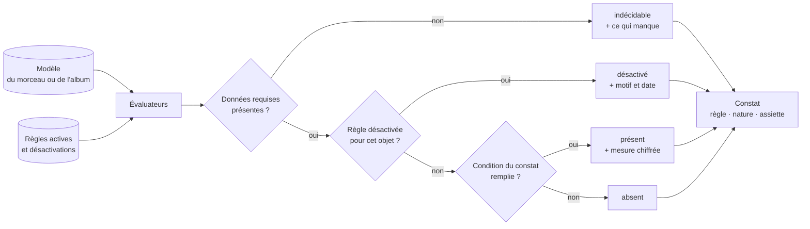
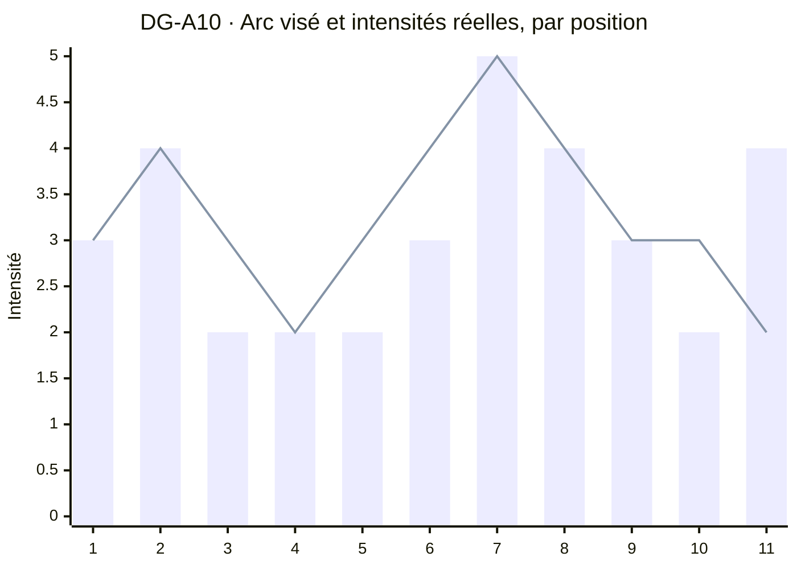
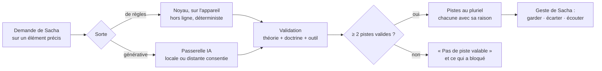
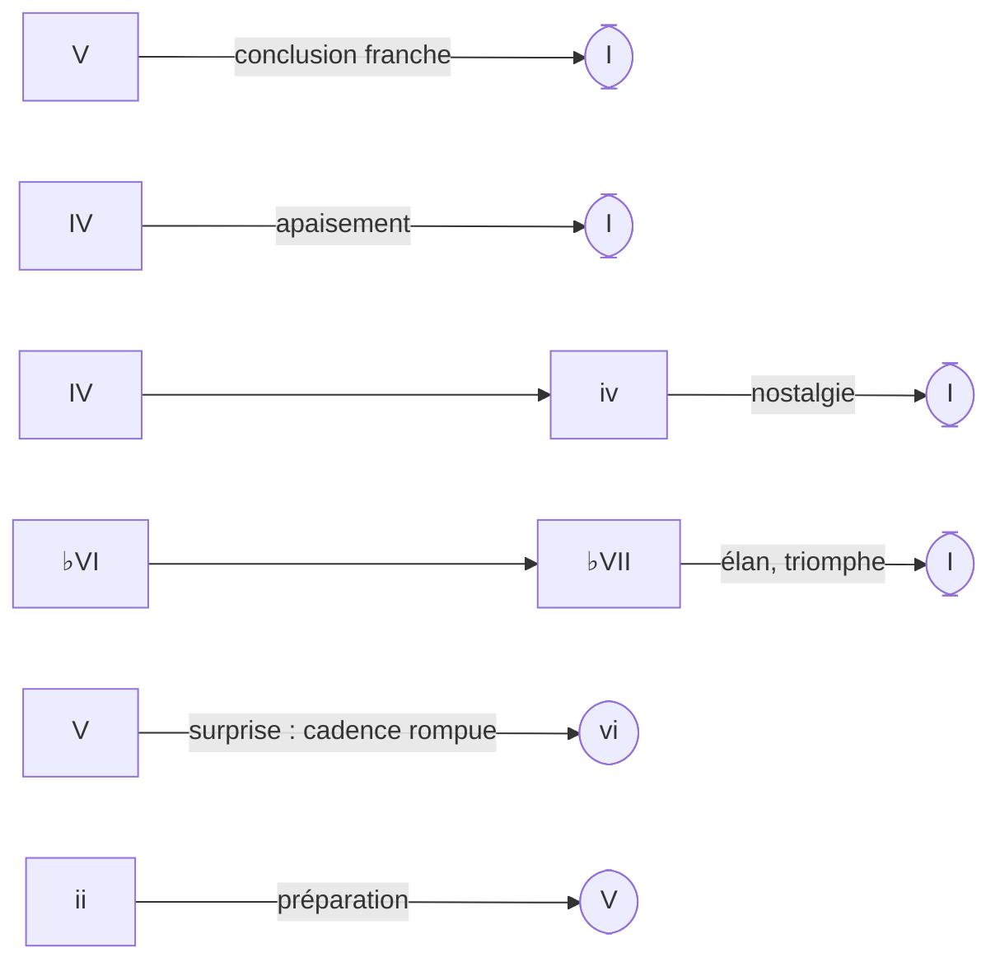
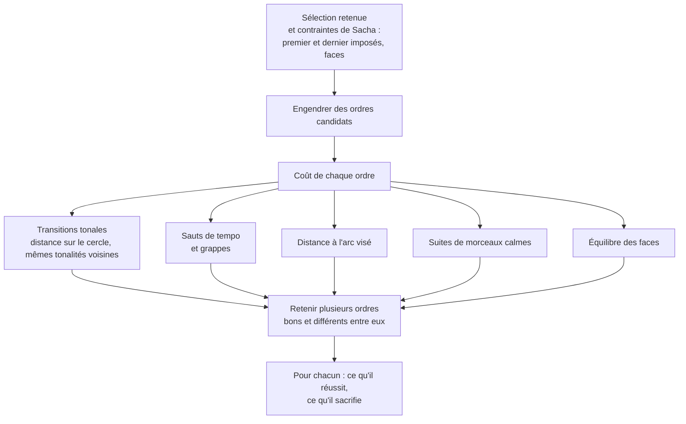

# 60 — Le moteur musical

Le moteur musical est la partie du noyau qui **sait la musique** : il analyse, diagnostique
et propose des pistes. Il ne décide rien. Trois idées le structurent :

1. les règles sont **des données**, pas du code, et chacune dit sa **nature** ;
2. un diagnostic **constate**, chiffre et dit sur quoi il s'appuie ; il n'écrit rien ;
3. une piste est **plurielle, expliquée, vérifiée**, et ne s'applique que par un geste.

---

## 1. Trois natures de règles

| | **Théorie** | **Doctrine** | **Règle d'outil** |
|---|---|---|---|
| Ce qu'elle dit | Ce qui se passe | Ce que Sacha veut | Ce qu'un outil externe accepte |
| Origine | Le fonds commun de la musique tonale et de la prosodie | L'expérience de Sacha sur ses propres morceaux | La documentation et la pratique d'un outil (par exemple un générateur de maquettes) |
| Autorité | Descriptive | Prescriptive, pour Sacha uniquement | Contrainte dure, tant que l'outil est le même |
| Qui la modifie | Personne ; on la corrige si elle est mal transcrite | **Sacha uniquement** | Sacha, quand l'outil change |
| Durée de vie | Stable | Évolue, et doit pouvoir évoluer | Celle de l'outil |
| Livrée | Avec l'application | Dans les réglages de Sacha | Dans les réglages, par profil d'outil |
| Ce qu'un constat en dit | « voici ce que c'est » | « voici en quoi cela s'éloigne de ce que tu veux » | « l'outil refusera ceci » |

**La séparation est matérielle.** La théorie est livrée avec le code ; la doctrine et
les profils d'outil vivent dans le document de réglages de Sacha. Si la doctrine est
vidée, tous les diagnostics de théorie continuent de tourner : un morceau s'analyse sans
qu'aucun goût ne s'en mêle.

### 1.1 Une règle, en données

```text
# regles.txt — une règle par ligne
# <id> nature= echelle= actif= parametres= source= | énoncé
R-AL-01 nature=theorie echelle=album actif=oui parametres=difference_bpm:6,voisins:3 source=pratique-courante | Grappe de tempo
R-PH-01 nature=theorie echelle=phrase actif=oui parametres=langue:en source=phonologie-anglaise | Accent lexical sur temps faible
R-DO-03 nature=doctrine echelle=phrase actif=oui parametres= source=Sacha | Pas de rime ajoutée dans une variante de ligne
```

- **Désactiver** une règle est une ligne modifiée, pas du code.
- Une règle peut être désactivée **pour un morceau**, avec un **motif obligatoire** et une
  date ; le rapport le rappelle à chaque exécution (« désactivée le … : forme strophique
  assumée »).
- Les **seuils** (6 BPM, trois voisins…) sont des **paramètres** de départ, réglables.
  Aucun n'est codé en dur.

### 1.2 Les familles d'accords

Une tonalité met à portée quatre **familles** d'accords. Ce sont des données de théorie,
livrées avec l'application, et deux vues y puisent : la [carte des chemins](#la-carte-des-chemins)
(§ 4.2) et la **table de la tonalité**,
[MIC-12](20-sfd/22-micro-motif-et-phrase.md#mic-12--parcourir-la-table-de-la-tonalité). La
table n'est pas une piste : elle montre tous les accords des quatre familles, sans en
classer ni en recommander aucun.

| Famille | Rangée de la table | Ce qu'elle rassemble | Flèche de résolution |
|---|---|---|---|
| **Diatoniques** | Centre | Les accords bâtis sur les sept degrés de la tonalité | Aucune |
| **Dominantes secondaires** | Au-dessus | La dominante, en accord de septième (V7), d'un accord du centre : sa cible | Vers sa cible, au centre |
| **Emprunts au mode parallèle** | Au-dessous | Les accords de la tonalité de même tonique et de mode opposé : do mineur pour do majeur, la majeur pour la mineur | Aucune |
| **Harmonie sombre** | Couche sombre, à la demande | Le mineur harmonique, les diminués secondaires (vii°7), la sixte napolitaine (♭II6) | Un diminué vers sa cible, la napolitaine vers la dominante ; l'augmenté n'en a pas |

**Les rangées.** L'exemple est en do majeur et en la mineur. La table se calcule en degrés,
puis se nomme dans la tonalité ([ADR-008](adr/adr-008-hauteurs-relatives.md)).

| Rangée | Majeur | Mineur |
|---|---|---|
| **Au-dessus** · dominantes secondaires, chacune fléchée vers sa cible | V7/ii `A7`→Dm, V7/iii `B7`→Em, V7/IV `C7`→F, V7/V `D7`→G, V7/vi `E7`→Am | V7/i `E7`→Am (la dominante du mineur harmonique), V7/III `G7`→C, V7/iv `A7`→Dm, V7/v `B7`→Em, V7/VI `C7`→F, V7/VII `D7`→G |
| **Centre** · diatoniques | I `C`, ii `Dm`, iii `Em`, IV `F`, V `G`, vi `Am`, vii° `B°` | i `Am`, ii° `B°`, III `C`, iv `Dm`, v `Em`, VI `F`, VII `G` |
| **Au-dessous** · emprunts au mode parallèle | i `Cm`, ii° `D°`, ♭III `E♭`, iv `Fm`, v `Gm`, ♭VI `A♭`, ♭VII `B♭` | I `A`, ii `Bm`, iii `C♯m`, IV `D`, V `E`, vi `F♯m`, vii° `G♯°` |
| **Couche sombre**, à la demande | vii°7 de chaque cible du centre (`C♯°7`→Dm, `D♯°7`→Em, `E°7`→F, `F♯°7`→G, `G♯°7`→Am), vii°7 `B°7`→C, la napolitaine ♭II6 `D♭/F`→G | Le mineur harmonique : III+ `C+`, vii°7 `G♯°7`→Am ; les vii°7 des autres cibles ; la napolitaine ♭II6 `B♭/D`→E |

**Ce que porte une case.** Le nom de l'accord, son chiffre romain (son degré), sa famille et
une ligne d'effet. La famille se lit **par la rangée et par une forme de cadre**, jamais par
la seule couleur (P6).

**Les flèches de résolution.** Une flèche relie une case à sa **cible**, l'accord où elle se
résout : `A7`→Dm se lit « `A7` tire vers Dm ». Chaque flèche relie exactement deux cases. Les
diatoniques et les emprunts au mode parallèle n'en portent pas, ni l'augmenté de l'harmonie
sombre.

**Les lignes d'effet.** La ligne d'effet d'une case est l'une de celles-ci, mot pour mot ;
`<cible>` y est le nom de l'accord où mène sa flèche.

| Case | Ligne d'effet |
|---|---|
| Une dominante secondaire | `tire vers <cible>` |
| Un emprunt au mineur, dans une tonalité majeure | `assombrit` |
| Un emprunt au majeur, dans une tonalité mineure | `éclaire` |
| Un diminué de la couche sombre (vii°7) | `glisse vers <cible>` |
| La napolitaine | `tension sombre avant la dominante` |
| L'augmenté | `suspend` |
| Au centre, la fonction : tonique, sous-dominante, dominante | `repos`, `éloignement`, `tension`, dans cet ordre |

Au centre, chaque degré porte une fonction, selon le regroupement courant en harmonie de
chanson ([Q20](90-questions-ouvertes.md#q20--quelle-fonction-porte-chaque-degré-du-centre-de-la-table-)) :

| Mode | `repos` | `éloignement` | `tension` |
|---|---|---|---|
| Majeur | I, iii, vi | ii, IV | V, vii° |
| Mineur | i, III | ii°, iv, VI | v, VII |

**Changer de tonalité.** Chaque case garde sa place et son chiffre ; seul le nom change
([I26](70-qualite-et-verification.md#3-les-invariants-et-leurs-tests)).
L'orthographe des tonalités est celle de l'arbitrage A17
([§ 90](90-questions-ouvertes.md#les-arbitrages-pris-dans-cette-conception)). De do à mi♭
majeur, `C` devient `E♭`, `A7` devient `C7` et `B°` devient `D°`. En fa♯ majeur, le iii
s'écrit `A♯m` ; en mi♭ mineur, le V7/i s'écrit `B♭7`. Une case dont le nom porterait une
double altération s'écrit à l'enharmonique simple, sous le même chiffre romain : en ré♭
majeur, le ♭VI s'écrit `A`, et non `B𝄫`. La préférence d'orthographe ne s'applique pas à la
table ([Q21](90-questions-ouvertes.md#q21--comment-sécrivent-les-cases-de-la-table-)).

**La couche sombre.** Elle est masquée par défaut et s'affiche à la demande. Elle n'ajoute
aucune case aux trois rangées : elle forme sa propre rangée, qui porte son nom. Affichée,
elle nourrit aussi les accords suivants de la [carte des chemins](#la-carte-des-chemins).

---

## 2. Comment un diagnostic se calcule



Un constat porte toujours : la **règle** et sa **nature**, l'**état** (`présent`,
`absent`, `indécidable`, `désactivé`), la **mesure chiffrée** qui le fonde, et
l'**assiette** — sur combien d'éléments il a raisonné, combien portaient la donnée
requise, combien étaient décidés.

Quatre règles de rédaction, vérifiées par test :

1. **L'inventaire d'abord.** Un rapport commence par ce que contient l'objet, avant tout
   constat : on énonce ce que la démo contient réellement avant de lui chercher des
   défauts.
2. **Un constat, pas un ordre.** Aucun libellé à l'impératif.
3. **Indécidable n'est pas absent.** Sans intensités, « dernier refrain sans relance » est
   indécidable, jamais « absent ».
4. **L'ordre est celui de l'objet**, pas celui d'une gravité inventée.

---

## 3. Le catalogue des diagnostics

Les identifiants `DG-…` sont stables. La colonne « requiert » dit ce sans quoi le constat
est indécidable.

### 3.1 Phrase (É2)

| # | Constat | Nature | Requiert |
|---|---|---|---|
| DG-P1 | Syllabe accentuée sur un temps faible — contrainte **dure** en anglais, **molle** en français | Théorie | Mélodie, alignement, langue de la ligne |
| DG-P2 | Voyelle réduite ou fermée tenue sur une note longue | Théorie | Mélodie, alignement, langue |
| DG-P3 | Densité syllabique : syllabes par mesure, comparée entre phrases | Théorie (information) | Alignement |
| DG-P4 | Notes hors de la tessiture | Théorie | Mélodie, tessiture |
| DG-P5 | Note étrangère à l'accord, tenue sur un temps fort, sans résolution | Théorie | Mélodie, grille |
| DG-P6 | Syllabes non alignées, ou en excès | Théorie | Alignement |
| DG-P7 | Rimes **présentes** (relevé, jamais prescription) | Théorie (information) | Texte, langue |
| DG-P8 | `e` muet : deux comptes syllabiques légitimes (français) | Théorie (information) | Texte en français |

### 3.2 Section (É3)

| # | Constat | Nature | Requiert |
|---|---|---|---|
| DG-S1 | Cadence finale : parfaite, plagale, demi-cadence, rompue, aucune | Théorie (information) | Grille, tonalité |
| DG-S2 | Rythme harmonique : accords par mesure, comparé entre sections | Théorie (information) | Grille |
| DG-S3 | Contour mesuré : arche, vague descendante, escalier, saut, chute | Théorie (information) | Mélodie |
| DG-S4 | Occurrence identique à une autre : mêmes écarts et même texte | Pratique | Forme, texte |
| DG-S5 | Ambitus de la section comparé aux autres | Théorie (information) | Mélodie |

### 3.3 Morceau (É4)

| # | Constat | Nature | Requiert |
|---|---|---|---|
| DG-M0 | **Inventaire** : occurrences, mesures, durée, types présents et absents, intensités renseignées | — | Rien |
| DG-M1 | Premier refrain après le premier tiers des mesures | Pratique | Forme typée |
| DG-M2 | Refrain qui n'apparaît qu'une fois | Pratique | Forme typée |
| DG-M3 | Aucune section contrastante (ni pont, ni changement net d'intensité, d'ambitus ou de rythme harmonique) | Pratique | Forme ; intensité ou mélodie |
| DG-M4 | Une occurrence de type « fin » qui n'est pas la dernière | Pratique | Forme typée |
| DG-M5 | Dernier refrain sans relance : son intensité est ≤ à celle du plus intense des refrains précédents ; strictement plus haute, le constat est `absent` | Pratique | Forme typée (deux refrains au moins), intensités des refrains |
| DG-M6 | Courbe d'intensité plate | Pratique | Intensités |
| DG-M7 | Apparition sans creux : une occurrence qui doit ressortir, sans respiration avant elle | Doctrine | Intensités |
| DG-M8 | Fin en suspens (information) | Théorie (information) | Grille finale |
| DG-M9 | Plus de cinq couches simultanées | Pratique | Arrangement |
| DG-M10 | Deux instruments dans le même registre, dans la même occurrence | Théorie | Arrangement |
| DG-M11 | Aucun moyen d'espace nommé dans une occurrence (répétition, bourdon, pièce) | Doctrine | Arrangement |

Les constats DG-M1 à DG-M3 se **désactivent par morceau** quand la forme est assumée : un
morceau strophique sans refrain n'a pas à être rappelé à l'ordre à chaque ouverture.

### 3.4 Album (É5)

| # | Constat | Nature | Requiert |
|---|---|---|---|
| DG-A0 | **Inventaire** : cardinal engendré, durée totale, répartition des tonalités, des tempos, des intensités, avec l'assiette de chacune | — | Rien |
| DG-A1 | Deux voisins dans la même tonalité | Pratique | Ordre, tonalités |
| DG-A2 | Relation tonale entre la fin d'un morceau et le début du suivant (quinte, relative, demi-ton…) | Théorie (information) | Ordre, tonalités de fin et de début |
| DG-A3 | Grappe de tempo : trois voisins ou plus dont les tempos diffèrent deux à deux de moins de 6 BPM | Pratique | Ordre, tempos |
| DG-A4 | Amplitude de tempo faible : moins de 20 BPM sur quatre morceaux ou plus | Pratique | Tempos |
| DG-A5 | Trois morceaux calmes d'affilée (intensité ≤ 2) | Pratique | Ordre, intensités |
| DG-A6 | L'album finit sur son morceau le moins intense | Pratique (information) | Ordre, intensités |
| DG-A7 | Un procédé, une image ou un thème partagé par plus de la moitié des morceaux | Doctrine | Étiquettes de procédés et de thèmes |
| DG-A8 | Squelette partagé : deux morceaux aux grilles, formes ou contours très proches | Théorie (information) | Grilles, formes, mélodies |
| DG-A9 | Durée d'une face au-delà de la limite du support visé | Outil | Ordre, faces, support |
| DG-A10 | Distance à l'arc visé : intensité par position comparée à la courbe voulue | Doctrine | Ordre, intensités, arc |

**Sans ordre, les constats d'adjacence (A1, A2, A3, A5, A6) sont indécidables**, jamais
« aucun problème » : on ne peut pas dire « côte à côte » sans « à côté ».



*Barres : intensités décidées des morceaux dans l'ordre candidat. Ligne : l'arc visé.
Les positions 3 à 5 alignent trois morceaux calmes d'affilée (DG-A5) ; la fin dépasse
l'arc voulu (DG-A10).*

---

## 4. Les pistes

### 4.1 Deux sortes, un même contrat



| Contrat d'une piste | Pourquoi |
|---|---|
| **À la demande** : Sacha la demande, sur un élément précis | L'outil ne parle pas quand on compose (N1) |
| **Au pluriel** : au moins deux, ou l'aveu qu'il n'y en a pas | Une seule recommandation est une réponse déguisée (N6) |
| **Expliquée** : chaque piste dit pourquoi elle est là | « V–I : conclusion franche » vaut mieux qu'une note sur 10 |
| **Vérifiée** : chaque piste a passé la validation déterministe | Une piste qui viole la doctrine de Sacha ne s'affiche pas |
| **Écoutable** quand c'est musical | On juge un accord à l'oreille |
| **Tracée** : acceptée, elle garde sa provenance | La part d'origine reste lisible (B10) |
| **Jamais classée par qualité** | Les pistes se groupent par **effet**, pas par note ; un ordre objectif et nommé (par exemple le coût en mesures ajoutées) est admis, et dit |

### 4.2 Les pistes de règles

Calculées par le noyau, **hors ligne**, de façon déterministe.

| Piste | Échelle | Principe |
|---|---|---|
| **Accords suivants** | É1, É2 | Depuis la suite **réellement** jouée (deux à quatre accords), les enchaînements possibles dans la tonalité, plus les emprunts courants et les dominantes secondaires, groupés par **effet** |
| **Substitutions et enrichissements** | É1 | Relatif, triton, échange modal, extensions ; chaque enrichissement porte sa jouabilité à la guitare |
| **Modulations et retours** | É3, É4 | Accord pivot, modulation par la dominante, modulation directe ; toujours avec un chemin de retour |
| **Transformations mélodiques** | É1, É2 | Transposer, renverser, rétrograder, augmenter, diminuer, décaler d'un temps, séquencer : chacune produit une **variante** |
| **Rimes et quasi-rimes** | É2 | Depuis un dictionnaire phonétique, par langue : rime riche, suffisante, assonance ; avec le compte syllabique et l'accent de chaque mot |
| **Pistes de contraste** | É3 | Pour une section qui doit trancher : changer de centre harmonique, de rythme harmonique, de registre, de densité — baisser le niveau n'est qu'une de ces pistes, jamais la seule proposée |
| **Allonger ou raccourcir** | É4 | Répéter, instrumental, augmentation par l'arrangement, demi-tempo, modulation, coda, section neuve ; chaque piste dit sa durée résultante, et elles se rangent par coût en mesures ajoutées, un ordre nommé (§ 4.1) |
| **Ordres d'album** | É5 | Une fonction de coût explicite sur les transitions et l'arc ; plusieurs ordres **divers**, chacun avec ses compromis (§ 4.4) |

#### La carte des chemins

L'effet d'une arrivée dépend du **chemin**, pas du seul dernier accord. La carte raisonne
donc sur des suites, et affiche les possibles **depuis ce qui précède réellement** dans le
morceau.



La carte s'affiche **dans la tonalité du morceau**, avec les noms d'accords et les doigtés
de Sacha ; sur une grille vide, elle part du premier degré (I, ou i en mineur). Pour une
tonalité indécise, elle s'affiche pour chaque candidat, côte à côte.
Depuis un emprunt, elle montre d'abord les **retours**, puisque c'est la question réelle
quand on est sorti.

La carte et la table de la tonalité puisent dans les mêmes
[familles d'accords](#12-les-familles-daccords) (§ 1.2) : la table montre tout, la carte part
de ce qui précède réellement. Si la **couche sombre** est affichée, ses accords nourrissent
aussi les accords suivants. La table n'est pas une piste : ses données, les rangées, les
flèches de résolution et les lignes d'effet sont au § 1.2.

### 4.3 Les pistes génératives

Passent par la [passerelle IA](40-architecture.md#6-la-passerelle-ia), à la maison.

| Piste | Entrée | Contraintes vérifiées après génération |
|---|---|---|
| **Variantes de ligne** | La ligne, sa phrase, sa langue | Compte syllabique, accents sur les temps forts, voyelles tenues, rime ou non selon la doctrine, aucune ligne décidée réécrite sans demande explicite |
| **Idées de titre** | Les lignes retenues, les thèmes étiquetés | Longueur, langue, aucun titre déjà employé dans le fonds |
| **Expliquer un constat** | Le constat, sa règle, sa mesure | Ne contredit pas la mesure ; ne formule aucun ordre |

**Hors périmètre, même sur demande** : engendrer une section entière, une mélodie
complète, un texte complet. La frontière est la même que pour tout le reste : une piste
porte sur **un élément**, et Sacha le choisit.

### 4.4 Les pistes d'ordre d'album



Les **poids** de la fonction de coût sont visibles et réglables. Une piste d'ordre ne
réordonne jamais l'album : elle se compare à l'ordre courant
([ALB-09](20-sfd/25-album.md#alb-09--comparer-deux-ordres)), et Sacha en retient tout ou
partie.

---

## 5. La prosodie, en deux langues

La langue est un attribut **de la ligne**. La langue par défaut d'une ligne nouvelle est
celle du morceau, réglable. Pupitre **ne détecte pas** la langue d'une ligne : quatre mots
ne suffisent pas, et une détection fausse appliquerait les mauvaises règles en silence.
Sur une ligne sans langue, les constats qui en dépendent (DG-P1, DG-P2, DG-P7, DG-P8)
**refusent de tourner** et nomment la langue manquante ; les autres (DG-P3 à DG-P6)
tournent.

| Point | Anglais | Français |
|---|---|---|
| **Accent** | Lexical et fort : *RE-cord* et *re-CORD* sont deux mots. Un accent sur temps faible s'entend comme une faute de diction : **contrainte dure** | Accent de groupe, sur la dernière syllabe prononcée : **contrainte molle** |
| **Compte syllabique** | Stable, mais des diphtongues ambiguës (*fire* : une ou deux syllabes ?) : la découpe proposée se corrige | Variable : le `e` muet final se chante ou non, d'où **deux comptes légitimes** |
| **Voyelles tenues** | Beaucoup de voyelles réduites (schwa), intenables sur une note longue : défaut **grave** | Riche en voyelles ouvertes : tenir est plus facile |
| **Consonnes finales** | Toutes prononcées, d'où des amas difficiles à chanter vite (*asked*) | Liaisons qui changent le compte et la sonorité |
| **Rime** | **Phonétique** seulement : *love* / *move* ne riment pas | La rime orthographique est admise par tradition |

---

## 6. Les doigtés de guitare

Un doigté n'est **pas stocké** : il est calculé à chaque affichage, **selon le contexte**.
Seul l'**épinglage** par Sacha est une décision.

### 6.1 Comment le doigté par défaut se choisit

L'accordage est `EADGBE`, MIDI [40, 45, 50, 55, 59, 64], sans réglage ni capodastre au calcul
(§ 6.2).

**Les candidats sont les formes du recueil.** Une forme se décrit par ses frettes en position
ouverte, de la corde grave à l'aiguë (`x` : corde étouffée). Une forme **mobile** se déplace
d'un même nombre de frettes sur toutes ses cordes, tant qu'aucune frette ne dépasse 15. Une
forme **fixe** ne sert qu'à sa place. Une forme placée sert tout accord dont elle tient les
contraintes, quel que soit son nom.

| Accord | Formes mobiles | Formes fixes |
|---|---|---|
| Majeur | E `022100`, A `x02220`, D `xx0232` | C `x32010`, G `320003` |
| Mineur | Em `022000`, Am `x02210`, Dm `xx0231` | — |
| Septième | E7 `020100`, A7 `x02020`, D7 `xx0212` | C7 `x32310`, G7 `320001`, B7 `x21202` |
| Diminué | B° `x2343x`, D° `xx0131` | — |
| Diminué 7 | D°7 `xx0101`, A°7 `x01212`, A♯°7 `x1202x`, E°7 `012020` | — |
| Augmenté | D+ `xx0332` | C+ `x32110`, E+ `032110` |
| Premier renversement (la napolitaine) | C/E `xx2010`, G/B `x20003` | B♭/D `xx0331`, F/A `x03211` |

**Les contraintes** sont toutes obligatoires : une forme placée n'est candidate que si elle les
tient toutes.

- **Notes justes** : elle ne fait sonner que des notes de l'accord.
- **Basse juste** : la corde la plus grave jouée sonne la basse de l'accord, la fondamentale
  ou la basse voulue.
- **Complétude** : elle a toutes les notes ; seule la quinte peut manquer, jamais la tierce ni
  la septième.
- **Étendue** : au plus trois frettes entre la frette appuyée la plus basse et la plus haute.
- **Jouabilité** : au plus quatre doigts, un barré comptant pour un.

**Le barré** ne s'emploie que s'il faudrait plus de quatre doigts sans lui. L'index couvre alors
la frette appuyée la plus basse, de la corde la plus grave qui y est appuyée à la plus aiguë.
Il faut que ces deux cordes soient distinctes et que toute corde entre elles soit jouée, à
cette frette ou plus haut : une corde étouffée ou à vide entre les bornes interdit le barré.

**Les numéros de doigts.** L'index (1) prend le barré, ou sinon la note appuyée la plus basse
en frette (la plus grave, à frette égale). Les autres notes appuyées prennent 2, 3 et 4, dans
l'ordre des frettes croissantes, puis des cordes de la plus grave à la plus aiguë. Lus de la
corde grave à l'aiguë :

- `x32010` donne 3, 2, 1 ;
- `x02220` donne 1, 2, 3 ;
- `133211` donne un barré, puis 3, 4, 2 ;
- `x24432` donne un barré, puis 3, 4, 2.

**Hors contexte**, dans la table, les candidats se départagent dans cet ordre :

1. la frette appuyée la plus basse, la plus basse (0 si aucune corde n'est appuyée) ;
2. le plus de cordes à vide ;
3. le plus de cordes jouées ;
4. le moins de doigts ;
5. le premier dans l'ordre des frettes lues de la grave à l'aiguë, une corde étouffée avant 0.

**En contexte**, le doigté vit dans la même zone du manche que ses voisins : c'est le plus
court chemin sur la suite d'accords de la section. La **zone** d'un doigté vaut 0 s'il fait
sonner une corde à vide, et sinon sa frette appuyée la plus basse. Le **déplacement** entre
deux doigtés est l'écart de leurs zones, et on minimise le déplacement total. À égalité, on
prend le chemin qui fait sonner le plus de cordes à vide, puis, accord par accord dans l'ordre
de la suite, l'ordre hors contexte. Un accord jouable en position ouverte et en barré à la
septième frette prend l'ouverte si ses voisins sont ouverts, le barré s'ils sont en haut du
manche. C'est ce qui distingue un outil d'un dictionnaire d'accords.

Un **maillon fixé**, un doigté épinglé (§ 6.2), n'a que son doigté pour candidat. Un accord
sans candidat reste sans doigté, et le chemin le saute.

Une préférence ne rachète jamais une contrainte : pour `C`, `032010` fait sonner plus de
cordes à vide que `x32010`, mais sa basse est un mi ; il est écarté.

Un accord **sans candidat** (agrégat serré, cinq notes) produit « pas de doigté jouable » et la
liste des notes, jamais un diagramme approximatif.

### 6.2 Épingler, transposer, capodastre

| Situation | Comportement |
|---|---|
| Épingler | Un épinglage lie un **accord absolu** (fondamentale nommée, qualité, basse) à des frettes, des doigts, un barré. Trois portées : morceau (document du morceau), album (document d'album), fonds (document de réglages) ; la plus spécifique gagne. Un épinglé revient partout : grille, fiche, carte des chemins, impression |
| Doigté épinglé jugé injouable par le calcul | Accepté et signalé : c'est peut-être une position que Sacha tient et que le calcul ignore |
| Transposer le morceau | **Rien n'est réécrit** : seule la tonique de référence change (I02). Un épinglage qui ne correspond plus à aucun accord du morceau est listé comme **inactif** — un état **engendré**, qui disparaît si l'accord revient. Ni supprimé, ni transposé en silence : un doigté de `Bm` n'a pas de sens pour `Cm` |
| Capodastre | Un **paramètre de rendu**, jamais une modification de l'objet harmonique. Les deux noms s'affichent : le son réel et la forme jouée. Les confondre est l'erreur classique |
| Accordage | Un paramètre des réglages. `EADGBE` par défaut ; un autre accordage change le calcul, pas le modèle |

### 6.3 Le voicing au clavier

Au clavier, un accord se joue d'une main. Son **voicing**, la disposition de ses notes sous
la main, se décide par son **renversement** : la note de l'accord que la main place en bas.
Comme un doigté, il n'est **pas stocké** : il est calculé à chaque affichage, selon le
contexte, et seul l'**épinglage** par Sacha est une décision. Le diagramme qui le dessine
est [REN-08](20-sfd/28-rendus-encre-impression.md#ren-08--diagrammes-de-clavier).

- **Le moindre déplacement de la main.** Dans une grille, le renversement par défaut est
  celui qui limite le déplacement de la main depuis l'accord précédent : après `G`, `C`
  prend le renversement qui déplace le moins la main depuis `G`.
- **La position fondamentale hors contexte.** Hors contexte, dans une table, l'accord est en
  position fondamentale : pour `C`, la main y joue do, mi, sol.
  La napolitaine fait exception : sa basse est imposée (voir les candidats).
- **Les candidats.** Un accord a un candidat par renversement, en **position serrée** : la
  basse est la note du renversement, entre do 3 et si 3 (do 3 = MIDI 60, la 3 = 440 Hz), et
  chaque autre note, prise dans l'ordre de l'accord à partir de la basse, se place à la hauteur
  la plus proche **strictement** au-dessus de la précédente. Pour `C`, les candidats sont
  [60, 64, 67], [64, 67, 72] et [67, 72, 76]. Un accord à basse imposée, comme la napolitaine
  `D♭/F`, ne garde que le candidat de sa basse : [65, 68, 73] en do majeur.
- **Le déplacement.** Le déplacement entre deux voicings additionne, pour chaque note de l'un,
  la distance en demi-tons à la note la plus proche de l'autre, dans les deux sens. Après `G`
  [67, 71, 74], `C` en [67, 72, 76] coûte 6, contre 7 pour [64, 67, 72] et 21 pour
  [60, 64, 67] : le premier l'emporte. **À égalité, la basse la plus grave l'emporte.** Sans
  accord précédent, l'accord se joue comme hors contexte.
- **L'épinglage.** Un épinglage lie un accord absolu à un renversement, qui l'emporte alors
  sur le calcul. Il a les trois portées et la priorité d'un épinglage de doigté (§ 6.2) : la
  plus spécifique gagne. Après une transposition, un renversement épinglé qui ne correspond
  plus à aucun accord est listé comme inactif, comme un doigté épinglé (A08) : un état
  engendré, rien n'est réécrit
  ([Q19](90-questions-ouvertes.md#q19--que-devient-un-renversement-épinglé-après-une-transposition-)).

---

## 7. Tessiture et diapasons

| Donnée | Comment elle s'obtient | Ce qu'elle permet |
|---|---|---|
| **Tessiture** | Sacha chante sa note la plus grave et la plus aiguë tenables ; Pupitre les **propose**, Sacha les décide | DG-P4 ; avertir quand une transposition sort de la voix, en nommant les notes |
| **Diapason d'une prise** | Mesuré sur la prise : un décalage en cents par rapport au La 440 | Comparer une prise à l'écrit sans attribuer de fausses notes ; une analyse de hauteur sans diapason **refuse de tourner** plutôt que de supposer 440 |
| **Diapason de lecture** | Réglé par Sacha, éventuellement depuis la mesure du piano | L'écoute de contrôle sonne à la hauteur du piano de la maison |

---

## 8. La doctrine de Sacha, en exemples

La doctrine est propre à chaque personne. Pour le persona, en voici des exemples, tels
qu'ils s'écrivent dans les réglages et tels qu'ils agissent.

| Règle de doctrine | Agit sur |
|---|---|
| « Pas de rime ajoutée : si la ligne d'origine ne rime pas, une variante ne rime pas. » | Validation des variantes de ligne |
| « Une ligne écrite et décidée ne se réécrit pas pour sa seule sonorité. » | Les pistes de ligne ne portent que sur les lignes transcrites ou provisoires, sauf demande explicite |
| « Toujours au moins deux directions. » | Contrat des pistes (§ 4.1) |
| « Pour qu'un moment ressorte, creuser ce qui le précède. » | DG-M7 |
| « Nommer ce qui crée l'espace : répétition, bourdon, pièce. » | DG-M11 |
| « Exclure la manière, pas l'objet » | Validation des listes d'exclusion des briefs de génération (§ 9) |

### Quand théorie et doctrine se contredisent

Pupitre ne tranche pas : il affiche les deux constats, chacun avec sa nature.

| Sujet | La théorie constate | La doctrine dit |
|---|---|---|
| Rime | Une rime est un procédé de cohésion | Pas de rime ajoutée |
| Syntaxe | Une construction est fautive | Dans un texte décidé, ce qui ressemble à une erreur peut être un trait de style |
| Refrain | La forme n'a pas de refrain | Forme strophique assumée |
| Fin | La fin ne résout pas | Une fin en suspens est voulue |

---

## 9. Les règles d'outil : le brief de génération

Un **profil d'outil** décrit, en données, ce qu'accepte un générateur de maquettes :
longueur maximale des paroles et du style, syntaxe des balises de section, nombre
maximal d'entrées d'exclusion, mots que l'outil interprète mal. Pupitre engendre le brief
depuis le morceau et **refuse** de produire un brief qui viole le profil, en nommant la
contrainte ([MOR-07](20-sfd/24-morceau.md#mor-07--maquettes-et-brief-de-génération)).

Pour les listes d'exclusion, une règle de doctrine du persona affine la règle d'outil :
**exclure la manière, pas l'objet** — exclure *une démonstration virtuose* plutôt que *un
solo de guitare*, qui tuerait aussi le bon solo. Une entrée qui nomme un objet n'est
admise que si le style demande explicitement l'objet concurrent dans le même registre
(exclure *contrebasse* quand le style demande *basse électrique*). Chaque entrée porte sa
nature (manière ou objet) en données, modifiable par Sacha.

---

## 10. Comment on vérifie le moteur

| # | Test | Échoue si… |
|---|---|---|
| 1 | Tout constat cite sa règle, sa nature et son assiette | Un constat est muet sur l'un des trois |
| 2 | Aucune règle de doctrine n'est codée en dur | Un diagnostic applique une règle sans ligne correspondante dans les règles |
| 3 | La théorie tourne sans la doctrine | Vider la doctrine change un constat de théorie, ou provoque une erreur |
| 4 | Désactiver une règle la retire des constats, sans redémarrage | Elle persiste |
| 5 | Aucun libellé engendré n'est à l'impératif | Un verbe à l'impératif apparaît |
| 6 | Sans la donnée requise, un constat est `indécidable` | Il est `absent` |
| 7 | Toute piste affichée a passé la validation | Une piste non conforme s'affiche |
| 8 | Une demande de pistes rend au moins deux pistes ou « pas de piste valable » | Elle en rend une seule |
| 9 | La carte des chemins d'un morceau en si mineur, grille vide, part de `Bm` (i) et nomme sa dominante `F♯` ou `F♯7` | Elle part d'un autre accord que `Bm`, ou nomme V autrement que `F♯`/`F♯7` |
| 10 | Pour un même accord, deux contextes différents donnent deux doigtés différents quand le déplacement l'exige | Le doigté ignore le contexte |
| 11 | Tout doigté proposé tient les trois contraintes, sur les douze tonalités et un vocabulaire de référence | Une préférence l'emporte sur une contrainte : basse fausse, note manquante autre que la quinte, plus de quatre doigts |
