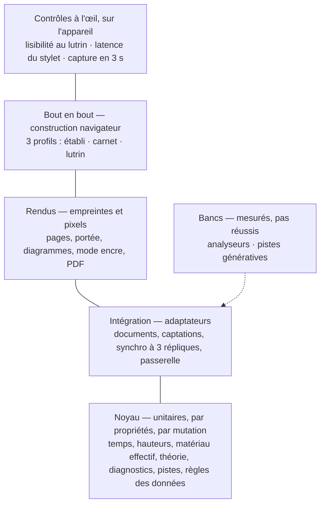
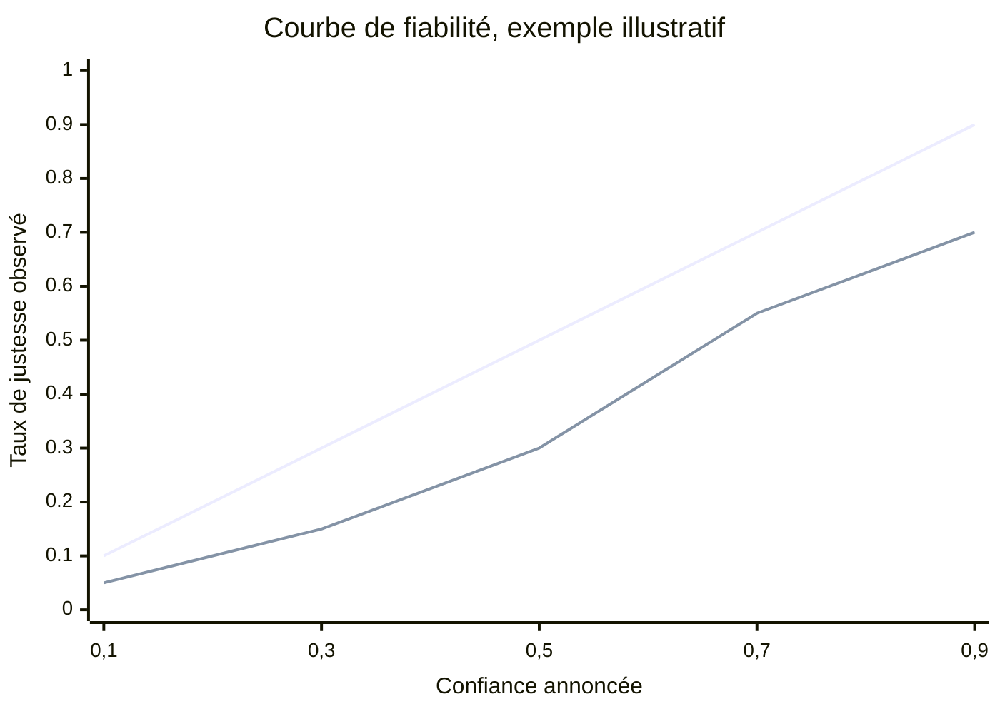

# 70 — Qualité et vérification

Une conception ne vaut que si l'on peut vérifier qu'elle est tenue. Ce document dit
**comment** : quels tests, à quel étage, contre quels invariants, et ce qui reste à
vérifier à l'œil sur l'appareil.

---

## 1. La stratégie

| Étage | Outil | Volume visé | Ce qu'il protège |
|---|---|---|---|
| **Noyau** | `cargo test`, tests par propriétés, `cargo-mutants` | La masse des tests ; rapides, sans interface | La musique : transposition, matériau effectif, prosodie, diagnostics, validation des pistes ; dès INC-1, les règles qui décident des données (plus bas) |
| **Intégration** | `cargo test` sur les adaptateurs, avec un nœud de test | Ciblé | Documents, captations, synchronisation, passerelle |
| **Rendus** | Empreintes SVG, rastérisation, comparaison de pixels ; le PDF contre ses pages SVG | Une fois par composant de rendu | Déterminisme, mode encre, pagination ; un PDF qui coïncide avec sa page (H09) |
| **Bout en bout** | Rust, par WebDriver, sur la construction navigateur de l'interface ; axe-core | Un parcours par situation S1 à S5 | Les parcours de Sacha, l'accessibilité |
| **Bancs** | mir_eval (Python, dans le conteneur d'analyse), banc maison pour les pistes | Exécutés à la demande et avant toute entrée d'analyseur ou de modèle | La qualité des propositions ; leurs chiffres alimentent les confiances affichées |
| **À l'œil** | Une liste de contrôle datée | À chaque version qui touche l'affichage, la capture ou le stockage | Ce qu'aucune machine ne mesure : confort, lisibilité au soleil |

Les **tests par propriétés** sont centraux : la musique se prête aux invariants
(« transposer de +n puis de −n rend l'original », « la somme des durées des occurrences
est la durée du morceau »). Ils trouvent les cas qu'on n'avait pas imaginés.

Le **test de mutation** vérifie que les tests vérifient : `cargo-mutants` altère le noyau
(un signe, une borne, un retour), et chaque mutation qui survit à la suite est un test qui
manque. La méthode l'exige dès qu'il y a une logique de domaine
([M-0001](modele/decisions/M-0001-ecosysteme-des-applications-personnelles.md)) ; ici,
c'est le noyau ([ADR-019](adr/adr-019-rust-et-python.md)).

**Les règles qui décident des données s'écrivent dans le noyau**, en fonctions pures : un
adaptateur leur donne ce qu'il a lu, elles rendent ce qu'il faut faire, et il l'applique sans
rien décider lui-même. L'heure et l'aléa, dont un identifiant a besoin, leur arrivent en
arguments, comme la date du cahier des tables. La mutation les éprouve donc, comme la
théorie. En INC-1 :

| Règle | Ce que décide le noyau | Lot d'INC-1 | Éprouvée par |
|---|---|---|---|
| Aucune captation n'est évincée avant l'accusé de réception du nœud | Ce qui reste à envoyer, et ce qu'un appareil peut évincer : jamais une captation que le nœud n'a pas accusée, ni une que la règle de l'appareil garde ([§ 31 · 6.2](31-persistance-et-synchronisation.md#62-ce-quun-appareil-garde)) | 3 | I15 ; [SYN-04](20-sfd/29-socle-donnees-appareils.md#syn-04--acheminer-les-captations) · 1 et 4 ; le test 5 du [§ 31 · 10](31-persistance-et-synchronisation.md#10-les-tests-qui-verrouillent-ce-document) |
| Un import rejoué ne crée aucun doublon | Ce qu'un import ajoute, au vu des empreintes que le fonds connaît déjà : rien, la seconde fois ([§ 31 · 6.1](31-persistance-et-synchronisation.md#61-adressage-par-contenu)) | 1 | [CAP-03](20-sfd/21-capter-et-organiser.md#cap-03--importer-un-fonds-existant) · 1 et 2 |
| Le relevé des conflits | Quelles valeurs concurrentes d'un même champ, lues à la synchronisation, sont relevées pour être présentées « à trancher » ([§ 31 · 5](31-persistance-et-synchronisation.md#5-les-conflits)) | 3 | I11 ; le test 3 du [§ 31 · 10](31-persistance-et-synchronisation.md#10-les-tests-qui-verrouillent-ce-document) |
| Les gestes du fonds | Regrouper, relier et délier, retirer et rétablir, annuler le dernier geste de tri ; la clé d'un lien, l'état « reliée » d'une idée, sa durée, l'assiette d'une requête sur les idées | 1 | [CAP-02](20-sfd/21-capter-et-organiser.md#cap-02--trier-la-boîte-didées), [CAP-06](20-sfd/21-capter-et-organiser.md#cap-06--interroger-le-fonds), [CAP-07](20-sfd/21-capter-et-organiser.md#cap-07--voir-le-fonds) ; I09, I28 |
| Le stockage des documents | Quelle lignée l'emporte, quand une version de schéma oblige à lire sans écrire, quels fichiers d'ajout une compaction retire, l'écriture de la teneur | 1 ; la lignée, de bout en bout, au lot 4 | Les tests 8 à 11, 13 et 14 du [§ 31 · 10](31-persistance-et-synchronisation.md#10-les-tests-qui-verrouillent-ce-document) ; la règle de la lignée, sur des lignées que le test écrit ; au lot 4, avec le miroir, le test 12 et I12 |

**La mutation suit le noyau.** Le module qui porte l'une de ces règles entre dans
`.cargo/mutants.toml` dans la PR qui l'écrit, et chacun de ses fichiers de tests rejoint la
liste des tests que rejoue chaque mutant. Les deux passages de mutation, celui d'une PR et
celui de chaque lundi, ont un délai de deux fois un passage complet mesuré : la PR qui étend
le périmètre remesure ce passage, à froid, et corrige les deux délais avec sa mesure.

---

## 2. Les trois profils d'appareil en test

| Profil | Viewport | Particularités simulées |
|---|---|---|
| **Établi** | 1440 × 900, souris et clavier | Raccourcis, focus visible |
| **Carnet** | 390 × 844, tactile | Hors ligne, micro simulé par un fichier, stockage limité |
| **Lutrin** | 1404 × 1872, tactile | **Niveaux de gris forcés, mouvement réduit**, aucune horloge permise, zones tactiles ≥ 12 mm |

Le **profil lutrin** est celui de la Note Air 2 Plus, la tablette à encre du lutrin : un
écran de 10,3 pouces, 1404 × 1872, environ 227 ppi, Android 11, un haut-parleur. À cette
densité, une zone tactile de 12 mm mesure environ 107 pixels. Le haut-parleur permet
l'écoute au lutrin, sans curseur animé
([arbitrage A19](90-questions-ouvertes.md#les-arbitrages-pris-dans-cette-conception)) ;
elle se contrôle sur l'appareil (§ 7).

Les parcours de bout en bout tournent sur la **construction navigateur** de l'interface : le
même code Leptos que dans les applications, sans Tauri
([ADR-020](adr/adr-020-leptos-et-tauri.md)). Ses commandes y sont servies par les mêmes
services d'application, sur des adaptateurs `Documents` et `Captations` en mémoire
([ADR-022](adr/adr-022-documents-cote-natif.md)) : un parcours y fait ce que fait Sacha, sans
fichier ni réseau. Une même suite de tests des commandes passe sur l'adaptateur `Documents`
en mémoire et sur celui des fichiers, pour que les deux disent la même chose. Ce que la
construction navigateur ne couvre pas — les fichiers de l'application, la synchronisation et
la clé épinglée, le module Kotlin, la WebView réelle et sa CSP — se vérifie sur les
constructions Windows et Android (H10) et à l'œil, sur l'appareil (§ 7).

---

## 3. Les invariants et leurs tests

Chaque invariant verrouille une décision. Un invariant sans test est une intention.

| # | Invariant | Test | Verrouille |
|---|---|---|---|
| I01 | Rien d'engendré n'est stocké | Parcourir les documents ; échouer sur tout champ de la liste interdite du [§ 30 · 13](30-modele-de-domaine.md#13-ce-que-le-modèle-interdit-de-stocker) | [ADR-001](adr/adr-001-un-seul-materiau.md) |
| I02 | Transposer change tous les rendus et aucune donnée hors la tonique de référence | Pour chaque morceau d'un jeu de test : transposer de +n, réengendrer tous les rendus, vérifier qu'aucun n'a gardé l'ancienne valeur et que seule la tonique a changé dans le document | [ADR-008](adr/adr-008-hauteurs-relatives.md) |
| I03 | Modifier un bloc change ses occurrences, sauf là où un écart vise le même élément | Propriété sur blocs et écarts aléatoires ; et sur des paroles reprises : modifier une ligne de l'occurrence reprise change celles qui la reprennent, sauf là où elles ont leur propre ligne | [ADR-007](adr/adr-007-blocs-et-occurrences.md) |
| I04 | Aucune proposition ne devient décision sans geste | Importer 100 résultats d'analyse et demander 100 pistes : zéro élément décidé | [ADR-004](adr/adr-004-proposer-n-est-pas-decider.md) |
| I05 | Toute valeur non décidée porte sa marque dans tout rendu | Morceau entièrement proposé ; chaque rendu ; chaque valeur affichée, engendrées comprises, doit porter `~` ou `—` | [ADR-004](adr/adr-004-proposer-n-est-pas-decider.md) |
| I06 | Toute piste affichée est validée ; au moins deux, ou l'aveu | Banc de demandes avec un fournisseur simulé qui renvoie des candidats non conformes | [ADR-005](adr/adr-005-des-pistes-pas-des-reponses.md) |
| I07 | Le morceau vide se rend et se diagnostique sans erreur | Morceau à identité seule ; tous les rendus, tous les diagnostics | [ADR-006](adr/adr-006-le-partiel-est-normal.md) |
| I08 | Aucun cardinal en dur | Toute la suite sur des albums de 0, 1, 11 et 57 morceaux ; recherche statique des littéraux de cardinal dans la logique d'album | [ADR-006](adr/adr-006-le-partiel-est-normal.md) |
| I09 | Tout agrégat déclare son assiette | Pour chaque diagnostic et chaque requête agrégée, la sortie contient les trois nombres de l'assiette | [ADR-006](adr/adr-006-le-partiel-est-normal.md) |
| I10 | Trois répliques convergent | Opérations concurrentes aléatoires sur trois répliques, synchronisation dans un ordre aléatoire, états égaux | [ADR-002](adr/adr-002-local-first.md) |
| I11 | Aucune fusion ne produit une valeur que personne n'a écrite : ni un texte caractère par caractère, ni un accord ou une hauteur champ par champ | Deux répliques modifient hors ligne la même ligne, le même accord, la même hauteur : après synchronisation, deux variantes intactes de chacun, dont une « à trancher ». Un objet harmonique, une hauteur et une provenance s'écrivent d'un bloc, comme un objet neuf, jamais champ par champ ; les modifications concurrentes d'un même attribut sont relevées à la synchronisation et présentées « à trancher » | [ADR-003](adr/adr-003-crdt-et-miroir-durable.md) |
| I12 | Le miroir durable fait un aller-retour fidèle | Documents → miroir → documents ; teneurs égales ([§ 31 · 2.6](31-persistance-et-synchronisation.md#26-la-teneur)) | [ADR-003](adr/adr-003-crdt-et-miroir-durable.md) |
| I13 | Les dérivés sont jetables | Supprimer tous les dérivés, les reconstruire, comparer les empreintes canoniques | [ADR-003](adr/adr-003-crdt-et-miroir-durable.md) |
| I14 | Les captations sont immuables | Empreinte de chaque objet égale à son nom ; aucune écriture sur un objet existant | [ADR-003](adr/adr-003-crdt-et-miroir-durable.md) |
| I15 | Aucune captation n'est évincée avant accusé de réception | Nœud coupé, capter, purger le cache : la captation survit | [ADR-002](adr/adr-002-local-first.md) |
| I16 | Tout ce qui est local marche réseau coupé | Parcours S1 entier en mode avion ; avant INC-4, la part de S1 déjà livrée ([§ 40 · 9](40-architecture.md#9-trajectoire-de-construction)) | [ADR-002](adr/adr-002-local-first.md) |
| I17 | Aucune information portée par la seule couleur | Analyse statique des classes `sem-` ; différence de pixels ≥ 2 % couleur supprimée ([§ 50 · 6.5](50-interfaces-et-appareils.md#65-comment-on-le-vérifie)) | [ADR-010](adr/adr-010-trois-appareils-mode-encre.md) |
| I18 | Aucune animation ni horloge en mode encre | Contrôle statique des styles et des scripts du profil lutrin | [ADR-010](adr/adr-010-trois-appareils-mode-encre.md) |
| I19 | La même pagination au lutrin et à l'impression | Même nombre de pages, mêmes coupures ; aucune mesure coupée entre deux pages sur un morceau de 150 mesures | [ADR-010](adr/adr-010-trois-appareils-mode-encre.md) |
| I20 | Un rendu figé ne change jamais ; aucun code n'interprète les traits (ni reconnaissance, ni détection de symbole, ni décision) : l'affichage, l'extraction d'un PDF annoté et le rattachement d'un trait à une section par sa boîte englobante sont les seules lectures de leur géométrie | Annoter, modifier la forme, réengendrer : empreinte du rendu annoté inchangée ; contrôle statique : aucun appel ne lit la géométrie des traits hors de ces trois lectures | [ADR-011](adr/adr-011-encre-ancree-rendu-fige.md) |
| I21 | L'écoute de contrôle ne produit pas de son exportable ni d'effet | Contrôle statique du graphe audio : échantillonneur, lecteur de prise (ralenti à hauteur constante), volume, sortie ; aucune exportation audio | [ADR-009](adr/adr-009-ecoute-de-controle.md) |
| I22 | Hors la route d'appairage, aucune requête n'aboutit sans jeton, par aucun chemin ; aucun en-tête d'identité injecté n'est cru | Toutes les routes appelées sans jeton, par l'adresse locale, l'adresse du foyer et, s'il existe, le réseau privé ; puis avec des en-têtes d'identité forgés. Sur la route d'appairage : un code invalidé après cinq essais faux, un seul appairage ouvert à la fois, et un relais qui ne connaît pas le code n'obtient ni jeton ni clé épinglée | [ADR-021](adr/adr-021-cle-du-noeud-epinglee.md) |
| I23 | Aucun envoi distant sans consentement ; journal complet | Passerelle avec fournisseur distant simulé : sans consentement, zéro appel ; avec, une ligne de journal par appel | [ADR-015](adr/adr-015-passerelle-ia.md) |
| I24 | Pupitre fonctionne Internet coupé | Résolution publique et sorties coupées : le nœud démarre, les applications chargent les échantillons à partir d'INC-3 (servis par le nœud, jamais par un hôte public), synchronisent, appairent | [ADR-021](adr/adr-021-cle-du-noeud-epinglee.md) |
| I25 | Les rendus sont déterministes | Deux engendrements des mêmes données : mêmes empreintes | [ADR-011](adr/adr-011-encre-ancree-rendu-fige.md) |
| I26 | Transposer la table translate les noms, case à case, sans changer ni position ni chiffre | Par propriété, sur les 24 tonalités du cahier, couche sombre affichée : d'une tonalité à une autre du même mode, chaque case garde sa rangée, sa colonne et son chiffre romain, et son nom se translate de l'intervalle entre les deux toniques, orthographié selon l'arbitrage A17, à l'enharmonie près pour les cases qui porteraient une double altération, écrites à l'enharmonique simple ([Q21](90-questions-ouvertes.md#q21--comment-sécrivent-les-cases-de-la-table-)). Les critères 3 et 4 de [MIC-12](20-sfd/22-micro-motif-et-phrase.md#mic-12--parcourir-la-table-de-la-tonalité) en sont des cas | [ADR-008](adr/adr-008-hauteurs-relatives.md) |
| I27 | La palette et MIC-06 classent une note de la même façon | Par propriété, sur chaque accord de la table dans les 24 tonalités, et sur chaque note de la tonalité tenue sur lui sans mouvement conjoint : le rôle que lui donne [MIC-06](20-sfd/22-micro-motif-et-phrase.md#mic-06--lire-la-relation-mélodie-harmonie) (note de l'accord, tension, note étrangère) est celui de la [palette](20-sfd/22-micro-motif-et-phrase.md#mic-13--lire-la-palette-dun-accord) (appui, tension, frotte). Le critère 4 de MIC-13 en est le cas d'une mélodie | [ADR-001](adr/adr-001-un-seul-materiau.md) |
| I28 | Toute modification d'un document naît d'une opération nommée | Contrôle statique : hors de l'adaptateur `Documents`, qui applique les opérations nommées, aucun code n'écrit dans un document, ni l'interface, ni le module Kotlin. Chaque opération, jouée sur un document de test, y laisse une seule modification atomique par document qu'elle touche, avec son message ([§ 31 · 3](31-persistance-et-synchronisation.md#3-les-opérations-nommées)) ; l'historique d'un document de test ne porte aucune modification sans le message d'une opération connue, la genèse et les migrations comprises ([§ 31 · 2](31-persistance-et-synchronisation.md#2-les-documents)). La synchronisation et la restauration ne font que reprendre des modifications nées ainsi | [ADR-003](adr/adr-003-crdt-et-miroir-durable.md) |
| I29 | Aucune notification : Pupitre ne dit rien hors de l'application, et un état ou un échec s'y affiche en bandeau | Contrôle statique : ni greffon ni API de notification, dans l'interface comme côté natif. Une écriture refusée puis, à partir du lot 4 d'INC-1, une sauvegarde en échec, simulées, s'affichent en bandeau, et rien ne paraît hors de l'application. Seule y échappe la notice qu'Android demande pour un enregistrement au premier plan, au carnet : elle dit qu'un enregistrement est en cours, et rien d'autre | [A14](90-questions-ouvertes.md#les-arbitrages-pris-dans-cette-conception) |
| I30 | Aucun test n'écrit dans le dossier de l'application, et le mode démonstration n'atteint jamais le fonds de Sacha | Chaque adaptateur reçoit ses chemins de qui le lance ([§ 31 · 1](31-persistance-et-synchronisation.md#1-trois-natures-de-données-quatre-lieux)). Un test garde-fou lance les tests de l'application avec le dossier de l'application du système redirigé vers un dossier sentinelle, vide : il échoue si un fichier y paraît. Un second test donne aux adaptateurs une racine jetable, où un fonds témoin, `donnees/`, côtoie `demonstration/` ; il y ouvre le mode démonstration, et échoue si un fichier de `donnees/` est lu ou modifié. Un contrôle statique refuse, dans le code de l'application, hors du seul endroit qui reçoit les chemins du système, tout appel qui en devine un : dossier de l'application, dossier personnel, dossier temporaire | [M-0001](modele/decisions/M-0001-ecosysteme-des-applications-personnelles.md) |
| I31 | L'interface n'exécute que le code de Pupitre, et n'appelle que les commandes que ses droits nomment | Un test relit `tauri.conf.json` : la CSP existe et égale, directive par directive, le tableau du [§ 40 · 7.5](40-architecture.md#75-linterface-la-csp-et-les-commandes) ; elle n'admet ni origine hors de l'application, ni `'unsafe-inline'`, ni `'unsafe-eval'` ; et `dangerousDisableAssetCspModification` n'est pas posé. Un test relit les droits de chaque plateforme : chaque commande permise y est nommée, aucun droit ne nomme une commande que l'application n'a pas, aucun ne donne un greffon à l'interface. Une requête au protocole des captations qui ne nomme pas une empreinte connue est refusée. Un texte piégé, saisi dans une idée (`<script>`, ``), s'affiche tel quel. À l'œil, chaque écran s'ouvre et sert dans l'application installée (§ 7) | [ADR-022](adr/adr-022-documents-cote-natif.md) |

---

## 4. Les critères d'acceptation de la SFD

Chaque fonction de la [SFD](20-sfd/README.md) porte des critères d'acceptation numérotés,
écrits pour être **exécutables** :

> *Étant donné* un état de départ, *quand* un geste ou un événement, *alors* un résultat
> observable.

Un critère qui ne peut pas l'être est marqué `[à l'œil]` et dit pourquoi. La partie
vérifiable d'un tel critère est automatisée ; seule la partie physique reste à l'œil, et
aucune ne se cache derrière l'autre.

---

## 5. Le banc d'évaluation des analyseurs

**Aucun analyseur n'entre sans mesure, et aucune confiance n'est affichée sans
calibration.**

### 5.1 Le jeu de référence

Une vingtaine de prises **du fonds réel**, choisies pour couvrir les situations du
persona : voix seule, guitare et voix, piano et voix, mix dense, fragment court, prise
longue sans métronome. La maîtrise d'ouvrage les annote une fois, en s'aidant de Pupitre
lui-même (tapotage, saisie de grille), dès que le tapotage
([MOR-03](20-sfd/24-morceau.md#mor-03--découper-une-prise-à-loreille)) est livré dans
INC-4 :

| Annotation | Sur combien de prises |
|---|---|
| Pulsations et premiers temps | Toutes |
| Tonalité | Toutes |
| Accords par mesure | Une dizaine |
| Notes de la voix | Quelques phrases par prise, sur une dizaine de prises |
| Frontières de sections | Toutes |
| Texte chanté | Quelques passages |

Coût estimé : une journée (6 à 10 heures), étalée ; chronométrer les trois premières
prises. Sans ce jeu, les confiances affichées seraient des promesses
([Q10](90-questions-ouvertes.md)).

### 5.2 Les mesures

| Tâche | Mesure |
|---|---|
| Pulsations, premiers temps | F-mesure à ± 70 ms |
| Tonalité | Score pondéré : quinte, relative et parallèle comptent partiellement |
| Accords | Taux de recouvrement pondéré par la durée, vocabulaire majeur-mineur puis septièmes |
| Mélodie | F-mesure par note : attaque à ± 50 ms, hauteur à ± 50 cents |
| Frontières | F-mesure à ± 0,5 s et à ± 3 s |
| Texte | Taux d'erreur par mot |

### 5.3 Les seuils et leur effet

- Un analyseur **entre** s'il fait mieux que le précédent sur le jeu de référence, tâche
  par tâche.
- Sur une prise dont **plus de la moitié des mesures** sont douteuses (détecteurs en
  désaccord, ou confiance basse), la grille proposée ne s'affiche **pas** comme une
  grille, mais comme une **liste d'indices par mesure**, avec le taux de doute. Une grille
  à 60 % de doute présentée comme une grille serait une affirmation.

### 5.4 La calibration des confiances

Une confiance affichée de 0,8 doit vouloir dire « juste huit fois sur dix » sur le jeu de
référence. Le banc trace la courbe de fiabilité et corrige les confiances brutes de
chaque analyseur.

*Diagonale : un analyseur parfaitement calibré. Courbe basse : un analyseur trop sûr de
lui, dont les confiances doivent être corrigées avant d'être affichées. Chiffres
illustratifs.*

---

## 6. Le banc des pistes génératives

Cinquante demandes types, tirées des cas de Sacha (variantes de ligne en anglais et en
français, contraintes syllabiques variées, doctrine active ou non), jouées contre chaque
fournisseur et chaque modèle candidat.

| Mesure | Seuil d'entrée |
|---|---|
| Demandes rendant au moins deux pistes valides | ≥ 80 % |
| Motifs de rejet par la validation | Relevés, pour améliorer les gabarits d'invite |
| Latence par demande | ≤ 20 s en local ; en distant, mesurée au banc avec un effort réglé explicitement |
| Coût par demande, en distant | Relevé et affiché |

---

## 7. Les contrôles à l'œil, sur l'appareil

Ce qu'aucun test automatique ne mesure, vérifié à chaque version qui touche l'affichage,
la capture ou le stockage, et consigné avec sa date.

| Contrôle | Appareil | Critère |
|---|---|---|
| Lisibilité d'une fiche de travail à bout de bras, sur un pupitre, à la lumière du jour | 📖 | Tout se lit sans se pencher |
| Images rémanentes après dix tours de page | 📖 | Aucune information parasite |
| Latence du stylet dans Pupitre, et par le chemin PDF | 📖 | L'écriture suit le geste (H02) |
| Du téléphone verrouillé à l'enregistrement | 📱 | ≤ 3 s, chronométré en mode avion et après une veille (H01) |
| « Garder » au compagnon, mains revenant du clavier | 📱 | Un geste, sans viser |
| Écoute de contrôle au casque et au haut-parleur | 📱 💻 | Accords et mélodie reconnaissables ; aucune latence gênante |
| Écoute d'un accord ou d'une suite au haut-parleur de la tablette | 📖 | Accords reconnaissables ; rien ne bouge à l'écran pendant l'écoute (A19) |
| Une page du cahier des tables, à bout de bras, couche sombre affichée | 📖 🖨 | La famille de chaque case se lit à la forme de son cadre, sans lire le nom de la rangée ; chaque flèche mène à une case de la rangée voisine |
| Impression d'une fiche en noir et blanc | 🖨 | Doigts, cordes à vide, cordes étouffées, barré et épinglage distinguables |
| Retrouver une idée désignée d'avance, par attribut ou par texte, dans le fonds de mesure ([§ 31 · 10](31-persistance-et-synchronisation.md#10-les-tests-qui-verrouillent-ce-document)) | 💻 au lot 1 d'INC-1 ; 📱 au lot 2, sur le téléphone de référence | Au plus 10 s du premier geste à l'idée ouverte, chronométré ; les résultats paraissent en moins d'une seconde, mesuré automatiquement ([CAP-06](20-sfd/21-capter-et-organiser.md#cap-06--interroger-le-fonds) · 6, IR-3). Les 300 morceaux du critère s'y ajoutent avec INC-2 |
| Ouvrir l'application sur le fonds de mesure, jusqu'à la boîte d'idées affichée | 💻 au lot 1 ; 📱 au lot 2 | Chronométré ; la première mesure fixe la cible, écrite ici |
| Installer une version par-dessus la précédente, sur un fonds qui a des idées et des captations | 💻 dès le lot 1 ; 📱 dès le lot 2 | Rien ne manque : les mêmes idées, le même journal du fonds, chaque captation relue contre son empreinte ([§ 40 · 8](40-architecture.md#8-déploiement)) |
| L'interface dans l'application installée, CSP et droits posés ([§ 40 · 7.5](40-architecture.md#75-linterface-la-csp-et-les-commandes)) | 💻 au lot 1 ; 📱 au lot 2 | Chaque écran du lot s'ouvre et sert : ni fenêtre blanche, ni élément absent, ni geste sans effet ([AM-3](registre.md)) |
| Reconstruire un nœud neuf depuis la sauvegarde, par la procédure écrite | 🏠 | Rejouée une fois avant la mise en service, au lot 4 d'INC-1, et chronométrée : la durée et chaque écart à la procédure se consignent ici ([SYN-06](20-sfd/29-socle-donnees-appareils.md#syn-06--sauvegarder-et-restaurer) · 4). La PR de conception du lot 4 en fixe la cible |

**Les relevés.** Chaque passage se consigne ici : sa date, la version, le contrôle et ce
qu'on a vu.

| Date | Version | Contrôle | Résultat |
|---|---|---|---|
| 2026-11-02 | PR #3 | H09 : la fiche témoin, en SVG puis en PDF, sur la Note Air (📖) | Passe : mêmes pages, mêmes glyphes, rien ne déborde, les quatre cadres distincts. Le papier n'a pas pu se faire ([EM-1](registre.md)) |
| 2026-11-02 | `2111d3f` (PR #7) | L'établi installé (💻) : la tonalité d'un geste, la couche sombre, la cible en inverse, « Palette » et la fiche de l'accord, le focus au clavier, l'export du cahier, enregistré puis abandonné | Passe |
| 2026-11-02 | `2111d3f` (PR #7) | Les 24 tables, couche sombre affichée, à bout de bras (📖) ; un verso du cahier | Passe. Ces tables ont été rendues à part, depuis le même code : depuis la PR de la revue finale, la commande en ligne du cahier les rend (`cahier --couche affichee`) |
| 2026-11-02 | — | L'impression en noir et blanc d'une page du cahier et des diagrammes (🖨) | Reportée, faute d'imprimante disponible ([A23](90-questions-ouvertes.md#les-arbitrages-pris-dans-cette-conception)) |

---

## 8. Les portes de CI

**À la naissance du dépôt public** (2026-11-01, avant la première ligne de code) : trois
jobs, quatre portes
([CONVENTIONS](../CONVENTIONS.md#portes-de-ci)). Le job `socle`, fourni par le modèle, porte
`socle / secrets`, qui refuse un secret dans un commit, et `socle / confidentialite`, qui
refuse une donnée d'identité dans le diff, les messages de commit ou le texte de la PR. Le
job `contenu` refuse les données personnelles détectables mécaniquement dans les fichiers du
dépôt. Le job `documentation` vérifie que chaque diagramme se rend et que chaque lien interne
mène quelque part.

**INC-0** (2026-11-02) : les premières portes du code
([CONVENTIONS](../CONVENTIONS.md#portes-de-ci)). Le job `verifier` lance `cargo fmt`, `cargo clippy`
et les tests du noyau, du cahier et de l'interface. Le job `windows` construit l'établi, le passe
à `cargo clippy`, lance ses tests, et dépose l'installateur et le cahier des tables en artefacts.
Le job `mutants` éprouve les tests du noyau sur le diff de chaque PR, et `mutants-complet` rejoue
le passage entier chaque lundi.

**Après INC-0** (2026-11-04) : le job `documentation` vérifie aussi les faits recopiés, chacun
comparé à sa source ([CONVENTIONS](../CONVENTIONS.md#portes-de-ci)). C'est la porte due au motif
« Un compte recopié en plusieurs endroits », relevé trois fois (AM-1, LE-8, [LE-9](registre.md)).

La cinquième famille de garde-fous ([M-0001](modele/decisions/M-0001-ecosysteme-des-applications-personnelles.md)),
le test d'isolation des chemins de données, n'est pas due en INC-0, qui n'a aucun chemin de
données : ni stockage, ni `instance/`, `config/` ou `contenu/`. Ce test naît avec le stockage,
au lot 1 d'INC-1 : c'est l'invariant I30 ([§ 3](#3-les-invariants-et-leurs-tests)), dans la
ligne 4 du tableau ci-dessous. Il tourne avec les tests de l'application, sans job de plus.
Le mode démonstration qu'il éprouve ouvre le jeu factice, dont les captations s'engendrent à
l'exécution ([§ 31 · 1](31-persistance-et-synchronisation.md#1-trois-natures-de-données-quatre-lieux)) :
aucune n'est suivie dans le dépôt.

**Depuis INC-0**, les portes du code s'ajoutent **une à une**, chacune justifiée par ce
qu'elle protège :

| Ordre | Porte | Protège |
|---|---|---|
| 1 | Le job `verifier` : `cargo fmt --check`, `cargo clippy -D warnings` et `cargo test` | Les erreurs grossières, à moindre coût ; puis la musique, par les tests unitaires et par propriétés du noyau |
| 2 | `cargo-mutants` sur le noyau | Des tests qui vérifient vraiment ([M-0001](modele/decisions/M-0001-ecosysteme-des-applications-personnelles.md)) |
| 3 | Les constructions Windows et Android (H10) | Des applications qui se construisent hors du poste, à l'identique |
| 4 | Invariants I01 à I31 | Les décisions |
| 5 | Bout en bout, trois profils, sur la construction navigateur | Les parcours |
| 6 | Restauration, chaque nuit en CI sur un jeu de test ; le nœud la rejoue chaque semaine sur les vraies données ([SYN-06](20-sfd/29-socle-donnees-appareils.md#syn-06--sauvegarder-et-restaurer)) | La durabilité |

**Où en est le tableau, après INC-0.** Les lignes 1 et 2 sont posées : `verifier`, `mutants` et
`mutants-complet`. La ligne 3 l'est pour Windows (`windows`) ; la construction Android reste à
poser avec l'application mobile. Dans la ligne 4, I17, I18, I19, I25, I26 et I27 ont leur test ;
les autres invariants attendent le code qu'ils verrouillent. Les lignes 5 et 6 restent à venir.

**Une porte se corrige par le code ou le document qu'elle refuse, pas en l'affaiblissant**
à son premier faux positif. On n'assouplit une règle que si le faux positif est structurel,
et on l'écrit dans la PR.
