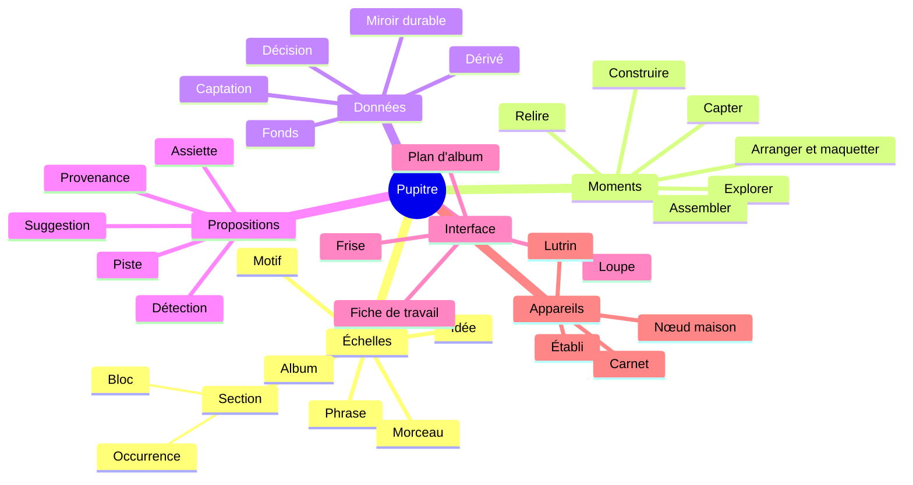

# 80 — Glossaire

Le vocabulaire de Pupitre est fixé ici. Il est employé avec ce sens exact dans tous les
documents, et c'est lui que l'interface affichera. Un terme nouveau entre dans ce
glossaire avant d'entrer dans la SFD. Un mot pour une chose : quand un terme courant a
deux sens, le glossaire dit lequel est retenu.

---

## Les personnes

| Terme | Définition |
|---|---|
| **Sacha** | Le persona pour lequel Pupitre est conçu : une personne qui écrit, compose et chante ses chansons en solo. Profil complet au [§ 11](11-persona-et-situations.md). Ce n'est pas une personne réelle, et Sacha n'agit pas dans le monde réel : tout ce que fait le produit, Sacha en est le sujet |
| **Maîtrise d'ouvrage** | La personne qui porte le projet et arbitre les décisions de conception. Distincte du persona dans les documents, même si elle en partage les besoins. C'est elle qui agit pendant la construction : chronométrer un prototype, annoter le jeu de référence, transcrire la doctrine |

Le vocabulaire du persona, au [§ 11](11-persona-et-situations.md) :

| Code | Terme | Définition |
|---|---|---|
| B01 … B15 | **Besoin** | Ce que Sacha veut pouvoir faire, dans une circonstance donnée, et pourquoi |
| D1 … D8 | **Douleur** | Ce qui coûte aujourd'hui, avec les outils existants |
| N1 … N6 | **Anti-besoin** | Ce que Sacha refuse qu'un outil fasse, même bien |
| S1 … S5 | **Situation** | Une situation physique de travail, avec ses contraintes : en mouvement, au piano, à la guitare, à l'établi, au calme |

## Les échelles

Du plus petit au plus grand. Détail au [§ 12](12-continuum-de-composition.md).

| Code | Terme | Définition |
|---|---|---|
| É0 | **Idée** | Ce qui arrive dans la boîte d'idées : un texte libre, des prises, des photos, des MIDI ou des textes versés, des étiquettes, des liens. Ses prises sont les versions d'une même idée. Pas encore de structure musicale ([§ 30 · 9.1](30-modele-de-domaine.md#91-lidée)) |
| É1 | **Motif** | Une cellule musicale structurée, de une à quatre mesures le plus souvent : un enchaînement d'accords, une figure mélodique, un rythme, une accroche de texte. Vit dans le fonds ; placé dans un bloc, il y est **copié**, avec ou sans suivi |
| É2 | **Phrase** | Une unité de chant : une plage d'un bloc, de (mesure, décalage) à (mesure, décalage) — elle peut commencer sur une levée —, avec la ligne de texte qui s'y aligne dans chaque occurrence |
| É3 | **Section** | Un couplet, un refrain, un pont… Dans le modèle, une section se compose d'un **bloc** et de ses **occurrences** |
| É3 | **Bloc** | Le matériau musical partagé d'un type de section (grille, mélodie, arrangement par défaut), défini une seule fois. Exemple : « le refrain ». Un fichier Automerge se découpe en tronçons (*chunks*), jamais en blocs ([ADR-023](adr/adr-023-stockage-des-documents.md)) |
| É3 | **Occurrence** | Une apparition d'un bloc dans la forme, avec ses paroles — les siennes, ou celles d'une autre occurrence du même bloc, reprises —, son intensité et ses écarts. Exemple : « Refrain 2 » |
| É3 | **Écart** | Une variation locale d'une occurrence par rapport à son bloc : une mesure changée, une transposition, une fin allongée. Le mot n'a pas d'autre sens dans Pupitre |
| É4 | **Forme** | La suite ordonnée des occurrences d'un morceau |
| É4 | **Morceau** | Une chanson en cours : identité stable, titres datés, forme, blocs, paroles, tonalité, tempo, arrangement, prises, variantes, journal |
| É5 | **Album** | Une sélection de morceaux, ses ordres candidats, ses transitions et son arc |
| É5 | **Ordre** | Une suite candidate des morceaux d'un album, nommée et datée. Plusieurs coexistent ; un seul peut être **retenu** |
| É5 | **Transition** | Le passage d'un morceau au suivant dans un ordre : relation tonale, différence de tempo, nature (silence, fondu, enchaîné, interlude). Au sens de l'album, on dit transition, jamais enchaînement |
| É5 | **Arc** | L'intention d'ensemble d'un album : trajectoire d'intensité, de lumière, de thèmes |
| — | **Variante** | Une version alternative d'un élément — ligne, mélodie, cadence, motif transformé —, gardée à côté de l'original pour être comparée, retenue ou écartée. Au niveau du morceau, une bifurcation entière du document, qu'on peut aussi fusionner |

## Les moments du travail

Non linéaires : on y revient sans cesse. Détail au [§ 12](12-continuum-de-composition.md).

| Code | Moment | Ce qu'on y fait |
|---|---|---|
| M1 | **Capter** | Enregistrer, noter, photographier, fredonner, puis trier la boîte d'idées |
| M2 | **Explorer** | Essayer des accords, des variantes, des chemins ; demander des pistes ; écouter pour vérifier |
| M3 | **Construire** | Fixer l'harmonie, la mélodie, le texte, l'alignement, la forme |
| M4 | **Arranger et maquetter** | Décider qui joue quoi et avec quelle poussée ; produire et confronter des maquettes |
| M5 | **Relire** | Diagnostiquer, lire au lutrin, annoter, trancher, consigner |
| M6 | **Assembler** | Sélectionner, ordonner, régler les transitions, documenter l'album ; exporter |

## Les données

Détail au [§ 30](30-modele-de-domaine.md) et au [§ 31](31-persistance-et-synchronisation.md).

| Terme | Définition |
|---|---|
| **Fonds** | L'ensemble de la matière de Sacha : idées, motifs, prises, morceaux, albums. C'est le périmètre d'une recherche et le réservoir d'où sort un album. Ce n'est pas une échelle de travail |
| **Décision** | Tout contenu que Sacha a saisi ou accepté. Vit dans les documents synchronisés. C'est la vérité |
| **Document** | Une unité de synchronisation : le fonds, un morceau, un album, les réglages. Répliqué sur chaque appareil ; sur le disque, un fichier complet et des fichiers d'ajout ([§ 31 · 2.1](31-persistance-et-synchronisation.md#21-sur-le-disque)) |
| **Voisin** | Le fichier qu'une écriture prépare à côté de celui qu'elle remplace, `<nom>.<processus>.partiel`, ou, si ce nom est pris, `<nom>.<processus>-2.partiel`, `-3`… : écrit, synchronisé sur le disque, fermé et relu, il prend ensuite la place du fichier par un renommage, s'il rend les octets écrits. Un fichier est ainsi entier, ou absent ([§ 31 · 2.1](31-persistance-et-synchronisation.md#21-sur-le-disque)). Le nom provisoire d'une captation se forme de même, mais ne remplace aucun fichier : ce n'est pas un voisin ([§ 31 · 6.1](31-persistance-et-synchronisation.md#61-adressage-par-contenu)) |
| **Racine** | Au sens du disque, la **racine des données** d'un fonds : le dossier qui porte ses documents, ses captations et ses caches, `donnees/` pour le fonds de Sacha, `demonstration/` pour le mode démonstration, un dossier jetable pour un test ([§ 31 · 2.1](31-persistance-et-synchronisation.md#21-sur-le-disque)). Au sens d'un document Automerge, la **racine du document** est son objet de tête, où vivent sa version de schéma, sa lignée et son identifiant de propriétaire ([§ 31 · 2.4](31-persistance-et-synchronisation.md#24-la-version-de-schéma)). On dit toujours l'une ou l'autre en entier. Une racine installée est celle d'une autorité de certification ; un conteneur sans racine tourne sans privilège, et le mode racine, son contraire, avec ceux de l'administrateur |
| **Conteneur** | Au sens d'un document Automerge, un objet qui en contient d'autres : objet à clés, liste ou texte ([§ 31 · 2.4](31-persistance-et-synchronisation.md#24-la-version-de-schéma)). Au sens de l'architecture, une partie déployable du système, l'application ou un service du nœud ([§ 40 · 2](40-architecture.md#2-conteneurs)) ; au sens du nœud, un conteneur Docker, sans racine ([ADR-017](adr/adr-017-noeud-en-conteneurs.md)). On dit duquel il s'agit dès que le contexte ne le dit pas |
| **Identifiant de propriétaire** | L'identifiant opaque à qui appartient tout un fonds : un UUID tiré au hasard à sa création, sans signification, que porte chaque document ([§ 30 · 2](30-modele-de-domaine.md#2-identités) ; [M-0001](modele/decisions/M-0001-ecosysteme-des-applications-personnelles.md)). Il ne nomme personne : Pupitre n'authentifie que des appareils. Au sens d'un logiciel, on dit fermé, jamais propriétaire |
| **Genèse** | La première modification de chaque sorte de document, écrite une fois pour toutes dans le code de Pupitre, la même dans chaque installation et chaque version. Chaque document part d'elle ; chaque migration de sa version de schéma s'y ajoute, écrite d'avance de même ([§ 31 · 2.3](31-persistance-et-synchronisation.md#23-la-genèse-et-le-point-de-départ-du-fonds)) |
| **Version de schéma** | Le numéro de la structure d'un document, qu'il porte lui-même. Une application lit et écrit les versions de schéma qu'elle connaît ; devant une plus récente, elle lit sans écrire. Toujours dite en entier : seule, une version est celle d'une prise, d'un morceau ou de l'application ([§ 31 · 2.4](31-persistance-et-synchronisation.md#24-la-version-de-schéma)) |
| **Lecture seule (d'un document)** | L'état d'un document qui montre ce qui se lit, sans y écrire d'opération ni se compacter. Devant un fichier illisible, une relecture du disque manquée, ou une version de schéma absente, nulle, ou qui n'est pas un entier non signé, il n'envoie ni ne reçoit ; devant une version de schéma plus récente, il reçoit, et ne transmet aucune modification ([§ 31 · 2.1](31-persistance-et-synchronisation.md#21-sur-le-disque), [§ 31 · 2.4](31-persistance-et-synchronisation.md#24-la-version-de-schéma)). Au sens d'une vue, ce qui se montre sans se modifier, comme la mesure d'avant et celle d'après sous la loupe ([MIC-01](20-sfd/22-micro-motif-et-phrase.md#mic-01--ouvrir-la-loupe)) ; au sens de l'application, un protocole qui sert sans écrire, celui des captations ([§ 40 · 7.5](40-architecture.md#75-linterface-la-csp-et-les-commandes)) ; au sens du nœud, un dossier monté sans écriture ([M-0006](modele/decisions/M-0006-code-et-donnees.md)). On dit duquel il s'agit dès que le contexte ne le dit pas |
| **Lignée** | L'histoire dont descendent les copies d'un document. Deux copies d'une même lignée fusionnent ; un document reconstruit hors de son histoire, depuis le miroir, ouvre une lignée nouvelle, qui remplace l'ancienne sans jamais fusionner avec elle ([§ 31 · 2.5](31-persistance-et-synchronisation.md#25-la-lignée)) |
| **Teneur** | Ce que dit un document, sans son histoire : chaque objet, chaque clé et chaque valeur, écrits de façon déterministe. Deux documents de même teneur disent la même chose, quelle que soit leur histoire. C'est elle que comparent l'aller-retour du miroir, le test de restauration et la réimportation de l'archive ([§ 31 · 2.6](31-persistance-et-synchronisation.md#26-la-teneur)) |
| **Captation** | Un objet immuable adressé par l'empreinte de son contenu : audio (une prise, un stem), photo, MIDI ou texte versé, manifeste d'une prise en stems, rapport d'import, traits d'encre, rendu figé, résultat d'analyse. Ne se modifie jamais : on en produit une autre |
| **Empreinte** | Le condensé SHA-256 d'un contenu. Celle d'une captation est son nom ; celles d'un fichier d'ajout, d'une page, d'un PDF ou de la teneur d'un document servent à les nommer ou à les comparer ([§ 31 · 2](31-persistance-et-synchronisation.md#2-les-documents)) |
| **Prise** | Une captation audio, ou un jeu de stems versé, la **prise en stems**, avec ses métadonnées (noms d'origine, format, durée, date, appareil, origine déclarée, diapason mesuré). Une prise en stems est nommée par l'empreinte de son **manifeste**, l'ensemble de ses stems ; regrouper la déplace entière. Elle appartient à une seule idée, dont elle est une version. Sa durée est un fait de sa captation, jamais une durée engendrée ; celle d'une prise en stems s'engendre de ses stems. Ses rattachements à des morceaux sont des décisions du document du morceau ([§ 30 · 9.2](30-modele-de-domaine.md#92-prises-photos-et-analyses)) |
| **Stem** | L'enregistrement séparé d'une voix ou d'un instrument d'une version d'un morceau. Les stems d'une même version forment un **jeu de stems** ; versé, un jeu devient une seule prise, la prise en stems, dont chaque stem est une captation, avec son type. Les stems d'une prise sont ses parties ; les prises d'une idée, ses versions. Un stem n'est jamais une piste, mot réservé aux suggestions ([§ 30 · 9.2](30-modele-de-domaine.md#92-prises-photos-et-analyses) ; [ADR-024](adr/adr-024-import-d-un-fonds.md)) |
| **Manifeste** | L'ensemble des empreintes des stems d'une prise en stems, figé en captation : son empreinte nomme la prise ([§ 30 · 9.2](30-modele-de-domaine.md#92-prises-photos-et-analyses)). Le manifeste de l'application, où Tauri déclare ses commandes ([§ 40 · 7.5](40-architecture.md#75-linterface-la-csp-et-les-commandes)), est une autre chose, toujours dite avec son complément |
| **MIDI versé**, **texte versé** | Un fichier MIDI ou un texte entré par l'import : une captation, qui appartient à une idée ou, pour un MIDI qui porte le nom d'un stem, accompagne ce stem. Son contenu devient une proposition en INC-2, dans un morceau ([CAP-03](20-sfd/21-capter-et-organiser.md#cap-03--importer-un-fonds-existant)) |
| **Origine déclarée** | Ce que Sacha dit, à l'import ou plus tard, d'un fichier versé : de sa main, ou produit par un générateur externe, qu'il nomme ; `—` tant qu'il ne l'a pas dit. Déclarée générée, elle ne se retire jamais, et ce qu'on en accepte compte dans la part d'origine. Ce n'est pas une provenance, dont l'origine dit comment un élément est entré (saisie, détectée…) : celle du contenu qu'on en accepte reste `importee` ([§ 30 · 8.1](30-modele-de-domaine.md#81-la-provenance) ; [ADR-024](adr/adr-024-import-d-un-fonds.md)) |
| **Photo** | Une captation image, une page de carnet ou une partition, avec ses métadonnées (format, date, appareil). Comme une prise, elle appartient à une seule idée ([§ 30 · 9.2](30-modele-de-domaine.md#92-prises-photos-et-analyses)) |
| **Lien** | Une relation nommée entre deux objets du fonds, idées, motifs ou morceaux : « apparenté à », non orienté, posé en reliant ; « devenue », d'une idée vers le motif ou le morceau qu'elle a fait naître, posé en promouvant. **Relier** pose un lien, **délier** l'ôte. Les prises d'une même idée ne sont pas liées : elles sont regroupées ([§ 30 · 9.3](30-modele-de-domaine.md#93-regrouper-et-relier)). Au sens d'une page, un lien est un renvoi, comme ceux du sommaire du cahier des tables. Un **lien vivant** entre documents, qui suivrait un objet d'un document à l'autre, est écarté ([§ 30 · 5.4](30-modele-de-domaine.md#54-motifs-placés), [ADR-007](adr/adr-007-blocs-et-occurrences.md)) : ce n'est pas un lien du fonds |
| **Carte de temps** | La correspondance entre les secondes d'une prise et les mesures d'un morceau |
| **Dérivé** | Tout ce qui se recalcule : index, rendus, diagnostics, suggestions, doigtés et renversements calculés. Jetable par construction |
| **Miroir durable** | La projection en texte brut, versionnée dans git, de toutes les décisions. Lisible sans Pupitre, sauvegardée hors des appareils |
| **Jeu factice** | Le fonds inventé, écrit en code et versionné avec l'application, sur lequel s'ouvre le mode démonstration. Les tests engendrent leurs propres fonds de la même façon, sans jamais en dériver un d'un fonds réel : le fonds de mesure ([§ 31 · 10](31-persistance-et-synchronisation.md#10-les-tests-qui-verrouillent-ce-document)), que le mode démonstration engendre aussi à la demande ([§ 31 · 1](31-persistance-et-synchronisation.md#1-trois-natures-de-données-quatre-lieux)), le fonds témoin d'I30, le jeu de test sur lequel la restauration tourne chaque nuit en CI. Ses captations sont engendrées par le code, jamais suivies dans le dépôt ([§ 31 · 1](31-persistance-et-synchronisation.md#1-trois-natures-de-données-quatre-lieux) ; [M-0001](modele/decisions/M-0001-ecosysteme-des-applications-personnelles.md)) |
| **Opération nommée** | Une modification du modèle qui porte un nom et un message lisible : « Pont raccourci de 16 à 8 mesures ». Le journal est fait de ces messages |
| **Journal** | L'historique lisible du fonds, d'un morceau ou d'un album, engendré depuis les opérations nommées |
| **Rendu figé** | Une page rendue, gelée en captation, à laquelle l'encre est ancrée |
| **À trancher** | L'état de deux valeurs concurrentes, nées d'une synchronisation entre appareils ou d'une fusion de variantes : Pupitre les présente côte à côte, Sacha choisit. Réservé à ces conflits ; une proposition non tranchée est dite **en attente** |
| **À envoyer** | L'état d'une captation dont le nœud n'a pas encore accusé réception : l'appareil la garde, et l'envoie dès que le nœud est joignable ([SYN-04](20-sfd/29-socle-donnees-appareils.md#syn-04--acheminer-les-captations)). Dès qu'un nœud est appairé, une idée se montre « à envoyer » tant qu'une de ses captations l'est ; sans nœud, aucune ne se montre ainsi, et la captation reste gardée ([§ 31 · 4.3](31-persistance-et-synchronisation.md#43-létat-visible-de-la-synchronisation)). C'est un état de l'appareil qui garde la captation : il ne s'écrit dans aucun document. D'une captation, on ne dit jamais qu'elle est « en attente », mot réservé aux propositions ; l'[ADR-002](adr/adr-002-local-first.md), acceptée, le dit encore, au sens de « à envoyer » |

## Les propositions

Détail au [§ 20.6](20-sfd/26-propositions-suggestions-provenance.md).

| Terme | Définition |
|---|---|
| **Proposition** | Tout contenu que Pupitre offre sans que Sacha l'ait décidé. Deux sortes : la détection et la suggestion. Une proposition n'est jamais appliquée sans geste ; tant qu'elle n'est pas tranchée, elle est **en attente**, et ce mot ne se dit que d'une proposition |
| **Détection** | Une proposition mesurée sur une captation : tempo, tonalité, accords, mélodie, frontières de sections, transcription de paroles |
| **Suggestion** | Une proposition engendrée pour aider à décider : accord suivant, variante de mélodie, rime, variante de ligne, forme alternative, ordre d'album |
| **Piste** | Une suggestion demandée par Sacha, rendue au pluriel — au moins deux, ou l'aveu qu'il n'y en a pas —, chacune avec son effet ; jamais classée par qualité, jamais appliquée sans geste. *Piste de règles* : calculée hors ligne ; *piste générative* : passée par la passerelle IA |
| **Accepter** | Le geste qui fait d'une proposition une décision. La provenance est conservée. Libellé d'interface : « Garder » |
| **Écarter** | Le geste qui ôte une proposition de la vue. Réversible |
| **Prendre** | Le geste qui fait passer un accord de la table dans le morceau ouvert, à la position courante : c'est une saisie, de provenance `saisie`, et non une suggestion acceptée ([MIC-12](20-sfd/22-micro-motif-et-phrase.md#mic-12--parcourir-la-table-de-la-tonalité) ; [ADR-018](adr/adr-018-la-table-montre-tout.md) ; A16) |
| **Statut d'une valeur** | Décidée (droit), proposée (italique et « ~ »), absente (« — »). Une valeur engendrée prend le statut le plus faible de ses entrées |
| **Provenance** | L'origine de chaque élément : `saisie`, `detectee`, `suggeree`, `importee`, `retouchee` — affichées saisie, détectée, suggérée, importée, retouchée. Elle accompagne l'élément à vie. Une idée a la sienne, `captee` ou `importee`, affichée captée ou importée ([§ 30 · 8.1](30-modele-de-domaine.md#81-la-provenance)) |
| **Confiance** | Pour une détection : une probabilité calibrée sur un jeu de référence, avec les hypothèses concurrentes |
| **Chromagramme** | L'énergie d'un son rangée sur les douze classes de hauteur, octaves confondues. Un accord joué se nomme à son chromagramme, pas à une fondamentale ([ECO-03](20-sfd/27-ecoute-et-compagnon.md#eco-03--nommer-un-accord-joué)) |
| **Assiette** | Ce sur quoi un calcul a porté : combien d'éléments considérés, combien portent la donnée requise, combien sont décidés |
| **Part d'origine** | La part du matériau d'un morceau issue de suggestions acceptées, ou d'un fichier versé déclaré généré ([PRO-02](20-sfd/26-propositions-suggestions-provenance.md#pro-02--provenance-et-part-dorigine)). Visible à la demande |
| **Mode sans suggestion** | Un réglage, global ou par morceau, qui retire toute suggestion de l'interface |

## La musique

Détail au [§ 30](30-modele-de-domaine.md) et au [§ 60](60-moteur-musical.md).

| Terme | Définition |
|---|---|
| **Tonique de référence** | La hauteur d'ancrage par rapport à laquelle un matériau stocke ses notes et ses accords. C'est un repère de stockage, pas une affirmation d'analyse. La changer transpose |
| **Tonalité** | L'analyse tonale d'un passage : décidée, ou proposée avec ses candidats |
| **Objet harmonique** | Un accord tel qu'il est stocké : fondamentale (intervalle orthographié depuis la tonique de référence), qualité, basse. Son nom, son degré et son diagramme sont des rendus |
| **Enchaînement** | Une suite d'accords : V–I, IV–iv–I. Au sens de l'album, on dit **transition** |
| **Grille** | La suite des accords, mesure par mesure, d'un bloc ou d'un morceau |
| **Accroche** | Le fragment de texte et de mélodie qui porte l'idée d'un morceau, souvent son titre |
| **Degré · fonction** | La lecture d'un accord dans une tonalité : `iv`, sous-dominante. Engendrée |
| **Emprunt** | Un accord hors de la tonalité analysée. Marqué `*` dans la grille, jamais refusé ; la table n'en marque aucun, car sa rangée et son cadre disent sa famille ([§ 50 · 3.7](50-interfaces-et-appareils.md#37-la-table-de-la-tonalité)) |
| **Famille** | Au sens de la table, le groupe auquel un accord appartient dans sa tonalité — diatoniques, dominantes secondaires, emprunts au mode parallèle ou harmonie sombre (mineur harmonique, diminués secondaires, sixte napolitaine) —, lu par sa rangée et par la forme de son cadre, jamais par la seule couleur ([§ 60](60-moteur-musical.md#12-les-familles-daccords) ; [MIC-12](20-sfd/22-micro-motif-et-phrase.md#mic-12--parcourir-la-table-de-la-tonalité)) |
| **Palette** | Les notes d'un accord et de sa tonalité, rangées par rôle — appui, tension, frotte —, à lire avant d'écrire une mélodie sur lui ; celle des instruments se dit toujours palette d'instruments ([MIC-13](20-sfd/22-micro-motif-et-phrase.md#mic-13--lire-la-palette-dun-accord)) |
| **Diapason d'une prise** | La hauteur de référence mesurée d'un enregistrement (décalage en cents par rapport au la 440). Propriété de la prise, jamais de l'écrit |
| **Diapason de lecture** | Le diapason auquel l'écoute de contrôle joue, pour sonner avec un piano. Un réglage |
| **Tessiture** | Les bornes vocales de Sacha, mesurées ou déclarées |
| **Doigté** | Une position de guitare pour un accord. Calculé selon le contexte ; **épinglé** quand Sacha le fixe. Après une transposition, un épinglage qui ne correspond plus à aucun accord est **inactif** : un état engendré, rien n'est réécrit |
| **Voicing** | La disposition des notes d'un accord sous une main, au clavier, qui se décide par son renversement : calculé selon le contexte, il est épinglé quand Sacha fixe ce renversement. Après une transposition, un renversement épinglé qui ne correspond plus à aucun accord est **inactif**, comme un doigté ([§ 60 · 6.3](60-moteur-musical.md#63-le-voicing-au-clavier) ; [REN-08](20-sfd/28-rendus-encre-impression.md#ren-08--diagrammes-de-clavier)) |
| **Intensité** | Le niveau d'une occurrence, de 1 (nu) à 5 (plein) : son énergie. Décidée, ou proposée depuis l'audio. Sa suite forme la **courbe d'intensité** du morceau |
| **Densité** | Le nombre de couches présentes dans une occurrence. Engendrée depuis l'arrangement |
| **Densité syllabique** | Le nombre de syllabes par mesure d'une phrase. Mesurée (DG-P3) |
| **Poussée** | L'élan d'une occurrence, distinct de sa densité : un passage peut être dense et calme. Décidée |
| **Contour** | La forme d'une ligne mélodique : arche, vague descendante, escalier, saut, chute. Mesuré |

## Les règles

Détail au [§ 60](60-moteur-musical.md).

| Terme | Définition |
|---|---|
| **Théorie** | Les règles descriptives de la musique tonale. Disent ce qui se passe |
| **Doctrine** | Les règles personnelles de Sacha. Disent ce que Sacha veut. Modifiables par Sacha uniquement |
| **Règle d'outil** | Les contraintes d'un outil externe (par exemple les limites d'un générateur de maquettes). Non négociables tant que l'outil est le même |
| **Diagnostic** | L'évaluation d'un ensemble de règles sur un objet. Produit des constats ; n'écrit rien |
| **Constat** | Le résultat d'une règle : `présent`, `absent`, `indécidable` ou `désactivé`, avec sa mesure chiffrée et son assiette |
| **Indécidable** | L'état d'un constat dont la donnée manque. Jamais confondu avec `absent` |

## L'interface

Détail au [§ 50](50-interfaces-et-appareils.md).

| Terme | Définition |
|---|---|
| **Boîte d'idées** | L'endroit où arrivent les idées, captées ou importées, avant tout tri ; une idée retirée la quitte ([CAP-02](20-sfd/21-capter-et-organiser.md#cap-02--trier-la-boîte-didées)) |
| **Regrouper** | Au sens du fonds : verser des prises, des photos, des MIDI versés seuls ou des textes versés dans une autre idée, qui les contient désormais ; les prises d'une même idée sont ses versions. Rien n'est copié, rien n'est lié ([§ 30 · 9.3](30-modele-de-domaine.md#93-regrouper-et-relier)). Le regroupement courant des fonctions d'accords ([§ 60](60-moteur-musical.md)) est une convention d'harmonie, sans rapport |
| **Retirer** | Au sens du fonds, le geste qui ôte une idée de la boîte, de la vue du fonds et des requêtes sans rien en effacer ; elle se **rétablit** d'un geste, telle qu'elle était ([CAP-02](20-sfd/21-capter-et-organiser.md#cap-02--trier-la-boîte-didées)). Une occurrence retirée reste de même récupérable ([MOR-02](20-sfd/24-morceau.md#mor-02--poser-et-modifier-la-forme)) ; seule une opération destructrice explicite efface. Au sens d'un fichier sur le disque, retirer, c'est l'effacer, comme un fichier d'ajout que la compaction a absorbé ([§ 31 · 2.2](31-persistance-et-synchronisation.md#22-la-compaction)) |
| **Loupe** | La vue d'une à huit mesures au plus fin : accords, mélodie, syllabes, rôle des notes, pistes ([MIC-01](20-sfd/22-micro-motif-et-phrase.md#mic-01--ouvrir-la-loupe)) |
| **Carte des chemins** | La vue des accords qui peuvent suivre, depuis le premier degré de la tonalité, groupés par effet ([MIC-08](20-sfd/22-micro-motif-et-phrase.md#mic-08--parcourir-la-carte-des-chemins)) |
| **Table** | La table de la tonalité : la vue de tous les accords qu'une tonalité met à portée, en une rangée par famille, chacun avec l'accord où il mène, sans en classer ni en recommander aucun ([MIC-12](20-sfd/22-micro-motif-et-phrase.md#mic-12--parcourir-la-table-de-la-tonalité)). L'objet à clés d'Automerge (`Map`, `Table`) se dit « objet à clés », jamais « table » ([§ 31 · 2.6](31-persistance-et-synchronisation.md#26-la-teneur)) |
| **Rangée** | L'une des lignes de la table, chacune pour une famille (au-dessus les dominantes secondaires, au centre les diatoniques, au-dessous les emprunts au mode parallèle, et la couche sombre), où une case garde sa place quand la tonalité change ([MIC-12](20-sfd/22-micro-motif-et-phrase.md#mic-12--parcourir-la-table-de-la-tonalité)) |
| **Couche sombre** | La rangée de la table qui montre l'harmonie sombre, masquée par défaut et affichée à la demande, sans ajouter de case aux trois autres rangées ; affichée, elle nourrit aussi la carte des chemins ([MIC-12](20-sfd/22-micro-motif-et-phrase.md#mic-12--parcourir-la-table-de-la-tonalité)) |
| **Flèche de résolution** | Dans la table, le trait orienté qui relie une case à sa cible, l'accord où elle se résout : une dominante secondaire, un diminué de la couche sombre ou la napolitaine en portent une, et chaque flèche relie exactement deux cases ([MIC-12](20-sfd/22-micro-motif-et-phrase.md#mic-12--parcourir-la-table-de-la-tonalité)) |
| **Ligne d'effet** | Dans la table, les mots qui disent ce que fait une case : `tire vers <cible>`, `assombrit`, `éclaire`, `glisse vers <cible>`, `tension sombre avant la dominante`, `suspend`, et au centre `repos`, `éloignement`, `tension` ([§ 60](60-moteur-musical.md#12-les-familles-daccords) ; [MIC-12](20-sfd/22-micro-motif-et-phrase.md#mic-12--parcourir-la-table-de-la-tonalité)) |
| **Cahier des tables** | Les tables des 24 tonalités réunies en un document, avec un sommaire à liens, au format de l'écran du lutrin et imprimable avec la même pagination ([REN-01](20-sfd/28-rendus-encre-impression.md#ren-01--fiche-de-travail)) |
| **Accord employé** | Sur la table d'un morceau, un accord que sa grille emploie : sa case garde le cadre de sa famille, en trait épais, avec son nombre d'emplois ([MOR-14](20-sfd/24-morceau.md#mor-14--poser-le-morceau-sur-la-table)) |
| **Hors table** | La liste, sous la table d'un morceau, des accords absents des rangées affichées, chacun avec ses notes communes avec la tonalité ; aucun n'est forcé dans une case ([MOR-14](20-sfd/24-morceau.md#mor-14--poser-le-morceau-sur-la-table)) |
| **Frise** | La forme d'un morceau en largeur proportionnelle à la durée, avec la courbe d'intensité ([MOR-05](20-sfd/24-morceau.md#mor-05--voir-la-frise)) |
| **Fiche de travail** | La page d'un morceau, imprimable et lisible au lutrin : en-tête, frise, grille, portée et paroles, diagrammes ([REN-01](20-sfd/28-rendus-encre-impression.md)) |
| **Plan d'album** | Les couloirs d'un album alignés sur un ordre : tonalités, tempos, intensités, durées et cumul, transitions, faces ([ALB-04](20-sfd/25-album.md#alb-04--voir-le-plan-dalbum)) |
| **Feuille d'album** | La page de synthèse d'un album : ordre, tonalités, tempos, durées, transitions ([ALB-10](20-sfd/25-album.md#alb-10--feuille-dalbum-et-livret)) |
| **Maturité** | Le niveau d'un morceau par dimension — forme, harmonie, mélodie, texte, arrangement, maquette — : absent, esquissé, complet, confirmé. Engendrée, jamais saisie ([MOR-13](20-sfd/24-morceau.md#mor-13--maturité-et-statut)) |
| **Statut d'un morceau** | Actif, en pause, abouti, abandonné : une décision datée de Sacha |

## Les appareils et les modes

Détail au [§ 50](50-interfaces-et-appareils.md) et au [§ 40](40-architecture.md).

| Terme | Définition |
|---|---|
| **Établi** 💻 | Le rôle de l'ordinateur : construire, éditer finement, assembler l'album |
| **Carnet** 📱 | Le rôle du téléphone : capter, écouter, accompagner l'instrument, retoucher court |
| **Lutrin** 📖 | Le rôle de la tablette à encre électronique avec stylet : lire au pupitre ou au calme, annoter, répéter |
| **Nœud maison** 🏠 | Un petit serveur toujours allumé au foyer : synchronise, sauvegarde, fait les analyses lourdes, sert les échantillons de l'écoute de contrôle, héberge la passerelle IA. Recommandé : sans lui, rien ne se synchronise, et chaque appareil travaille sur sa copie |
| **Mode encre** | Le profil de présentation pour l'encre électronique : paginé, sans animation, sans couleur porteuse de sens |
| **Mode démonstration** | Pupitre ouvert sur le jeu factice ou, à la demande, sur le fonds de mesure, dans un dossier à part, sans synchronisation ni appairage jusqu'au lot 3 d'INC-1, sous son propre identifiant de propriétaire : il montre l'application sans aucune donnée de Sacha. Il s'ouvre par un choix explicite, qui relance l'application sur son dossier, et un bandeau le dit ([§ 31 · 1](31-persistance-et-synchronisation.md#1-trois-natures-de-données-quatre-lieux) ; [M-0001](modele/decisions/M-0001-ecosysteme-des-applications-personnelles.md)). Une démo, elle, est un enregistrement de Sacha : le mot ne désigne jamais ce mode |
| **Compagnon d'instrument** | Le mode du carnet au piano ou à la guitare : nommer un accord joué, accorder, battre la mesure, suivre une prise |
| **Écoute de contrôle** | Le rendu sonore simple de ce qui est écrit, pour vérifier. Jamais un produit |
| **Appairage** | L'ajout d'un appareil au fonds de Sacha, par un code court affiché sur un appareil déjà appairé |
| **Clé du nœud** | La clé publique par laquelle chaque appareil reconnaît le nœud maison. L'appairage l'authentifie par un échange dérivé du code (PAKE) ; l'appareil l'**épingle** alors : il refuse toute autre clé, sauf une rotation signée par l'ancienne ([SYN-08](20-sfd/29-socle-donnees-appareils.md#syn-08--appairer-et-révoquer-des-appareils)). Au sens musical, épingler se dit d'un doigté ou d'un renversement |
| **Construction navigateur** | L'interface Leptos construite pour un navigateur, sans Tauri : elle sert aux tests de bout en bout, jamais à Sacha, et ne sait pas épingler la clé du nœud. Ses commandes y sont servies par les mêmes services d'application, sur des documents et des captations en mémoire ([ADR-020](adr/adr-020-leptos-et-tauri.md) ; [ADR-022](adr/adr-022-documents-cote-natif.md) ; [§ 70 · 2](70-qualite-et-verification.md#2-les-trois-profils-dappareil-en-test)) |
| **Côté natif** | Le code Rust d'une application Tauri, hors de la WebView : il tient les documents, leur synchronisation et les captations, et sert les commandes de l'interface ([ADR-022](adr/adr-022-documents-cote-natif.md)) |
| **Commande** | Un appel de l'interface au côté natif, par son nom, avec des arguments et une réponse typés. Une commande n'est permise que si les droits de Tauri la nomment, plateforme par plateforme ([§ 40 · 7.5](40-architecture.md#75-linterface-la-csp-et-les-commandes)). Au sens d'un terminal, on dit commande en ligne, comme celle qui engendre le cahier des tables |
| **Passerelle IA** | Le point unique par lequel passent les demandes à un modèle génératif, local ou distant |
| **Brief de génération** | L'export d'un morceau vers un générateur de maquettes externe, conforme aux règles de l'outil visé |

## Le projet

| Code | Terme | Définition |
|---|---|---|
| P1 … P8 | **Principe** | Une règle de conception qui tranche les cas imprévus ([§ 10](10-vision.md)) |
| R1 … R7 | **Risque** | Ce qui ferait échouer le projet, et sa parade ([§ 10](10-vision.md)) |
| IR-1 … IR-9 | **Indicateur** | Un signe observable de réussite, avec sa cible ([§ 10](10-vision.md)) |
| INC-0 … INC-6 | **Incrément** | Une étape de construction qui rend un service réel ([§ 40 · 9](40-architecture.md#9-trajectoire-de-construction)) |
| — | **Lot** | Une part d'un incrément qui rend à elle seule un service réel. Il suit [le cycle d'un lot](modele/methode.md#le-cycle-dun-lot) et se livre sous une étiquette `vX.Y.Z`. INC-0 a tenu en un seul lot ; INC-1 en compte plusieurs ([§ 40 · 9](40-architecture.md#9-trajectoire-de-construction)). Au [registre](registre.md), les lots A et B, l'alignement sur le socle puis la pile Rust et la table dans la conception, ont précédé INC-0 et suivi le même cycle, sans être des parts d'un incrément ; le lot C est INC-0 |
| H01 … H10 | **Hypothèse** | Une supposition technique à confronter avant d'en dépendre ([§ 40 · 11](40-architecture.md#11-hypothèses-à-confronter)) |
| I01 … I31 | **Invariant** | Une propriété toujours vraie, vérifiée par un test ([§ 70 · 3](70-qualite-et-verification.md#3-les-invariants-et-leurs-tests)) |
| Q01 … Q23 | **Question ouverte** | Ce qui n'est pas tranché, avec son enjeu et une recommandation ([§ 90](90-questions-ouvertes.md)) |
| A01 … A23 | **Arbitrage** | Une décision prise faute d'information, avec le coût de son renversement ([§ 90](90-questions-ouvertes.md)) |
