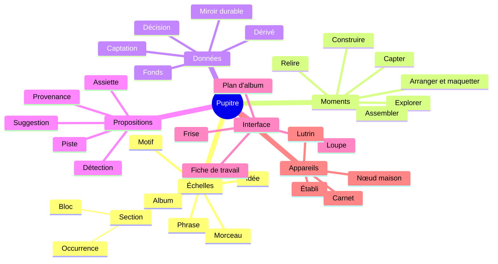

# 80 — Glossaire

Le vocabulaire de Pupitre est fixé ici. Il est employé avec ce sens exact dans tous les
documents, et c'est lui que l'interface affichera. Un terme nouveau entre dans ce
glossaire avant d'entrer dans la SFD. Un mot pour une chose : quand un terme courant a
deux sens, le glossaire dit lequel est retenu.

---

## Les personnes

| Terme | Définition |
|---|---|
| **Sacha** | Le persona pour lequel Pupitre est conçu : une personne qui écrit, compose et chante ses chansons en solo. Profil complet au [§ 11](11-persona-et-situations.md). Ce n'est pas une personne réelle, et Sacha n'agit pas dans le monde réel : tout ce que fait le produit, Sacha en est le sujet |
| **Maîtrise d'ouvrage** | La personne qui porte le projet et arbitre les décisions de conception. Distincte du persona dans les documents, même si elle en partage les besoins. C'est elle qui agit pendant la construction : chronométrer un prototype, annoter le jeu de référence, transcrire la doctrine |

Le vocabulaire du persona, au [§ 11](11-persona-et-situations.md) :

| Code | Terme | Définition |
|---|---|---|
| B01 … B15 | **Besoin** | Ce que Sacha veut pouvoir faire, dans une circonstance donnée, et pourquoi |
| D1 … D8 | **Douleur** | Ce qui coûte aujourd'hui, avec les outils existants |
| N1 … N6 | **Anti-besoin** | Ce que Sacha refuse qu'un outil fasse, même bien |
| S1 … S5 | **Situation** | Une situation physique de travail, avec ses contraintes : en mouvement, au piano, à la guitare, à l'établi, au calme |

## Les échelles

Du plus petit au plus grand. Détail au [§ 12](12-continuum-de-composition.md).

| Code | Terme | Définition |
|---|---|---|
| É0 | **Idée** | Ce qui arrive dans la boîte d'idées : une ou plusieurs prises ou photos, un texte libre, des étiquettes. Pas encore de structure musicale |
| É1 | **Motif** | Une cellule musicale structurée, de une à quatre mesures le plus souvent : un enchaînement d'accords, une figure mélodique, un rythme, une accroche de texte. Vit dans le fonds ; placé dans un bloc, il y est **copié**, avec ou sans suivi |
| É2 | **Phrase** | Une unité de chant : une plage d'un bloc, de (mesure, décalage) à (mesure, décalage) — elle peut commencer sur une levée —, avec la ligne de texte qui s'y aligne dans chaque occurrence |
| É3 | **Section** | Un couplet, un refrain, un pont… Dans le modèle, une section se compose d'un **bloc** et de ses **occurrences** |
| É3 | **Bloc** | Le matériau musical partagé d'un type de section (grille, mélodie, arrangement par défaut), défini une seule fois. Exemple : « le refrain » |
| É3 | **Occurrence** | Une apparition d'un bloc dans la forme, avec ses paroles — les siennes, ou celles d'une autre occurrence du même bloc, reprises —, son intensité et ses écarts. Exemple : « Refrain 2 » |
| É3 | **Écart** | Une variation locale d'une occurrence par rapport à son bloc : une mesure changée, une transposition, une fin allongée. Le mot n'a pas d'autre sens dans Pupitre |
| É4 | **Forme** | La suite ordonnée des occurrences d'un morceau |
| É4 | **Morceau** | Une chanson en cours : identité stable, titres datés, forme, blocs, paroles, tonalité, tempo, arrangement, prises, variantes, journal |
| É5 | **Album** | Une sélection de morceaux, ses ordres candidats, ses transitions et son arc |
| É5 | **Ordre** | Une suite candidate des morceaux d'un album, nommée et datée. Plusieurs coexistent ; un seul peut être **retenu** |
| É5 | **Transition** | Le passage d'un morceau au suivant dans un ordre : relation tonale, différence de tempo, nature (silence, fondu, enchaîné, interlude). Au sens de l'album, on dit transition, jamais enchaînement |
| É5 | **Arc** | L'intention d'ensemble d'un album : trajectoire d'intensité, de lumière, de thèmes |
| — | **Variante** | Une version alternative d'un élément — ligne, mélodie, cadence, motif transformé —, gardée à côté de l'original pour être comparée, retenue ou écartée. Au niveau du morceau, une bifurcation entière du document, qu'on peut aussi fusionner |

## Les moments du travail

Non linéaires : on y revient sans cesse. Détail au [§ 12](12-continuum-de-composition.md).

| Code | Moment | Ce qu'on y fait |
|---|---|---|
| M1 | **Capter** | Enregistrer, noter, photographier, fredonner, puis trier la boîte d'idées |
| M2 | **Explorer** | Essayer des accords, des variantes, des chemins ; demander des pistes ; écouter pour vérifier |
| M3 | **Construire** | Fixer l'harmonie, la mélodie, le texte, l'alignement, la forme |
| M4 | **Arranger et maquetter** | Décider qui joue quoi et avec quelle poussée ; produire et confronter des maquettes |
| M5 | **Relire** | Diagnostiquer, lire au lutrin, annoter, trancher, consigner |
| M6 | **Assembler** | Sélectionner, ordonner, régler les transitions, documenter l'album ; exporter |

## Les données

Détail au [§ 30](30-modele-de-domaine.md) et au [§ 31](31-persistance-et-synchronisation.md).

| Terme | Définition |
|---|---|
| **Fonds** | L'ensemble de la matière de Sacha : idées, motifs, prises, morceaux, albums. C'est le périmètre d'une recherche et le réservoir d'où sort un album. Ce n'est pas une échelle de travail |
| **Décision** | Tout contenu que Sacha a saisi ou accepté. Vit dans les documents synchronisés. C'est la vérité |
| **Document** | Une unité de synchronisation : le fonds, un morceau, un album, les réglages. Répliqué sur chaque appareil |
| **Captation** | Un objet immuable adressé par l'empreinte de son contenu : audio, photo, traits d'encre, rendu figé, résultat d'analyse. Ne se modifie jamais : on en produit une autre |
| **Empreinte** | Le condensé SHA-256 du contenu d'une captation. C'est son nom |
| **Prise** | Une captation audio, avec ses métadonnées (nom d'origine, format, durée, date, appareil, diapason mesuré). Ses rattachements à des morceaux sont des décisions du document du morceau |
| **Carte de temps** | La correspondance entre les secondes d'une prise et les mesures d'un morceau |
| **Dérivé** | Tout ce qui se recalcule : index, rendus, diagnostics, suggestions, doigtés et renversements calculés. Jetable par construction |
| **Miroir durable** | La projection en texte brut, versionnée dans git, de toutes les décisions. Lisible sans Pupitre, sauvegardée hors des appareils |
| **Opération nommée** | Une modification du modèle qui porte un nom et un message lisible : « Pont raccourci de 16 à 8 mesures ». Le journal est fait de ces messages |
| **Journal** | L'historique lisible du fonds, d'un morceau ou d'un album, engendré depuis les opérations nommées |
| **Rendu figé** | Une page rendue, gelée en captation, à laquelle l'encre est ancrée |
| **À trancher** | L'état de deux valeurs concurrentes, nées d'une synchronisation entre appareils ou d'une fusion de variantes : Pupitre les présente côte à côte, Sacha choisit. Réservé à ces conflits ; une proposition non tranchée est dite **en attente** |

## Les propositions

Détail au [§ 20.6](20-sfd/26-propositions-suggestions-provenance.md).

| Terme | Définition |
|---|---|
| **Proposition** | Tout contenu que Pupitre offre sans que Sacha l'ait décidé. Deux sortes : la détection et la suggestion. Une proposition n'est jamais appliquée sans geste ; tant qu'elle n'est pas tranchée, elle est **en attente** |
| **Détection** | Une proposition mesurée sur une captation : tempo, tonalité, accords, mélodie, frontières de sections, transcription de paroles |
| **Suggestion** | Une proposition engendrée pour aider à décider : accord suivant, variante de mélodie, rime, variante de ligne, forme alternative, ordre d'album |
| **Piste** | Une suggestion demandée par Sacha, rendue au pluriel — au moins deux, ou l'aveu qu'il n'y en a pas —, chacune avec son effet ; jamais classée par qualité, jamais appliquée sans geste. *Piste de règles* : calculée hors ligne ; *piste générative* : passée par la passerelle IA |
| **Accepter** | Le geste qui fait d'une proposition une décision. La provenance est conservée. Libellé d'interface : « Garder » |
| **Écarter** | Le geste qui retire une proposition de la vue. Réversible |
| **Prendre** | Le geste qui fait passer un accord de la table dans le morceau ouvert, à la position courante : c'est une saisie, de provenance `saisie`, et non une suggestion acceptée ([MIC-12](20-sfd/22-micro-motif-et-phrase.md#mic-12--parcourir-la-table-de-la-tonalité) ; [ADR-018](adr/adr-018-la-table-montre-tout.md) ; A16) |
| **Statut d'une valeur** | Décidée (droit), proposée (italique et « ~ »), absente (« — »). Une valeur engendrée prend le statut le plus faible de ses entrées |
| **Provenance** | L'origine de chaque élément : `saisie`, `detectee`, `suggeree`, `importee`, `retouchee` — affichées saisie, détectée, suggérée, importée, retouchée. Elle accompagne l'élément à vie |
| **Confiance** | Pour une détection : une probabilité calibrée sur un jeu de référence, avec les hypothèses concurrentes |
| **Chromagramme** | L'énergie d'un son rangée sur les douze classes de hauteur, octaves confondues. Un accord joué se nomme à son chromagramme, pas à une fondamentale ([ECO-03](20-sfd/27-ecoute-et-compagnon.md#eco-03--nommer-un-accord-joué)) |
| **Assiette** | Ce sur quoi un calcul a porté : combien d'éléments considérés, combien portent la donnée requise, combien sont décidés |
| **Part d'origine** | La part du matériau d'un morceau issue de suggestions acceptées. Visible à la demande |
| **Mode sans suggestion** | Un réglage, global ou par morceau, qui retire toute suggestion de l'interface |

## La musique

Détail au [§ 30](30-modele-de-domaine.md) et au [§ 60](60-moteur-musical.md).

| Terme | Définition |
|---|---|
| **Tonique de référence** | La hauteur d'ancrage par rapport à laquelle un matériau stocke ses notes et ses accords. C'est un repère de stockage, pas une affirmation d'analyse. La changer transpose |
| **Tonalité** | L'analyse tonale d'un passage : décidée, ou proposée avec ses candidats |
| **Objet harmonique** | Un accord tel qu'il est stocké : fondamentale (intervalle orthographié depuis la tonique de référence), qualité, basse. Son nom, son degré et son diagramme sont des rendus |
| **Enchaînement** | Une suite d'accords : V–I, IV–iv–I. Au sens de l'album, on dit **transition** |
| **Grille** | La suite des accords, mesure par mesure, d'un bloc ou d'un morceau |
| **Accroche** | Le fragment de texte et de mélodie qui porte l'idée d'un morceau, souvent son titre |
| **Degré · fonction** | La lecture d'un accord dans une tonalité : `iv`, sous-dominante. Engendrée |
| **Emprunt** | Un accord hors de la tonalité analysée. Marqué `*` dans la grille, jamais refusé ; la table n'en marque aucun, car sa rangée et son cadre disent sa famille ([§ 50 · 3.7](50-interfaces-et-appareils.md#37-la-table-de-la-tonalité)) |
| **Famille** | Au sens de la table, le groupe auquel un accord appartient dans sa tonalité — diatoniques, dominantes secondaires, emprunts au mode parallèle ou harmonie sombre (mineur harmonique, diminués secondaires, sixte napolitaine) —, lu par sa rangée et par la forme de son cadre, jamais par la seule couleur ([§ 60](60-moteur-musical.md#12-les-familles-daccords) ; [MIC-12](20-sfd/22-micro-motif-et-phrase.md#mic-12--parcourir-la-table-de-la-tonalité)) |
| **Palette** | Les notes d'un accord et de sa tonalité, rangées par rôle — appui, tension, frotte —, à lire avant d'écrire une mélodie sur lui ; celle des instruments se dit toujours palette d'instruments ([MIC-13](20-sfd/22-micro-motif-et-phrase.md#mic-13--lire-la-palette-dun-accord)) |
| **Diapason d'une prise** | La hauteur de référence mesurée d'un enregistrement (décalage en cents par rapport au la 440). Propriété de la prise, jamais de l'écrit |
| **Diapason de lecture** | Le diapason auquel l'écoute de contrôle joue, pour sonner avec un piano. Un réglage |
| **Tessiture** | Les bornes vocales de Sacha, mesurées ou déclarées |
| **Doigté** | Une position de guitare pour un accord. Calculé selon le contexte ; **épinglé** quand Sacha le fixe. Après une transposition, un épinglage qui ne correspond plus à aucun accord est **inactif** : un état engendré, rien n'est réécrit |
| **Voicing** | La disposition des notes d'un accord sous une main, au clavier, qui se décide par son renversement : calculé selon le contexte, il est épinglé quand Sacha fixe ce renversement. Après une transposition, un renversement épinglé qui ne correspond plus à aucun accord est **inactif**, comme un doigté ([§ 60 · 6.3](60-moteur-musical.md#63-le-voicing-au-clavier) ; [REN-08](20-sfd/28-rendus-encre-impression.md#ren-08--diagrammes-de-clavier)) |
| **Intensité** | Le niveau d'une occurrence, de 1 (nu) à 5 (plein) : son énergie. Décidée, ou proposée depuis l'audio. Sa suite forme la **courbe d'intensité** du morceau |
| **Densité** | Le nombre de couches présentes dans une occurrence. Engendrée depuis l'arrangement |
| **Densité syllabique** | Le nombre de syllabes par mesure d'une phrase. Mesurée (DG-P3) |
| **Poussée** | L'élan d'une occurrence, distinct de sa densité : un passage peut être dense et calme. Décidée |
| **Contour** | La forme d'une ligne mélodique : arche, vague descendante, escalier, saut, chute. Mesuré |

## Les règles

Détail au [§ 60](60-moteur-musical.md).

| Terme | Définition |
|---|---|
| **Théorie** | Les règles descriptives de la musique tonale. Disent ce qui se passe |
| **Doctrine** | Les règles personnelles de Sacha. Disent ce que Sacha veut. Modifiables par Sacha uniquement |
| **Règle d'outil** | Les contraintes d'un outil externe (par exemple les limites d'un générateur de maquettes). Non négociables tant que l'outil est le même |
| **Diagnostic** | L'évaluation d'un ensemble de règles sur un objet. Produit des constats ; n'écrit rien |
| **Constat** | Le résultat d'une règle : `présent`, `absent`, `indécidable` ou `désactivé`, avec sa mesure chiffrée et son assiette |
| **Indécidable** | L'état d'un constat dont la donnée manque. Jamais confondu avec `absent` |

## L'interface

Détail au [§ 50](50-interfaces-et-appareils.md).

| Terme | Définition |
|---|---|
| **Boîte d'idées** | L'endroit où arrivent les idées captées, avant tout tri ([CAP-02](20-sfd/21-capter-et-organiser.md#cap-02--trier-la-boîte-didées)) |
| **Loupe** | La vue d'une à huit mesures au plus fin : accords, mélodie, syllabes, rôle des notes, pistes ([MIC-01](20-sfd/22-micro-motif-et-phrase.md#mic-01--ouvrir-la-loupe)) |
| **Carte des chemins** | La vue des accords qui peuvent suivre, depuis le premier degré de la tonalité, groupés par effet ([MIC-08](20-sfd/22-micro-motif-et-phrase.md#mic-08--parcourir-la-carte-des-chemins)) |
| **Table** | La table de la tonalité : la vue de tous les accords qu'une tonalité met à portée, en une rangée par famille, chacun avec l'accord où il mène, sans en classer ni en recommander aucun ([MIC-12](20-sfd/22-micro-motif-et-phrase.md#mic-12--parcourir-la-table-de-la-tonalité)) |
| **Rangée** | L'une des lignes de la table, chacune pour une famille (au-dessus les dominantes secondaires, au centre les diatoniques, au-dessous les emprunts au mode parallèle, et la couche sombre), où une case garde sa place quand la tonalité change ([MIC-12](20-sfd/22-micro-motif-et-phrase.md#mic-12--parcourir-la-table-de-la-tonalité)) |
| **Couche sombre** | La rangée de la table qui montre l'harmonie sombre, masquée par défaut et affichée à la demande, sans ajouter de case aux trois autres rangées ; affichée, elle nourrit aussi la carte des chemins ([MIC-12](20-sfd/22-micro-motif-et-phrase.md#mic-12--parcourir-la-table-de-la-tonalité)) |
| **Flèche de résolution** | Dans la table, le trait orienté qui relie une case à sa cible, l'accord où elle se résout : une dominante secondaire, un diminué de la couche sombre ou la napolitaine en portent une, et chaque flèche relie exactement deux cases ([MIC-12](20-sfd/22-micro-motif-et-phrase.md#mic-12--parcourir-la-table-de-la-tonalité)) |
| **Ligne d'effet** | Dans la table, les mots qui disent ce que fait une case : `tire vers <cible>`, `assombrit`, `éclaire`, `glisse vers <cible>`, `tension sombre avant la dominante`, `suspend`, et au centre `repos`, `éloignement`, `tension` ([§ 60](60-moteur-musical.md#12-les-familles-daccords) ; [MIC-12](20-sfd/22-micro-motif-et-phrase.md#mic-12--parcourir-la-table-de-la-tonalité)) |
| **Cahier des tables** | Les tables des 24 tonalités réunies en un document, avec un sommaire à liens, au format de l'écran du lutrin et imprimable avec la même pagination ([REN-01](20-sfd/28-rendus-encre-impression.md#ren-01--fiche-de-travail)) |
| **Accord employé** | Sur la table d'un morceau, un accord que sa grille emploie : sa case garde le cadre de sa famille, en trait épais, avec son nombre d'emplois ([MOR-14](20-sfd/24-morceau.md#mor-14--poser-le-morceau-sur-la-table)) |
| **Hors table** | La liste, sous la table d'un morceau, des accords absents des rangées affichées, chacun avec ses notes communes avec la tonalité ; aucun n'est forcé dans une case ([MOR-14](20-sfd/24-morceau.md#mor-14--poser-le-morceau-sur-la-table)) |
| **Frise** | La forme d'un morceau en largeur proportionnelle à la durée, avec la courbe d'intensité ([MOR-05](20-sfd/24-morceau.md#mor-05--voir-la-frise)) |
| **Fiche de travail** | La page d'un morceau, imprimable et lisible au lutrin : en-tête, frise, grille, portée et paroles, diagrammes ([REN-01](20-sfd/28-rendus-encre-impression.md)) |
| **Plan d'album** | Les couloirs d'un album alignés sur un ordre : tonalités, tempos, intensités, durées et cumul, transitions, faces ([ALB-04](20-sfd/25-album.md#alb-04--voir-le-plan-dalbum)) |
| **Feuille d'album** | La page de synthèse d'un album : ordre, tonalités, tempos, durées, transitions ([ALB-10](20-sfd/25-album.md#alb-10--feuille-dalbum-et-livret)) |
| **Maturité** | Le niveau d'un morceau par dimension — forme, harmonie, mélodie, texte, arrangement, maquette — : absent, esquissé, complet, confirmé. Engendrée, jamais saisie ([MOR-13](20-sfd/24-morceau.md#mor-13--maturité-et-statut)) |
| **Statut d'un morceau** | Actif, en pause, abouti, abandonné : une décision datée de Sacha |

## Les appareils et les modes

Détail au [§ 50](50-interfaces-et-appareils.md) et au [§ 40](40-architecture.md).

| Terme | Définition |
|---|---|
| **Établi** 💻 | Le rôle de l'ordinateur : construire, éditer finement, assembler l'album |
| **Carnet** 📱 | Le rôle du téléphone : capter, écouter, accompagner l'instrument, retoucher court |
| **Lutrin** 📖 | Le rôle de la tablette à encre électronique avec stylet : lire au pupitre ou au calme, annoter, répéter |
| **Nœud maison** 🏠 | Un petit serveur toujours allumé au foyer : synchronise, sauvegarde, fait les analyses lourdes, sert les échantillons de l'écoute de contrôle, héberge la passerelle IA. Recommandé : sans lui, Pupitre fonctionne sur un seul appareil |
| **Mode encre** | Le profil de présentation pour l'encre électronique : paginé, sans animation, sans couleur porteuse de sens |
| **Compagnon d'instrument** | Le mode du carnet au piano ou à la guitare : nommer un accord joué, accorder, battre la mesure, suivre une prise |
| **Écoute de contrôle** | Le rendu sonore simple de ce qui est écrit, pour vérifier. Jamais un produit |
| **Appairage** | L'ajout d'un appareil au fonds de Sacha, par un code court affiché sur un appareil déjà appairé |
| **Clé du nœud** | La clé publique par laquelle chaque appareil reconnaît le nœud maison. L'appairage l'authentifie par un échange dérivé du code (PAKE) ; l'appareil l'**épingle** alors : il refuse toute autre clé, sauf une rotation signée par l'ancienne ([SYN-08](20-sfd/29-socle-donnees-appareils.md#syn-08--appairer-et-révoquer-des-appareils)). Au sens musical, épingler se dit d'un doigté ou d'un renversement |
| **Construction navigateur** | L'interface Leptos construite pour un navigateur, sans Tauri : elle sert aux tests de bout en bout, jamais à Sacha, et ne sait pas épingler la clé du nœud ([ADR-020](adr/adr-020-leptos-et-tauri.md) ; [§ 70 · 2](70-qualite-et-verification.md#2-les-trois-profils-dappareil-en-test)) |
| **Passerelle IA** | Le point unique par lequel passent les demandes à un modèle génératif, local ou distant |
| **Brief de génération** | L'export d'un morceau vers un générateur de maquettes externe, conforme aux règles de l'outil visé |

## Le projet

| Code | Terme | Définition |
|---|---|---|
| P1 … P8 | **Principe** | Une règle de conception qui tranche les cas imprévus ([§ 10](10-vision.md)) |
| R1 … R7 | **Risque** | Ce qui ferait échouer le projet, et sa parade ([§ 10](10-vision.md)) |
| IR-1 … IR-9 | **Indicateur** | Un signe observable de réussite, avec sa cible ([§ 10](10-vision.md)) |
| INC-0 … INC-6 | **Incrément** | Une étape de construction qui rend un service réel ([§ 40 · 9](40-architecture.md#9-trajectoire-de-construction)) |
| H01 … H10 | **Hypothèse** | Une supposition technique à confronter avant d'en dépendre ([§ 40 · 11](40-architecture.md#11-hypothèses-à-confronter)) |
| I01 … I27 | **Invariant** | Une propriété toujours vraie, vérifiée par un test ([§ 70 · 3](70-qualite-et-verification.md#3-les-invariants-et-leurs-tests)) |
| Q01 … Q22 | **Question ouverte** | Ce qui n'est pas tranché, avec son enjeu et une recommandation ([§ 90](90-questions-ouvertes.md)) |
| A01 … A22 | **Arbitrage** | Une décision prise faute d'information, avec le coût de son renversement ([§ 90](90-questions-ouvertes.md)) |
