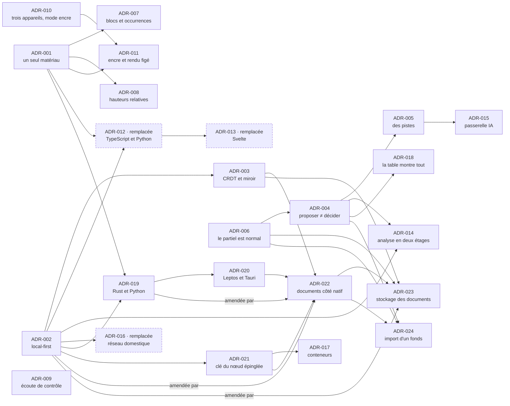

# Décisions d'architecture

Une décision par fichier, numérotée sur trois chiffres, **jamais renumérotée, jamais
supprimée**. Une décision remplacée garde son fichier et son numéro, passe au statut
`remplacée`, et pointe vers celle qui la remplace. Exception unique : la refonte du
2026-10-11 a remplacé toute la série précédente, ADR-1 à ADR-8, conservée dans
l'historique du dépôt privé `pupitre-donnees` (commit `0044944`) ; les numéros à trois
chiffres de la nouvelle série ne réemploient pas ces identifiants.

> **Série refondée le 2026-10-11.** La série précédente était écrite autour d'une matière
> et d'une installation particulières. Les principes qui répondaient à des besoins
> inchangés y ont été **réexaminés à partir des besoins** du
> [persona](../11-persona-et-situations.md), pas recopiés.

## Statuts

| Statut | Sens |
|---|---|
| ✅ **acceptée** | Validée par la maîtrise d'ouvrage |
| 🟡 **proposée** | Rédigée et argumentée ; en vigueur pour la conception, à confirmer avant l'implémentation |
| 🔄 **remplacée** | Une autre décision la remplace ; le fichier reste |
| ⛔ **abandonnée** | Écartée après examen ; le fichier reste, avec la raison |

**Amender plutôt que remplacer.** Une décision qui ne change qu'une part d'une ADR acceptée
l'amende. La nouvelle ADR le dit en tête de son contexte, cite ce qu'elle change, et
s'appuie sur l'ADR amendée. Celle-ci reste acceptée, et son texte ne change pas : sa ligne
« Statut » ajoute seulement, après le tiret, « amendée par ADR-NNN le AAAA-MM-JJ », comme
une ADR remplacée pointe vers celle qui la remplace. **Une ADR proposée se corrige et se
complète tant qu'elle est proposée, au plus tard dans la PR qui l'accepte** ; acceptée, elle
ne se réécrit plus. **Un mot qu'une ADR acceptée emploie dans un sens retiré se dit à son
entrée du [glossaire](../80-glossaire.md), pas dans l'ADR.**

## La série

| N° | Décision | Statut | Principe |
|---|---|---|---|
| [ADR-001](adr-001-un-seul-materiau.md) | Un seul matériau, des vues à toutes les échelles | ✅ acceptée | P1 |
| [ADR-002](adr-002-local-first.md) | Local-first : chaque appareil porte sa copie, la maison synchronise | ✅ acceptée | P5 |
| [ADR-003](adr-003-crdt-et-miroir-durable.md) | Des documents CRDT pour travailler, un miroir texte pour durer | ✅ acceptée | P5, P8 |
| [ADR-004](adr-004-proposer-n-est-pas-decider.md) | Proposer n'est pas décider | ✅ acceptée | P2 |
| [ADR-005](adr-005-des-pistes-pas-des-reponses.md) | Des pistes, pas des réponses | 🟡 proposée | P3 |
| [ADR-006](adr-006-le-partiel-est-normal.md) | Le partiel est l'état normal | ✅ acceptée | P4 |
| [ADR-007](adr-007-blocs-et-occurrences.md) | Blocs et occurrences | 🟡 proposée | P1 |
| [ADR-008](adr-008-hauteurs-relatives.md) | Des hauteurs relatives à une tonique de référence | ✅ acceptée | P1 |
| [ADR-009](adr-009-ecoute-de-controle.md) | Écouter pour vérifier, jamais pour produire | ✅ acceptée | P7 |
| [ADR-010](adr-010-trois-appareils-mode-encre.md) | Trois appareils, trois rôles ; un mode encre sans couleur porteuse de sens | ✅ acceptée | P6 |
| [ADR-011](adr-011-encre-ancree-rendu-fige.md) | L'encre s'ancre à un rendu figé | 🟡 proposée | P6 |
| [ADR-012](adr-012-typescript-et-python.md) | TypeScript partout où l'on travaille hors ligne, Python pour l'analyse lourde | 🔄 remplacée par [ADR-019](adr-019-rust-et-python.md) | P5 |
| [ADR-013](adr-013-svelte-pour-l-interface.md) | Svelte 5 pour l'interface | 🔄 remplacée par [ADR-020](adr-020-leptos-et-tauri.md) | P6 |
| [ADR-014](adr-014-analyse-en-deux-etages.md) | L'analyse en deux étages, toujours mesurée | 🟡 proposée | P2, P5 |
| [ADR-015](adr-015-passerelle-ia.md) | Une passerelle IA unique, locale par défaut, distante sur consentement | 🟡 proposée | P3, P8 |
| [ADR-016](adr-016-reseau-domestique.md) | Réseau domestique seulement, HTTPS par certificat de domaine, appairage par code | 🔄 remplacée par [ADR-021](adr-021-cle-du-noeud-epinglee.md) | P8 |
| [ADR-017](adr-017-noeud-en-conteneurs.md) | Le nœud maison en conteneurs | 🟡 proposée | P8 |
| [ADR-018](adr-018-la-table-montre-tout.md) | La table montre tout sans choisir : y prendre un accord, c'est le saisir | ✅ acceptée | P2, P3 |
| [ADR-019](adr-019-rust-et-python.md) | Rust pour tout le code écrit par le projet, Python pour la seule analyse lourde | ✅ acceptée | P5 |
| [ADR-020](adr-020-leptos-et-tauri.md) | Leptos pour l'interface, Tauri 2 pour les applications | ✅ acceptée | P5, P6 |
| [ADR-021](adr-021-cle-du-noeud-epinglee.md) | Réseau domestique seulement ; TLS par la clé du nœud, épinglée à l'appairage | ✅ acceptée | P8 |
| [ADR-022](adr-022-documents-cote-natif.md) | Les documents et la synchronisation côté natif | ✅ acceptée | P5, P8 |
| [ADR-023](adr-023-stockage-des-documents.md) | Le stockage des documents | ✅ acceptée | P5, P8 |
| [ADR-024](adr-024-import-d-un-fonds.md) | L'import d'un fonds existant | ✅ acceptée | P2, P4 |

Légende : une flèche A → B se lit « B s'appuie sur A » ; la ligne « S'appuie sur » de
chaque ADR reprend exactement ses flèches entrantes. Une ADR remplacée garde ses flèches,
porte la mention « remplacée » et un cadre pointillé. Une flèche marquée « amendée par » va
d'une ADR acceptée à celle qui l'amende ; elle compte parmi les flèches entrantes de
celle-ci.



## Gabarit

```markdown
# ADR-NNN — Titre

| | |
|---|---|
| **Statut** | ✅ acceptée · 🟡 proposée · 🔄 remplacée par ADR-MMM · ⛔ abandonnée |
| **Date** | AAAA-MM-JJ |
| **Sert** | besoins Bxx, principe Px |
| **S'appuie sur** | ADR-MMM, ou — |

## Contexte
## Décision
## Conséquences
### Ce que ça permet
### Ce que ça coûte
## Options écartées
## Comment on vérifie
```

La dernière rubrique n'est pas décorative : elle nomme un test automatisable, ou dit
explicitement qu'il n'y en a pas.
