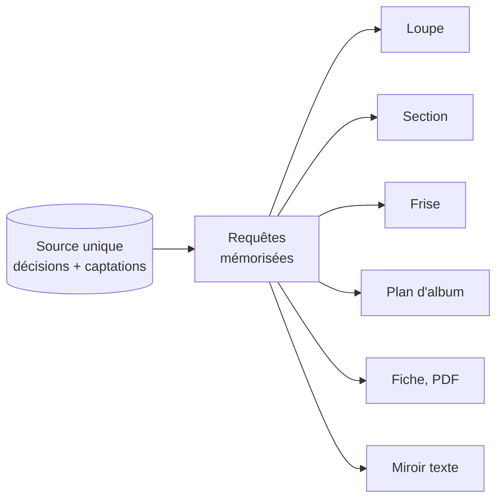

# ADR-001 — Un seul matériau, des vues à toutes les échelles

| | |
|---|---|
| **Statut** | ✅ acceptée — confirmée le 2026-10-28 |
| **Date** | 2026-10-11 |
| **Sert** | B03, B05, B11 · principe P1 |
| **S'appuie sur** | — |

## Contexte

Sacha travaille à six échelles à la fois, et une décision prise à l'une se répercute sur
les autres : changer la cadence du refrain change la fin du morceau, donc sa transition
avec le suivant dans l'album.

Les outils qui **recopient** une information d'une échelle à l'autre — une tonalité
reportée dans un tableau d'album, un tempo noté dans une fiche, un compte de questions
tenu à la main — produisent des affirmations **vraies quand on les écrit et fausses quand
on les lit**. Ce n'est pas un défaut d'attention : c'est la duplication comme principe.
La douleur D3 (« la mémoire invente ») et la douleur D4 (« l'album est invisible ») en
découlent directement.

## Décision

**Toute information dérivable est engendrée depuis sa source, jamais recopiée.**

- Il y a **une seule source** par information : une décision de Sacha, ou une captation.
- Chaque échelle est une **vue** — une requête et un rendu — sur le même modèle.
- Cas d'école : **un accord est un objet harmonique**. Son nom, son degré, sa fonction,
  son diagramme de manche et sa place sur la portée sont des rendus de cet objet.
- Sont engendrés, jamais stockés : durées, numéros de mesure et d'occurrence, comptes,
  densités, maturité, cardinal d'un album, matériau effectif d'une occurrence, doigtés
  calculés, diagnostics.

## Conséquences

### Ce que ça permet

- Une correction se fait **à un seul endroit** et se voit partout, aussitôt.
- Les contradictions internes deviennent **impossibles par construction**, pas seulement
  improbables.
- Zoomer ne coûte rien : la vue d'album lit les morceaux tels qu'ils sont.
- Transposer, changer de tempo, insérer une mesure cessent d'être des opérations risquées.

### Ce que ça coûte

- Il faut un moteur de requêtes et de rendu **avant** d'avoir une interface utile.
- Une valeur fausse se corrige à la source, jamais dans le rendu.
- Les vues doivent être mémorisées et invalidées proprement pour rester rapides.

## Options écartées

| Option | Pourquoi |
|---|---|
| Dénormaliser, puis vérifier par un script de cohérence | Un script ne détecte que les écarts qu'on lui a appris, et peut lui-même se tromper. C'est un filet, pas une prévention |
| Stocker plusieurs représentations d'un accord et choisir à l'affichage | C'est précisément le mécanisme qui produit deux valeurs contradictoires dans un même fichier |
| Une convention d'écriture « ne pas recopier » | Une convention demande une vigilance soutenue, et la vigilance s'use |

## Comment on vérifie

- **I01** : aucun champ engendré n'existe dans les documents ([§ 30 · 13](../30-modele-de-domaine.md#13-ce-que-le-modèle-interdit-de-stocker)).
- **I02** : transposer un morceau change tous ses rendus, et aucune donnée hors la tonique de
  référence. Un rendu qui ne bouge pas est un rendu stocké.
- **I27** : la palette et MIC-06 classent une note de la même façon.
