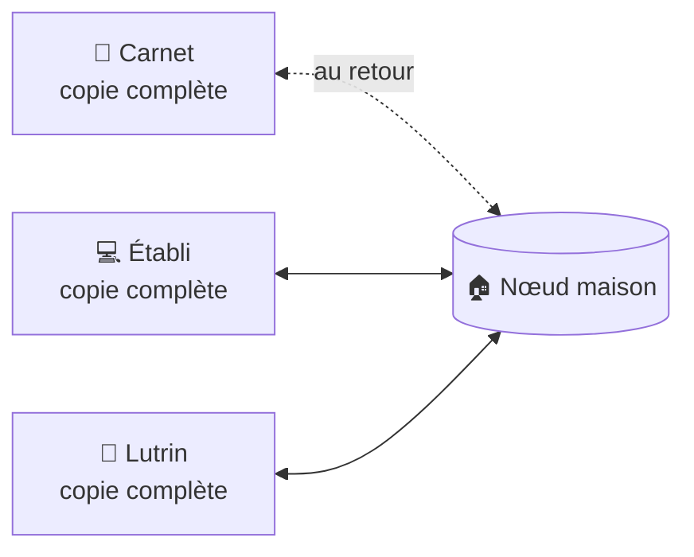

# ADR-002 — Local-first : chaque appareil porte sa copie, la maison synchronise

| | |
|---|---|
| **Statut** | ✅ acceptée — validée au cadrage du 2026-10-11 ; amendée par [ADR-022](adr-022-documents-cote-natif.md) et [ADR-023](adr-023-stockage-des-documents.md) le 2026-11-04 |
| **Date** | 2026-10-11 |
| **Sert** | B01, B13 · principe P5 |
| **S'appuie sur** | — |

## Contexte

Sacha travaille dans cinq situations ; dans l'une d'elles (S1, en mouvement), le réseau
est incertain ou absent, et c'est là qu'arrivent beaucoup d'idées. Au cadrage, la réponse
à « que doit permettre l'outil en déplacement ? » a été : **tout, hors ligne, avec une
synchronisation au retour, et toujours aucune exposition publique**.

Une application servie par un serveur de la maison ne répond pas à ce besoin : hors du
foyer, elle n'existe plus, et à la maison, chaque page dépend du serveur.

## Décision

- L'application tourne **entièrement sur chaque appareil**, avec une **copie complète**
  des documents.
- Le **nœud maison** synchronise, sauvegarde, analyse lourd et héberge la passerelle IA. Il
  est recommandé, pas indispensable : sans lui, Pupitre fonctionne sur un seul appareil.
- Aucun appareil n'a besoin d'un autre pour travailler. La synchronisation se fait
  **d'elle-même** dès que le nœud est joignable.
- **Rien n'est exposé sur Internet** ([ADR-021](adr-021-cle-du-noeud-epinglee.md)).

## Conséquences

### Ce que ça permet

- Capter **et retravailler** partout : dans le train, sans réseau, tout répond.
- Une interface instantanée : aucune écriture n'attend un aller-retour réseau.
- Une panne du nœud n'arrête pas le travail.

### Ce que ça coûte

- Il faut synchroniser et gérer les conflits ([ADR-003](adr-003-crdt-et-miroir-durable.md)).
- Chaque appareil stocke les documents (moins de 125 Mo au pire pour une soixantaine de
  morceaux, historique compris).
- Le noyau métier doit tourner sur chaque appareil, compilé en WebAssembly sous
  l'interface ([ADR-019](adr-019-rust-et-python.md)).
- Une captation faite dehors n'existe que sur le téléphone jusqu'au retour. Parades :
  aucune éviction avant accusé de réception, compte des captations en attente toujours
  visible, et synchronisation facultative par un réseau privé ([Q07](../90-questions-ouvertes.md)).

## Options écartées

| Option | Pourquoi |
|---|---|
| Une application servie par le nœud, pages rendues côté serveur | Inutilisable hors du foyer ; chaque page dépend du serveur |
| Un accès distant obligatoire par réseau privé virtuel | Rien ne marche sans réseau, ce qui est le cas dans le train |
| Un service hébergé en ligne | Exposition publique, dépendance à un tiers, données hors de chez Sacha |

## Comment on vérifie

- **I10** : trois répliques modifiées en même temps convergent.
- **I15** : aucune captation n'est évincée avant l'accusé de réception du nœud.
- **I16** : le parcours S1 entier passe en mode avion.
