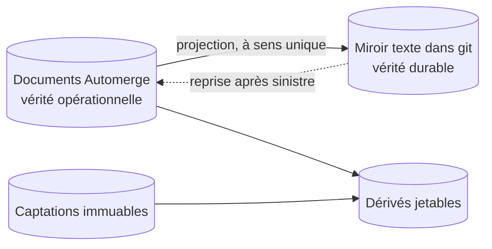

# ADR-003 — Des documents CRDT pour travailler, un miroir texte pour durer

| | |
|---|---|
| **Statut** | ✅ acceptée — confirmée le 2026-11-04, complétée d'Automerge et de la couche de synchronisation (A21) |
| **Date** | 2026-10-11 |
| **Sert** | B13, B14 · principes P5, P8 |
| **S'appuie sur** | [ADR-002](adr-002-local-first.md) |

## Contexte

Travailler hors ligne sur trois appareils ([ADR-002](adr-002-local-first.md)) impose de
**fusionner** des modifications faites séparément, sans serveur pour arbitrer.

Sacha tient aussi à ce que ses données **durent** : lisibles sans l'outil, dans des années,
avec un historique qui raconte comment chaque morceau a bougé (B13, B14). Et le domaine a
besoin de **bifurquer** : essayer une variante d'un morceau, puis la fusionner ou non.

Des fichiers texte versionnés comme vérité opérationnelle ne conviennent pas : deux
appareils déconnectés qui modifient le même fichier produisent un conflit de fusion
textuel, que personne ne veut résoudre au milieu d'une séance de piano.

Enfin, une personne seule construit et entretient l'outil : la fusion, l'historique et la
compaction doivent venir d'une bibliothèque éprouvée, pas de code maison
(R7, [§ 10](../10-vision.md#7-ce-qui-ferait-échouer-le-projet)).

## Décision

Trois natures de données et leur projection durable ([§ 31](../31-persistance-et-synchronisation.md)) :

1. **Décisions** : des **documents Automerge** répliqués (fonds, morceaux, albums,
   réglages). C'est la vérité **opérationnelle**. Toute modification passe par une
   **opération nommée**, qui porte un message lisible.
2. **Captations** : des objets **immuables**, nommés par l'empreinte de leur contenu.
3. **Dérivés** : des caches, recalculables, jamais sauvegardés.
4. **Miroir durable** : une **projection en texte brut** des documents (un enregistrement
   par ligne, en-têtes en TOML), écrite par le nœud dans un dépôt **git**. C'est la vérité
   **durable** : lisible sans Pupitre, sauvegardée sur le disque externe, et hors site si
   la copie facultative existe, réimportable en cas de sinistre. Elle est **à sens
   unique** et son aller-retour est testé.

Le moteur est **Automerge** : la crate `automerge`, à version épinglée, fusionne, garde
l'historique et compacte ; son stockage sur disque est celui de
l'[ADR-023](adr-023-stockage-des-documents.md). La **synchronisation** est une couche maison,
en étoile autour du nœud, sur WebSocket en TLS
([A21](../90-questions-ouvertes.md#les-arbitrages-pris-dans-cette-conception)). Elle ne
fait que deux choses : échanger avec le nœud, pour chaque document, les modifications qui
manquent de part et d'autre, par le protocole de synchronisation d'Automerge ; relever les
conflits, pour les présenter « à trancher ». Elle ne transporte que les documents : les
captations passent par l'adaptateur `Captations`. Elle est isolée derrière l'adaptateur
`Documents`
([§ 31 · 4.4](../31-persistance-et-synchronisation.md#44-la-couche-de-synchronisation)) :
si H07 voit diverger les répliques, samod, le dépôt Automerge en Rust, remplace la couche de
synchronisation derrière le même adaptateur. Il tient alors lui-même les fichiers des
documents et leur compaction : les décisions 1 à 3 de
l'[ADR-023](adr-023-stockage-des-documents.md) seraient amendées par une ADR nouvelle. Les
captations restent à l'adaptateur `Captations`, que samod ne remplace pas.

Les règles de fusion propres au domaine :

- un **texte** (une ligne de paroles) est une valeur atomique : deux retouches
  concurrentes donnent **deux variantes** à trancher, jamais un mélange caractère par
  caractère ; la ligne rendue est tenue par un registre de l'occurrence, où un double
  choix est un conflit visible ;
- un **objet harmonique**, une **hauteur** et une **provenance** s'écrivent d'un bloc :
  deux modifications concurrentes donnent deux valeurs à trancher, jamais un mélange
  champ par champ ;
- un attribut simple (tempo, tonique, statut) modifié des deux côtés garde une valeur, et
  l'autre reste en conflit : Pupitre lit ces conflits à la synchronisation et les présente
  « à trancher » ;
- une forme fusionnée improbable est **signalée**, pas corrigée en silence.

## Conséquences

### Ce que ça permet

- Fusionner sans arbitre ; ce que la fusion ne sait pas départager est présenté « à
  trancher », jamais perdu en silence ; travailler hors ligne sans crainte.
- Un historique complet : le journal, les retours en arrière.
- Bifurquer : les variantes d'un morceau ([MOR-11](../20-sfd/24-morceau.md#mor-11--bifurquer-en-variantes)).
  Automerge fusionne une variante entière ; fusionner les changements choisis rejoue, dans
  la cible, les opérations nommées choisies.
- Un texte durable qui se lit avec n'importe quel éditeur et se diffe proprement.

### Ce que ça coûte

- Deux représentations à tenir cohérentes : la projection est à sens unique, et son
  aller-retour est testé à chaque écriture du miroir.
- Une dépendance à Automerge, isolée derrière l'adaptateur `Documents`.
- Une couche de synchronisation à écrire et à tenir, quand R7 préfère les bibliothèques
  éprouvées au code maison. Le coût est borné : la couche ne fait que transporter et
  relever, et Automerge garde la fusion, l'historique et la compaction, que le journal
  maison écarté plus bas aurait dû écrire. H07 en juge.
- Automerge ne garde l'autre valeur d'un conflit que jusqu'à la prochaine écriture du même
  champ ([§ 31 · 5](../31-persistance-et-synchronisation.md#5-les-conflits)) : Pupitre
  relève le conflit à la synchronisation, et le garde lui-même « à trancher », dans le
  document. Où il l'y garde se conçoit avec la synchronisation par le nœud, avant son plan
  ([§ 40 · 9](../40-architecture.md#9-trajectoire-de-construction)).
- Le poids de l'historique, acceptable aux volumes visés.

## Options écartées

| Option | Pourquoi |
|---|---|
| Fichiers texte dans git comme vérité | Conflits de fusion textuels entre appareils déconnectés ; aucune fusion qui comprenne la structure |
| Yjs | Excellent pour l'édition collaborative en temps réel ; historique et bifurcations moins naturels |
| Journal d'événements maison | Le protocole de synchronisation, la fusion et la compaction à construire soi-même : trop pour une personne (R7). La couche maison retenue ne fait que porter le protocole d'Automerge et relever les conflits |
| samod, le dépôt Automerge en Rust | Jeune, et il fait davantage que l'étoile ne demande ; il reste le repli si H07 échoue ([A21](../90-questions-ouvertes.md#les-arbitrages-pris-dans-cette-conception)) |
| Base de données sur un serveur | Contraire à [ADR-002](adr-002-local-first.md) |

## Comment on vérifie

- **I10** convergence à trois répliques · **I11** aucun texte fusionné caractère par
  caractère, ni accord ou hauteur champ par champ · **I12** aller-retour du miroir ·
  **I13** dérivés jetables · **I14** captations immuables · **I28** toute modification d'un
  document naît d'une opération nommée.
- **H07** : deux répliques du fonds, modifiées hors ligne, convergent par la couche de
  synchronisation ; une copie des données, restaurée dans un dossier neuf, relit chaque
  captation contre son empreinte
  ([§ 40 · 11](../40-architecture.md#11-hypothèses-à-confronter)). Si les répliques
  divergent, samod remplace la couche, derrière le même adaptateur, et le rangement des
  documents sur le disque ; si une captation s'altère, c'est l'adaptateur `Captations`
  qu'on reprend.
