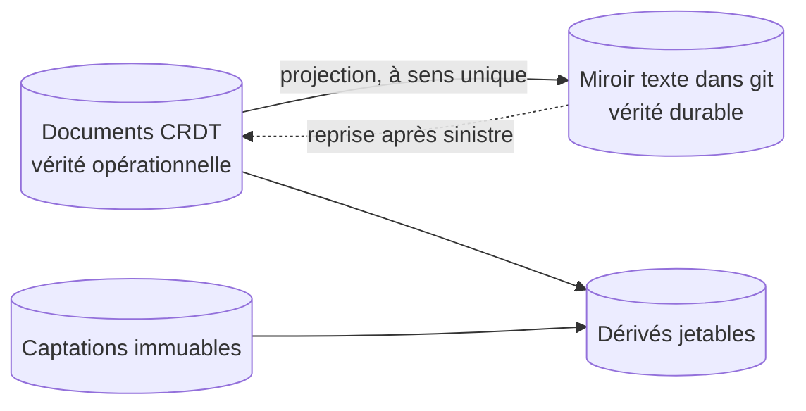

# ADR-003 — Des documents CRDT pour travailler, un miroir texte pour durer

| | |
|---|---|
| **Statut** | 🟡 proposée |
| **Date** | 2026-10-11 |
| **Sert** | B13, B14 · principes P5, P8 |
| **S'appuie sur** | [ADR-002](adr-002-local-first.md) |

## Contexte

Travailler hors ligne sur trois appareils ([ADR-002](adr-002-local-first.md)) impose de
**fusionner** des modifications faites séparément, sans serveur pour arbitrer.

Sacha tient aussi à ce que ses données **durent** : lisibles sans l'outil, dans des années,
avec un historique qui raconte comment chaque morceau a bougé (B13, B14). Et le domaine a
besoin de **bifurquer** : essayer une variante d'un morceau, puis la fusionner ou non.

Des fichiers texte versionnés comme vérité opérationnelle ne conviennent pas : deux
appareils déconnectés qui modifient le même fichier produisent un conflit de fusion
textuel, que personne ne veut résoudre au milieu d'une séance de piano.

## Décision

Trois natures de données et leur projection durable ([§ 31](../31-persistance-et-synchronisation.md)) :

1. **Décisions** : des **documents CRDT** répliqués (fonds, morceaux, albums, réglages).
   C'est la vérité **opérationnelle**. Toute modification passe par une **opération
   nommée**, qui porte un message lisible.
2. **Captations** : des objets **immuables**, nommés par l'empreinte de leur contenu.
3. **Dérivés** : des caches, recalculables, jamais sauvegardés.
4. **Miroir durable** : une **projection en texte brut** des documents (un enregistrement
   par ligne, en-têtes en TOML), écrite par le nœud dans un dépôt **git**. C'est la vérité
   **durable** : lisible sans Pupitre, sauvegardée sur le disque externe, et hors site si
   la copie facultative existe, réimportable en cas de sinistre. Elle est **à sens
   unique** et son aller-retour est testé.

Les règles de fusion propres au domaine :

- un **texte** (une ligne de paroles) est une valeur atomique : deux retouches
  concurrentes donnent **deux variantes** à trancher, jamais un mélange caractère par
  caractère ; la ligne rendue est tenue par un registre de l'occurrence, où un double
  choix est un conflit visible ;
- un **objet harmonique**, une **hauteur** et une **provenance** s'écrivent d'un bloc :
  deux modifications concurrentes donnent deux valeurs à trancher, jamais un mélange
  champ par champ ;
- un attribut simple (tempo, tonique, statut) modifié des deux côtés garde une valeur, et
  l'autre reste en conflit : Pupitre lit ces conflits à la synchronisation et les présente
  « à trancher » ;
- une forme fusionnée improbable est **signalée**, pas corrigée en silence.

## Conséquences

### Ce que ça permet

- Fusionner sans arbitre ; ce que la fusion ne sait pas départager est présenté « à
  trancher », jamais perdu en silence ; travailler hors ligne sans crainte.
- Un historique complet : le journal, les retours en arrière.
- Bifurquer : les variantes d'un morceau ([MOR-11](../20-sfd/24-morceau.md#mor-11--bifurquer-en-variantes)).
  Automerge fusionne une variante entière ; fusionner les changements choisis rejoue, dans
  la cible, les opérations nommées choisies.
- Un texte durable qui se lit avec n'importe quel éditeur et se diffe proprement.

### Ce que ça coûte

- Deux représentations à tenir cohérentes : la projection est à sens unique, et son
  aller-retour est testé à chaque lot.
- Une dépendance à une bibliothèque CRDT, isolée derrière un adaptateur.
- Le poids de l'historique, acceptable aux volumes visés.

## Options écartées

| Option | Pourquoi |
|---|---|
| Fichiers texte dans git comme vérité | Conflits de fusion textuels entre appareils déconnectés ; aucune fusion qui comprenne la structure |
| Yjs | Excellent pour l'édition collaborative en temps réel ; historique et bifurcations moins naturels |
| Journal d'événements maison | Synchronisation, fusion, compaction à construire soi-même : trop pour une personne (R7) |
| Base de données sur un serveur | Contraire à [ADR-002](adr-002-local-first.md) |

## Comment on vérifie

- **I10** convergence à trois répliques · **I11** aucun texte fusionné caractère par
  caractère, ni accord ou hauteur champ par champ · **I12** aller-retour du miroir ·
  **I13** dérivés jetables · **I14** captations immuables.
