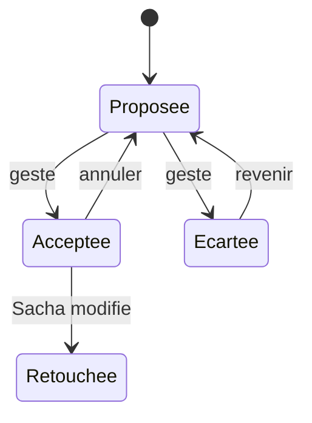

# ADR-004 — Proposer n'est pas décider

| | |
|---|---|
| **Statut** | ✅ acceptée — « toujours sous décision humaine », validé au cadrage du 2026-10-11 |
| **Date** | 2026-10-11 |
| **Sert** | B04, B10, B14 · principe P2 |
| **S'appuie sur** | [ADR-006](adr-006-le-partiel-est-normal.md) |

## Contexte

Pupitre mesure (tempo, tonalité, accords, mélodie, frontières, texte chanté) et, désormais,
imagine (accords suivants, variantes, rimes, ordres d'album). Aucune de ces productions
n'est fiable au point d'être présentée comme un fait :

- sur des démos réelles — mix denses, fragments, prises sans métronome — les détecteurs se
  trompent souvent, et **avec aplomb** ; une confiance élevée n'est pas une justesse ;
- une valeur fausse affichée comme un fait **se propage** : elle se recopie, elle devient
  l'hypothèse de travail de la séance suivante (douleur D3) ;
- une proposition de machine acceptée sans trace brouille la **paternité** (douleur D5).

## Décision

**Tout ce que la machine mesure (détection) ou imagine (piste) est une proposition. Seul
un geste de Sacha en fait une décision.**

1. Une proposition est **stockée hors des décisions** : dans son résultat d'analyse (une
   captation immuable), ou éphémère pour une piste.
2. Elle s'affiche **marquée** (`~`, italique, pointillé), avec sa **confiance** et ses
   alternatives (détection) ou sa **raison** (piste).
3. Elle n'est **jamais appliquée sans geste**, et il n'existe **aucune acceptation par
   seuil de confiance**.
4. L'accepter écrit l'élément avec sa **provenance** : origine, moteur ou modèle, date,
   confiance au moment de l'acceptation.
5. Une décision n'efface jamais la proposition qui l'a précédée ; **tout se défait**.
6. Un agrégat expose son **assiette**, et la part de ce qui n'est que proposé.

## Conséquences

### Ce que ça permet

- Des détecteurs imparfaits deviennent utiles sans mentir : Pupitre peut exister avant
  que la détection soit bonne.
- La différence entre mesure et décision devient une information : un morceau où elles
  divergent est un morceau à réécouter.
- La paternité reste lisible, jusqu'à la part d'origine ([PRO-02](../20-sfd/26-propositions-suggestions-provenance.md#pro-02--provenance-et-part-dorigine)).

### Ce que ça coûte

- Plus d'états à afficher : décidé, proposé, absent.
- Un travail de tri que personne ne peut faire à la place de Sacha, allégé par
  l'acceptation par plage.
- Pas de mode « automatique ».

## Options écartées

| Option | Pourquoi |
|---|---|
| Afficher la valeur la plus probable et laisser corriger | Le comportement par défaut des outils d'analyse ; c'est lui qui fait circuler des faits faux |
| Un seuil de confiance au-delà duquel la mesure s'affirme | La confiance d'un détecteur n'est pas sa justesse : un résultat « net » peut contredire frontalement une autre source |
| Ne rien montrer avant décision | On jetterait une information utile : savoir que le détecteur hésite entre deux tonalités oriente l'écoute |

## Comment on vérifie

- **I04** : importer 100 analyses et demander 100 pistes ne décide rien.
- **I05** : dans tout rendu, toute valeur non décidée porte sa marque.
- Critères de [PRO-01](../20-sfd/26-propositions-suggestions-provenance.md#pro-01--accepter-ou-écarter-une-proposition).
