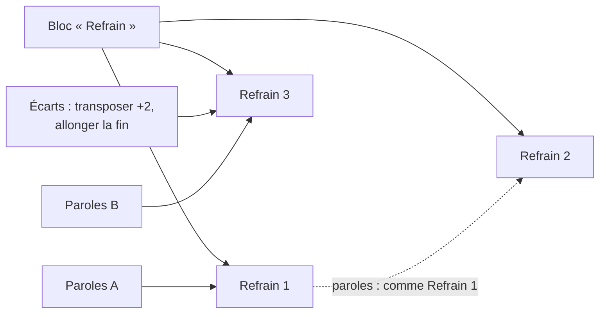

# ADR-007 — Blocs et occurrences

| | |
|---|---|
| **Statut** | 🟡 proposée |
| **Date** | 2026-10-11 |
| **Sert** | B05, B03 · principe P1 |
| **S'appuie sur** | [ADR-001](adr-001-un-seul-materiau.md) |

## Contexte

À l'échelle de la section, la musique se répète et le texte change : trois couplets sur
la même grille, un refrain identique trois fois, un dernier refrain un ton plus haut.
Sacha veut **changer le refrain une fois** et le voir changer partout, tout en gardant les
**variations locales** — et la différence entre deux occurrences est en soi une
information musicale : une répétition à l'identique peut être un symptôme.

## Décision

- Un **bloc** porte le matériau musical d'un type de section : mesures, accords, mélodie,
  phrases, arrangement par défaut. Il est défini **une fois**.
- Une **occurrence** joue un bloc à une place de la forme. Elle porte son intensité, sa
  poussée, et ses **écarts** : des modifications locales qui ciblent un élément du bloc
  par son identifiant.
- Une occurrence porte **ses paroles**, ou reprend celles d'une autre occurrence du même
  bloc (« paroles : comme Refrain 1 ») ; ses lignes propres sont alors des écarts. Le
  texte repris est engendré, jamais recopié.
- Le **matériau effectif** d'une occurrence (le bloc, puis ses écarts) est engendré, jamais
  stocké.
- Un écart dont la cible disparaît devient **orphelin** : conservé, signalé, proposé à la
  suppression.
- Deux gestes explicites : **promouvoir** un écart au bloc ; **détacher** une occurrence en
  bloc neuf.
- Entre documents, pas de lien vivant : un **motif** placé dans un bloc y est **copié**, avec
  un **suivi** qui propose les reports ([§ 30 · 5.4](../30-modele-de-domaine.md#54-motifs-placés)).

## Conséquences

### Ce que ça permet

- Modifier une fois, partout ; et voir exactement où une occurrence s'écarte.
- Des rendus lisibles : « comme Refrain 1, sauf mesure 7 ».
- Le constat « joué deux fois à l'identique » devient un calcul.
- Un refrain modulé est le même bloc, avec un écart.

### Ce que ça coûte

- Calculer le matériau effectif à chaque lecture (mémorisé).
- Une interface qui rend explicite ce qu'on modifie : le bloc, ou cette occurrence
  (l'interrupteur de la loupe, [MIC-01](../20-sfd/22-micro-motif-et-phrase.md#mic-01--ouvrir-la-loupe)).
- La gestion des écarts orphelins.

## Options écartées

| Option | Pourquoi |
|---|---|
| Des sections indépendantes, copiées | Duplication : changer le refrain trois fois, musique ou paroles, et en oublier une ([ADR-001](adr-001-un-seul-materiau.md)) |
| Des répétitions de rendu, sans identité propre | Pas de paroles par occurrence, pas d'intensité par occurrence |
| Un lien vivant d'un motif du fonds vers un bloc d'un morceau | Fragile à la synchronisation ; la proposition de report dit la même chose sans rien imposer |

## Comment on vérifie

- **I03** : modifier un bloc change ses occurrences, sauf là où un écart vise le même élément
  (test par propriétés).
- Le même test par propriétés, pour les paroles : modifier une ligne de l'occurrence
  reprise change celles qui la reprennent, sauf aux emplacements où elles ont leur propre
  ligne.
- Critères de [SEC-02](../20-sfd/23-section.md#sec-02--faire-varier-une-occurrence).
