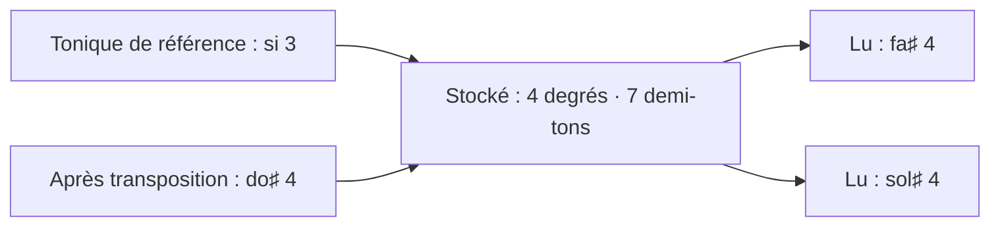

# ADR-008 — Des hauteurs relatives à une tonique de référence

| | |
|---|---|
| **Statut** | ✅ acceptée — confirmée le 2026-10-28 |
| **Date** | 2026-10-11 |
| **Sert** | B05, B11 · principe P1 |
| **S'appuie sur** | [ADR-001](adr-001-un-seul-materiau.md) |

## Contexte

Transposer est un geste artistique courant : pour la voix, ou pour soigner la transition
vers le morceau suivant de l'album. Un refrain final se module. Et la tonalité
d'une bonne partie du fonds est **indécise** : deux candidats, parfois davantage.

Trois façons de stocker une hauteur s'offrent, et deux échouent :

- en **absolu** (fa♯ 4) : transposer réécrit des milliers d'éléments et alourdit
  l'historique ; un refrain modulé devient un autre bloc ;
- en **degrés de la tonalité analysée** : le stockage dépend d'une analyse qui, souvent,
  n'est pas décidée.

## Décision

- Toute hauteur d'un matériau est un **intervalle orthographié** — degrés diatoniques et
  demi-tons — depuis une **tonique de référence** propre au morceau (ou au motif).
- La tonique de référence est un **repère de stockage, pas une analyse**. La **tonalité**
  est un attribut à part : décidée, ou proposée avec ses candidats.
- Un accord est un **objet harmonique** : fondamentale (intervalle), qualité (vocabulaire
  fermé), extensions, basse ; ensemble de notes explicite s'il sort du vocabulaire. Nom,
  degré et fonction sont des rendus.
- **Transposer** change la tonique de référence ; **moduler une occurrence** est un écart.
- L'**orthographe** saisie (fa♯ ou sol♭) est conservée.
- Le **diapason** appartient aux prises, jamais à l'écrit.

## Conséquences

### Ce que ça permet

- Transposer coûte une écriture ; l'historique reste lisible.
- Un bloc se rejoue modulé, par un simple écart.
- L'orthographe de Sacha survit à toutes les opérations.
- Tout fonctionne avec une tonalité indécise.

### Ce que ça coûte

- Des conversions aux frontières : import, export, miroir (qui écrit les hauteurs en clair,
  avec la tonique de référence en en-tête).
- Un doigté épinglé est stocké sur un accord absolu (fondamentale nommée, qualité,
  basse), puisque des frettes sonnent des hauteurs absolues. Après une transposition, un
  épinglage qui ne correspond plus à aucun accord est listé comme inactif : un état
  engendré, rien n'est réécrit, et I02 tient.

## Options écartées

| Option | Pourquoi |
|---|---|
| Hauteurs absolues | Transposer réécrit tout ; un refrain modulé devient un autre bloc |
| Degrés relatifs à la tonalité analysée | Casse quand la tonalité est indécise, ce qui est fréquent |
| Noms d'accords stockés | Duplication des rendus ([ADR-001](adr-001-un-seul-materiau.md)) |

## Comment on vérifie

- **I02** : transposer de +n puis de −n rend l'original (propriété) ; après transposition,
  seule la tonique de référence a changé dans le document, et tous les rendus ont changé.
- **I26** : transposer la table translate les noms, case à case, sans changer ni position ni
  chiffre.
- Critères de [MIC-02](../20-sfd/22-micro-motif-et-phrase.md#mic-02--saisir-et-éditer-des-accords).
