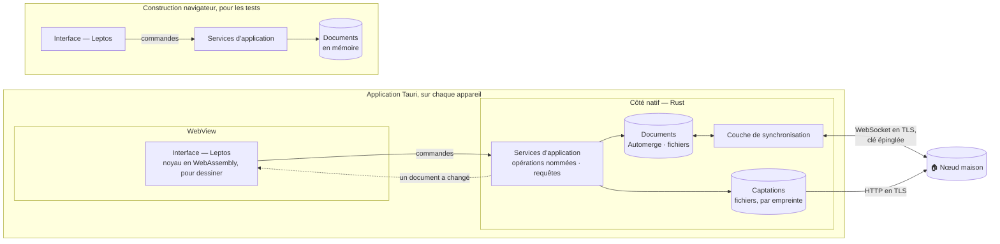

# ADR-022 — Les documents et la synchronisation côté natif

| | |
|---|---|
| **Statut** | ✅ acceptée |
| **Date** | 2026-11-04 |
| **Sert** | B01, B13 · principes P5, P8 · contre le risque R6 |
| **S'appuie sur** | [ADR-002](adr-002-local-first.md), [ADR-003](adr-003-crdt-et-miroir-durable.md), [ADR-019](adr-019-rust-et-python.md), [ADR-020](adr-020-leptos-et-tauri.md) et [ADR-021](adr-021-cle-du-noeud-epinglee.md) |

## Contexte

Elle amende l'[ADR-002](adr-002-local-first.md) et l'[ADR-019](adr-019-rust-et-python.md),
qui restent acceptées et dont le texte ne change pas.

Toutes deux placent le noyau sous l'interface. L'ADR-002 dit que « le noyau métier doit
tourner sur chaque appareil, compilé en WebAssembly sous l'interface » ; l'ADR-019, qu'il
« est partagé par l'interface, compilée en WebAssembly, par le nœud et par les tests ».
C'est un héritage de la pile où tout tournait dans un navigateur
([ADR-012](adr-012-typescript-et-python.md)).

Avec Tauri ([ADR-020](adr-020-leptos-et-tauri.md)), une application a deux côtés :
l'interface, en WebAssembly dans la WebView du système, et le **côté natif**, le code Rust
de l'application, hors de la WebView. Le schéma de la pile
([§ 41 · 2](../41-pile-technique.md#2-la-pile-en-un-schéma)) ne disait pas, avant cette ADR,
de quel côté vivent les documents Automerge ([ADR-003](adr-003-crdt-et-miroir-durable.md))
et leur synchronisation. INC-1 y fait entrer les
premières données réelles : il faut le trancher avant.

Quatre faits pèsent :

- **Tout est fichier**, dans le dossier de l'application, et aucun stockage de navigateur
  n'est permis ([§ 31 · 1](../31-persistance-et-synchronisation.md#1-trois-natures-de-données-quatre-lieux)).
  La WebView n'atteint ce dossier que par une commande du côté natif : l'établi écrit déjà
  ainsi le cahier des tables (`app/ui/src/export.rs`).
- **La synchronisation passe par TLS, la clé du nœud épinglée**
  ([ADR-021](adr-021-cle-du-noeud-epinglee.md)). La construction navigateur ne sait pas
  épingler une clé, et la WebView, moteur de navigateur, pas davantage : l'API WebSocket n'y
  laisse pas choisir la clé qu'on accepte.
- **La construction navigateur ne couvre pas les fichiers de l'application**
  ([§ 70 · 2](../70-qualite-et-verification.md#2-les-trois-profils-dappareil-en-test)) : les
  parcours de bout en bout n'y ont aucun dossier où écrire, et il leur faut pourtant des
  documents.
- **La capture depuis l'écran verrouillé se fait hors de l'interface**, par le module Kotlin
  ([ADR-019](adr-019-rust-et-python.md), exception 3) : la captation arrive du côté natif.

## Décision

- **Les documents vivent côté natif**, en Rust, dans l'application Tauri : l'adaptateur
  `Documents` les tient sur fichiers
  ([§ 40 · 3](../40-architecture.md#3-composants-de-lapplication)), et chaque document n'a
  qu'une copie en mémoire sur l'appareil.
- **Leur synchronisation aussi** : la couche de synchronisation
  ([ADR-003](adr-003-crdt-et-miroir-durable.md)), TLS, la clé épinglée et l'appairage
  ([ADR-021](adr-021-cle-du-noeud-epinglee.md)). L'adaptateur `Captations`, qui range les
  captations et les envoie au nœud, vit du même côté.
- **Les services d'application s'exécutent côté natif** : les opérations nommées, seule
  porte d'écriture
  ([§ 31 · 3](../31-persistance-et-synchronisation.md#3-les-opérations-nommées)), et les
  requêtes, recherche comprise.
- **L'interface n'appelle que des commandes.** Une commande a un nom, des arguments et une
  réponse, typés et écrits une fois en Rust pour les deux côtés. L'interface en reçoit ce
  qu'elle montre, une vue engendrée, jamais un document. Quand un document change hors
  d'elle, par une synchronisation ou une capture, le côté natif le lui signale, et elle
  redemande ce qu'elle montre.
- **Seule exception, en lecture** : une photo ou une prise se lit par le protocole des
  captations, `captation`
  ([§ 40 · 7.5](../40-architecture.md#75-linterface-la-csp-et-les-commandes)).
  Ce protocole n'est pas une commande, et les droits ne le nomment pas : son gestionnaire, du
  côté natif, ne sert qu'une empreinte connue des documents de la racine des données
  ouverte, et refuse tout autre chemin. Il donne le type que le document nomme pour la
  captation, et répond aux requêtes partielles (`Range`), chaque réponse bornée, pour qu'une
  prise longue se lise et se parcoure sans être chargée en entier.
- **Chaque commande est permise par son nom**, dans les droits de Tauri, plateforme par
  plateforme. Une commande que les droits ne nomment pas est refusée. Les droits et la
  politique de sécurité du contenu sont au
  [§ 40 · 7.5](../40-architecture.md#75-linterface-la-csp-et-les-commandes).
- **L'interface garde le noyau en WebAssembly**, pour dessiner ce qu'elle reçoit, et pour ce
  qui ne lit aucun document, comme la table de la tonalité.
- **Le module Kotlin n'écrit aucun document.** Il dépose la captation, et le côté natif, en
  Rust, crée l'idée qui la reçoit. Le détail se conçoit avec le carnet, avant son plan.
- **La construction navigateur reçoit un adaptateur `Documents` en mémoire**, qui tient des
  documents Automerge sans fichier. Ses commandes
  sont servies dans l'interface même, par les mêmes services d'application. Rien ne s'y
  écrit sur disque, rien ne s'y synchronise, aucune clé ne s'y épingle. Un parcours qui
  demande une captation y reçoit de même un adaptateur `Captations` en mémoire. Ces
  adaptateurs n'entrent que dans la construction navigateur et dans les tests du côté natif,
  où l'adaptateur `Documents` en mémoire passe la même suite de tests des commandes que celui
  des fichiers ([§ 40 · 9](../40-architecture.md#9-trajectoire-de-construction)) : aucune
  application installée ne les porte.

**Ce qu'elle amende.** Les phrases citées plus haut se lisent désormais ainsi ; le reste,
cette ADR ne le change pas.

- [ADR-002](adr-002-local-first.md), « Ce que ça coûte » : le noyau métier tourne sur chaque
  appareil, du côté natif, avec les documents, et en WebAssembly sous l'interface, pour
  dessiner.
- [ADR-019](adr-019-rust-et-python.md), « Décision » : le noyau est partagé par le côté natif
  des applications, par l'interface, compilée en WebAssembly, par le nœud et par les tests.
  « Ce que ça coûte » : aux trois frontières qu'elle nomme s'en ajoute une quatrième, les
  commandes entre l'interface et le côté natif.

## Conséquences

### Ce que ça permet

- Un seul chemin d'écriture sur chaque appareil, pour l'interface comme pour la capture
  verrouillée : la règle « toute écriture passe par une opération nommée » se tient à un
  seul endroit.
- Les fichiers, TLS, la clé épinglée et l'appairage restent en Rust, testés comme le reste
  du côté natif, sans dépendre des API d'une WebView.
- Les parcours de bout en bout gardent leurs trois profils sur la construction navigateur
  ([ADR-020](adr-020-leptos-et-tauri.md)), et y passent par les mêmes services que les
  applications.
- Les commandes se testent en Rust, sans interface.
- L'interface des applications reste légère : ni `automerge`, ni services, ni pile TLS dans
  son WebAssembly, dont le poids compte au premier affichage sur la tablette à encre
  ([ADR-020](adr-020-leptos-et-tauri.md)).

### Ce que ça coûte

- Une frontière de plus, les commandes entre l'interface et le côté natif : chaque appel et
  chaque réponse s'y sérialisent, et les vues renvoyées doivent rester petites.
- Deux adaptateurs `Documents` à tenir d'accord, en mémoire et sur fichiers.
- Les services d'application se compilent pour deux cibles : le côté natif, et WebAssembly
  pour la construction navigateur, où l'adaptateur `Documents` en mémoire emploie
  `automerge` avec sa fonction `wasm`. L'adaptateur sur fichiers, la synchronisation, TLS et
  l'appairage n'existent que côté natif.
- Les parcours de bout en bout ne voient ni les fichiers, ni la synchronisation, ni
  l'épinglage : ils se vérifient sur les constructions Windows et Android, et sur
  l'appareil ([§ 70 · 2](../70-qualite-et-verification.md#2-les-trois-profils-dappareil-en-test)).
- Une liste de commandes permises à tenir, plateforme par plateforme.

## Options écartées

| Option | Pourquoi |
|---|---|
| Les documents et la synchronisation dans l'interface, en WebAssembly, comme le lisaient l'ADR-002 et l'ADR-019 | La WebView n'atteint le dossier de l'application que par une commande, et un stockage de navigateur est exclu ; elle ne sait pas épingler la clé du nœud ([ADR-021](adr-021-cle-du-noeud-epinglee.md)) ; une captation faite écran verrouillé attendrait que l'interface s'ouvre pour devenir une idée |
| Une copie de chaque document de chaque côté, tenues d'accord par la synchronisation d'Automerge | Deux répliques sur un même appareil : la mémoire doublée, une synchronisation de plus à éprouver, et des conflits de l'appareil avec lui-même, pour aucun besoin de la SFD (R7) |
| Les documents côté natif, la synchronisation dans l'interface | La synchronisation lit chaque document à chaque échange : ils traverseraient la frontière en entier, et l'épinglage resterait impossible |
| Une construction navigateur sans services, sur des réponses écrites à la main | Les parcours de bout en bout ne testeraient plus que l'affichage, et non ce que fait Sacha |

## Comment on vérifie

- Construite pour les applications, l'interface ne lie ni `automerge`, ni les services
  d'application, ni une pile TLS : son graphe de dépendances le montre, en CI.
- L'interface n'emploie aucun stockage du navigateur : un contrôle statique y refuse
  IndexedDB, `localStorage`, `sessionStorage` et OPFS.
- La même suite de tests des commandes passe sur l'adaptateur `Documents` en mémoire et sur
  celui des fichiers.
- Une requête partielle au protocole des captations, sur une empreinte connue, rend les
  seuls octets demandés, avec le type que nomme le document ; une requête ouverte rend une
  part bornée.
- **I28** : hors de l'adaptateur `Documents`, aucun code n'écrit dans un document, ni
  l'interface, ni le module Kotlin.
- **I31** : un test relit les droits de Tauri de chaque plateforme ; aucune commande n'est
  permise sans y être nommée, et aucun droit ne nomme une commande que l'application n'a
  pas ([§ 70 · 3](../70-qualite-et-verification.md#3-les-invariants-et-leurs-tests)).
- **H07** se joue côté natif, sur l'adaptateur sur fichiers
  ([§ 40 · 11](../40-architecture.md#11-hypothèses-à-confronter)).
